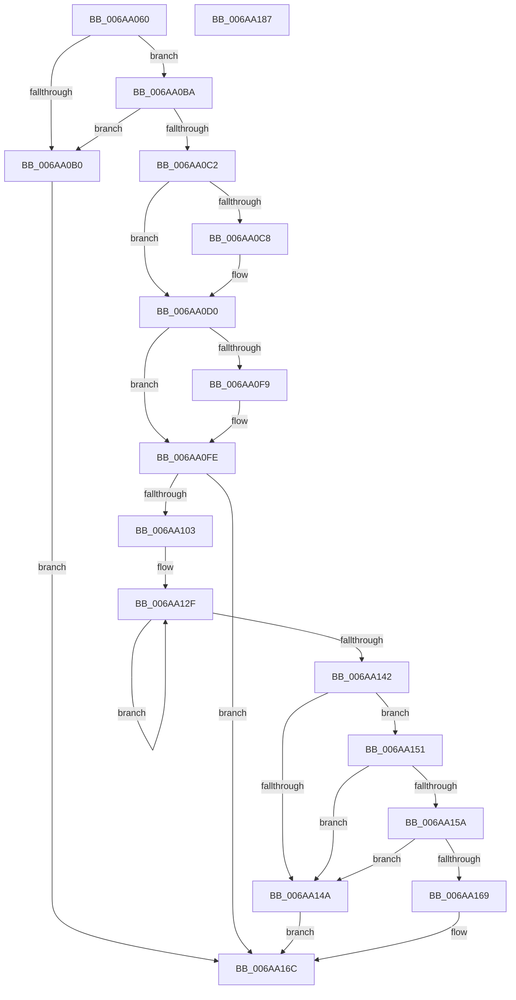

# RtlpCaptureRetpolineBinaryInfoForImage

- RVA: `0x006AA060`–`0x006AA188` (길이 `296` bytes)
- VA: `0x00000001406AA060`
- 실행 섹션: `.text`
- PDB 이름 있음: `예`; PDB Function 태그: `아니요`
- unwind 정보 RVA: `0x00093E28`
- 디코드: `89`개 명령, `296/296` bytes 표시
- 미해석 바이트: `0` (있으면 어셈블리에 `.byte`로 보존)

> 이 문서는 커널 이미지의 기계어와 PDB 기호를 분석해 생성했습니다. 4번과 5번은 함수 원형과 자료형을 바이너리 사용 방식에서 추정한 C 해석이며 원본 소스 복구 결과는 아닙니다.

## 1. Dependencies

- 직접 호출 지점: **2**; 고유 호출 대상: **2**
- 직접 호출자로 확인된 함수: **2**
- RIP 상대 이미지 참조: **0**

### Outgoing calls
- `0x006AA0A6` → [LdrImageDirectoryEntryToLoadConfig](../../page/A8/LdrImageDirectoryEntryToLoadConfig_function_00A8F564.md) (function, `0x00A8F564`)
- `0x006AA0EA` → [RtlpImageDirectoryEntryToDataEx](../43/RtlpImageDirectoryEntryToDataEx_function_00432A60.md) (function, `0x00432A60`)

### Direct callers
- [RtlPerformRetpolineRelocationsOnImageEx](RtlPerformRetpolineRelocationsOnImageEx_function_006A9AD4.md) at `0x006A9B37`
- [RtlUpdateImportRelocationsInImage](RtlUpdateImportRelocationsInImage_function_006A9E1C.md) at `0x006A9E87`

### Static image references
- 디코드된 RIP-relative 메모리 참조가 없습니다.

## 2. Other-region calls and transfers

- 다른 실행 섹션으로 향하는 call: **1**
  - `0x006AA0A6` → [LdrImageDirectoryEntryToLoadConfig](../../page/A8/LdrImageDirectoryEntryToLoadConfig_function_00A8F564.md) (`.text` → `PAGE`)
- 별도 외부 분기/꼬리 이동을 확인하지 못했습니다.

## 3. Assembly (complete function range)

```asm
006AA060  48 8B C4                        mov rax, rsp
006AA063  48 89 58 08                     mov qword ptr [rax + 8], rbx
006AA067  48 89 68 10                     mov qword ptr [rax + 0x10], rbp
006AA06B  48 89 70 18                     mov qword ptr [rax + 0x18], rsi
006AA06F  57                              push rdi
006AA070  41 56                           push r14
006AA072  41 57                           push r15
006AA074  48 83 EC 40                     sub rsp, 0x40
006AA078  48 8B B4 24 88 00 00 00         mov rsi, qword ptr [rsp + 0x88]
006AA080  0F 57 C0                        xorps xmm0, xmm0
006AA083  33 DB                           xor ebx, ebx
006AA085  45 8B F8                        mov r15d, r8d
006AA088  48 89 58 E0                     mov qword ptr [rax - 0x20], rbx
006AA08C  49 8B F9                        mov rdi, r9
006AA08F  33 C0                           xor eax, eax
006AA091  4C 8B F2                        mov r14, rdx
006AA094  0F 11 06                        movups xmmword ptr [rsi], xmm0
006AA097  48 8B E9                        mov rbp, rcx
006AA09A  0F 11 46 10                     movups xmmword ptr [rsi + 0x10], xmm0
006AA09E  0F 11 46 20                     movups xmmword ptr [rsi + 0x20], xmm0
006AA0A2  48 89 46 30                     mov qword ptr [rsi + 0x30], rax
006AA0A6  E8 B9 54 3E 00                  call 0x140a8f564
006AA0AB  48 85 C0                        test rax, rax
006AA0AE  75 0A                           jne 0x1406aa0ba
006AA0B0  BB BB 00 00 C0                  mov ebx, 0xc00000bb
006AA0B5  E9 B2 00 00 00                  jmp 0x1406aa16c
006AA0BA  81 38 C8 00 00 00               cmp dword ptr [rax], 0xc8
006AA0C0  72 EE                           jb 0x1406aa0b0
006AA0C2  48 39 58 78                     cmp qword ptr [rax + 0x78], rbx
006AA0C6  74 08                           je 0x1406aa0d0
006AA0C8  8B 40 78                        mov eax, dword ptr [rax + 0x78]
006AA0CB  41 2B C6                        sub eax, r14d
006AA0CE  89 06                           mov dword ptr [rsi], eax
006AA0D0  48 8D 44 24 38                  lea rax, [rsp + 0x38]
006AA0D5  41 B8 0C 00 00 00               mov r8d, 0xc
006AA0DB  4C 8D 4C 24 30                  lea r9, [rsp + 0x30]
006AA0E0  48 89 44 24 20                  mov qword ptr [rsp + 0x20], rax
006AA0E5  B2 01                           mov dl, 1
006AA0E7  48 8B CD                        mov rcx, rbp
006AA0EA  E8 71 89 D8 FF                  call 0x140432a60
006AA0EF  48 8B 44 24 38                  mov rax, qword ptr [rsp + 0x38]
006AA0F4  48 85 C0                        test rax, rax
006AA0F7  74 05                           je 0x1406aa0fe
006AA0F9  2B C5                           sub eax, ebp
006AA0FB  89 46 04                        mov dword ptr [rsi + 4], eax
006AA0FE  48 85 FF                        test rdi, rdi
006AA101  74 69                           je 0x1406aa16c
006AA103  48 8B 94 24 80 00 00 00         mov rdx, qword ptr [rsp + 0x80]
006AA10B  49 2B FE                        sub rdi, r14
006AA10E  41 B8 10 00 00 00               mov r8d, 0x10
006AA114  8B 42 40                        mov eax, dword ptr [rdx + 0x40]
006AA117  8B 4A 44                        mov ecx, dword ptr [rdx + 0x44]
006AA11A  3B C8                           cmp ecx, eax
006AA11C  0F 46 C8                        cmovbe ecx, eax
006AA11F  8B 42 48                        mov eax, dword ptr [rdx + 0x48]
006AA122  3B C1                           cmp eax, ecx
006AA124  0F 46 C1                        cmovbe eax, ecx
006AA127  8B 4A 4C                        mov ecx, dword ptr [rdx + 0x4c]
006AA12A  3B C8                           cmp ecx, eax
006AA12C  0F 46 C8                        cmovbe ecx, eax
006AA12F  8B 02                           mov eax, dword ptr [rdx]
006AA131  3B C1                           cmp eax, ecx
006AA133  48 8D 52 04                     lea rdx, [rdx + 4]
006AA137  0F 46 C1                        cmovbe eax, ecx
006AA13A  8B C8                           mov ecx, eax
006AA13C  49 83 E8 01                     sub r8, 1
006AA140  75 ED                           jne 0x1406aa12f
006AA142  48 03 CF                        add rcx, rdi
006AA145  48 3B CF                        cmp rcx, rdi
006AA148  7D 07                           jge 0x1406aa151
006AA14A  BB 30 00 00 C0                  mov ebx, 0xc0000030
006AA14F  EB 1B                           jmp 0x1406aa16c
006AA151  48 81 F9 FF FF FF 7F            cmp rcx, 0x7fffffff
006AA158  7F F0                           jg 0x1406aa14a
006AA15A  48 8B CF                        mov rcx, rdi
006AA15D  49 2B CF                        sub rcx, r15
006AA160  48 81 F9 00 00 00 80            cmp rcx, -0x80000000
006AA167  7C E1                           jl 0x1406aa14a
006AA169  89 7E 30                        mov dword ptr [rsi + 0x30], edi
006AA16C  48 8B 6C 24 68                  mov rbp, qword ptr [rsp + 0x68]
006AA171  8B C3                           mov eax, ebx
006AA173  48 8B 5C 24 60                  mov rbx, qword ptr [rsp + 0x60]
006AA178  48 8B 74 24 70                  mov rsi, qword ptr [rsp + 0x70]
006AA17D  48 83 C4 40                     add rsp, 0x40
006AA181  41 5F                           pop r15
006AA183  41 5E                           pop r14
006AA185  5F                              pop rdi
006AA186  C3                              ret
006AA187  CC                              int3
```

## 4. C-style interpretation (structured pseudocode)

```c
__int64 __fastcall RtlpCaptureRetpolineBinaryInfoForImage(__int64 a1, __int64 a2, int a3, __int64 a4, __int64 a5, __int64 a6)
{
    __int64 result;
    __int64 v_rbx;
    __int64 v_rdi;
    __int64 v_rsp;
    unsigned __int64 v_stack_m20;
    unsigned __int64 v_stack_m28;
    unsigned __int64 v_stack_m38;
    unsigned __int64 v_stack_p10;
    unsigned __int64 v_stack_p18;
    unsigned __int64 v_stack_p8;

    *(unsigned __int64 *)(v_rsp + 8) = v_rbx;
    *(unsigned __int64 *)(v_rsp + 16) = v_rbp;
    *(unsigned __int64 *)(v_rsp + 24) = v_rsi;
    v_rsp = (v_rsp) - (64);
    v_rbx = 0;
    *(unsigned __int64 *)(v_rsp - 32) = 0;
    result = 0;
    *(unsigned __int64 *)(a6) = v_xmm0;
    *(unsigned __int64 *)(a6 + 16) = v_xmm0;
    *(unsigned __int64 *)(a6 + 32) = v_xmm0;
    *(unsigned __int64 *)(a6 + 48) = 0;
    result = LdrImageDirectoryEntryToLoadConfig(a1, a2, a3, a4);
    if (result != 0) goto loc_006AA0BA;
loc_006AA0B0:
    goto loc_006AA16C;
loc_006AA0BA:
    if ((*(unsigned int *)(result)) < 200) goto loc_006AA0B0;
    if ((*(unsigned __int64 *)(result + 120)) != ((unsigned int)(0xC00000BBULL))) {
        result = *(unsigned int *)(result + 120);
        result = (unsigned int)((result) - ((unsigned int)(a2)));
        *(unsigned int *)(a6) = (unsigned int)(result);
    }
    v_stack_m38 = v_stack_m20;
    result = RtlpImageDirectoryEntryToDataEx(a1, 1, 12, v_stack_m28);
    result = v_stack_m20;
    if (v_stack_m20 != 0) {
        result = (unsigned int)((v_stack_m20) - ((unsigned int)(a1)));
        *(unsigned int *)(a6 + 4) = (unsigned int)(result);
    }
    if (a4 == 0) goto loc_006AA16C;
    v_rdi = (a4) - (a2);
    a1 = (unsigned int)(*(unsigned int *)(a5 + 68));
    if (((unsigned int)((unsigned int)(*(unsigned int *)(a5 + 68)))) <= ((unsigned int)((unsigned int)(*(unsigned int *)(a5 + 64))))) { a1 = (unsigned int)((unsigned int)(*(unsigned int *)(a5 + 64))); }
    result = (unsigned int)(*(unsigned int *)(a5 + 72));
    if (((unsigned int)((unsigned int)(*(unsigned int *)(a5 + 72)))) <= ((unsigned int)(a1))) { result = (unsigned int)(a1); }
    a1 = (unsigned int)(*(unsigned int *)(a5 + 76));
    if (((unsigned int)((unsigned int)(*(unsigned int *)(a5 + 76)))) <= ((unsigned int)(result))) { a1 = (unsigned int)(result); }
loc_006AA12F:
    result = (unsigned int)(*(unsigned int *)(a5));
    if (((unsigned int)((unsigned int)(*(unsigned int *)(a5)))) <= ((unsigned int)(a1))) { result = (unsigned int)(a1); }
    a3 = (16) - (1);
    if (condition_is_not_equal) goto loc_006AA12F;
    a1 = ((unsigned int)((unsigned int)(result))) + (v_rdi);
    if (a1 >= v_rdi) goto loc_006AA151;
loc_006AA14A:
    goto loc_006AA16C;
loc_006AA151:
    if (a1 > 0x7FFFFFFFULL) goto loc_006AA14A;
    a1 = (v_rdi) - ((unsigned int)(a3));
    if (a1 < 0xFFFFFFFF80000000ULL) goto loc_006AA14A;
    *(unsigned int *)(a6 + 48) = (unsigned int)(v_rdi);
loc_006AA16C:
    v_rsp = (v_rsp) + (64);
    return (unsigned int)((unsigned int)((unsigned int)(0xC0000030ULL)));
}
```

## 5. (Beta) C Style

```c
int64_t RtlpCaptureRetpolineBinaryInfoForImage(int64_t Arg1, int64_t Arg2, int32_t Arg3, int64_t Arg4, void *Arg5, void *Arg6)
{
    uint8_t *arg5 = (uint8_t *)Arg5;
    uint8_t *arg6 = (uint8_t *)Arg6;

    int64_t result;
    int64_t local_rbx;
    int64_t local_rdi;
    int64_t local_rsp;
    uint64_t v_stack_m20;
    uint64_t v_stack_m28;
    uint64_t v_stack_m38;
    uint64_t v_stack_p10;
    uint64_t v_stack_p18;
    uint64_t v_stack_p8;

    *(uint64_t *)(local_rsp + 0x8) = local_rbx;
    *(uint64_t *)(local_rsp + 0x10) = local_rbp;
    *(uint64_t *)(local_rsp + 0x18) = local_rsi;
    local_rsp = (local_rsp) - (64);
    local_rbx = 0;
    *(uint64_t *)(local_rsp - 0x20) = 0;
    result = 0;
    *(uint64_t *)(arg6) = v_xmm0;
    *(uint64_t *)(arg6 + 0x10) = v_xmm0;
    *(uint64_t *)(arg6 + 0x20) = v_xmm0;
    *(uint64_t *)(arg6 + 0x30) = 0;
    result = LdrImageDirectoryEntryToLoadConfig(Arg1, Arg2, Arg3, Arg4);
    if (result != 0) goto loc_006AA0BA;
loc_006AA0B0:
    goto loc_006AA16C;
loc_006AA0BA:
    if ((*(uint32_t *)(result)) < 200) goto loc_006AA0B0;
    if ((*(uint64_t *)(result + 0x78)) != ((uint32_t)(0xC00000BBULL))) {
        result = *(uint32_t *)(result + 0x78);
        result = (uint32_t)((result) - ((uint32_t)(Arg2)));
        *(uint32_t *)(arg6) = (uint32_t)(result);
    }
    v_stack_m38 = v_stack_m20;
    result = RtlpImageDirectoryEntryToDataEx(Arg1, 1, 12, v_stack_m28);
    result = v_stack_m20;
    if (v_stack_m20 != 0) {
        result = (uint32_t)((v_stack_m20) - ((uint32_t)(Arg1)));
        *(uint32_t *)(arg6 + 0x4) = (uint32_t)(result);
    }
    if (Arg4 == 0) goto loc_006AA16C;
    local_rdi = (Arg4) - (Arg2);
    Arg1 = (uint32_t)(*(uint32_t *)(arg5 + 0x44));
    if (((uint32_t)((uint32_t)(*(uint32_t *)(arg5 + 0x44)))) <= ((uint32_t)((uint32_t)(*(uint32_t *)(arg5 + 0x40))))) { Arg1 = (uint32_t)((uint32_t)(*(uint32_t *)(arg5 + 0x40))); }
    result = (uint32_t)(*(uint32_t *)(arg5 + 0x48));
    if (((uint32_t)((uint32_t)(*(uint32_t *)(arg5 + 0x48)))) <= ((uint32_t)(Arg1))) { result = (uint32_t)(Arg1); }
    Arg1 = (uint32_t)(*(uint32_t *)(arg5 + 0x4C));
    if (((uint32_t)((uint32_t)(*(uint32_t *)(arg5 + 0x4C)))) <= ((uint32_t)(result))) { Arg1 = (uint32_t)(result); }
loc_006AA12F:
    result = (uint32_t)(*(uint32_t *)(arg5));
    if (((uint32_t)((uint32_t)(*(uint32_t *)(arg5)))) <= ((uint32_t)(Arg1))) { result = (uint32_t)(Arg1); }
    Arg3 = (16) - (1);
    if (condition_is_not_equal) goto loc_006AA12F;
    Arg1 = ((uint32_t)((uint32_t)(result))) + (local_rdi);
    if (Arg1 >= local_rdi) goto loc_006AA151;
loc_006AA14A:
    goto loc_006AA16C;
loc_006AA151:
    if (Arg1 > 0x7FFFFFFFULL) goto loc_006AA14A;
    Arg1 = (local_rdi) - ((uint32_t)(Arg3));
    if (Arg1 < 0xFFFFFFFF80000000ULL) goto loc_006AA14A;
    *(uint32_t *)(arg6 + 0x30) = (uint32_t)(local_rdi);
loc_006AA16C:
    local_rsp = (local_rsp) + (64);
    return (uint32_t)((uint32_t)((uint32_t)(0xC0000030ULL)));
}
```

### 관측된 메모리 오프셋

구조체 형식이 확인되지 않은 접근은 인자 기준의 오프셋으로만 기록했습니다.

| 기준 인자 | 오프셋 표현 | 폭 (bit) | 접근 |
|---|---:|---:|---|
| `Arg5` | `+ 0x0` | `32` | `R` |
| `Arg5` | `+ 0x4` | `64` | `R` |
| `Arg5` | `+ 0x40` | `32` | `R` |
| `Arg5` | `+ 0x44` | `32` | `R` |
| `Arg5` | `+ 0x48` | `32` | `R` |
| `Arg5` | `+ 0x4C` | `32` | `R` |
| `Arg6` | `+ 0x0` | `32` | `W` |
| `Arg6` | `+ 0x0` | `128` | `R` |
| `Arg6` | `+ 0x4` | `32` | `W` |
| `Arg6` | `+ 0x10` | `128` | `R` |
| `Arg6` | `+ 0x20` | `128` | `R` |
| `Arg6` | `+ 0x30` | `32` | `W` |
| `Arg6` | `+ 0x30` | `64` | `W` |

## 6. Execution-region graph

[열기: 2D/3D 그래프와 함수 탐색 컨트롤 패널](../../../control-panel.html?section=text&rva=0x006AA060&view=graph)

- 2D 그래프는 위에서 아래로 흐르고, 3D 그래프는 빈 공간을 드래그해 회전합니다. Shift+드래그는 이동, 휠은 확대·축소, 함수 노드 선택은 대상 보고서 이동입니다.

### Static fallback


