# RtlpCheckFunctionPatchAppliedInOriginalImage

- RVA: `0x006AA408`–`0x006AA48A` (길이 `130` bytes)
- VA: `0x00000001406AA408`
- 실행 섹션: `.text`
- PDB 이름 있음: `예`; PDB Function 태그: `아니요`
- unwind 정보 RVA: `0x000DB714`
- 디코드: `49`개 명령, `130/130` bytes 표시
- 미해석 바이트: `0` (있으면 어셈블리에 `.byte`로 보존)

> 이 문서는 커널 이미지의 기계어와 PDB 기호를 분석해 생성했습니다. 4번과 5번은 함수 원형과 자료형을 바이너리 사용 방식에서 추정한 C 해석이며 원본 소스 복구 결과는 아닙니다.

## 1. Dependencies

- 직접 호출 지점: **0**; 고유 호출 대상: **0**
- 직접 호출자로 확인된 함수: **4**
- RIP 상대 이미지 참조: **0**

### Outgoing calls
- 직접 디코드된 call 명령이 없습니다.

### Direct callers
- [RtlHotPatchSynchronizationRequired](RtlHotPatchSynchronizationRequired_function_006AA21C.md) at `0x006AA2E1`
- [RtlCountRequiredHotPatchAddressTableEntries](../../page/84/RtlCountRequiredHotPatchAddressTableEntries_function_00840BF8.md) at `0x00840CBC`
- [RtlApplyHotPatch](../../pagelk/B7/RtlApplyHotPatch_function_00B7528C.md) at `0x00B7563A`
- [RtlpCheckFunctionPatchApplied](../../pagelk/B7/RtlpCheckFunctionPatchApplied_function_00B75828.md) at `0x00B75833`

### Static image references
- 디코드된 RIP-relative 메모리 참조가 없습니다.

## 2. Other-region calls and transfers

- 다른 실행 섹션으로 향하는 call: **0**
- 별도 외부 분기/꼬리 이동을 확인하지 못했습니다.

## 3. Assembly (complete function range)

```asm
006AA408  44 8A 01                        mov r8b, byte ptr [rcx]
006AA40B  48 8B C1                        mov rax, rcx
006AA40E  8A 49 01                        mov cl, byte ptr [rcx + 1]
006AA411  41 B9 FF FF FF FF               mov r9d, 0xffffffff
006AA417  41 80 F8 EB                     cmp r8b, 0xeb
006AA41B  75 4A                           jne 0x1406aa467
006AA41D  80 F9 F9                        cmp cl, 0xf9
006AA420  72 45                           jb 0x1406aa467
006AA422  75 5A                           jne 0x1406aa47e
006AA424  80 78 FB E9                     cmp byte ptr [rax - 5], 0xe9
006AA428  75 54                           jne 0x1406aa47e
006AA42A  48 63 48 FC                     movsxd rcx, dword ptr [rax - 4]
006AA42E  48 03 C8                        add rcx, rax
006AA431  48 3B C8                        cmp rcx, rax
006AA434  72 48                           jb 0x1406aa47e
006AA436  F6 C1 07                        test cl, 7
006AA439  75 43                           jne 0x1406aa47e
006AA43B  48 8B 54 24 28                  mov rdx, qword ptr [rsp + 0x28]
006AA440  48 3B CA                        cmp rcx, rdx
006AA443  72 39                           jb 0x1406aa47e
006AA445  48 8B C1                        mov rax, rcx
006AA448  48 2B C2                        sub rax, rdx
006AA44B  49 3B C1                        cmp rax, r9
006AA44E  77 2E                           ja 0x1406aa47e
006AA450  2B CA                           sub ecx, edx
006AA452  8B C1                           mov eax, ecx
006AA454  C1 E9 03                        shr ecx, 3
006AA457  C1 E8 0D                        shr eax, 0xd
006AA45A  81 E1 FF 01 00 00               and ecx, 0x1ff
006AA460  C1 E0 09                        shl eax, 9
006AA463  03 C1                           add eax, ecx
006AA465  C3                              ret
006AA466  CC                              int3
006AA467  33 C0                           xor eax, eax
006AA469  48 85 D2                        test rdx, rdx
006AA46C  74 15                           je 0x1406aa483
006AA46E  44 3A 02                        cmp r8b, byte ptr [rdx]
006AA471  75 0B                           jne 0x1406aa47e
006AA473  3A 4A 01                        cmp cl, byte ptr [rdx + 1]
006AA476  0F 95 C0                        setne al
006AA479  83 C0 FE                        add eax, -2
006AA47C  C3                              ret
006AA47D  CC                              int3
006AA47E  41 8B C1                        mov eax, r9d
006AA481  C3                              ret
006AA482  CC                              int3
006AA483  B8 FE FF FF FF                  mov eax, 0xfffffffe
006AA488  C3                              ret
006AA489  CC                              int3
```

## 4. C-style interpretation (structured pseudocode)

```c
__int64 __fastcall RtlpCheckFunctionPatchAppliedInOriginalImage(__int64 a1, __int64 a2, __int64 a3, __int64 a4, __int64 a5)
{
    __int64 result;

    if (((unsigned __int8)(*(unsigned __int8 *)(a1))) != 235) goto loc_006AA467;
    if (((unsigned __int8)(*(unsigned __int8 *)(a1 + 1))) < 249) goto loc_006AA467;
    if (((unsigned __int8)(*(unsigned __int8 *)(a1 + 1))) != 249) goto loc_006AA47E;
    if ((*(unsigned __int8 *)(a1 - 5)) != 233) goto loc_006AA47E;
    a1 = ((int)(*(unsigned int *)(a1 - 4))) + (a1);
    if (a1 < a1) goto loc_006AA47E;
    if ((((unsigned __int8)(a1)) & (7)) != 0) goto loc_006AA47E;
    if (a1 < a5) goto loc_006AA47E;
    result = (a1) - (a5);
    if (result > ((unsigned int)(0xFFFFFFFFULL))) goto loc_006AA47E;
    a1 = (unsigned int)((a1) - ((unsigned int)(a5)));
    a1 = (unsigned int)((a1) >> (3));
    result = (unsigned int)(((unsigned int)((unsigned int)(a1))) >> (13));
    a1 = (unsigned int)((a1) & (511));
    result = (unsigned int)((result) << (9));
    result = (unsigned int)((result) + ((unsigned int)(a1)));
    return result;
loc_006AA467:
    result = 0;
    if (a5 == 0) goto loc_006AA483;
    if (((unsigned __int8)(*(unsigned __int8 *)(a1))) != (*(unsigned __int8 *)(a5))) goto loc_006AA47E;
    result = (((unsigned __int8)(a1)) != (*(unsigned __int8 *)(a5 + 1))) ? 1 : 0;
    result = (unsigned int)((result) + (-2));
    return result;
loc_006AA47E:
    return (unsigned int)((unsigned int)((unsigned int)(0xFFFFFFFFULL)));
loc_006AA483:
    return (unsigned int)(0xFFFFFFFEULL);
}
```

## 5. (Beta) C Style

```c
int64_t RtlpCheckFunctionPatchAppliedInOriginalImage(void *Arg1, int64_t Arg2, int64_t Arg3, int64_t Arg4, int64_t Arg5)
{
    uint8_t *arg1 = (uint8_t *)Arg1;

    int64_t result;

    if (((uint8_t)(*(uint8_t *)(arg1))) != 235) goto loc_006AA467;
    if (((uint8_t)(*(uint8_t *)(arg1 + 0x1))) < 249) goto loc_006AA467;
    if (((uint8_t)(*(uint8_t *)(arg1 + 0x1))) != 249) goto loc_006AA47E;
    if ((*(uint8_t *)(arg1 - 0x5)) != 233) goto loc_006AA47E;
    Arg1 = ((int32_t)(*(uint32_t *)(arg1 - 0x4))) + (Arg1);
    if (Arg1 < Arg1) goto loc_006AA47E;
    if ((((uint8_t)(Arg1)) & (7)) != 0) goto loc_006AA47E;
    if (Arg1 < Arg5) goto loc_006AA47E;
    result = (Arg1) - (Arg5);
    if (result > ((uint32_t)(0xFFFFFFFFULL))) goto loc_006AA47E;
    Arg1 = (uint32_t)((Arg1) - ((uint32_t)(Arg5)));
    Arg1 = (uint32_t)((Arg1) >> (3));
    result = (uint32_t)(((uint32_t)((uint32_t)(Arg1))) >> (13));
    Arg1 = (uint32_t)((Arg1) & (511));
    result = (uint32_t)((result) << (9));
    result = (uint32_t)((result) + ((uint32_t)(Arg1)));
    return result;
loc_006AA467:
    result = 0;
    if (Arg5 == 0) goto loc_006AA483;
    if (((uint8_t)(*(uint8_t *)(arg1))) != (*(uint8_t *)(Arg5))) goto loc_006AA47E;
    result = (((uint8_t)(Arg1)) != (*(uint8_t *)(Arg5 + 0x1))) ? 1 : 0;
    result = (uint32_t)((result) + (-2));
    return result;
loc_006AA47E:
    return (uint32_t)((uint32_t)((uint32_t)(0xFFFFFFFFULL)));
loc_006AA483:
    return (uint32_t)(0xFFFFFFFEULL);
}
```

### 관측된 메모리 오프셋

구조체 형식이 확인되지 않은 접근은 인자 기준의 오프셋으로만 기록했습니다.

| 기준 인자 | 오프셋 표현 | 폭 (bit) | 접근 |
|---|---:|---:|---|
| `Arg1` | `- 0x5` | `8` | `R` |
| `Arg1` | `- 0x4` | `32` | `R` |
| `Arg1` | `+ 0x0` | `8` | `R` |
| `Arg1` | `+ 0x1` | `8` | `R` |

## 6. Execution-region graph

[열기: 2D/3D 그래프와 함수 탐색 컨트롤 패널](../../../control-panel.html?section=text&rva=0x006AA408&view=graph)

- 2D 그래프는 위에서 아래로 흐르고, 3D 그래프는 빈 공간을 드래그해 회전합니다. Shift+드래그는 이동, 휠은 확대·축소, 함수 노드 선택은 대상 보고서 이동입니다.

### Static fallback

```mermaid
flowchart TD
  bb_006AA408[BB_006AA408]
  bb_006AA41D[BB_006AA41D]
  bb_006AA422[BB_006AA422]
  bb_006AA424[BB_006AA424]
  bb_006AA42A[BB_006AA42A]
  bb_006AA436[BB_006AA436]
  bb_006AA43B[BB_006AA43B]
  bb_006AA445[BB_006AA445]
  bb_006AA450[BB_006AA450]
  bb_006AA466[BB_006AA466]
  bb_006AA467[BB_006AA467]
  bb_006AA46E[BB_006AA46E]
  bb_006AA473[BB_006AA473]
  bb_006AA47D[BB_006AA47D]
  bb_006AA47E[BB_006AA47E]
  bb_006AA482[BB_006AA482]
  bb_006AA483[BB_006AA483]
  bb_006AA489[BB_006AA489]
  bb_006AA408 -->|branch| bb_006AA467
  bb_006AA408 -->|fallthrough| bb_006AA41D
  bb_006AA41D -->|branch| bb_006AA467
  bb_006AA41D -->|fallthrough| bb_006AA422
  bb_006AA422 -->|branch| bb_006AA47E
  bb_006AA422 -->|fallthrough| bb_006AA424
  bb_006AA424 -->|branch| bb_006AA47E
  bb_006AA424 -->|fallthrough| bb_006AA42A
  bb_006AA42A -->|branch| bb_006AA47E
  bb_006AA42A -->|fallthrough| bb_006AA436
  bb_006AA436 -->|branch| bb_006AA47E
  bb_006AA436 -->|fallthrough| bb_006AA43B
  bb_006AA43B -->|branch| bb_006AA47E
  bb_006AA43B -->|fallthrough| bb_006AA445
  bb_006AA445 -->|branch| bb_006AA47E
  bb_006AA445 -->|fallthrough| bb_006AA450
  bb_006AA466 -->|flow| bb_006AA467
  bb_006AA467 -->|branch| bb_006AA483
  bb_006AA467 -->|fallthrough| bb_006AA46E
  bb_006AA46E -->|branch| bb_006AA47E
  bb_006AA46E -->|fallthrough| bb_006AA473
  bb_006AA47D -->|flow| bb_006AA47E
  bb_006AA482 -->|flow| bb_006AA483
```


