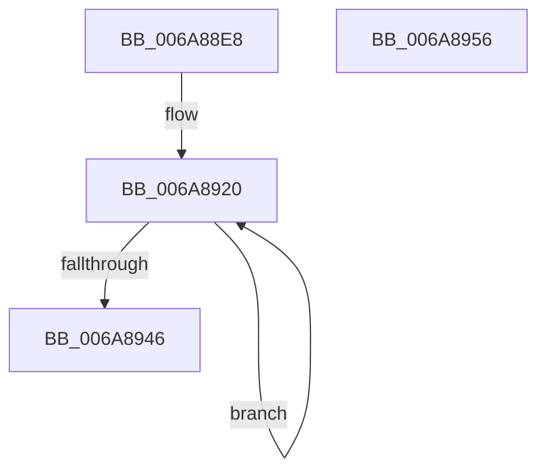

# RtlpDynamicLookasideInitialize

- RVA: `0x006A88E8`–`0x006A8957` (길이 `111` bytes)
- VA: `0x00000001406A88E8`
- 실행 섹션: `.text`
- PDB 이름 있음: `예`; PDB Function 태그: `아니요`
- unwind 정보 RVA: `0x00060BC4`
- 디코드: `28`개 명령, `111/111` bytes 표시
- 미해석 바이트: `0` (있으면 어셈블리에 `.byte`로 보존)

> 이 문서는 커널 이미지의 기계어와 PDB 기호를 분석해 생성했습니다. 4번과 5번은 함수 원형과 자료형을 바이너리 사용 방식에서 추정한 C 해석이며 원본 소스 복구 결과는 아닙니다.

## 1. Dependencies

- 직접 호출 지점: **2**; 고유 호출 대상: **2**
- 직접 호출자로 확인된 함수: **2**
- RIP 상대 이미지 참조: **0**

### Outgoing calls
- `0x006A8902` → [memset](../6C/memset_function_006C6C40.md) (function, `0x006C6C40`)
- `0x006A8924` → [InitializeSListHead](../46/InitializeSListHead_function_00468A90.md) (function, `0x00468A90`)

### Direct callers
- [ExInitializePagedHeaps](../65/ExInitializePagedHeaps_function_0065C23C.md) at `0x0065C2DE`
- [ExInitializePoolHeapManagement](../65/ExInitializePoolHeapManagement_function_0065C3D0.md) at `0x0065C4FD`

### Static image references
- 디코드된 RIP-relative 메모리 참조가 없습니다.

## 2. Other-region calls and transfers

- 다른 실행 섹션으로 향하는 call: **0**
- 별도 외부 분기/꼬리 이동을 확인하지 못했습니다.

## 3. Assembly (complete function range)

```asm
006A88E8  48 89 5C 24 08                  mov qword ptr [rsp + 8], rbx
006A88ED  48 89 74 24 10                  mov qword ptr [rsp + 0x10], rsi
006A88F2  57                              push rdi
006A88F3  48 83 EC 20                     sub rsp, 0x20
006A88F7  33 D2                           xor edx, edx
006A88F9  41 B8 40 10 00 00               mov r8d, 0x1040
006A88FF  48 8B D9                        mov rbx, rcx
006A8902  E8 39 E3 01 00                  call 0x1406c6c40
006A8907  C7 43 08 3F 00 00 00            mov dword ptr [rbx + 8], 0x3f
006A890E  BF 40 00 00 00                  mov edi, 0x40
006A8913  C7 43 0C 10 00 00 00            mov dword ptr [rbx + 0xc], 0x10
006A891A  48 83 C3 52                     add rbx, 0x52
006A891E  33 F6                           xor esi, esi
006A8920  48 8D 4B EE                     lea rcx, [rbx - 0x12]
006A8924  E8 67 01 DC FF                  call 0x140468a90
006A8929  48 C7 43 FE 00 00 00 01         mov qword ptr [rbx - 2], 0x1000000
006A8931  48 89 73 06                     mov qword ptr [rbx + 6], rsi
006A8935  48 89 73 0E                     mov qword ptr [rbx + 0xe], rsi
006A8939  89 73 16                        mov dword ptr [rbx + 0x16], esi
006A893C  48 8D 5B 40                     lea rbx, [rbx + 0x40]
006A8940  48 83 EF 01                     sub rdi, 1
006A8944  75 DA                           jne 0x1406a8920
006A8946  48 8B 5C 24 30                  mov rbx, qword ptr [rsp + 0x30]
006A894B  48 8B 74 24 38                  mov rsi, qword ptr [rsp + 0x38]
006A8950  48 83 C4 20                     add rsp, 0x20
006A8954  5F                              pop rdi
006A8955  C3                              ret
006A8956  CC                              int3
```

## 4. C-style interpretation (structured pseudocode)

```c
__int64 __fastcall RtlpDynamicLookasideInitialize(__int64 a1, int a2)
{
    __int64 result;
    __int64 v_rbx;
    __int64 v_rdi;
    __int64 v_rsi;
    __int64 v_rsp;
    unsigned __int64 v_stack_p10;
    unsigned __int64 v_stack_p8;

    v_stack_p8 = v_rbx;
    v_stack_p10 = v_rsi;
    v_rsp = (v_rsp) - (32);
    a2 = 0;
    result = memset(a1, a2, (unsigned int)(0x1040ULL), a4);
    *(unsigned int *)(a1 + 8) = 63;
    *(unsigned int *)(a1 + 12) = 16;
    v_rbx = (a1) + (82);
    v_rsi = 0;
loc_006A8920:
    result = InitializeSListHead(v_rbx - 18, a2, (unsigned int)(0x1040ULL), a4);
    *(unsigned __int64 *)(v_rbx - 2) = 0x1000000ULL;
    *(unsigned __int64 *)(v_rbx + 6) = 0;
    *(unsigned __int64 *)(v_rbx + 14) = 0;
    *(unsigned int *)(v_rbx + 22) = 0;
    v_rdi = (64) - (1);
    if (condition_is_not_equal) goto loc_006A8920;
    v_rsp = (v_rsp) + (32);
    return result;
}
```

## 5. (Beta) C Style

```c
int64_t RtlpDynamicLookasideInitialize(void *Arg1, int32_t Arg2)
{
    uint8_t *arg1 = (uint8_t *)Arg1;

    int64_t result;
    int64_t local_rbx;
    int64_t local_rdi;
    int64_t local_rsi;
    int64_t local_rsp;
    uint64_t v_stack_p10;
    uint64_t v_stack_p8;

    v_stack_p8 = local_rbx;
    v_stack_p10 = local_rsi;
    local_rsp = (local_rsp) - (32);
    Arg2 = 0;
    result = memset(Arg1, Arg2, (uint32_t)(0x1040ULL), a4);
    *(uint32_t *)(arg1 + 0x8) = 63;
    *(uint32_t *)(arg1 + 0xC) = 16;
    local_rbx = (Arg1) + (82);
    local_rsi = 0;
loc_006A8920:
    result = InitializeSListHead(local_rbx - 18, Arg2, (uint32_t)(0x1040ULL), a4);
    *(uint64_t *)(local_rbx - 0x2) = 0x1000000ULL;
    *(uint64_t *)(local_rbx + 0x6) = 0;
    *(uint64_t *)(local_rbx + 0xE) = 0;
    *(uint32_t *)(local_rbx + 0x16) = 0;
    local_rdi = (64) - (1);
    if (condition_is_not_equal) goto loc_006A8920;
    local_rsp = (local_rsp) + (32);
    return result;
}
```

### 관측된 메모리 오프셋

구조체 형식이 확인되지 않은 접근은 인자 기준의 오프셋으로만 기록했습니다.

| 기준 인자 | 오프셋 표현 | 폭 (bit) | 접근 |
|---|---:|---:|---|
| `Arg1` | `- 0x12` | `64` | `R` |
| `Arg1` | `- 0x2` | `64` | `W` |
| `Arg1` | `+ 0x6` | `64` | `W` |
| `Arg1` | `+ 0x8` | `32` | `W` |
| `Arg1` | `+ 0xC` | `32` | `W` |
| `Arg1` | `+ 0xE` | `64` | `W` |
| `Arg1` | `+ 0x16` | `32` | `W` |
| `Arg1` | `+ 0x40` | `64` | `R` |

## 6. Execution-region graph

[열기: 2D/3D 그래프와 함수 탐색 컨트롤 패널](../../../control-panel.html?section=text&rva=0x006A88E8&view=graph)

- 2D 그래프는 위에서 아래로 흐르고, 3D 그래프는 빈 공간을 드래그해 회전합니다. Shift+드래그는 이동, 휠은 확대·축소, 함수 노드 선택은 대상 보고서 이동입니다.

### Static fallback


