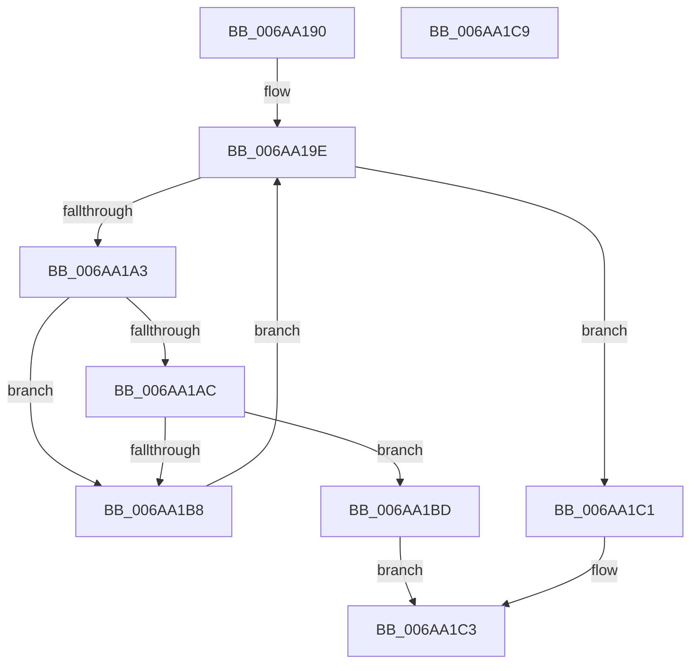

# RtlpIsAddressInIgnoreRegion

- RVA: `0x006AA190`–`0x006AA1CA` (길이 `58` bytes)
- VA: `0x00000001406AA190`
- 실행 섹션: `.text`
- PDB 이름 있음: `예`; PDB Function 태그: `아니요`
- unwind 정보 RVA: `0x00071750`
- 디코드: `21`개 명령, `58/58` bytes 표시
- 미해석 바이트: `0` (있으면 어셈블리에 `.byte`로 보존)

> 이 문서는 커널 이미지의 기계어와 PDB 기호를 분석해 생성했습니다. 4번과 5번은 함수 원형과 자료형을 바이너리 사용 방식에서 추정한 C 해석이며 원본 소스 복구 결과는 아닙니다.

## 1. Dependencies

- 직접 호출 지점: **0**; 고유 호출 대상: **0**
- 직접 호출자로 확인된 함수: **1**
- RIP 상대 이미지 참조: **0**

### Outgoing calls
- 직접 디코드된 call 명령이 없습니다.

### Direct callers
- [RtlPerformRetpolineRelocationsOnImageEx](RtlPerformRetpolineRelocationsOnImageEx_function_006A9AD4.md) at `0x006A9C2B`
- [RtlPerformRetpolineRelocationsOnImageEx](RtlPerformRetpolineRelocationsOnImageEx_function_006A9AD4.md) at `0x006A9CE4`
- [RtlPerformRetpolineRelocationsOnImageEx](RtlPerformRetpolineRelocationsOnImageEx_function_006A9AD4.md) at `0x006A9D9A`

### Static image references
- 디코드된 RIP-relative 메모리 참조가 없습니다.

## 2. Other-region calls and transfers

- 다른 실행 섹션으로 향하는 call: **0**
- 별도 외부 분기/꼬리 이동을 확인하지 못했습니다.

## 3. Assembly (complete function range)

```asm
006AA190  48 89 5C 24 08                  mov qword ptr [rsp + 8], rbx
006AA195  49 8B D8                        mov rbx, r8
006AA198  44 8B D9                        mov r11d, ecx
006AA19B  45 33 D2                        xor r10d, r10d
006AA19E  45 3B D1                        cmp r10d, r9d
006AA1A1  73 1E                           jae 0x1406aa1c1
006AA1A3  46 8B 04 92                     mov r8d, dword ptr [rdx + r10*4]
006AA1A7  45 3B D8                        cmp r11d, r8d
006AA1AA  72 0C                           jb 0x1406aa1b8
006AA1AC  42 8B 0C 93                     mov ecx, dword ptr [rbx + r10*4]
006AA1B0  41 03 C8                        add ecx, r8d
006AA1B3  44 3B D9                        cmp r11d, ecx
006AA1B6  72 05                           jb 0x1406aa1bd
006AA1B8  41 FF C2                        inc r10d
006AA1BB  EB E1                           jmp 0x1406aa19e
006AA1BD  B0 01                           mov al, 1
006AA1BF  EB 02                           jmp 0x1406aa1c3
006AA1C1  32 C0                           xor al, al
006AA1C3  48 8B 5C 24 08                  mov rbx, qword ptr [rsp + 8]
006AA1C8  C3                              ret
006AA1C9  CC                              int3
```

## 4. C-style interpretation (structured pseudocode)

```c
__int64 __fastcall RtlpIsAddressInIgnoreRegion(int a1, __int64 a2, __int64 a3, int a4)
{
    __int64 result;
    __int64 v_r10;
    unsigned __int64 v_stack_p8;

    v_stack_p8 = v_rbx;
    v_r10 = 0;
loc_006AA19E:
    if (0 >= a4) goto loc_006AA1C1;
    if (((unsigned int)((unsigned int)(a1))) < ((unsigned int)((unsigned int)(*(unsigned int *)(a2 + v_r10 * 4))))) goto loc_006AA1B8;
    a1 = (unsigned int)(((unsigned int)(*(unsigned int *)(a3 + v_r10 * 4))) + ((unsigned int)((unsigned int)(*(unsigned int *)(a2 + v_r10 * 4)))));
    if (((unsigned int)((unsigned int)(a1))) < a1) goto loc_006AA1BD;
loc_006AA1B8:
    v_r10 = (unsigned int)((v_r10) + 1);
    goto loc_006AA19E;
loc_006AA1BD:
    goto loc_006AA1C3;
loc_006AA1C1:
    result = 0;
loc_006AA1C3:
    return result;
}
```

## 5. (Beta) C Style

```c
int64_t RtlpIsAddressInIgnoreRegion(int32_t Arg1, void *Arg2, void *Arg3, int32_t Arg4)
{
    uint8_t *arg2 = (uint8_t *)Arg2;
    uint8_t *arg3 = (uint8_t *)Arg3;

    int64_t result;
    int64_t local_r10;
    uint64_t v_stack_p8;

    v_stack_p8 = local_rbx;
    local_r10 = 0;
loc_006AA19E:
    if (0 >= Arg4) goto loc_006AA1C1;
    if (((uint32_t)((uint32_t)(Arg1))) < ((uint32_t)((uint32_t)(*(uint32_t *)(arg2 + local_r10 * 4))))) goto loc_006AA1B8;
    Arg1 = (uint32_t)(((uint32_t)(*(uint32_t *)(arg3 + local_r10 * 4))) + ((uint32_t)((uint32_t)(*(uint32_t *)(arg2 + local_r10 * 4)))));
    if (((uint32_t)((uint32_t)(Arg1))) < Arg1) goto loc_006AA1BD;
loc_006AA1B8:
    local_r10 = (uint32_t)((local_r10) + 1);
    goto loc_006AA19E;
loc_006AA1BD:
    goto loc_006AA1C3;
loc_006AA1C1:
    result = 0;
loc_006AA1C3:
    return result;
}
```

### 관측된 메모리 오프셋

구조체 형식이 확인되지 않은 접근은 인자 기준의 오프셋으로만 기록했습니다.

| 기준 인자 | 오프셋 표현 | 폭 (bit) | 접근 |
|---|---:|---:|---|
| `Arg2` | `+ 0x0 + r10*4` | `32` | `R` |
| `Arg3` | `+ 0x0 + r10*4` | `32` | `R` |

## 6. Execution-region graph

[열기: 2D/3D 그래프와 함수 탐색 컨트롤 패널](../../../control-panel.html?section=text&rva=0x006AA190&view=graph)

- 2D 그래프는 위에서 아래로 흐르고, 3D 그래프는 빈 공간을 드래그해 회전합니다. Shift+드래그는 이동, 휠은 확대·축소, 함수 노드 선택은 대상 보고서 이동입니다.

### Static fallback


