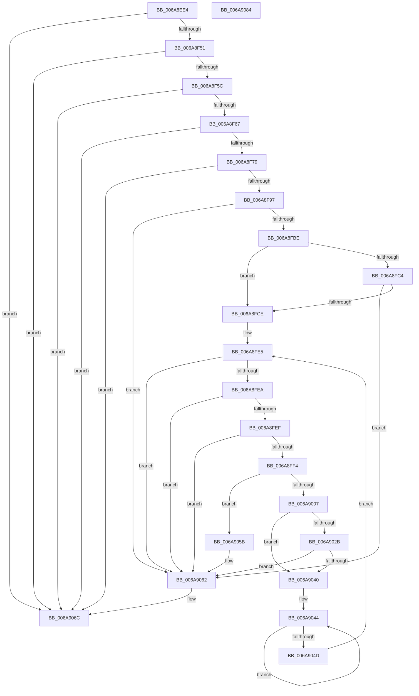

# RtlpMuiRegAddAlternateCodePage

- RVA: `0x006A8EE4`–`0x006A9085` (길이 `417` bytes)
- VA: `0x00000001406A8EE4`
- 실행 섹션: `.text`
- PDB 이름 있음: `예`; PDB Function 태그: `아니요`
- unwind 정보 RVA: `0x000BD508`
- 디코드: `119`개 명령, `417/417` bytes 표시
- 미해석 바이트: `0` (있으면 어셈블리에 `.byte`로 보존)

> 이 문서는 커널 이미지의 기계어와 PDB 기호를 분석해 생성했습니다. 4번과 5번은 함수 원형과 자료형을 바이너리 사용 방식에서 추정한 C 해석이며 원본 소스 복구 결과는 아닙니다.

## 1. Dependencies

- 직접 호출 지점: **8**; 고유 호출 대상: **6**
- 직접 호출자로 확인된 함수: **1**
- RIP 상대 이미지 참조: **2**

### Outgoing calls
- `0x006A8F25` → [RtlInitUnicodeString](../42/RtlInitUnicodeString_function_0042A780.md) (function, `0x0042A780`)
- `0x006A8F41` → [LdrpQueryValueKey](../../page/79/LdrpQueryValueKey_function_007919D0.md) (function, `0x007919D0`)
- `0x006A8F86` → [ExAllocatePool2](../../poolcode/B8/ExAllocatePool2_function_00B820F0.md) (function, `0x00B820F0`)
- `0x006A8FB1` → [LdrpQueryValueKey](../../page/79/LdrpQueryValueKey_function_007919D0.md) (function, `0x007919D0`)
- `0x006A8FFE` → [wcsicmp](../50/wcsicmp_function_00500080.md) (function, `0x00500080`)
- `0x006A900E` → [RtlInitUnicodeString](../42/RtlInitUnicodeString_function_0042A780.md) (function, `0x0042A780`)
- `0x006A9020` → [RtlUnicodeStringToInteger](../../page/99/RtlUnicodeStringToInteger_function_00993480.md) (function, `0x00993480`)
- `0x006A9067` → [ExFreePoolWithTag](../../poolcode/B8/ExFreePoolWithTag_function_00B82870.md) (function, `0x00B82870`)

### Direct callers
- [RtlpMuiRegAddLanguageByName](../../page/83/RtlpMuiRegAddLanguageByName_function_0083D748.md) at `0x0083D888`

### Static image references
- `0x006A8F08` → RVA `0x006D1470` (` ?? ::FNODOBFM::`string'`; read)
- `0x006A8FF4` → RVA `0x006D1550` (` ?? ::FNODOBFM::`string'`; read)

## 2. Other-region calls and transfers

- 다른 실행 섹션으로 향하는 call: **5**
  - `0x006A8F41` → [LdrpQueryValueKey](../../page/79/LdrpQueryValueKey_function_007919D0.md) (`.text` → `PAGE`)
  - `0x006A8F86` → [ExAllocatePool2](../../poolcode/B8/ExAllocatePool2_function_00B820F0.md) (`.text` → `POOLCODE`)
  - `0x006A8FB1` → [LdrpQueryValueKey](../../page/79/LdrpQueryValueKey_function_007919D0.md) (`.text` → `PAGE`)
  - `0x006A9020` → [RtlUnicodeStringToInteger](../../page/99/RtlUnicodeStringToInteger_function_00993480.md) (`.text` → `PAGE`)
  - `0x006A9067` → [ExFreePoolWithTag](../../poolcode/B8/ExFreePoolWithTag_function_00B82870.md) (`.text` → `POOLCODE`)
- 별도 외부 분기/꼬리 이동을 확인하지 못했습니다.

## 3. Assembly (complete function range)

```asm
006A8EE4  48 89 5C 24 08                  mov qword ptr [rsp + 8], rbx
006A8EE9  55                              push rbp
006A8EEA  56                              push rsi
006A8EEB  57                              push rdi
006A8EEC  41 54                           push r12
006A8EEE  41 55                           push r13
006A8EF0  41 56                           push r14
006A8EF2  41 57                           push r15
006A8EF4  48 8B EC                        mov rbp, rsp
006A8EF7  48 83 EC 50                     sub rsp, 0x50
006A8EFB  48 8B F2                        mov rsi, rdx
006A8EFE  C7 45 58 07 00 00 00            mov dword ptr [rbp + 0x58], 7
006A8F05  4C 8B E1                        mov r12, rcx
006A8F08  48 8D 15 61 85 02 00            lea rdx, [rip + 0x28561]
006A8F0F  45 33 F6                        xor r14d, r14d
006A8F12  48 8D 4D E8                     lea rcx, [rbp - 0x18]
006A8F16  0F 57 C0                        xorps xmm0, xmm0
006A8F19  44 89 75 50                     mov dword ptr [rbp + 0x50], r14d
006A8F1D  44 89 75 E0                     mov dword ptr [rbp - 0x20], r14d
006A8F21  0F 11 45 E8                     movups xmmword ptr [rbp - 0x18], xmm0
006A8F25  E8 56 18 D8 FF                  call 0x14042a780
006A8F2A  48 8D 45 50                     lea rax, [rbp + 0x50]
006A8F2E  45 33 C9                        xor r9d, r9d
006A8F31  4C 8D 45 58                     lea r8, [rbp + 0x58]
006A8F35  48 89 44 24 20                  mov qword ptr [rsp + 0x20], rax
006A8F3A  48 8D 55 E8                     lea rdx, [rbp - 0x18]
006A8F3E  48 8B CE                        mov rcx, rsi
006A8F41  E8 8A 8A 0E 00                  call 0x1407919d0
006A8F46  3D 34 00 00 C0                  cmp eax, 0xc0000034
006A8F4B  0F 84 1B 01 00 00               je 0x1406a906c
006A8F51  8B 4D 50                        mov ecx, dword ptr [rbp + 0x50]
006A8F54  85 C9                           test ecx, ecx
006A8F56  0F 84 10 01 00 00               je 0x1406a906c
006A8F5C  3D 05 00 00 80                  cmp eax, 0x80000005
006A8F61  0F 85 05 01 00 00               jne 0x1406a906c
006A8F67  83 C1 02                        add ecx, 2
006A8F6A  89 4D 50                        mov dword ptr [rbp + 0x50], ecx
006A8F6D  83 C1 03                        add ecx, 3
006A8F70  83 E1 FC                        and ecx, 0xfffffffc
006A8F73  0F 84 F3 00 00 00               je 0x1406a906c
006A8F79  8B D1                           mov edx, ecx
006A8F7B  41 B8 6D 6C 74 72               mov r8d, 0x72746c6d
006A8F81  B9 00 01 00 00                  mov ecx, 0x100
006A8F86  E8 65 91 4D 00                  call 0x140b820f0
006A8F8B  48 8B D8                        mov rbx, rax
006A8F8E  48 85 C0                        test rax, rax
006A8F91  0F 84 D5 00 00 00               je 0x1406a906c
006A8F97  48 8B F8                        mov rdi, rax
006A8F9A  4C 8D 45 58                     lea r8, [rbp + 0x58]
006A8F9E  48 8D 45 50                     lea rax, [rbp + 0x50]
006A8FA2  4C 8B CB                        mov r9, rbx
006A8FA5  48 8D 55 E8                     lea rdx, [rbp - 0x18]
006A8FA9  48 89 44 24 20                  mov qword ptr [rsp + 0x20], rax
006A8FAE  48 8B CE                        mov rcx, rsi
006A8FB1  E8 1A 8A 0E 00                  call 0x1407919d0
006A8FB6  85 C0                           test eax, eax
006A8FB8  0F 85 A4 00 00 00               jne 0x1406a9062
006A8FBE  83 7D 58 01                     cmp dword ptr [rbp + 0x58], 1
006A8FC2  74 0A                           je 0x1406a8fce
006A8FC4  83 7D 58 07                     cmp dword ptr [rbp + 0x58], 7
006A8FC8  0F 85 94 00 00 00               jne 0x1406a9062
006A8FCE  44 8B 7D 50                     mov r15d, dword ptr [rbp + 0x50]
006A8FD2  45 8B EE                        mov r13d, r14d
006A8FD5  41 D1 EF                        shr r15d, 1
006A8FD8  49 8B F6                        mov rsi, r14
006A8FDB  33 D2                           xor edx, edx
006A8FDD  4D 8D 74 24 14                  lea r14, [r12 + 0x14]
006A8FE2  48 8B FB                        mov rdi, rbx
006A8FE5  45 3B EF                        cmp r13d, r15d
006A8FE8  73 78                           jae 0x1406a9062
006A8FEA  48 85 DB                        test rbx, rbx
006A8FED  74 73                           je 0x1406a9062
006A8FEF  66 39 13                        cmp word ptr [rbx], dx
006A8FF2  74 6E                           je 0x1406a9062
006A8FF4  48 8D 15 55 85 02 00            lea rdx, [rip + 0x28555]
006A8FFB  48 8B CB                        mov rcx, rbx
006A8FFE  E8 7D 70 E5 FF                  call 0x140500080
006A9003  85 C0                           test eax, eax
006A9005  74 54                           je 0x1406a905b
006A9007  48 8B D3                        mov rdx, rbx
006A900A  48 8D 4D E8                     lea rcx, [rbp - 0x18]
006A900E  E8 6D 17 D8 FF                  call 0x14042a780
006A9013  4C 8D 45 E0                     lea r8, [rbp - 0x20]
006A9017  BA 0A 00 00 00                  mov edx, 0xa
006A901C  48 8D 4D E8                     lea rcx, [rbp - 0x18]
006A9020  E8 5B A4 2E 00                  call 0x140993480
006A9025  33 D2                           xor edx, edx
006A9027  85 C0                           test eax, eax
006A9029  75 15                           jne 0x1406a9040
006A902B  0F B7 45 E0                     movzx eax, word ptr [rbp - 0x20]
006A902F  48 FF C6                        inc rsi
006A9032  66 41 89 06                     mov word ptr [r14], ax
006A9036  49 83 C6 02                     add r14, 2
006A903A  48 83 FE 04                     cmp rsi, 4
006A903E  7D 22                           jge 0x1406a9062
006A9040  48 83 C8 FF                     or rax, 0xffffffffffffffff
006A9044  48 FF C0                        inc rax
006A9047  66 39 14 43                     cmp word ptr [rbx + rax*2], dx
006A904B  75 F7                           jne 0x1406a9044
006A904D  41 FF C5                        inc r13d
006A9050  44 03 E8                        add r13d, eax
006A9053  FF C0                           inc eax
006A9055  48 8D 1C 43                     lea rbx, [rbx + rax*2]
006A9059  EB 8A                           jmp 0x1406a8fe5
006A905B  66 41 83 4C 24 14 FF            or word ptr [r12 + 0x14], 0xffff
006A9062  33 D2                           xor edx, edx
006A9064  48 8B CF                        mov rcx, rdi
006A9067  E8 04 98 4D 00                  call 0x140b82870
006A906C  48 8B 9C 24 90 00 00 00         mov rbx, qword ptr [rsp + 0x90]
006A9074  48 83 C4 50                     add rsp, 0x50
006A9078  41 5F                           pop r15
006A907A  41 5E                           pop r14
006A907C  41 5D                           pop r13
006A907E  41 5C                           pop r12
006A9080  5F                              pop rdi
006A9081  5E                              pop rsi
006A9082  5D                              pop rbp
006A9083  C3                              ret
006A9084  CC                              int3
```

## 4. C-style interpretation (structured pseudocode)

```c
__int64 __fastcall RtlpMuiRegAddAlternateCodePage(__int64 a1, __int64 a2, __int64 a3, int a4)
{
    __int64 result;
    __int64 v_r13;
    __int64 v_r14;
    __int64 v_r15;
    __int64 v_rsi;
    __int64 v_rsp;
    unsigned __int64 v_stack_m50;
    unsigned int v_stack_m58;
    unsigned __int64 v_stack_m68;
    unsigned int v_stack_p18;
    unsigned int v_stack_p20;
    unsigned __int64 v_stack_p8;

    v_stack_p8 = v_rbx;
    v_rsp = (v_rsp) - (80);
    v_stack_p20 = 7;
    v_r14 = 0;
    v_stack_p18 = 0;
    v_stack_m58 = 0;
    v_stack_m50 = v_xmm0;
    result = RtlInitUnicodeString(v_stack_m50, v_rip + 165217, a3, a4);
    a4 = 0;
    v_stack_m68 = v_stack_p18;
    result = LdrpQueryValueKey(a2, v_stack_m50, v_stack_p20, a4);
    if (((unsigned int)(result)) == 0xC0000034ULL) goto loc_006A906C;
    if ((unsigned int)((unsigned int)(v_stack_p18)) == 0) goto loc_006A906C;
    if (((unsigned int)(result)) != 0x80000005ULL) goto loc_006A906C;
    a1 = (unsigned int)(((unsigned int)(v_stack_p18)) + (2));
    v_stack_p18 = (unsigned int)(a1);
    a1 = (unsigned int)((a1) + (3));
    a1 = (unsigned int)((a1) & (0xFFFFFFFCULL));
    if (condition_is_equal) goto loc_006A906C;
    result = ExAllocatePool2(256, (unsigned int)((unsigned int)(a1)), (unsigned int)(0x72746C6DULL), a4);
    if (result == 0) goto loc_006A906C;
    v_stack_m68 = v_stack_p18;
    result = LdrpQueryValueKey(a2, v_stack_m50, v_stack_p20, result);
    if ((unsigned int)(result) != 0) goto loc_006A9062;
    if (v_stack_p20 == 1) goto loc_006A8FCE;
    if (v_stack_p20 != 7) goto loc_006A9062;
loc_006A8FCE:
    v_r15 = (unsigned int)(((unsigned int)(v_stack_p18)) >> (1));
    a2 = 0;
loc_006A8FE5:
    if (0 >= ((unsigned int)(v_r15))) goto loc_006A9062;
    if (result == 0) goto loc_006A9062;
    if ((*(unsigned __int16 *)(result)) == 0) goto loc_006A9062;
    result = wcsicmp(result, v_rip + 165205, v_stack_p20, result);
    if ((unsigned int)(result) == 0) goto loc_006A905B;
    result = RtlInitUnicodeString(v_stack_m50, result, v_stack_p20, result);
    result = RtlUnicodeStringToInteger(v_stack_m50, 10, v_stack_m58, result);
    a2 = 0;
    if ((unsigned int)(result) != 0) goto loc_006A9040;
    v_rsi = (0) + 1;
    *(unsigned __int16 *)(a1 + 20) = (unsigned __int16)(v_stack_m58);
    v_r14 = (a1 + 20) + (2);
    if (v_rsi >= 4) goto loc_006A9062;
loc_006A9040:
    result = (v_stack_m58) | (-1);
loc_006A9044:
    result = (result) + 1;
    if ((*(unsigned __int16 *)(result + result * 2)) != 0) goto loc_006A9044;
    v_r13 = (unsigned int)((0) + 1);
    v_r13 = (unsigned int)((v_r13) + ((unsigned int)(result)));
    result = (unsigned int)((result) + 1);
    goto loc_006A8FE5;
loc_006A905B:
loc_006A9062:
    a2 = 0;
    result = ExFreePoolWithTag(result, a2, v_stack_m58, result);
loc_006A906C:
    v_rsp = (v_rsp) + (80);
    return result;
}
```

## 5. (Beta) C Style

```c
int64_t RtlpMuiRegAddAlternateCodePage(void *Arg1, int64_t Arg2, int64_t Arg3, int32_t Arg4)
{
    uint8_t *arg1 = (uint8_t *)Arg1;

    int64_t result;
    int64_t local_r13;
    int64_t local_r14;
    int64_t local_r15;
    int64_t local_rsi;
    int64_t local_rsp;
    uint64_t v_stack_m50;
    uint32_t v_stack_m58;
    uint64_t v_stack_m68;
    uint32_t v_stack_p18;
    uint32_t v_stack_p20;
    uint64_t v_stack_p8;

    v_stack_p8 = local_rbx;
    local_rsp = (local_rsp) - (80);
    v_stack_p20 = 7;
    local_r14 = 0;
    v_stack_p18 = 0;
    v_stack_m58 = 0;
    v_stack_m50 = v_xmm0;
    result = RtlInitUnicodeString(v_stack_m50, v_rip + 165217, Arg3, Arg4);
    Arg4 = 0;
    v_stack_m68 = v_stack_p18;
    result = LdrpQueryValueKey(Arg2, v_stack_m50, v_stack_p20, Arg4);
    if (((uint32_t)(result)) == 0xC0000034ULL) goto loc_006A906C;
    if ((uint32_t)((uint32_t)(v_stack_p18)) == 0) goto loc_006A906C;
    if (((uint32_t)(result)) != 0x80000005ULL) goto loc_006A906C;
    Arg1 = (uint32_t)(((uint32_t)(v_stack_p18)) + (2));
    v_stack_p18 = (uint32_t)(Arg1);
    Arg1 = (uint32_t)((Arg1) + (3));
    Arg1 = (uint32_t)((Arg1) & (0xFFFFFFFCULL));
    if (condition_is_equal) goto loc_006A906C;
    result = ExAllocatePool2(256, (uint32_t)((uint32_t)(Arg1)), (uint32_t)(0x72746C6DULL), Arg4);
    if (result == 0) goto loc_006A906C;
    v_stack_m68 = v_stack_p18;
    result = LdrpQueryValueKey(Arg2, v_stack_m50, v_stack_p20, result);
    if ((uint32_t)(result) != 0) goto loc_006A9062;
    if (v_stack_p20 == 1) goto loc_006A8FCE;
    if (v_stack_p20 != 7) goto loc_006A9062;
loc_006A8FCE:
    local_r15 = (uint32_t)(((uint32_t)(v_stack_p18)) >> (1));
    Arg2 = 0;
loc_006A8FE5:
    if (0 >= ((uint32_t)(local_r15))) goto loc_006A9062;
    if (result == 0) goto loc_006A9062;
    if ((*(uint16_t *)(result)) == 0) goto loc_006A9062;
    result = wcsicmp(result, v_rip + 165205, v_stack_p20, result);
    if ((uint32_t)(result) == 0) goto loc_006A905B;
    result = RtlInitUnicodeString(v_stack_m50, result, v_stack_p20, result);
    result = RtlUnicodeStringToInteger(v_stack_m50, 10, v_stack_m58, result);
    Arg2 = 0;
    if ((uint32_t)(result) != 0) goto loc_006A9040;
    local_rsi = (0) + 1;
    *(uint16_t *)(arg1 + 0x14) = (uint16_t)(v_stack_m58);
    local_r14 = (Arg1 + 20) + (2);
    if (local_rsi >= 4) goto loc_006A9062;
loc_006A9040:
    result = (v_stack_m58) | (-1);
loc_006A9044:
    result = (result) + 1;
    if ((*(uint16_t *)(result + result * 2)) != 0) goto loc_006A9044;
    local_r13 = (uint32_t)((0) + 1);
    local_r13 = (uint32_t)((local_r13) + ((uint32_t)(result)));
    result = (uint32_t)((result) + 1);
    goto loc_006A8FE5;
loc_006A905B:
loc_006A9062:
    Arg2 = 0;
    result = ExFreePoolWithTag(result, Arg2, v_stack_m58, result);
loc_006A906C:
    local_rsp = (local_rsp) + (80);
    return result;
}
```

### 관측된 메모리 오프셋

구조체 형식이 확인되지 않은 접근은 인자 기준의 오프셋으로만 기록했습니다.

| 기준 인자 | 오프셋 표현 | 폭 (bit) | 접근 |
|---|---:|---:|---|
| `Arg1` | `+ 0x0` | `16` | `W` |
| `Arg1` | `+ 0x14` | `16` | `R/W` |
| `Arg1` | `+ 0x14` | `64` | `R` |

## 6. Execution-region graph

[열기: 2D/3D 그래프와 함수 탐색 컨트롤 패널](../../../control-panel.html?section=text&rva=0x006A8EE4&view=graph)

- 2D 그래프는 위에서 아래로 흐르고, 3D 그래프는 빈 공간을 드래그해 회전합니다. Shift+드래그는 이동, 휠은 확대·축소, 함수 노드 선택은 대상 보고서 이동입니다.

### Static fallback


