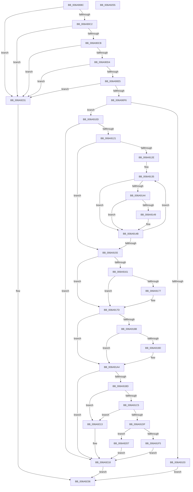

# RtlpMuiRegCreateKernelRegistryInfo

- RVA: `0x006A908C`–`0x006A9256` (길이 `458` bytes)
- VA: `0x00000001406A908C`
- 실행 섹션: `.text`
- PDB 이름 있음: `예`; PDB Function 태그: `아니요`
- unwind 정보 RVA: `0x000C4928`
- 디코드: `136`개 명령, `458/458` bytes 표시
- 미해석 바이트: `0` (있으면 어셈블리에 `.byte`로 보존)

> 이 문서는 커널 이미지의 기계어와 PDB 기호를 분석해 생성했습니다. 4번과 5번은 함수 원형과 자료형을 바이너리 사용 방식에서 추정한 C 해석이며 원본 소스 복구 결과는 아닙니다.

## 1. Dependencies

- 직접 호출 지점: **10**; 고유 호출 대상: **7**
- 직접 호출자로 확인된 함수: **1**
- RIP 상대 이미지 참조: **0**

### Outgoing calls
- `0x006A90F6` → [RtlpMuiRegCreateRegistryInfo](../../page/83/RtlpMuiRegCreateRegistryInfo_function_0083DD3C.md) (function, `0x0083DD3C`)
- `0x006A9110` → [RtlpMuiRegLoadRegistryInfo](../../page/83/RtlpMuiRegLoadRegistryInfo_function_0083EDC4.md) (function, `0x0083EDC4`)
- `0x006A916E` → [RtlpMuiRegGetInstalledLanguageIndexByLangId](../../page/83/RtlpMuiRegGetInstalledLanguageIndexByLangId_function_0083E31C.md) (function, `0x0083E31C`)
- `0x006A9194` → [RtlpMuiRegGetInstalledLanguageIndexByLangId](../../page/83/RtlpMuiRegGetInstalledLanguageIndexByLangId_function_0083E31C.md) (function, `0x0083E31C`)
- `0x006A91B2` → [RtlpMuiRegSerializeRegistryInfo](../../page/84/RtlpMuiRegSerializeRegistryInfo_function_00840088.md) (function, `0x00840088`)
- `0x006A91D2` → [ExAllocatePool2](../../poolcode/B8/ExAllocatePool2_function_00B820F0.md) (function, `0x00B820F0`)
- `0x006A91EA` → [RtlpMuiRegSerializeRegistryInfo](../../page/84/RtlpMuiRegSerializeRegistryInfo_function_00840088.md) (function, `0x00840088`)
- `0x006A920C` → [ExFreePoolWithTag](../../poolcode/B8/ExFreePoolWithTag_function_00B82870.md) (function, `0x00B82870`)
- `0x006A9220` → [RtlpMuiRegFreeRegistryInfo](../../page/83/RtlpMuiRegFreeRegistryInfo_function_0083DE14.md) (function, `0x0083DE14`)
- `0x006A922A` → [ExFreePoolWithTag](../../poolcode/B8/ExFreePoolWithTag_function_00B82870.md) (function, `0x00B82870`)

### Direct callers
- [MUIRegistrySystemRoutine](../../page/7D/MUIRegistrySystemRoutine_function_007D4170.md) at `0x007D41AB`

### Static image references
- 디코드된 RIP-relative 메모리 참조가 없습니다.

## 2. Other-region calls and transfers

- 다른 실행 섹션으로 향하는 call: **10**
  - `0x006A90F6` → [RtlpMuiRegCreateRegistryInfo](../../page/83/RtlpMuiRegCreateRegistryInfo_function_0083DD3C.md) (`.text` → `PAGE`)
  - `0x006A9110` → [RtlpMuiRegLoadRegistryInfo](../../page/83/RtlpMuiRegLoadRegistryInfo_function_0083EDC4.md) (`.text` → `PAGE`)
  - `0x006A916E` → [RtlpMuiRegGetInstalledLanguageIndexByLangId](../../page/83/RtlpMuiRegGetInstalledLanguageIndexByLangId_function_0083E31C.md) (`.text` → `PAGE`)
  - `0x006A9194` → [RtlpMuiRegGetInstalledLanguageIndexByLangId](../../page/83/RtlpMuiRegGetInstalledLanguageIndexByLangId_function_0083E31C.md) (`.text` → `PAGE`)
  - `0x006A91B2` → [RtlpMuiRegSerializeRegistryInfo](../../page/84/RtlpMuiRegSerializeRegistryInfo_function_00840088.md) (`.text` → `PAGE`)
  - `0x006A91D2` → [ExAllocatePool2](../../poolcode/B8/ExAllocatePool2_function_00B820F0.md) (`.text` → `POOLCODE`)
  - `0x006A91EA` → [RtlpMuiRegSerializeRegistryInfo](../../page/84/RtlpMuiRegSerializeRegistryInfo_function_00840088.md) (`.text` → `PAGE`)
  - `0x006A920C` → [ExFreePoolWithTag](../../poolcode/B8/ExFreePoolWithTag_function_00B82870.md) (`.text` → `POOLCODE`)
  - `0x006A9220` → [RtlpMuiRegFreeRegistryInfo](../../page/83/RtlpMuiRegFreeRegistryInfo_function_0083DE14.md) (`.text` → `PAGE`)
  - `0x006A922A` → [ExFreePoolWithTag](../../poolcode/B8/ExFreePoolWithTag_function_00B82870.md) (`.text` → `POOLCODE`)
- 별도 외부 분기/꼬리 이동을 확인하지 못했습니다.

## 3. Assembly (complete function range)

```asm
006A908C  48 8B C4                        mov rax, rsp
006A908F  48 89 58 10                     mov qword ptr [rax + 0x10], rbx
006A9093  48 89 68 18                     mov qword ptr [rax + 0x18], rbp
006A9097  48 89 70 20                     mov qword ptr [rax + 0x20], rsi
006A909B  48 89 48 08                     mov qword ptr [rax + 8], rcx
006A909F  57                              push rdi
006A90A0  41 54                           push r12
006A90A2  41 55                           push r13
006A90A4  41 56                           push r14
006A90A6  41 57                           push r15
006A90A8  48 83 EC 30                     sub rsp, 0x30
006A90AC  33 DB                           xor ebx, ebx
006A90AE  45 8B E9                        mov r13d, r9d
006A90B1  4D 8B F8                        mov r15, r8
006A90B4  4C 8B E2                        mov r12, rdx
006A90B7  8B EB                           mov ebp, ebx
006A90B9  48 85 C9                        test rcx, rcx
006A90BC  0F 84 6F 01 00 00               je 0x1406a9231
006A90C2  48 85 D2                        test rdx, rdx
006A90C5  0F 84 66 01 00 00               je 0x1406a9231
006A90CB  4D 85 C0                        test r8, r8
006A90CE  0F 84 5D 01 00 00               je 0x1406a9231
006A90D4  48 8B B4 24 80 00 00 00         mov rsi, qword ptr [rsp + 0x80]
006A90DC  48 85 F6                        test rsi, rsi
006A90DF  0F 84 4C 01 00 00               je 0x1406a9231
006A90E5  4C 8B B4 24 90 00 00 00         mov r14, qword ptr [rsp + 0x90]
006A90ED  4D 85 F6                        test r14, r14
006A90F0  0F 84 3B 01 00 00               je 0x1406a9231
006A90F6  E8 41 4C 19 00                  call 0x14083dd3c
006A90FB  48 8B F8                        mov rdi, rax
006A90FE  48 85 C0                        test rax, rax
006A9101  75 0A                           jne 0x1406a910d
006A9103  BB 17 00 00 C0                  mov ebx, 0xc0000017
006A9108  E9 29 01 00 00                  jmp 0x1406a9236
006A910D  48 8B CF                        mov rcx, rdi
006A9110  E8 AF 5C 19 00                  call 0x14083edc4
006A9115  33 D2                           xor edx, edx
006A9117  8B D8                           mov ebx, eax
006A9119  85 C0                           test eax, eax
006A911B  0F 88 F7 00 00 00               js 0x1406a9218
006A9121  48 8B 4F 18                     mov rcx, qword ptr [rdi + 0x18]
006A9125  0F B7 41 06                     movzx eax, word ptr [rcx + 6]
006A9129  66 3B D0                        cmp dx, ax
006A912C  73 27                           jae 0x1406a9155
006A912E  48 8B 49 10                     mov rcx, qword ptr [rcx + 0x10]
006A9132  44 8B C0                        mov r8d, eax
006A9135  0F B7 11                        movzx edx, word ptr [rcx]
006A9138  8B C2                           mov eax, edx
006A913A  25 20 90 00 00                  and eax, 0x9020
006A913F  83 F8 20                        cmp eax, 0x20
006A9142  75 07                           jne 0x1406a914b
006A9144  F6 C2 03                        test dl, 3
006A9147  74 02                           je 0x1406a914b
006A9149  FF C5                           inc ebp
006A914B  48 83 C1 1C                     add rcx, 0x1c
006A914F  49 83 E8 01                     sub r8, 1
006A9153  75 E0                           jne 0x1406a9135
006A9155  41 89 2F                        mov dword ptr [r15], ebp
006A9158  33 ED                           xor ebp, ebp
006A915A  89 2E                           mov dword ptr [rsi], ebp
006A915C  45 85 ED                        test r13d, r13d
006A915F  74 1C                           je 0x1406a917d
006A9161  45 33 C9                        xor r9d, r9d
006A9164  41 B0 01                        mov r8b, 1
006A9167  41 0F B7 D5                     movzx edx, r13w
006A916B  48 8B CF                        mov rcx, rdi
006A916E  E8 A9 51 19 00                  call 0x14083e31c
006A9173  85 C0                           test eax, eax
006A9175  78 06                           js 0x1406a917d
006A9177  C7 06 01 00 00 00               mov dword ptr [rsi], 1
006A917D  8B 94 24 88 00 00 00            mov edx, dword ptr [rsp + 0x88]
006A9184  41 89 2E                        mov dword ptr [r14], ebp
006A9187  85 D2                           test edx, edx
006A9189  74 19                           je 0x1406a91a4
006A918B  45 33 C9                        xor r9d, r9d
006A918E  41 B0 01                        mov r8b, 1
006A9191  48 8B CF                        mov rcx, rdi
006A9194  E8 83 51 19 00                  call 0x14083e31c
006A9199  85 C0                           test eax, eax
006A919B  78 07                           js 0x1406a91a4
006A919D  41 C7 06 01 00 00 00            mov dword ptr [r14], 1
006A91A4  4C 8D 44 24 20                  lea r8, [rsp + 0x20]
006A91A9  89 6C 24 20                     mov dword ptr [rsp + 0x20], ebp
006A91AD  33 D2                           xor edx, edx
006A91AF  48 8B CF                        mov rcx, rdi
006A91B2  E8 D1 6E 19 00                  call 0x140840088
006A91B7  8B D8                           mov ebx, eax
006A91B9  85 C0                           test eax, eax
006A91BB  78 5B                           js 0x1406a9218
006A91BD  8B 44 24 20                     mov eax, dword ptr [rsp + 0x20]
006A91C1  85 C0                           test eax, eax
006A91C3  74 4E                           je 0x1406a9213
006A91C5  8B D0                           mov edx, eax
006A91C7  B9 00 01 00 00                  mov ecx, 0x100
006A91CC  41 B8 6D 6C 74 72               mov r8d, 0x72746c6d
006A91D2  E8 19 8F 4D 00                  call 0x140b820f0
006A91D7  48 8B F0                        mov rsi, rax
006A91DA  48 85 C0                        test rax, rax
006A91DD  74 34                           je 0x1406a9213
006A91DF  4C 8D 44 24 20                  lea r8, [rsp + 0x20]
006A91E4  48 8B D0                        mov rdx, rax
006A91E7  48 8B CF                        mov rcx, rdi
006A91EA  E8 99 6E 19 00                  call 0x140840088
006A91EF  8B D8                           mov ebx, eax
006A91F1  85 C0                           test eax, eax
006A91F3  78 12                           js 0x1406a9207
006A91F5  48 8B 44 24 60                  mov rax, qword ptr [rsp + 0x60]
006A91FA  48 89 30                        mov qword ptr [rax], rsi
006A91FD  8B 44 24 20                     mov eax, dword ptr [rsp + 0x20]
006A9201  41 89 04 24                     mov dword ptr [r12], eax
006A9205  EB 11                           jmp 0x1406a9218
006A9207  33 D2                           xor edx, edx
006A9209  48 8B CE                        mov rcx, rsi
006A920C  E8 5F 96 4D 00                  call 0x140b82870
006A9211  EB 05                           jmp 0x1406a9218
006A9213  BB 17 00 00 C0                  mov ebx, 0xc0000017
006A9218  BA FF 0F 00 00                  mov edx, 0xfff
006A921D  48 8B CF                        mov rcx, rdi
006A9220  E8 EF 4B 19 00                  call 0x14083de14
006A9225  33 D2                           xor edx, edx
006A9227  48 8B CF                        mov rcx, rdi
006A922A  E8 41 96 4D 00                  call 0x140b82870
006A922F  EB 05                           jmp 0x1406a9236
006A9231  BB 0D 00 00 C0                  mov ebx, 0xc000000d
006A9236  48 8B 6C 24 70                  mov rbp, qword ptr [rsp + 0x70]
006A923B  8B C3                           mov eax, ebx
006A923D  48 8B 5C 24 68                  mov rbx, qword ptr [rsp + 0x68]
006A9242  48 8B 74 24 78                  mov rsi, qword ptr [rsp + 0x78]
006A9247  48 83 C4 30                     add rsp, 0x30
006A924B  41 5F                           pop r15
006A924D  41 5E                           pop r14
006A924F  41 5D                           pop r13
006A9251  41 5C                           pop r12
006A9253  5F                              pop rdi
006A9254  C3                              ret
006A9255  CC                              int3
```

## 4. C-style interpretation (structured pseudocode)

```c
__int64 __fastcall RtlpMuiRegCreateKernelRegistryInfo(__int64 a1, __int64 a2, __int64 a3, int a4, __int64 a5, unsigned int a6, __int64 a7)
{
    __int64 result;
    __int64 v_rbp;
    __int64 v_rbx;
    __int64 v_rsp;
    unsigned __int64 v_stack_m38;
    unsigned __int64 v_stack_p10;
    unsigned __int64 v_stack_p18;
    unsigned __int64 v_stack_p20;
    unsigned __int64 v_stack_p8;

    *(unsigned __int64 *)(v_rsp + 16) = v_rbx;
    *(unsigned __int64 *)(v_rsp + 24) = v_rbp;
    *(unsigned __int64 *)(v_rsp + 32) = v_rsi;
    *(unsigned __int64 *)(v_rsp + 8) = a1;
    v_rsp = (v_rsp) - (48);
    v_rbx = 0;
    if (a1 == 0) goto loc_006A9231;
    if (a2 == 0) goto loc_006A9231;
    if (a3 == 0) goto loc_006A9231;
    if (a5 == 0) goto loc_006A9231;
    if (a7 == 0) goto loc_006A9231;
    result = RtlpMuiRegCreateRegistryInfo(a1, a2, a3, a4);
    if (result != 0) goto loc_006A910D;
    goto loc_006A9236;
loc_006A910D:
    result = RtlpMuiRegLoadRegistryInfo(result, a2, a3, a4);
    a2 = 0;
    if (sign_flag) goto loc_006A9218;
    if (0 >= ((unsigned __int16)(*(unsigned __int16 *)(*(unsigned __int64 *)(result + 24) + 6)))) goto loc_006A9155;
loc_006A9135:
    result = (unsigned int)(((unsigned int)((unsigned int)(*(unsigned __int16 *)(*(unsigned __int64 *)(*(unsigned __int64 *)(result + 24) + 16))))) & (0x9020ULL));
    if (((unsigned int)(result)) != 32) goto loc_006A914B;
    v_rbp = 0;
    if ((((unsigned __int8)(*(unsigned __int16 *)(*(unsigned __int64 *)(*(unsigned __int64 *)(result + 24) + 16)))) & (3)) != 0) {
        v_rbp = (unsigned int)((0) + 1);
    }
    a1 = (*(unsigned __int64 *)(*(unsigned __int64 *)(result + 24) + 16)) + (28);
    a3 = ((unsigned int)((unsigned int)(*(unsigned __int16 *)(*(unsigned __int64 *)(result + 24) + 6)))) - (1);
    if (condition_is_not_equal) goto loc_006A9135;
loc_006A9155:
    *(unsigned int *)(a3) = (unsigned int)(v_rbp);
    v_rbp = 0;
    *(unsigned int *)(a5) = 0;
    if ((unsigned int)((unsigned int)(a4)) == 0) goto loc_006A917D;
    a4 = 0;
    result = RtlpMuiRegGetInstalledLanguageIndexByLangId(result, (unsigned __int16)((unsigned int)(a4)), 1, a4);
    if (!(sign_flag)) {
        *(unsigned int *)(a5) = 1;
    }
    *(unsigned int *)(a7) = 0;
    if ((unsigned int)((unsigned int)(a6)) == 0) goto loc_006A91A4;
    a4 = 0;
    result = RtlpMuiRegGetInstalledLanguageIndexByLangId(result, (unsigned int)(a6), 1, a4);
    if (!(sign_flag)) {
        *(unsigned int *)(a7) = 1;
    }
    v_stack_m38 = 0;
    a2 = 0;
    result = RtlpMuiRegSerializeRegistryInfo(result, a2, v_stack_m38, a4);
    if (sign_flag) goto loc_006A9218;
    if ((unsigned int)((unsigned int)(v_stack_m38)) == 0) goto loc_006A9213;
    result = ExAllocatePool2(256, (unsigned int)((unsigned int)((unsigned int)(v_stack_m38))), (unsigned int)(0x72746C6DULL), a4);
    if (result == 0) goto loc_006A9213;
    result = RtlpMuiRegSerializeRegistryInfo(result, result, v_stack_m38, a4);
    if (sign_flag) goto loc_006A9207;
    *(unsigned __int64 *)(v_stack_p8) = result;
    *(unsigned int *)(a2) = (unsigned int)((unsigned int)(v_stack_m38));
    goto loc_006A9218;
loc_006A9207:
    a2 = 0;
    result = ExFreePoolWithTag(result, a2, v_stack_m38, a4);
    goto loc_006A9218;
loc_006A9213:
loc_006A9218:
    result = RtlpMuiRegFreeRegistryInfo(result, (unsigned int)(0xFFFULL), v_stack_m38, a4);
    a2 = 0;
    result = ExFreePoolWithTag(result, a2, v_stack_m38, a4);
    goto loc_006A9236;
loc_006A9231:
loc_006A9236:
    v_rsp = (v_rsp) + (48);
    return (unsigned int)((unsigned int)((unsigned int)(0xC000000DULL)));
}
```

## 5. (Beta) C Style

```c
int64_t RtlpMuiRegCreateKernelRegistryInfo(int64_t Arg1, void *Arg2, void *Arg3, int32_t Arg4, int64_t Arg5, uint32_t Arg6, int64_t Arg7)
{
    uint8_t *arg2 = (uint8_t *)Arg2;
    uint8_t *arg3 = (uint8_t *)Arg3;

    int64_t result;
    int64_t local_rbp;
    int64_t local_rbx;
    int64_t local_rsp;
    uint64_t v_stack_m38;
    uint64_t v_stack_p10;
    uint64_t v_stack_p18;
    uint64_t v_stack_p20;
    uint64_t v_stack_p8;

    *(uint64_t *)(local_rsp + 0x10) = local_rbx;
    *(uint64_t *)(local_rsp + 0x18) = local_rbp;
    *(uint64_t *)(local_rsp + 0x20) = local_rsi;
    *(uint64_t *)(local_rsp + 0x8) = Arg1;
    local_rsp = (local_rsp) - (48);
    local_rbx = 0;
    if (Arg1 == 0) goto loc_006A9231;
    if (Arg2 == NULL) goto loc_006A9231;
    if (Arg3 == NULL) goto loc_006A9231;
    if (Arg5 == 0) goto loc_006A9231;
    if (Arg7 == 0) goto loc_006A9231;
    result = RtlpMuiRegCreateRegistryInfo(Arg1, Arg2, Arg3, Arg4);
    if (result != 0) goto loc_006A910D;
    goto loc_006A9236;
loc_006A910D:
    result = RtlpMuiRegLoadRegistryInfo(result, Arg2, Arg3, Arg4);
    Arg2 = 0;
    if (sign_flag) goto loc_006A9218;
    if (0 >= ((uint16_t)(*(uint16_t *)(*(uint64_t *)(result + 0x18) + 0x6)))) goto loc_006A9155;
loc_006A9135:
    result = (uint32_t)(((uint32_t)((uint32_t)(*(uint16_t *)(*(uint64_t *)(*(uint64_t *)(result + 0x18) + 0x10))))) & (0x9020ULL));
    if (((uint32_t)(result)) != 32) goto loc_006A914B;
    local_rbp = 0;
    if ((((uint8_t)(*(uint16_t *)(*(uint64_t *)(*(uint64_t *)(result + 0x18) + 0x10)))) & (3)) != 0) {
        local_rbp = (uint32_t)((0) + 1);
    }
    Arg1 = (*(uint64_t *)(*(uint64_t *)(result + 0x18) + 0x10)) + (28);
    Arg3 = ((uint32_t)((uint32_t)(*(uint16_t *)(*(uint64_t *)(result + 0x18) + 0x6)))) - (1);
    if (condition_is_not_equal) goto loc_006A9135;
loc_006A9155:
    *(uint32_t *)(arg3) = (uint32_t)(local_rbp);
    local_rbp = 0;
    *(uint32_t *)(Arg5) = 0;
    if ((uint32_t)((uint32_t)(Arg4)) == 0) goto loc_006A917D;
    Arg4 = 0;
    result = RtlpMuiRegGetInstalledLanguageIndexByLangId(result, (uint16_t)((uint32_t)(Arg4)), 1, Arg4);
    if (!(sign_flag)) {
        *(uint32_t *)(Arg5) = 1;
    }
    *(uint32_t *)(Arg7) = 0;
    if ((uint32_t)((uint32_t)(Arg6)) == 0) goto loc_006A91A4;
    Arg4 = 0;
    result = RtlpMuiRegGetInstalledLanguageIndexByLangId(result, (uint32_t)(Arg6), 1, Arg4);
    if (!(sign_flag)) {
        *(uint32_t *)(Arg7) = 1;
    }
    v_stack_m38 = 0;
    Arg2 = 0;
    result = RtlpMuiRegSerializeRegistryInfo(result, Arg2, v_stack_m38, Arg4);
    if (sign_flag) goto loc_006A9218;
    if ((uint32_t)((uint32_t)(v_stack_m38)) == 0) goto loc_006A9213;
    result = ExAllocatePool2(256, (uint32_t)((uint32_t)((uint32_t)(v_stack_m38))), (uint32_t)(0x72746C6DULL), Arg4);
    if (result == 0) goto loc_006A9213;
    result = RtlpMuiRegSerializeRegistryInfo(result, result, v_stack_m38, Arg4);
    if (sign_flag) goto loc_006A9207;
    *(uint64_t *)(v_stack_p8) = result;
    *(uint32_t *)(arg2) = (uint32_t)((uint32_t)(v_stack_m38));
    goto loc_006A9218;
loc_006A9207:
    Arg2 = 0;
    result = ExFreePoolWithTag(result, Arg2, v_stack_m38, Arg4);
    goto loc_006A9218;
loc_006A9213:
loc_006A9218:
    result = RtlpMuiRegFreeRegistryInfo(result, (uint32_t)(0xFFFULL), v_stack_m38, Arg4);
    Arg2 = 0;
    result = ExFreePoolWithTag(result, Arg2, v_stack_m38, Arg4);
    goto loc_006A9236;
loc_006A9231:
loc_006A9236:
    local_rsp = (local_rsp) + (48);
    return (uint32_t)((uint32_t)((uint32_t)(0xC000000DULL)));
}
```

### 관측된 메모리 오프셋

구조체 형식이 확인되지 않은 접근은 인자 기준의 오프셋으로만 기록했습니다.

| 기준 인자 | 오프셋 표현 | 폭 (bit) | 접근 |
|---|---:|---:|---|
| `Arg2` | `+ 0x0` | `32` | `W` |
| `Arg3` | `+ 0x0` | `32` | `W` |

## 6. Execution-region graph

[열기: 2D/3D 그래프와 함수 탐색 컨트롤 패널](../../../control-panel.html?section=text&rva=0x006A908C&view=graph)

- 2D 그래프는 위에서 아래로 흐르고, 3D 그래프는 빈 공간을 드래그해 회전합니다. Shift+드래그는 이동, 휠은 확대·축소, 함수 노드 선택은 대상 보고서 이동입니다.

### Static fallback


