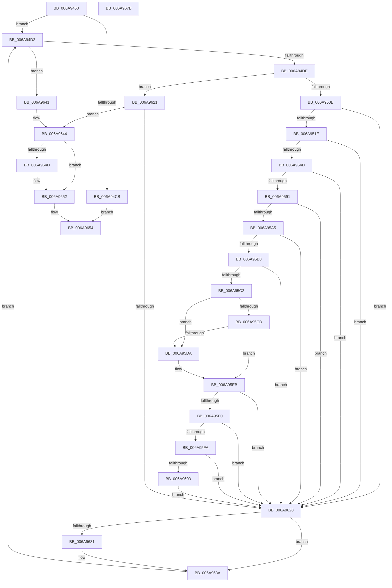

# RtlpMuiRegLoadInstalledFromKey

- RVA: `0x006A9450`–`0x006A967C` (길이 `556` bytes)
- VA: `0x00000001406A9450`
- 실행 섹션: `.text`
- PDB 이름 있음: `예`; PDB Function 태그: `아니요`
- unwind 정보 RVA: `0x000DB45C`
- 디코드: `150`개 명령, `556/556` bytes 표시
- 미해석 바이트: `0` (있으면 어셈블리에 `.byte`로 보존)

> 이 문서는 커널 이미지의 기계어와 PDB 기호를 분석해 생성했습니다. 4번과 5번은 함수 원형과 자료형을 바이너리 사용 방식에서 추정한 C 해석이며 원본 소스 복구 결과는 아닙니다.

## 1. Dependencies

- 직접 호출 지점: **12**; 고유 호출 대상: **8**
- 직접 호출자로 확인된 함수: **1**
- RIP 상대 이미지 참조: **3**

### Outgoing calls
- `0x006A94B1` → [RtlInitUnicodeString](../42/RtlInitUnicodeString_function_0042A780.md) (function, `0x0042A780`)
- `0x006A94C0` → [LdrpOpenKey](../../page/79/LdrpOpenKey_function_00791984.md) (function, `0x00791984`)
- `0x006A94FC` → [ZwEnumerateKey](ZwEnumerateKey_function_006AD710.md) (function, `0x006AD710`)
- `0x006A952F` → [RtlInitUnicodeString](../42/RtlInitUnicodeString_function_0042A780.md) (function, `0x0042A780`)
- `0x006A9540` → [LdrpOpenKey](../../page/79/LdrpOpenKey_function_00791984.md) (function, `0x00791984`)
- `0x006A9558` → [RtlInitUnicodeString](../42/RtlInitUnicodeString_function_0042A780.md) (function, `0x0042A780`)
- `0x006A9584` → [LdrpQueryValueKey](../../page/79/LdrpQueryValueKey_function_007919D0.md) (function, `0x007919D0`)
- `0x006A9598` → [ValidateRegistrLangType](../../page/83/ValidateRegistrLangType_function_0083F258.md) (function, `0x0083F258`)
- `0x006A961A` → [RtlpMuiRegAddLanguageByName](../../page/83/RtlpMuiRegAddLanguageByName_function_0083D748.md) (function, `0x0083D748`)
- `0x006A9631` → [NtClose](../../page/86/NtClose_function_00868870.md) (function, `0x00868870`)
- `0x006A964D` → [NtClose](../../page/86/NtClose_function_00868870.md) (function, `0x00868870`)
- `0x006A965E` → [_security_check_cookie](_security_check_cookie_function_006AC640.md) (function, `0x006AC640`)

### Direct callers
- [RtlpMuiRegLoadInstalled](../../page/83/RtlpMuiRegLoadInstalled_function_0083FB1C.md) at `0x0083FC05`

### Static image references
- `0x006A946E` → RVA `0x00E0A740` (`.data`; read)
- `0x006A9482` → RVA `0x00B0E3B0` (` ?? ::NNGAKEGL::`string'`; read)
- `0x006A954D` → RVA `0x006D1560` (` ?? ::FNODOBFM::`string'`; read)

## 2. Other-region calls and transfers

- 다른 실행 섹션으로 향하는 call: **7**
  - `0x006A94C0` → [LdrpOpenKey](../../page/79/LdrpOpenKey_function_00791984.md) (`.text` → `PAGE`)
  - `0x006A9540` → [LdrpOpenKey](../../page/79/LdrpOpenKey_function_00791984.md) (`.text` → `PAGE`)
  - `0x006A9584` → [LdrpQueryValueKey](../../page/79/LdrpQueryValueKey_function_007919D0.md) (`.text` → `PAGE`)
  - `0x006A9598` → [ValidateRegistrLangType](../../page/83/ValidateRegistrLangType_function_0083F258.md) (`.text` → `PAGE`)
  - `0x006A961A` → [RtlpMuiRegAddLanguageByName](../../page/83/RtlpMuiRegAddLanguageByName_function_0083D748.md) (`.text` → `PAGE`)
  - `0x006A9631` → [NtClose](../../page/86/NtClose_function_00868870.md) (`.text` → `PAGE`)
  - `0x006A964D` → [NtClose](../../page/86/NtClose_function_00868870.md) (`.text` → `PAGE`)
- 별도 외부 분기/꼬리 이동을 확인하지 못했습니다.

## 3. Assembly (complete function range)

```asm
006A9450  48 89 5C 24 10                  mov qword ptr [rsp + 0x10], rbx
006A9455  48 89 74 24 18                  mov qword ptr [rsp + 0x18], rsi
006A945A  55                              push rbp
006A945B  57                              push rdi
006A945C  41 56                           push r14
006A945E  48 81 EC A0 02 00 00            sub rsp, 0x2a0
006A9465  48 8D 6C 24 50                  lea rbp, [rsp + 0x50]
006A946A  48 83 E5 E0                     and rbp, 0xffffffffffffffe0
006A946E  48 8B 05 CB 12 76 00            mov rax, qword ptr [rip + 0x7612cb]
006A9475  48 33 C4                        xor rax, rsp
006A9478  48 89 85 40 02 00 00            mov qword ptr [rbp + 0x240], rax
006A947F  45 33 F6                        xor r14d, r14d
006A9482  48 8D 15 27 4F 46 00            lea rdx, [rip + 0x464f27]
006A9489  48 8B F1                        mov rsi, rcx
006A948C  44 89 75 20                     mov dword ptr [rbp + 0x20], r14d
006A9490  0F 57 C0                        xorps xmm0, xmm0
006A9493  4C 89 75 10                     mov qword ptr [rbp + 0x10], r14
006A9497  83 C8 FF                        or eax, 0xffffffff
006A949A  44 89 75 00                     mov dword ptr [rbp], r14d
006A949E  48 8D 4D 28                     lea rcx, [rbp + 0x28]
006A94A2  66 89 45 04                     mov word ptr [rbp + 4], ax
006A94A6  41 8B FE                        mov edi, r14d
006A94A9  4C 89 75 18                     mov qword ptr [rbp + 0x18], r14
006A94AD  0F 11 45 28                     movups xmmword ptr [rbp + 0x28], xmm0
006A94B1  E8 CA 12 D8 FF                  call 0x14042a780
006A94B6  4C 8D 4D 18                     lea r9, [rbp + 0x18]
006A94BA  33 D2                           xor edx, edx
006A94BC  48 8D 4D 28                     lea rcx, [rbp + 0x28]
006A94C0  E8 BF 84 0E 00                  call 0x140791984
006A94C5  8B D8                           mov ebx, eax
006A94C7  85 C0                           test eax, eax
006A94C9  79 07                           jns 0x1406a94d2
006A94CB  33 C0                           xor eax, eax
006A94CD  E9 82 01 00 00                  jmp 0x1406a9654
006A94D2  81 FB 1A 00 00 80               cmp ebx, 0x8000001a
006A94D8  0F 84 63 01 00 00               je 0x1406a9641
006A94DE  48 8B 4D 18                     mov rcx, qword ptr [rbp + 0x18]
006A94E2  48 8D 45 20                     lea rax, [rbp + 0x20]
006A94E6  48 89 44 24 28                  mov qword ptr [rsp + 0x28], rax
006A94EB  4C 8D 4D 40                     lea r9, [rbp + 0x40]
006A94EF  45 33 C0                        xor r8d, r8d
006A94F2  C7 44 24 20 00 02 00 00         mov dword ptr [rsp + 0x20], 0x200
006A94FA  8B D7                           mov edx, edi
006A94FC  E8 0F 42 00 00                  call 0x1406ad710
006A9501  8B D8                           mov ebx, eax
006A9503  85 C0                           test eax, eax
006A9505  0F 88 16 01 00 00               js 0x1406a9621
006A950B  8B 4D 4C                        mov ecx, dword ptr [rbp + 0x4c]
006A950E  48 8D 41 18                     lea rax, [rcx + 0x18]
006A9512  48 3D 00 02 00 00               cmp rax, 0x200
006A9518  0F 87 0A 01 00 00               ja 0x1406a9628
006A951E  48 D1 E9                        shr rcx, 1
006A9521  48 8D 55 50                     lea rdx, [rbp + 0x50]
006A9525  66 44 89 74 4D 50               mov word ptr [rbp + rcx*2 + 0x50], r14w
006A952B  48 8D 4D 28                     lea rcx, [rbp + 0x28]
006A952F  E8 4C 12 D8 FF                  call 0x14042a780
006A9534  48 8B 55 18                     mov rdx, qword ptr [rbp + 0x18]
006A9538  4C 8D 4D 10                     lea r9, [rbp + 0x10]
006A953C  48 8D 4D 28                     lea rcx, [rbp + 0x28]
006A9540  E8 3F 84 0E 00                  call 0x140791984
006A9545  85 C0                           test eax, eax
006A9547  0F 88 DB 00 00 00               js 0x1406a9628
006A954D  48 8D 15 0C 80 02 00            lea rdx, [rip + 0x2800c]
006A9554  48 8D 4D 28                     lea rcx, [rbp + 0x28]
006A9558  E8 23 12 D8 FF                  call 0x14042a780
006A955D  48 8B 4D 10                     mov rcx, qword ptr [rbp + 0x10]
006A9561  48 8D 45 24                     lea rax, [rbp + 0x24]
006A9565  4C 8D 4D 00                     lea r9, [rbp]
006A9569  48 89 44 24 20                  mov qword ptr [rsp + 0x20], rax
006A956E  4C 8D 45 08                     lea r8, [rbp + 8]
006A9572  C7 45 08 04 00 00 00            mov dword ptr [rbp + 8], 4
006A9579  48 8D 55 28                     lea rdx, [rbp + 0x28]
006A957D  C7 45 24 04 00 00 00            mov dword ptr [rbp + 0x24], 4
006A9584  E8 47 84 0E 00                  call 0x1407919d0
006A9589  85 C0                           test eax, eax
006A958B  0F 88 97 00 00 00               js 0x1406a9628
006A9591  44 8B 5D 00                     mov r11d, dword ptr [rbp]
006A9595  41 8B CB                        mov ecx, r11d
006A9598  E8 BB 5C 19 00                  call 0x14083f258
006A959D  85 C0                           test eax, eax
006A959F  0F 88 83 00 00 00               js 0x1406a9628
006A95A5  41 81 E3 9F 41 00 00            and r11d, 0x419f
006A95AC  41 8B CB                        mov ecx, r11d
006A95AF  44 89 5D 00                     mov dword ptr [rbp], r11d
006A95B3  83 E1 07                        and ecx, 7
006A95B6  74 70                           je 0x1406a9628
006A95B8  8B C1                           mov eax, ecx
006A95BA  F7 D8                           neg eax
006A95BC  23 C1                           and eax, ecx
006A95BE  3B C1                           cmp eax, ecx
006A95C0  75 66                           jne 0x1406a9628
006A95C2  41 8B D3                        mov edx, r11d
006A95C5  81 E2 80 01 00 00               and edx, 0x180
006A95CB  74 0D                           je 0x1406a95da
006A95CD  8B C2                           mov eax, edx
006A95CF  41 8B CB                        mov ecx, r11d
006A95D2  F7 D8                           neg eax
006A95D4  23 C2                           and eax, edx
006A95D6  3B C2                           cmp eax, edx
006A95D8  74 11                           je 0x1406a95eb
006A95DA  41 0F BA F3 08                  btr r11d, 8
006A95DF  41 0F BA EB 07                  bts r11d, 7
006A95E4  44 89 5D 00                     mov dword ptr [rbp], r11d
006A95E8  41 8B CB                        mov ecx, r11d
006A95EB  83 E1 18                        and ecx, 0x18
006A95EE  74 38                           je 0x1406a9628
006A95F0  8B C1                           mov eax, ecx
006A95F2  F7 D8                           neg eax
006A95F4  23 C1                           and eax, ecx
006A95F6  3B C1                           cmp eax, ecx
006A95F8  75 2E                           jne 0x1406a9628
006A95FA  41 8B C3                        mov eax, r11d
006A95FD  24 0C                           and al, 0xc
006A95FF  3C 08                           cmp al, 8
006A9601  74 25                           je 0x1406a9628
006A9603  48 8B 55 10                     mov rdx, qword ptr [rbp + 0x10]
006A9607  48 8D 45 04                     lea rax, [rbp + 4]
006A960B  45 8B CB                        mov r9d, r11d
006A960E  48 89 44 24 28                  mov qword ptr [rsp + 0x28], rax
006A9613  4C 8D 45 50                     lea r8, [rbp + 0x50]
006A9617  48 8B CE                        mov rcx, rsi
006A961A  E8 29 41 19 00                  call 0x14083d748
006A961F  EB 07                           jmp 0x1406a9628
006A9621  3D 1A 00 00 80                  cmp eax, 0x8000001a
006A9626  75 1C                           jne 0x1406a9644
006A9628  48 8B 4D 10                     mov rcx, qword ptr [rbp + 0x10]
006A962C  48 85 C9                        test rcx, rcx
006A962F  74 09                           je 0x1406a963a
006A9631  E8 3A F2 1B 00                  call 0x140868870
006A9636  4C 89 75 10                     mov qword ptr [rbp + 0x10], r14
006A963A  FF C7                           inc edi
006A963C  E9 91 FE FF FF                  jmp 0x1406a94d2
006A9641  41 8B DE                        mov ebx, r14d
006A9644  48 8B 4D 18                     mov rcx, qword ptr [rbp + 0x18]
006A9648  48 85 C9                        test rcx, rcx
006A964B  74 05                           je 0x1406a9652
006A964D  E8 1E F2 1B 00                  call 0x140868870
006A9652  8B C3                           mov eax, ebx
006A9654  48 8B 8D 40 02 00 00            mov rcx, qword ptr [rbp + 0x240]
006A965B  48 33 CC                        xor rcx, rsp
006A965E  E8 DD 2F 00 00                  call 0x1406ac640
006A9663  4C 8D 9C 24 A0 02 00 00         lea r11, [rsp + 0x2a0]
006A966B  49 8B 5B 28                     mov rbx, qword ptr [r11 + 0x28]
006A966F  49 8B 73 30                     mov rsi, qword ptr [r11 + 0x30]
006A9673  49 8B E3                        mov rsp, r11
006A9676  41 5E                           pop r14
006A9678  5F                              pop rdi
006A9679  5D                              pop rbp
006A967A  C3                              ret
006A967B  CC                              int3
```

## 4. C-style interpretation (structured pseudocode)

```c
__int64 __fastcall RtlpMuiRegLoadInstalledFromKey(__int64 a1, __int64 a2, int a3)
{
    __int64 result;
    __int64 v_r11;
    __int64 v_r14;
    __int64 v_rbp;
    __int64 v_rdi;
    __int64 v_rsp;
    unsigned __int64 v_stack_m18;
    unsigned __int64 v_stack_m218;
    unsigned int v_stack_m21C;
    unsigned __int64 v_stack_m228;
    unsigned __int64 v_stack_m240;
    unsigned __int64 v_stack_m244;
    unsigned int v_stack_m248;
    unsigned __int64 v_stack_m250;
    unsigned __int64 v_stack_m258;
    unsigned __int64 v_stack_m260;
    unsigned __int16 v_stack_m264;
    unsigned __int64 v_stack_m268;
    unsigned __int64 v_stack_m28;
    unsigned __int64 v_stack_m290;
    unsigned int v_stack_m298;
    unsigned __int64 v_stack_p10;
    unsigned __int64 v_stack_p18;

    v_stack_p10 = v_rbx;
    v_stack_p18 = v_rsi;
    v_rsp = (v_rsp) - (672);
    v_rbp = (v_stack_m268) & (-32);
    result = (*(unsigned __int64 *)(v_rip + 7738059)) ^ (v_rsp);
    v_stack_m28 = result;
    v_r14 = 0;
    v_stack_m248 = 0;
    v_stack_m258 = 0;
    result = (unsigned int)((result) | (0xFFFFFFFFULL));
    v_stack_m268 = 0;
    v_stack_m264 = (unsigned __int16)(result);
    v_stack_m250 = 0;
    v_stack_m240 = v_xmm0;
    result = RtlInitUnicodeString(v_stack_m240, v_rip + 4607783, a3, a4);
    a2 = 0;
    result = LdrpOpenKey(v_stack_m240, a2, a3, v_stack_m250);
    if (!sign_flag) goto loc_006A94D2;
    result = 0;
    goto loc_006A9654;
loc_006A94D2:
    if (((unsigned int)((unsigned int)((unsigned int)(result)))) == 0x8000001AULL) goto loc_006A9641;
    v_stack_m290 = v_stack_m248;
    a3 = 0;
    v_stack_m298 = 512;
    result = ZwEnumerateKey(v_stack_m250, 0, a3, v_stack_m228);
    if (sign_flag) goto loc_006A9621;
    if (((unsigned int)(v_stack_m21C) + 24) > 512) goto loc_006A9628;
    a1 = ((unsigned int)(v_stack_m21C)) >> (1);
    *(unsigned __int16 *)(v_rbp + a1 * 2 + 80) = 0;
    result = RtlInitUnicodeString(v_stack_m240, v_stack_m218, a3, v_stack_m228);
    result = LdrpOpenKey(v_stack_m240, v_stack_m250, a3, v_stack_m258);
    if (sign_flag) goto loc_006A9628;
    result = RtlInitUnicodeString(v_stack_m240, v_rip + 163852, a3, v_stack_m258);
    v_stack_m298 = v_stack_m244;
    v_stack_m260 = 4;
    v_stack_m244 = 4;
    result = LdrpQueryValueKey(v_stack_m258, v_stack_m240, v_stack_m260, v_stack_m268);
    if (sign_flag) goto loc_006A9628;
    result = ValidateRegistrLangType((unsigned int)((unsigned int)((unsigned int)(v_stack_m268))), v_stack_m240, v_stack_m260, v_stack_m268);
    if (sign_flag) goto loc_006A9628;
    v_r11 = (unsigned int)(((unsigned int)(v_stack_m268)) & (0x419FULL));
    v_stack_m268 = (unsigned int)(v_r11);
    a1 = (unsigned int)(((unsigned int)((unsigned int)(v_r11))) & (7));
    if (condition_is_equal) goto loc_006A9628;
    result = (unsigned int)(-((unsigned int)((unsigned int)(a1))));
    result = (unsigned int)((result) & ((unsigned int)(a1)));
    if (((unsigned int)(result)) != ((unsigned int)(a1))) goto loc_006A9628;
    a2 = (unsigned int)(((unsigned int)((unsigned int)(v_r11))) & (384));
    if (condition_is_equal) goto loc_006A95DA;
    result = (unsigned int)(-((unsigned int)((unsigned int)(a2))));
    result = (unsigned int)((result) & ((unsigned int)(a2)));
    if (((unsigned int)(result)) != ((unsigned int)(a2))) {
        v_stack_m268 = (unsigned int)(v_r11);
        a1 = (unsigned int)(v_r11);
    }
    a1 = (unsigned int)((a1) & (24));
    if (condition_is_equal) goto loc_006A9628;
    result = (unsigned int)(-((unsigned int)((unsigned int)(a1))));
    result = (unsigned int)((result) & ((unsigned int)(a1)));
    if (((unsigned int)(result)) != ((unsigned int)(a1))) goto loc_006A9628;
    result = (unsigned __int8)(((unsigned int)((unsigned int)(v_r11))) & (12));
    if (((unsigned __int8)(result)) == 8) goto loc_006A9628;
    v_stack_m290 = v_stack_m264;
    result = RtlpMuiRegAddLanguageByName(a1, v_stack_m258, v_stack_m218, (unsigned int)((unsigned int)(v_r11)));
    goto loc_006A9628;
loc_006A9621:
    if (((unsigned int)(result)) != 0x8000001AULL) goto loc_006A9644;
loc_006A9628:
    if (v_stack_m258 != 0) {
        result = NtClose(v_stack_m258, v_stack_m258, v_stack_m218, (unsigned int)((unsigned int)(v_r11)));
        v_stack_m258 = 0;
    }
    v_rdi = (unsigned int)((0) + 1);
    goto loc_006A94D2;
loc_006A9641:
loc_006A9644:
    if (v_stack_m250 != 0) {
        result = NtClose(v_stack_m250, v_stack_m258, v_stack_m218, (unsigned int)((unsigned int)(v_r11)));
    }
loc_006A9654:
    a1 = (v_stack_m28) ^ (v_rsp);
    result = _security_check_cookie(a1, v_stack_m258, v_stack_m218, (unsigned int)((unsigned int)(v_r11)));
    return result;
}
```

## 5. (Beta) C Style

```c
int64_t RtlpMuiRegLoadInstalledFromKey(int64_t Arg1, int64_t Arg2, int32_t Arg3)
{
    int64_t result;
    int64_t local_r11;
    int64_t local_r14;
    int64_t local_rbp;
    int64_t local_rdi;
    int64_t local_rsp;
    uint64_t v_stack_m18;
    uint64_t v_stack_m218;
    uint32_t v_stack_m21C;
    uint64_t v_stack_m228;
    uint64_t v_stack_m240;
    uint64_t v_stack_m244;
    uint32_t v_stack_m248;
    uint64_t v_stack_m250;
    uint64_t v_stack_m258;
    uint64_t v_stack_m260;
    uint16_t v_stack_m264;
    uint64_t v_stack_m268;
    uint64_t v_stack_m28;
    uint64_t v_stack_m290;
    uint32_t v_stack_m298;
    uint64_t v_stack_p10;
    uint64_t v_stack_p18;

    v_stack_p10 = local_rbx;
    v_stack_p18 = local_rsi;
    local_rsp = (local_rsp) - (672);
    local_rbp = (v_stack_m268) & (-32);
    result = (*(uint64_t *)(v_rip + 0x7612CB)) ^ (local_rsp);
    v_stack_m28 = result;
    local_r14 = 0;
    v_stack_m248 = 0;
    v_stack_m258 = 0;
    result = (uint32_t)((result) | (0xFFFFFFFFULL));
    v_stack_m268 = 0;
    v_stack_m264 = (uint16_t)(result);
    v_stack_m250 = 0;
    v_stack_m240 = v_xmm0;
    result = RtlInitUnicodeString(v_stack_m240, v_rip + 4607783, Arg3, a4);
    Arg2 = 0;
    result = LdrpOpenKey(v_stack_m240, Arg2, Arg3, v_stack_m250);
    if (!sign_flag) goto loc_006A94D2;
    result = 0;
    goto loc_006A9654;
loc_006A94D2:
    if (((uint32_t)((uint32_t)((uint32_t)(result)))) == 0x8000001AULL) goto loc_006A9641;
    v_stack_m290 = v_stack_m248;
    Arg3 = 0;
    v_stack_m298 = 512;
    result = ZwEnumerateKey(v_stack_m250, 0, Arg3, v_stack_m228);
    if (sign_flag) goto loc_006A9621;
    if (((uint32_t)(v_stack_m21C) + 24) > 512) goto loc_006A9628;
    Arg1 = ((uint32_t)(v_stack_m21C)) >> (1);
    *(uint16_t *)(local_rbp + Arg1 * 2 + 0x50) = 0;
    result = RtlInitUnicodeString(v_stack_m240, v_stack_m218, Arg3, v_stack_m228);
    result = LdrpOpenKey(v_stack_m240, v_stack_m250, Arg3, v_stack_m258);
    if (sign_flag) goto loc_006A9628;
    result = RtlInitUnicodeString(v_stack_m240, v_rip + 163852, Arg3, v_stack_m258);
    v_stack_m298 = v_stack_m244;
    v_stack_m260 = 4;
    v_stack_m244 = 4;
    result = LdrpQueryValueKey(v_stack_m258, v_stack_m240, v_stack_m260, v_stack_m268);
    if (sign_flag) goto loc_006A9628;
    result = ValidateRegistrLangType((uint32_t)((uint32_t)((uint32_t)(v_stack_m268))), v_stack_m240, v_stack_m260, v_stack_m268);
    if (sign_flag) goto loc_006A9628;
    local_r11 = (uint32_t)(((uint32_t)(v_stack_m268)) & (0x419FULL));
    v_stack_m268 = (uint32_t)(local_r11);
    Arg1 = (uint32_t)(((uint32_t)((uint32_t)(local_r11))) & (7));
    if (condition_is_equal) goto loc_006A9628;
    result = (uint32_t)(-((uint32_t)((uint32_t)(Arg1))));
    result = (uint32_t)((result) & ((uint32_t)(Arg1)));
    if (((uint32_t)(result)) != ((uint32_t)(Arg1))) goto loc_006A9628;
    Arg2 = (uint32_t)(((uint32_t)((uint32_t)(local_r11))) & (384));
    if (condition_is_equal) goto loc_006A95DA;
    result = (uint32_t)(-((uint32_t)((uint32_t)(Arg2))));
    result = (uint32_t)((result) & ((uint32_t)(Arg2)));
    if (((uint32_t)(result)) != ((uint32_t)(Arg2))) {
        v_stack_m268 = (uint32_t)(local_r11);
        Arg1 = (uint32_t)(local_r11);
    }
    Arg1 = (uint32_t)((Arg1) & (24));
    if (condition_is_equal) goto loc_006A9628;
    result = (uint32_t)(-((uint32_t)((uint32_t)(Arg1))));
    result = (uint32_t)((result) & ((uint32_t)(Arg1)));
    if (((uint32_t)(result)) != ((uint32_t)(Arg1))) goto loc_006A9628;
    result = (uint8_t)(((uint32_t)((uint32_t)(local_r11))) & (12));
    if (((uint8_t)(result)) == 8) goto loc_006A9628;
    v_stack_m290 = v_stack_m264;
    result = RtlpMuiRegAddLanguageByName(Arg1, v_stack_m258, v_stack_m218, (uint32_t)((uint32_t)(local_r11)));
    goto loc_006A9628;
loc_006A9621:
    if (((uint32_t)(result)) != 0x8000001AULL) goto loc_006A9644;
loc_006A9628:
    if (v_stack_m258 != 0) {
        result = NtClose(v_stack_m258, v_stack_m258, v_stack_m218, (uint32_t)((uint32_t)(local_r11)));
        v_stack_m258 = 0;
    }
    local_rdi = (uint32_t)((0) + 1);
    goto loc_006A94D2;
loc_006A9641:
loc_006A9644:
    if (v_stack_m250 != 0) {
        result = NtClose(v_stack_m250, v_stack_m258, v_stack_m218, (uint32_t)((uint32_t)(local_r11)));
    }
loc_006A9654:
    Arg1 = (v_stack_m28) ^ (local_rsp);
    result = _security_check_cookie(Arg1, v_stack_m258, v_stack_m218, (uint32_t)((uint32_t)(local_r11)));
    return result;
}
```

## 6. Execution-region graph

[열기: 2D/3D 그래프와 함수 탐색 컨트롤 패널](../../../control-panel.html?section=text&rva=0x006A9450&view=graph)

- 2D 그래프는 위에서 아래로 흐르고, 3D 그래프는 빈 공간을 드래그해 회전합니다. Shift+드래그는 이동, 휠은 확대·축소, 함수 노드 선택은 대상 보고서 이동입니다.

### Static fallback


