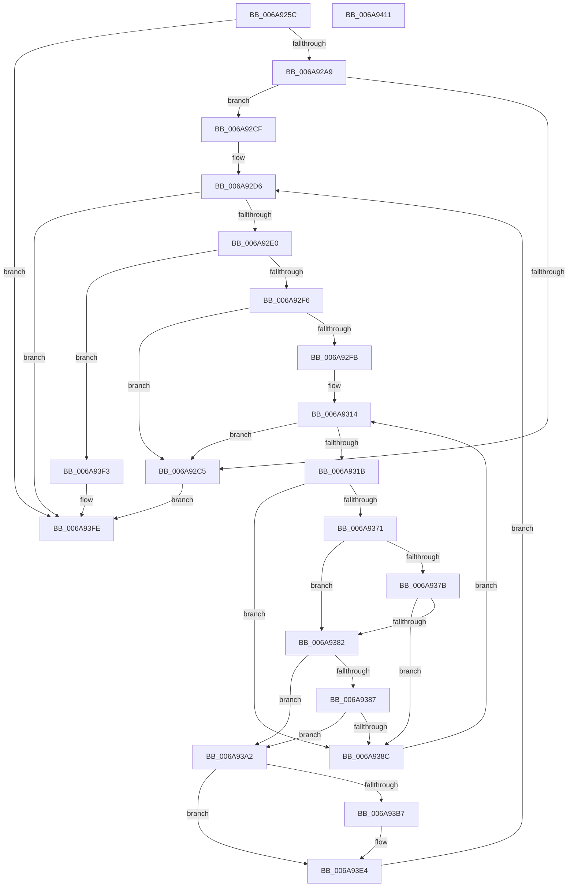

# RtlpMuiRegValidateConfigNode

- RVA: `0x006A925C`–`0x006A9412` (길이 `438` bytes)
- VA: `0x00000001406A925C`
- 실행 섹션: `.text`
- PDB 이름 있음: `예`; PDB Function 태그: `아니요`
- unwind 정보 RVA: `0x000C4D80`
- 디코드: `120`개 명령, `438/438` bytes 표시
- 미해석 바이트: `0` (있으면 어셈블리에 `.byte`로 보존)

> 이 문서는 커널 이미지의 기계어와 PDB 기호를 분석해 생성했습니다. 4번과 5번은 함수 원형과 자료형을 바이너리 사용 방식에서 추정한 C 해석이며 원본 소스 복구 결과는 아닙니다.

## 1. Dependencies

- 직접 호출 지점: **2**; 고유 호출 대상: **2**
- 직접 호출자로 확인된 함수: **1**
- RIP 상대 이미지 참조: **0**

### Outgoing calls
- `0x006A9297` → [RtlpMuiRegGetInstalledLanguageIndex](../../page/83/RtlpMuiRegGetInstalledLanguageIndex_function_0083E1CC.md) (function, `0x0083E1CC`)
- `0x006A9365` → [RtlpMuiRegConfigMatchesInstalled](../../page/83/RtlpMuiRegConfigMatchesInstalled_function_0083DA08.md) (function, `0x0083DA08`)

### Direct callers
- [RtlpPopulateLanguageConfigList](../../page/83/RtlpPopulateLanguageConfigList_function_0083EF20.md) at `0x0083F15B`

### Static image references
- 디코드된 RIP-relative 메모리 참조가 없습니다.

## 2. Other-region calls and transfers

- 다른 실행 섹션으로 향하는 call: **2**
  - `0x006A9297` → [RtlpMuiRegGetInstalledLanguageIndex](../../page/83/RtlpMuiRegGetInstalledLanguageIndex_function_0083E1CC.md) (`.text` → `PAGE`)
  - `0x006A9365` → [RtlpMuiRegConfigMatchesInstalled](../../page/83/RtlpMuiRegConfigMatchesInstalled_function_0083DA08.md) (`.text` → `PAGE`)
- 별도 외부 분기/꼬리 이동을 확인하지 못했습니다.

## 3. Assembly (complete function range)

```asm
006A925C  4C 8B DC                        mov r11, rsp
006A925F  49 89 4B 08                     mov qword ptr [r11 + 8], rcx
006A9263  53                              push rbx
006A9264  55                              push rbp
006A9265  56                              push rsi
006A9266  57                              push rdi
006A9267  41 54                           push r12
006A9269  41 55                           push r13
006A926B  41 56                           push r14
006A926D  41 57                           push r15
006A926F  48 83 EC 58                     sub rsp, 0x58
006A9273  4C 8B F2                        mov r14, rdx
006A9276  4D 8D 4B 10                     lea r9, [r11 + 0x10]
006A927A  0F B7 52 02                     movzx edx, word ptr [rdx + 2]
006A927E  33 C0                           xor eax, eax
006A9280  66 41 89 43 10                  mov word ptr [r11 + 0x10], ax
006A9285  48 8B F1                        mov rsi, rcx
006A9288  83 C8 FF                        or eax, 0xffffffff
006A928B  C1 EA 0E                        shr edx, 0xe
006A928E  45 0F B7 06                     movzx r8d, word ptr [r14]
006A9292  66 41 89 43 18                  mov word ptr [r11 + 0x18], ax
006A9297  E8 30 4F 19 00                  call 0x14083e1cc
006A929C  45 33 C0                        xor r8d, r8d
006A929F  8B D8                           mov ebx, eax
006A92A1  85 C0                           test eax, eax
006A92A3  0F 88 55 01 00 00               js 0x1406a93fe
006A92A9  48 0F BF 8C 24 A8 00 00 00      movsx rcx, word ptr [rsp + 0xa8]
006A92B2  48 6B F9 1C                     imul rdi, rcx, 0x1c
006A92B6  48 8B 4E 18                     mov rcx, qword ptr [rsi + 0x18]
006A92BA  48 03 79 10                     add rdi, qword ptr [rcx + 0x10]
006A92BE  66 0F BA 27 0C                  bt word ptr [rdi], 0xc
006A92C3  73 0A                           jae 0x1406a92cf
006A92C5  BB 34 00 00 C0                  mov ebx, 0xc0000034
006A92CA  E9 2F 01 00 00                  jmp 0x1406a93fe
006A92CF  41 0F B7 F0                     movzx esi, r8w
006A92D3  41 8B E8                        mov ebp, r8d
006A92D6  66 83 FD 06                     cmp bp, 6
006A92DA  0F 8D 1E 01 00 00               jge 0x1406a93fe
006A92E0  45 0F B7 7E 02                  movzx r15d, word ptr [r14 + 2]
006A92E5  0F B7 CD                        movzx ecx, bp
006A92E8  66 41 D3 EF                     shr r15w, cl
006A92EC  41 80 E7 03                     and r15b, 3
006A92F0  0F 84 FD 00 00 00               je 0x1406a93f3
006A92F6  48 85 FF                        test rdi, rdi
006A92F9  74 CA                           je 0x1406a92c5
006A92FB  48 0F BF C6                     movsx rax, si
006A92FF  45 0F B7 E8                     movzx r13d, r8w
006A9303  45 8B E0                        mov r12d, r8d
006A9306  41 0F B7 54 46 06               movzx edx, word ptr [r14 + rax*2 + 6]
006A930C  66 89 94 24 B8 00 00 00         mov word ptr [rsp + 0xb8], dx
006A9314  66 41 83 FC 08                  cmp r12w, 8
006A9319  7D AA                           jge 0x1406a92c5
006A931B  44 0F B7 4F 08                  movzx r9d, word ptr [rdi + 8]
006A9320  41 0F B7 CC                     movzx ecx, r12w
006A9324  66 41 D3 E9                     shr r9w, cl
006A9328  49 0F BF C5                     movsx rax, r13w
006A932C  41 80 E1 03                     and r9b, 3
006A9330  4C 89 44 24 40                  mov qword ptr [rsp + 0x40], r8
006A9335  44 0F B7 C2                     movzx r8d, dx
006A9339  41 8A D7                        mov dl, r15b
006A933C  0F B7 4C 47 0C                  movzx ecx, word ptr [rdi + rax*2 + 0xc]
006A9341  48 8D 84 24 B0 00 00 00         lea rax, [rsp + 0xb0]
006A9349  48 89 44 24 30                  mov qword ptr [rsp + 0x30], rax
006A934E  48 8D 44 24 40                  lea rax, [rsp + 0x40]
006A9353  48 89 44 24 28                  mov qword ptr [rsp + 0x28], rax
006A9358  66 89 4C 24 20                  mov word ptr [rsp + 0x20], cx
006A935D  48 8B 8C 24 A0 00 00 00         mov rcx, qword ptr [rsp + 0xa0]
006A9365  E8 9E 46 19 00                  call 0x14083da08
006A936A  45 33 C0                        xor r8d, r8d
006A936D  84 C0                           test al, al
006A936F  74 1B                           je 0x1406a938c
006A9371  48 8B 4C 24 40                  mov rcx, qword ptr [rsp + 0x40]
006A9376  48 85 C9                        test rcx, rcx
006A9379  74 07                           je 0x1406a9382
006A937B  66 0F BA 21 0C                  bt word ptr [rcx], 0xc
006A9380  72 0A                           jb 0x1406a938c
006A9382  F6 07 04                        test byte ptr [rdi], 4
006A9385  74 1B                           je 0x1406a93a2
006A9387  48 85 C9                        test rcx, rcx
006A938A  75 16                           jne 0x1406a93a2
006A938C  0F B7 94 24 B8 00 00 00         movzx edx, word ptr [rsp + 0xb8]
006A9394  66 41 FF C5                     inc r13w
006A9398  66 41 83 C4 02                  add r12w, 2
006A939D  E9 72 FF FF FF                  jmp 0x1406a9314
006A93A2  44 0F B7 84 24 B0 00 00 00      movzx r8d, word ptr [rsp + 0xb0]
006A93AB  83 C8 FF                        or eax, 0xffffffff
006A93AE  48 8B F9                        mov rdi, rcx
006A93B1  66 44 3B C0                     cmp r8w, ax
006A93B5  74 2D                           je 0x1406a93e4
006A93B7  8D 50 04                        lea edx, [rax + 4]
006A93BA  0F BF CE                        movsx ecx, si
006A93BD  03 C9                           add ecx, ecx
006A93BF  B8 02 00 00 00                  mov eax, 2
006A93C4  66 D3 E2                        shl dx, cl
006A93C7  66 F7 D2                        not dx
006A93CA  66 D3 E0                        shl ax, cl
006A93CD  66 41 23 56 02                  and dx, word ptr [r14 + 2]
006A93D2  66 0B D0                        or dx, ax
006A93D5  48 0F BF C6                     movsx rax, si
006A93D9  66 41 89 56 02                  mov word ptr [r14 + 2], dx
006A93DE  66 45 89 44 46 06               mov word ptr [r14 + rax*2 + 6], r8w
006A93E4  66 FF C6                        inc si
006A93E7  66 83 C5 02                     add bp, 2
006A93EB  45 33 C0                        xor r8d, r8d
006A93EE  E9 E3 FE FF FF                  jmp 0x1406a92d6
006A93F3  66 85 F6                        test si, si
006A93F6  B8 01 00 00 C0                  mov eax, 0xc0000001
006A93FB  0F 44 D8                        cmove ebx, eax
006A93FE  8B C3                           mov eax, ebx
006A9400  48 83 C4 58                     add rsp, 0x58
006A9404  41 5F                           pop r15
006A9406  41 5E                           pop r14
006A9408  41 5D                           pop r13
006A940A  41 5C                           pop r12
006A940C  5F                              pop rdi
006A940D  5E                              pop rsi
006A940E  5D                              pop rbp
006A940F  5B                              pop rbx
006A9410  C3                              ret
006A9411  CC                              int3
```

## 4. C-style interpretation (structured pseudocode)

```c
__int64 __fastcall RtlpMuiRegValidateConfigNode(__int64 a1, __int64 a2)
{
    __int64 result;
    __int64 v_r12;
    __int64 v_r13;
    __int64 v_r15;
    __int64 v_rbp;
    __int64 v_rbx;
    __int64 v_rdi;
    __int64 v_rsi;
    __int64 v_rsp;
    unsigned __int64 v_stack_m58;
    unsigned __int64 v_stack_m68;
    unsigned __int64 v_stack_m70;
    unsigned __int16 v_stack_m78;
    unsigned __int16 v_stack_p10;
    unsigned __int64 v_stack_p18;
    unsigned __int16 v_stack_p20;
    unsigned __int64 v_stack_p8;

    *(unsigned __int64 *)(v_rsp + 8) = a1;
    v_rsp = (v_rsp) - (88);
    result = 0;
    *(unsigned __int16 *)(v_rsp + 16) = 0;
    result = (unsigned int)((result) | (0xFFFFFFFFULL));
    a2 = (unsigned int)((*(unsigned __int16 *)(a2 + 2)) >> (14));
    *(unsigned __int16 *)(v_rsp + 24) = (unsigned __int16)(result);
    result = RtlpMuiRegGetInstalledLanguageIndex(a1, a2, *(unsigned __int16 *)(a2), v_rsp + 16);
    a3 = 0;
    if (sign_flag) goto loc_006A93FE;
    v_rdi = (v_rdi) * ((__int16)(v_stack_p10));
    v_rdi = (v_rdi) + (*(unsigned __int64 *)(*(unsigned __int64 *)(a1 + 24) + 16));
    if (condition_is_above_or_equal) goto loc_006A92CF;
loc_006A92C5:
    goto loc_006A93FE;
loc_006A92CF:
loc_006A92D6:
    if (0 >= 6) goto loc_006A93FE;
    v_r15 = (unsigned __int16)((*(unsigned __int16 *)(a2 + 2)) >> (0));
    v_r15 = (unsigned __int8)((v_r15) & (3));
    if (condition_is_equal) goto loc_006A93F3;
    if (v_rdi == 0) goto loc_006A92C5;
    v_stack_p20 = (unsigned __int16)(*(unsigned __int16 *)(a2 + (__int16)(0) * 2 + 6));
loc_006A9314:
    if (0 >= 8) goto loc_006A92C5;
    a4 = (unsigned __int16)((*(unsigned __int16 *)(v_rdi + 8)) >> (0));
    a4 = (unsigned __int8)((a4) & (3));
    v_stack_m58 = 0;
    v_stack_m68 = v_stack_p18;
    v_stack_m70 = v_stack_m58;
    v_stack_m78 = (unsigned __int16)(*(unsigned __int16 *)(v_rdi + (__int16)(0) * 2 + 12));
    result = RtlpMuiRegConfigMatchesInstalled(v_stack_p8, (unsigned __int8)(v_r15), (unsigned __int16)(*(unsigned __int16 *)(a2 + (__int16)(0) * 2 + 6)), a4);
    a3 = 0;
    if ((unsigned __int8)(result) == 0) goto loc_006A938C;
    if (v_stack_m58 == 0) goto loc_006A9382;
    if (condition_is_below) goto loc_006A938C;
loc_006A9382:
    if (((*(unsigned __int8 *)(v_rdi)) & (4)) == 0) goto loc_006A93A2;
    if (v_stack_m58 != 0) goto loc_006A93A2;
loc_006A938C:
    v_r13 = (unsigned __int16)((0) + 1);
    v_r12 = (unsigned __int16)((0) + (2));
    goto loc_006A9314;
loc_006A93A2:
    result = (unsigned int)((result) | (0xFFFFFFFFULL));
    if (((unsigned __int16)(v_stack_p18)) != ((unsigned __int16)(result))) {
        a2 = result + 4;
        a1 = (__int16)(0);
        a1 = (unsigned int)((a1) + ((unsigned int)(a1)));
        result = 2;
        a2 = (unsigned __int16)((a2) << ((unsigned __int8)(a1)));
        a2 = (unsigned __int16)(~(a2));
        result = (unsigned __int16)((result) << ((unsigned __int8)(a1)));
        a2 = (unsigned __int16)((a2) & (*(unsigned __int16 *)(a2 + 2)));
        a2 = (unsigned __int16)((a2) | ((unsigned __int16)(result)));
        result = (__int16)(0);
        *(unsigned __int16 *)(a2 + 2) = (unsigned __int16)(a2);
        *(unsigned __int16 *)(a2 + result * 2 + 6) = (unsigned __int16)(v_stack_p18);
    }
    v_rsi = (unsigned __int16)((0) + 1);
    v_rbp = (unsigned __int16)((0) + (2));
    a3 = 0;
    goto loc_006A92D6;
loc_006A93F3:
    v_rbx = (unsigned int)(0xC0000034ULL);
    if ((unsigned __int16)(v_rsi) == 0) { v_rbx = (unsigned int)((unsigned int)(0xC0000001ULL)); }
loc_006A93FE:
    v_rsp = (v_rsp) + (88);
    return (unsigned int)((unsigned int)(v_rbx));
}
```

## 5. (Beta) C Style

```c
int64_t RtlpMuiRegValidateConfigNode(void *Arg1, void *Arg2)
{
    uint8_t *arg1 = (uint8_t *)Arg1;
    uint8_t *arg2 = (uint8_t *)Arg2;

    int64_t result;
    int64_t local_r12;
    int64_t local_r13;
    int64_t local_r15;
    int64_t local_rbp;
    int64_t local_rbx;
    int64_t local_rdi;
    int64_t local_rsi;
    int64_t local_rsp;
    uint64_t v_stack_m58;
    uint64_t v_stack_m68;
    uint64_t v_stack_m70;
    uint16_t v_stack_m78;
    uint16_t v_stack_p10;
    uint64_t v_stack_p18;
    uint16_t v_stack_p20;
    uint64_t v_stack_p8;

    *(void **)(local_rsp + 0x8) = Arg1;
    local_rsp = (local_rsp) - (88);
    result = 0;
    *(uint16_t *)(local_rsp + 0x10) = 0;
    result = (uint32_t)((result) | (0xFFFFFFFFULL));
    Arg2 = (uint32_t)((*(uint16_t *)(arg2 + 0x2)) >> (14));
    *(uint16_t *)(local_rsp + 0x18) = (uint16_t)(result);
    result = RtlpMuiRegGetInstalledLanguageIndex(Arg1, Arg2, *(uint16_t *)(arg2), local_rsp + 16);
    a3 = 0;
    if (sign_flag) goto loc_006A93FE;
    local_rdi = (local_rdi) * ((int16_t)(v_stack_p10));
    local_rdi = (local_rdi) + (*(uint64_t *)(*(uint64_t *)(arg1 + 0x18) + 0x10));
    if (condition_is_above_or_equal) goto loc_006A92CF;
loc_006A92C5:
    goto loc_006A93FE;
loc_006A92CF:
loc_006A92D6:
    if (0 >= 6) goto loc_006A93FE;
    local_r15 = (uint16_t)((*(uint16_t *)(arg2 + 0x2)) >> (0));
    local_r15 = (uint8_t)((local_r15) & (3));
    if (condition_is_equal) goto loc_006A93F3;
    if (local_rdi == 0) goto loc_006A92C5;
    v_stack_p20 = (uint16_t)(*(uint16_t *)(arg2 + (int16_t)(0) * 2 + 0x6));
loc_006A9314:
    if (0 >= 8) goto loc_006A92C5;
    a4 = (uint16_t)((*(uint16_t *)(local_rdi + 0x8)) >> (0));
    a4 = (uint8_t)((a4) & (3));
    v_stack_m58 = 0;
    v_stack_m68 = v_stack_p18;
    v_stack_m70 = v_stack_m58;
    v_stack_m78 = (uint16_t)(*(uint16_t *)(local_rdi + (int16_t)(0) * 2 + 0xC));
    result = RtlpMuiRegConfigMatchesInstalled(v_stack_p8, (uint8_t)(local_r15), (uint16_t)(*(uint16_t *)(arg2 + (int16_t)(0) * 2 + 0x6)), a4);
    a3 = 0;
    if ((uint8_t)(result) == 0) goto loc_006A938C;
    if (v_stack_m58 == 0) goto loc_006A9382;
    if (condition_is_below) goto loc_006A938C;
loc_006A9382:
    if (((*(uint8_t *)(local_rdi)) & (4)) == 0) goto loc_006A93A2;
    if (v_stack_m58 != 0) goto loc_006A93A2;
loc_006A938C:
    local_r13 = (uint16_t)((0) + 1);
    local_r12 = (uint16_t)((0) + (2));
    goto loc_006A9314;
loc_006A93A2:
    result = (uint32_t)((result) | (0xFFFFFFFFULL));
    if (((uint16_t)(v_stack_p18)) != ((uint16_t)(result))) {
        Arg2 = result + 4;
        Arg1 = (int16_t)(0);
        Arg1 = (uint32_t)((Arg1) + ((uint32_t)(Arg1)));
        result = 2;
        Arg2 = (uint16_t)((Arg2) << ((uint8_t)(Arg1)));
        Arg2 = (uint16_t)(~(Arg2));
        result = (uint16_t)((result) << ((uint8_t)(Arg1)));
        Arg2 = (uint16_t)((Arg2) & (*(uint16_t *)(arg2 + 0x2)));
        Arg2 = (uint16_t)((Arg2) | ((uint16_t)(result)));
        result = (int16_t)(0);
        *(uint16_t *)(arg2 + 0x2) = (uint16_t)(Arg2);
        *(uint16_t *)(arg2 + result * 2 + 0x6) = (uint16_t)(v_stack_p18);
    }
    local_rsi = (uint16_t)((0) + 1);
    local_rbp = (uint16_t)((0) + (2));
    a3 = 0;
    goto loc_006A92D6;
loc_006A93F3:
    local_rbx = (uint32_t)(0xC0000034ULL);
    if ((uint16_t)(local_rsi) == 0) { local_rbx = (uint32_t)((uint32_t)(0xC0000001ULL)); }
loc_006A93FE:
    local_rsp = (local_rsp) + (88);
    return (uint32_t)((uint32_t)(local_rbx));
}
```

### 관측된 메모리 오프셋

구조체 형식이 확인되지 않은 접근은 인자 기준의 오프셋으로만 기록했습니다.

| 기준 인자 | 오프셋 표현 | 폭 (bit) | 접근 |
|---|---:|---:|---|
| `Arg1` | `+ 0x18` | `64` | `R` |
| `Arg2` | `+ 0x0` | `16` | `R` |
| `Arg2` | `+ 0x2` | `16` | `R` |
| `Arg2` | `+ 0x2` | `16` | `W` |
| `Arg2` | `+ 0x6 + rax*2` | `16` | `R` |
| `Arg2` | `+ 0x6 + rax*2` | `16` | `W` |

## 6. Execution-region graph

[열기: 2D/3D 그래프와 함수 탐색 컨트롤 패널](../../../control-panel.html?section=text&rva=0x006A925C&view=graph)

- 2D 그래프는 위에서 아래로 흐르고, 3D 그래프는 빈 공간을 드래그해 회전합니다. Shift+드래그는 이동, 휠은 확대·축소, 함수 노드 선택은 대상 보고서 이동입니다.

### Static fallback


