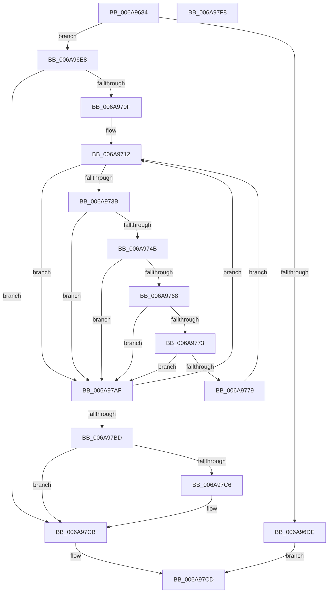

# RtlpRemovePendingDeleteLanguages

- RVA: `0x006A9684`–`0x006A97F9` (길이 `373` bytes)
- VA: `0x00000001406A9684`
- 실행 섹션: `.text`
- PDB 이름 있음: `예`; PDB Function 태그: `아니요`
- unwind 정보 RVA: `0x000DB488`
- 디코드: `99`개 명령, `373/373` bytes 표시
- 미해석 바이트: `0` (있으면 어셈블리에 `.byte`로 보존)

> 이 문서는 커널 이미지의 기계어와 PDB 기호를 분석해 생성했습니다. 4번과 5번은 함수 원형과 자료형을 바이너리 사용 방식에서 추정한 C 해석이며 원본 소스 복구 결과는 아닙니다.

## 1. Dependencies

- 직접 호출 지점: **6**; 고유 호출 대상: **6**
- 직접 호출자로 확인된 함수: **1**
- RIP 상대 이미지 참조: **2**

### Outgoing calls
- `0x006A96F3` → [RtlInitUnicodeString](../42/RtlInitUnicodeString_function_0042A780.md) (function, `0x0042A780`)
- `0x006A9702` → [LdrpOpenKey](../../page/79/LdrpOpenKey_function_00791984.md) (function, `0x00791984`)
- `0x006A9730` → [ZwEnumerateKey](ZwEnumerateKey_function_006AD710.md) (function, `0x006AD710`)
- `0x006A975F` → [RtlpMuiRegGetInstalledLanguageIndexByName](../../page/83/RtlpMuiRegGetInstalledLanguageIndexByName_function_0083E468.md) (function, `0x0083E468`)
- `0x006A97C6` → [NtClose](../../page/86/NtClose_function_00868870.md) (function, `0x00868870`)
- `0x006A97D7` → [_security_check_cookie](_security_check_cookie_function_006AC640.md) (function, `0x006AC640`)

### Direct callers
- [RtlpMuiRegValidateInstalled](../../page/84/RtlpMuiRegValidateInstalled_function_008404D4.md) at `0x00840705`

### Static image references
- `0x006A96A6` → RVA `0x00E0A740` (`.data`; read)
- `0x006A96E8` → RVA `0x006D14A0` (` ?? ::FNODOBFM::`string'`; read)

## 2. Other-region calls and transfers

- 다른 실행 섹션으로 향하는 call: **3**
  - `0x006A9702` → [LdrpOpenKey](../../page/79/LdrpOpenKey_function_00791984.md) (`.text` → `PAGE`)
  - `0x006A975F` → [RtlpMuiRegGetInstalledLanguageIndexByName](../../page/83/RtlpMuiRegGetInstalledLanguageIndexByName_function_0083E468.md) (`.text` → `PAGE`)
  - `0x006A97C6` → [NtClose](../../page/86/NtClose_function_00868870.md) (`.text` → `PAGE`)
- 별도 외부 분기/꼬리 이동을 확인하지 못했습니다.

## 3. Assembly (complete function range)

```asm
006A9684  48 89 5C 24 10                  mov qword ptr [rsp + 0x10], rbx
006A9689  48 89 74 24 18                  mov qword ptr [rsp + 0x18], rsi
006A968E  55                              push rbp
006A968F  57                              push rdi
006A9690  41 54                           push r12
006A9692  41 56                           push r14
006A9694  41 57                           push r15
006A9696  48 81 EC 80 02 00 00            sub rsp, 0x280
006A969D  48 8D 6C 24 50                  lea rbp, [rsp + 0x50]
006A96A2  48 83 E5 E0                     and rbp, 0xffffffffffffffe0
006A96A6  48 8B 05 93 10 76 00            mov rax, qword ptr [rip + 0x761093]
006A96AD  48 33 C4                        xor rax, rsp
006A96B0  48 89 85 20 02 00 00            mov qword ptr [rbp + 0x220], rax
006A96B7  45 33 FF                        xor r15d, r15d
006A96BA  41 83 CC FF                     or r12d, 0xffffffff
006A96BE  4C 89 7D 08                     mov qword ptr [rbp + 8], r15
006A96C2  0F 57 C0                        xorps xmm0, xmm0
006A96C5  44 89 7D 04                     mov dword ptr [rbp + 4], r15d
006A96C9  44 0F B7 F2                     movzx r14d, dx
006A96CD  66 44 89 65 00                  mov word ptr [rbp], r12w
006A96D2  48 8B F9                        mov rdi, rcx
006A96D5  0F 11 45 10                     movups xmmword ptr [rbp + 0x10], xmm0
006A96D9  48 85 C9                        test rcx, rcx
006A96DC  75 0A                           jne 0x1406a96e8
006A96DE  B8 0D 00 00 C0                  mov eax, 0xc000000d
006A96E3  E9 E5 00 00 00                  jmp 0x1406a97cd
006A96E8  48 8D 15 B1 7D 02 00            lea rdx, [rip + 0x27db1]
006A96EF  48 8D 4D 10                     lea rcx, [rbp + 0x10]
006A96F3  E8 88 10 D8 FF                  call 0x14042a780
006A96F8  4C 8D 4D 08                     lea r9, [rbp + 8]
006A96FC  33 D2                           xor edx, edx
006A96FE  48 8D 4D 10                     lea rcx, [rbp + 0x10]
006A9702  E8 7D 82 0E 00                  call 0x140791984
006A9707  85 C0                           test eax, eax
006A9709  0F 88 BC 00 00 00               js 0x1406a97cb
006A970F  41 8B DF                        mov ebx, r15d
006A9712  48 8B 4D 08                     mov rcx, qword ptr [rbp + 8]
006A9716  48 8D 45 04                     lea rax, [rbp + 4]
006A971A  48 89 44 24 28                  mov qword ptr [rsp + 0x28], rax
006A971F  4C 8D 4D 20                     lea r9, [rbp + 0x20]
006A9723  45 33 C0                        xor r8d, r8d
006A9726  C7 44 24 20 00 02 00 00         mov dword ptr [rsp + 0x20], 0x200
006A972E  8B D3                           mov edx, ebx
006A9730  E8 DB 3F 00 00                  call 0x1406ad710
006A9735  8B F0                           mov esi, eax
006A9737  85 C0                           test eax, eax
006A9739  78 74                           js 0x1406a97af
006A973B  8B 55 2C                        mov edx, dword ptr [rbp + 0x2c]
006A973E  48 8D 4A 18                     lea rcx, [rdx + 0x18]
006A9742  48 81 F9 FE 01 00 00            cmp rcx, 0x1fe
006A9749  73 64                           jae 0x1406a97af
006A974B  48 D1 EA                        shr rdx, 1
006A974E  4C 8D 4D 00                     lea r9, [rbp]
006A9752  48 8B CF                        mov rcx, rdi
006A9755  66 44 89 7C 55 30               mov word ptr [rbp + rdx*2 + 0x30], r15w
006A975B  48 8D 55 30                     lea rdx, [rbp + 0x30]
006A975F  E8 04 4D 19 00                  call 0x14083e468
006A9764  85 C0                           test eax, eax
006A9766  78 47                           js 0x1406a97af
006A9768  48 0F BF 45 00                  movsx rax, word ptr [rbp]
006A976D  66 44 3B E0                     cmp r12w, ax
006A9771  74 3C                           je 0x1406a97af
006A9773  66 41 3B C6                     cmp ax, r14w
006A9777  74 36                           je 0x1406a97af
006A9779  48 6B D0 1C                     imul rdx, rax, 0x1c
006A977D  48 8B 47 18                     mov rax, qword ptr [rdi + 0x18]
006A9781  48 8B 48 10                     mov rcx, qword ptr [rax + 0x10]
006A9785  B8 DF FF 00 00                  mov eax, 0xffdf
006A978A  66 21 04 0A                     and word ptr [rdx + rcx], ax
006A978E  48 0F BF 45 00                  movsx rax, word ptr [rbp]
006A9793  48 6B D0 1C                     imul rdx, rax, 0x1c
006A9797  48 8B 47 18                     mov rax, qword ptr [rdi + 0x18]
006A979B  48 8B 48 10                     mov rcx, qword ptr [rax + 0x10]
006A979F  B8 00 80 00 00                  mov eax, 0x8000
006A97A4  66 09 04 0A                     or word ptr [rdx + rcx], ax
006A97A8  FF C3                           inc ebx
006A97AA  E9 63 FF FF FF                  jmp 0x1406a9712
006A97AF  FF C3                           inc ebx
006A97B1  81 FE 1A 00 00 80               cmp esi, 0x8000001a
006A97B7  0F 85 55 FF FF FF               jne 0x1406a9712
006A97BD  48 8B 4D 08                     mov rcx, qword ptr [rbp + 8]
006A97C1  48 85 C9                        test rcx, rcx
006A97C4  74 05                           je 0x1406a97cb
006A97C6  E8 A5 F0 1B 00                  call 0x140868870
006A97CB  33 C0                           xor eax, eax
006A97CD  48 8B 8D 20 02 00 00            mov rcx, qword ptr [rbp + 0x220]
006A97D4  48 33 CC                        xor rcx, rsp
006A97D7  E8 64 2E 00 00                  call 0x1406ac640
006A97DC  4C 8D 9C 24 80 02 00 00         lea r11, [rsp + 0x280]
006A97E4  49 8B 5B 38                     mov rbx, qword ptr [r11 + 0x38]
006A97E8  49 8B 73 40                     mov rsi, qword ptr [r11 + 0x40]
006A97EC  49 8B E3                        mov rsp, r11
006A97EF  41 5F                           pop r15
006A97F1  41 5E                           pop r14
006A97F3  41 5C                           pop r12
006A97F5  5F                              pop rdi
006A97F6  5D                              pop rbp
006A97F7  C3                              ret
006A97F8  CC                              int3
```

## 4. C-style interpretation (structured pseudocode)

```c
__int64 __fastcall RtlpRemovePendingDeleteLanguages(__int64 a1, unsigned __int16 a2, int a3)
{
    __int64 result;
    __int64 v_r12;
    __int64 v_r15;
    __int64 v_rbp;
    __int64 v_rbx;
    __int64 v_rsp;
    unsigned __int64 v_stack_m228;
    unsigned int v_stack_m22C;
    unsigned __int64 v_stack_m238;
    unsigned __int64 v_stack_m248;
    unsigned __int64 v_stack_m250;
    unsigned int v_stack_m254;
    unsigned __int64 v_stack_m258;
    unsigned __int64 v_stack_m28;
    unsigned __int64 v_stack_m280;
    unsigned int v_stack_m288;
    unsigned __int64 v_stack_m38;
    unsigned __int64 v_stack_p10;
    unsigned __int64 v_stack_p18;

    v_stack_p10 = v_rbx;
    v_stack_p18 = v_rsi;
    v_rsp = (v_rsp) - (640);
    v_rbp = (v_stack_m258) & (-32);
    result = (*(unsigned __int64 *)(v_rip + 7737491)) ^ (v_rsp);
    v_stack_m38 = result;
    v_r15 = 0;
    v_r12 = (unsigned int)((v_r12) | (0xFFFFFFFFULL));
    v_stack_m250 = 0;
    v_stack_m254 = 0;
    v_stack_m258 = (unsigned __int16)(v_r12);
    v_stack_m248 = v_xmm0;
    if (a1 != 0) goto loc_006A96E8;
    goto loc_006A97CD;
loc_006A96E8:
    result = RtlInitUnicodeString(v_stack_m248, v_rip + 163249, a3, a4);
    a2 = 0;
    result = LdrpOpenKey(v_stack_m248, a2, a3, v_stack_m250);
    if (sign_flag) goto loc_006A97CB;
loc_006A9712:
    v_stack_m280 = v_stack_m254;
    a3 = 0;
    v_stack_m288 = 512;
    result = ZwEnumerateKey(v_stack_m250, 0, a3, v_stack_m238);
    if (sign_flag) goto loc_006A97AF;
    if (((unsigned int)(v_stack_m22C) + 24) >= 510) goto loc_006A97AF;
    a2 = ((unsigned int)(v_stack_m22C)) >> (1);
    *(unsigned __int16 *)(v_rbp + a2 * 2 + 48) = 0;
    result = RtlpMuiRegGetInstalledLanguageIndexByName(a1, v_stack_m228, a3, v_stack_m258);
    if (sign_flag) goto loc_006A97AF;
    if (((unsigned __int16)(v_r12)) == ((unsigned __int16)((__int16)(v_stack_m258)))) goto loc_006A97AF;
    if (((unsigned __int16)((__int16)(v_stack_m258))) == a2) goto loc_006A97AF;
    a2 = (v_stack_m228) * ((__int16)(v_stack_m258));
    a2 = (a2) * ((__int16)(v_stack_m258));
    v_rbx = (unsigned int)((0) + 1);
    goto loc_006A9712;
loc_006A97AF:
    v_rbx = (unsigned int)((v_rbx) + 1);
    if (((unsigned int)((unsigned int)((unsigned int)(result)))) != 0x8000001AULL) goto loc_006A9712;
    result = (unsigned int)(0x8000ULL);
    if (v_stack_m250 != 0) {
        result = NtClose(v_stack_m250, a2, a3, v_stack_m258);
    }
    result = 0;
loc_006A97CD:
    a1 = (v_stack_m38) ^ (v_rsp);
    result = _security_check_cookie(a1, a2, a3, v_stack_m258);
    return result;
}
```

## 5. (Beta) C Style

```c
int64_t RtlpRemovePendingDeleteLanguages(void *Arg1, uint16_t Arg2, int32_t Arg3)
{
    uint8_t *arg1 = (uint8_t *)Arg1;

    int64_t result;
    int64_t local_r12;
    int64_t local_r15;
    int64_t local_rbp;
    int64_t local_rbx;
    int64_t local_rsp;
    uint64_t v_stack_m228;
    uint32_t v_stack_m22C;
    uint64_t v_stack_m238;
    uint64_t v_stack_m248;
    uint64_t v_stack_m250;
    uint32_t v_stack_m254;
    uint64_t v_stack_m258;
    uint64_t v_stack_m28;
    uint64_t v_stack_m280;
    uint32_t v_stack_m288;
    uint64_t v_stack_m38;
    uint64_t v_stack_p10;
    uint64_t v_stack_p18;

    v_stack_p10 = local_rbx;
    v_stack_p18 = local_rsi;
    local_rsp = (local_rsp) - (640);
    local_rbp = (v_stack_m258) & (-32);
    result = (*(uint64_t *)(v_rip + 0x761093)) ^ (local_rsp);
    v_stack_m38 = result;
    local_r15 = 0;
    local_r12 = (uint32_t)((local_r12) | (0xFFFFFFFFULL));
    v_stack_m250 = 0;
    v_stack_m254 = 0;
    v_stack_m258 = (uint16_t)(local_r12);
    v_stack_m248 = v_xmm0;
    if (Arg1 != NULL) goto loc_006A96E8;
    goto loc_006A97CD;
loc_006A96E8:
    result = RtlInitUnicodeString(v_stack_m248, v_rip + 163249, Arg3, a4);
    Arg2 = 0;
    result = LdrpOpenKey(v_stack_m248, Arg2, Arg3, v_stack_m250);
    if (sign_flag) goto loc_006A97CB;
loc_006A9712:
    v_stack_m280 = v_stack_m254;
    Arg3 = 0;
    v_stack_m288 = 512;
    result = ZwEnumerateKey(v_stack_m250, 0, Arg3, v_stack_m238);
    if (sign_flag) goto loc_006A97AF;
    if (((uint32_t)(v_stack_m22C) + 24) >= 510) goto loc_006A97AF;
    Arg2 = ((uint32_t)(v_stack_m22C)) >> (1);
    *(uint16_t *)(local_rbp + Arg2 * 2 + 0x30) = 0;
    result = RtlpMuiRegGetInstalledLanguageIndexByName(Arg1, v_stack_m228, Arg3, v_stack_m258);
    if (sign_flag) goto loc_006A97AF;
    if (((uint16_t)(local_r12)) == ((uint16_t)((int16_t)(v_stack_m258)))) goto loc_006A97AF;
    if (((uint16_t)((int16_t)(v_stack_m258))) == Arg2) goto loc_006A97AF;
    Arg2 = (v_stack_m228) * ((int16_t)(v_stack_m258));
    Arg2 = (Arg2) * ((int16_t)(v_stack_m258));
    local_rbx = (uint32_t)((0) + 1);
    goto loc_006A9712;
loc_006A97AF:
    local_rbx = (uint32_t)((local_rbx) + 1);
    if (((uint32_t)((uint32_t)((uint32_t)(result)))) != 0x8000001AULL) goto loc_006A9712;
    result = (uint32_t)(0x8000ULL);
    if (v_stack_m250 != 0) {
        result = NtClose(v_stack_m250, Arg2, Arg3, v_stack_m258);
    }
    result = 0;
loc_006A97CD:
    Arg1 = (v_stack_m38) ^ (local_rsp);
    result = _security_check_cookie(Arg1, Arg2, Arg3, v_stack_m258);
    return result;
}
```

### 관측된 메모리 오프셋

구조체 형식이 확인되지 않은 접근은 인자 기준의 오프셋으로만 기록했습니다.

| 기준 인자 | 오프셋 표현 | 폭 (bit) | 접근 |
|---|---:|---:|---|
| `Arg1` | `+ 0x18` | `64` | `R` |

## 6. Execution-region graph

[열기: 2D/3D 그래프와 함수 탐색 컨트롤 패널](../../../control-panel.html?section=text&rva=0x006A9684&view=graph)

- 2D 그래프는 위에서 아래로 흐르고, 3D 그래프는 빈 공간을 드래그해 회전합니다. Shift+드래그는 이동, 휠은 확대·축소, 함수 노드 선택은 대상 보고서 이동입니다.

### Static fallback


