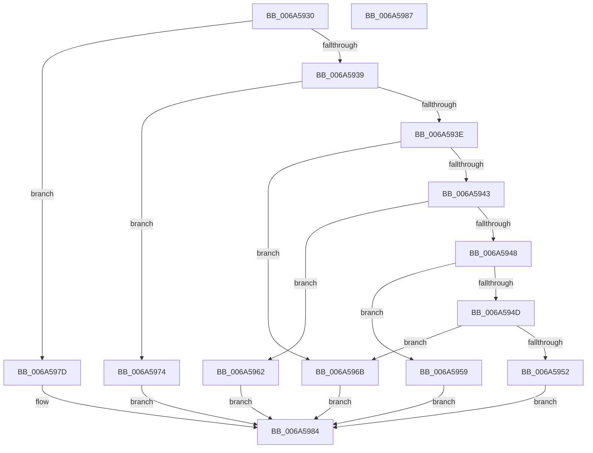

# SC_DEVICE::GetStoragePropertyPre

- RVA: `0x006A5930`–`0x006A5988` (길이 `88` bytes)
- VA: `0x00000001406A5930`
- 실행 섹션: `.text`
- PDB 이름 있음: `예`; PDB Function 태그: `아니요`
- unwind 정보 RVA: `0x000DB714`
- 디코드: `28`개 명령, `88/88` bytes 표시
- 미해석 바이트: `0` (있으면 어셈블리에 `.byte`로 보존)

> 이 문서는 커널 이미지의 기계어와 PDB 기호를 분석해 생성했습니다. 4번과 5번은 함수 원형과 자료형을 바이너리 사용 방식에서 추정한 C 해석이며 원본 소스 복구 결과는 아닙니다.

## 1. Dependencies

- 직접 호출 지점: **0**; 고유 호출 대상: **0**
- 직접 호출자로 확인된 함수: **1**
- RIP 상대 이미지 참조: **0**

### Outgoing calls
- 직접 디코드된 call 명령이 없습니다.

### Direct callers
- [SC_DISK::GetStoragePropertyPre](SC_DISK_GetStoragePropertyPre_function_006A4600.md) at `0x006A4677`

### Static image references
- 디코드된 RIP-relative 메모리 참조가 없습니다.

## 2. Other-region calls and transfers

- 다른 실행 섹션으로 향하는 call: **0**
- 별도 외부 분기/꼬리 이동을 확인하지 못했습니다.

## 3. Assembly (complete function range)

```asm
006A5930  33 C9                           xor ecx, ecx
006A5932  41 89 08                        mov dword ptr [r8], ecx
006A5935  85 D2                           test edx, edx
006A5937  74 44                           je 0x1406a597d
006A5939  83 EA 01                        sub edx, 1
006A593C  74 36                           je 0x1406a5974
006A593E  83 EA 01                        sub edx, 1
006A5941  74 28                           je 0x1406a596b
006A5943  83 EA 03                        sub edx, 3
006A5946  74 1A                           je 0x1406a5962
006A5948  83 EA 0E                        sub edx, 0xe
006A594B  74 0C                           je 0x1406a5959
006A594D  83 FA 2C                        cmp edx, 0x2c
006A5950  74 19                           je 0x1406a596b
006A5952  B9 25 02 00 C0                  mov ecx, 0xc0000225
006A5957  EB 2B                           jmp 0x1406a5984
006A5959  41 C7 00 1C 00 00 00            mov dword ptr [r8], 0x1c
006A5960  EB 22                           jmp 0x1406a5984
006A5962  41 C7 00 18 00 00 00            mov dword ptr [r8], 0x18
006A5969  EB 19                           jmp 0x1406a5984
006A596B  41 C7 00 10 00 00 00            mov dword ptr [r8], 0x10
006A5972  EB 10                           jmp 0x1406a5984
006A5974  41 C7 00 20 00 00 00            mov dword ptr [r8], 0x20
006A597B  EB 07                           jmp 0x1406a5984
006A597D  41 C7 00 28 00 00 00            mov dword ptr [r8], 0x28
006A5984  8B C1                           mov eax, ecx
006A5986  C3                              ret
006A5987  CC                              int3
```

## 4. C-style interpretation (structured pseudocode)

```c
__int64 __fastcall SC_DEVICE__GetStoragePropertyPre(int a1, int a2, __int64 a3)
{
    a1 = 0;
    *(unsigned int *)(a3) = 0;
    if (a2 == 0) goto loc_006A597D;
    a2 = (unsigned int)((a2) - (1));
    if (condition_is_equal) goto loc_006A5974;
    a2 = (unsigned int)((a2) - (1));
    if (condition_is_equal) goto loc_006A596B;
    a2 = (unsigned int)((a2) - (3));
    if (condition_is_equal) goto loc_006A5962;
    a2 = (unsigned int)((a2) - (14));
    if (condition_is_equal) goto loc_006A5959;
    if (a2 == 44) goto loc_006A596B;
    goto loc_006A5984;
loc_006A5959:
    *(unsigned int *)(a3) = 28;
    goto loc_006A5984;
loc_006A5962:
    *(unsigned int *)(a3) = 24;
    goto loc_006A5984;
loc_006A596B:
    *(unsigned int *)(a3) = 16;
    goto loc_006A5984;
loc_006A5974:
    *(unsigned int *)(a3) = 32;
    goto loc_006A5984;
loc_006A597D:
    *(unsigned int *)(a3) = 40;
loc_006A5984:
    return (unsigned int)((unsigned int)((unsigned int)(0xC0000225ULL)));
}
```

## 5. (Beta) C Style

```c
int64_t SC_DEVICE__GetStoragePropertyPre(int32_t Arg1, int32_t Arg2, void *Arg3)
{
    uint8_t *arg3 = (uint8_t *)Arg3;

    Arg1 = 0;
    *(uint32_t *)(arg3) = 0;
    if (Arg2 == 0) goto loc_006A597D;
    Arg2 = (uint32_t)((Arg2) - (1));
    if (condition_is_equal) goto loc_006A5974;
    Arg2 = (uint32_t)((Arg2) - (1));
    if (condition_is_equal) goto loc_006A596B;
    Arg2 = (uint32_t)((Arg2) - (3));
    if (condition_is_equal) goto loc_006A5962;
    Arg2 = (uint32_t)((Arg2) - (14));
    if (condition_is_equal) goto loc_006A5959;
    if (Arg2 == 44) goto loc_006A596B;
    goto loc_006A5984;
loc_006A5959:
    *(uint32_t *)(arg3) = 28;
    goto loc_006A5984;
loc_006A5962:
    *(uint32_t *)(arg3) = 24;
    goto loc_006A5984;
loc_006A596B:
    *(uint32_t *)(arg3) = 16;
    goto loc_006A5984;
loc_006A5974:
    *(uint32_t *)(arg3) = 32;
    goto loc_006A5984;
loc_006A597D:
    *(uint32_t *)(arg3) = 40;
loc_006A5984:
    return (uint32_t)((uint32_t)((uint32_t)(0xC0000225ULL)));
}
```

### 관측된 메모리 오프셋

구조체 형식이 확인되지 않은 접근은 인자 기준의 오프셋으로만 기록했습니다.

| 기준 인자 | 오프셋 표현 | 폭 (bit) | 접근 |
|---|---:|---:|---|
| `Arg3` | `+ 0x0` | `32` | `W` |

## 6. Execution-region graph

[열기: 2D/3D 그래프와 함수 탐색 컨트롤 패널](../../../control-panel.html?section=text&rva=0x006A5930&view=graph)

- 2D 그래프는 위에서 아래로 흐르고, 3D 그래프는 빈 공간을 드래그해 회전합니다. Shift+드래그는 이동, 휠은 확대·축소, 함수 노드 선택은 대상 보고서 이동입니다.

### Static fallback


