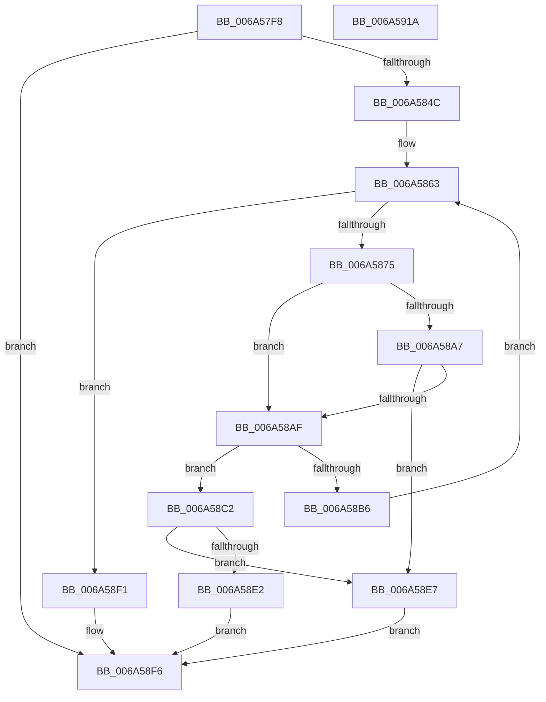

# SC_DEVICE::GetStorageProperty

- RVA: `0x006A57F8`–`0x006A591B` (길이 `291` bytes)
- VA: `0x00000001406A57F8`
- 실행 섹션: `.text`
- PDB 이름 있음: `예`; PDB Function 태그: `아니요`
- unwind 정보 RVA: `0x000DACCC`
- 디코드: `84`개 명령, `291/291` bytes 표시
- 미해석 바이트: `0` (있으면 어셈블리에 `.byte`로 보존)

> 이 문서는 커널 이미지의 기계어와 PDB 기호를 분석해 생성했습니다. 4번과 5번은 함수 원형과 자료형을 바이너리 사용 방식에서 추정한 C 해석이며 원본 소스 복구 결과는 아닙니다.

## 1. Dependencies

- 직접 호출 지점: **7**; 고유 호출 대상: **4**
- 직접 호출자로 확인된 함수: **1**
- RIP 상대 이미지 참조: **1**

### Outgoing calls
- `0x006A583D` → [guard_dispatch_icall](../6B/guard_dispatch_icall_function_006BAAD0.md) (function, `0x006BAAD0`)
- `0x006A5868` → [SC_ENV::Allocate](../../page/71/SC_ENV_Allocate_function_00716F90.md) (function, `0x00716F90`)
- `0x006A5898` → [guard_dispatch_icall](../6B/guard_dispatch_icall_function_006BAAD0.md) (function, `0x006BAAD0`)
- `0x006A58BB` → [AlpcpFreeBuffer](../../page/90/AlpcpFreeBuffer_function_009071C0.md) (function, `0x009071C0`)
- `0x006A58D7` → [guard_dispatch_icall](../6B/guard_dispatch_icall_function_006BAAD0.md) (function, `0x006BAAD0`)
- `0x006A58EA` → [AlpcpFreeBuffer](../../page/90/AlpcpFreeBuffer_function_009071C0.md) (function, `0x009071C0`)
- `0x006A5900` → [_security_check_cookie](_security_check_cookie_function_006AC640.md) (function, `0x006AC640`)

### Direct callers
- [SC_DEVICE::UpdateStorageProperty](SC_DEVICE_UpdateStorageProperty_function_006A5B34.md) at `0x006A5B4C`

### Static image references
- `0x006A5809` → RVA `0x00E0A740` (`.data`; read)

## 2. Other-region calls and transfers

- 다른 실행 섹션으로 향하는 call: **3**
  - `0x006A5868` → [SC_ENV::Allocate](../../page/71/SC_ENV_Allocate_function_00716F90.md) (`.text` → `PAGE`)
  - `0x006A58BB` → [AlpcpFreeBuffer](../../page/90/AlpcpFreeBuffer_function_009071C0.md) (`.text` → `PAGE`)
  - `0x006A58EA` → [AlpcpFreeBuffer](../../page/90/AlpcpFreeBuffer_function_009071C0.md) (`.text` → `PAGE`)
- 별도 외부 분기/꼬리 이동을 확인하지 못했습니다.

## 3. Assembly (complete function range)

```asm
006A57F8  48 89 5C 24 10                  mov qword ptr [rsp + 0x10], rbx
006A57FD  56                              push rsi
006A57FE  57                              push rdi
006A57FF  41 55                           push r13
006A5801  41 56                           push r14
006A5803  41 57                           push r15
006A5805  48 83 EC 60                     sub rsp, 0x60
006A5809  48 8B 05 30 4F 76 00            mov rax, qword ptr [rip + 0x764f30]
006A5810  48 33 C4                        xor rax, rsp
006A5813  48 89 44 24 58                  mov qword ptr [rsp + 0x58], rax
006A5818  49 83 20 00                     and qword ptr [r8], 0
006A581C  4D 8B F8                        mov r15, r8
006A581F  48 8B 01                        mov rax, qword ptr [rcx]
006A5822  4C 8D 44 24 40                  lea r8, [rsp + 0x40]
006A5827  83 64 24 40 00                  and dword ptr [rsp + 0x40], 0
006A582C  BA 06 00 00 00                  mov edx, 6
006A5831  83 64 24 50 00                  and dword ptr [rsp + 0x50], 0
006A5836  4C 8B F1                        mov r14, rcx
006A5839  48 8B 40 20                     mov rax, qword ptr [rax + 0x20]
006A583D  E8 8E 52 01 00                  call 0x1406baad0
006A5842  8B F8                           mov edi, eax
006A5844  85 C0                           test eax, eax
006A5846  0F 88 AA 00 00 00               js 0x1406a58f6
006A584C  83 64 24 4C 00                  and dword ptr [rsp + 0x4c], 0
006A5851  41 BD 00 00 00 80               mov r13d, 0x80000000
006A5857  8B 74 24 40                     mov esi, dword ptr [rsp + 0x40]
006A585B  C7 44 24 48 06 00 00 00         mov dword ptr [rsp + 0x48], 6
006A5863  8B CE                           mov ecx, esi
006A5865  45 33 C9                        xor r9d, r9d
006A5868  E8 23 17 07 00                  call 0x140716f90
006A586D  48 8B D8                        mov rbx, rax
006A5870  48 85 C0                        test rax, rax
006A5873  74 7C                           je 0x1406a58f1
006A5875  49 8B 0E                        mov rcx, qword ptr [r14]
006A5878  4C 8D 44 24 48                  lea r8, [rsp + 0x48]
006A587D  89 74 24 28                     mov dword ptr [rsp + 0x28], esi
006A5881  41 B9 0C 00 00 00               mov r9d, 0xc
006A5887  BA 00 14 2D 00                  mov edx, 0x2d1400
006A588C  48 89 5C 24 20                  mov qword ptr [rsp + 0x20], rbx
006A5891  48 8B 41 10                     mov rax, qword ptr [rcx + 0x10]
006A5895  49 8B CE                        mov rcx, r14
006A5898  E8 33 52 01 00                  call 0x1406baad0
006A589D  8B F8                           mov edi, eax
006A589F  41 03 C5                        add eax, r13d
006A58A2  41 85 C5                        test r13d, eax
006A58A5  75 08                           jne 0x1406a58af
006A58A7  81 FF 05 00 00 80               cmp edi, 0x80000005
006A58AD  75 38                           jne 0x1406a58e7
006A58AF  8B 43 04                        mov eax, dword ptr [rbx + 4]
006A58B2  3B C6                           cmp eax, esi
006A58B4  76 0C                           jbe 0x1406a58c2
006A58B6  48 8B CB                        mov rcx, rbx
006A58B9  8B F0                           mov esi, eax
006A58BB  E8 00 19 26 00                  call 0x1409071c0
006A58C0  EB A1                           jmp 0x1406a5863
006A58C2  89 73 04                        mov dword ptr [rbx + 4], esi
006A58C5  4C 8B C3                        mov r8, rbx
006A58C8  49 8B 06                        mov rax, qword ptr [r14]
006A58CB  BA 06 00 00 00                  mov edx, 6
006A58D0  49 8B CE                        mov rcx, r14
006A58D3  48 8B 40 28                     mov rax, qword ptr [rax + 0x28]
006A58D7  E8 F4 51 01 00                  call 0x1406baad0
006A58DC  8B F8                           mov edi, eax
006A58DE  85 C0                           test eax, eax
006A58E0  78 05                           js 0x1406a58e7
006A58E2  49 89 1F                        mov qword ptr [r15], rbx
006A58E5  EB 0F                           jmp 0x1406a58f6
006A58E7  48 8B CB                        mov rcx, rbx
006A58EA  E8 D1 18 26 00                  call 0x1409071c0
006A58EF  EB 05                           jmp 0x1406a58f6
006A58F1  BF 9A 00 00 C0                  mov edi, 0xc000009a
006A58F6  8B C7                           mov eax, edi
006A58F8  48 8B 4C 24 58                  mov rcx, qword ptr [rsp + 0x58]
006A58FD  48 33 CC                        xor rcx, rsp
006A5900  E8 3B 6D 00 00                  call 0x1406ac640
006A5905  48 8B 9C 24 98 00 00 00         mov rbx, qword ptr [rsp + 0x98]
006A590D  48 83 C4 60                     add rsp, 0x60
006A5911  41 5F                           pop r15
006A5913  41 5E                           pop r14
006A5915  41 5D                           pop r13
006A5917  5F                              pop rdi
006A5918  5E                              pop rsi
006A5919  C3                              ret
006A591A  CC                              int3
```

## 4. C-style interpretation (structured pseudocode)

```c
__int64 __fastcall SC_DEVICE__GetStorageProperty(__int64 a1, __int64 a2, __int64 a3, int a4)
{
    __int64 result;
    __int64 v_rsp;
    unsigned __int64 v_stack_m30;
    unsigned int v_stack_m38;
    unsigned int v_stack_m3C;
    unsigned int v_stack_m40;
    unsigned __int64 v_stack_m48;
    unsigned int v_stack_m60;
    unsigned __int64 v_stack_m68;
    unsigned __int64 v_stack_p10;

    v_stack_p10 = v_rbx;
    v_rsp = (v_rsp) - (96);
    result = (*(unsigned __int64 *)(v_rip + 7753520)) ^ (v_rsp);
    v_stack_m30 = result;
    result = guard_dispatch_icall(a1, 6, v_stack_m48, a4);
    if (sign_flag) goto loc_006A58F6;
    v_stack_m40 = 6;
loc_006A5863:
    a4 = 0;
    result = SC_ENV__Allocate((unsigned int)((unsigned int)((unsigned int)(v_stack_m48))), 6, v_stack_m48, a4);
    if (result == 0) goto loc_006A58F1;
    v_stack_m60 = (unsigned int)((unsigned int)(v_stack_m48));
    v_stack_m68 = result;
    result = guard_dispatch_icall(a1, (unsigned int)(0x2D1400ULL), v_stack_m40, 12);
    result = (unsigned int)((result) + ((unsigned int)((unsigned int)(0x80000000ULL))));
    if ((((unsigned int)((unsigned int)(0x80000000ULL))) & ((unsigned int)(result))) != 0) goto loc_006A58AF;
    if (((unsigned int)((unsigned int)((unsigned int)(result)))) != 0x80000005ULL) goto loc_006A58E7;
loc_006A58AF:
    if (((unsigned int)((unsigned int)(*(unsigned int *)(result + 4)))) <= ((unsigned int)((unsigned int)(v_stack_m48)))) goto loc_006A58C2;
    result = AlpcpFreeBuffer(result, (unsigned int)(0x2D1400ULL), v_stack_m40, 12);
    goto loc_006A5863;
loc_006A58C2:
    *(unsigned int *)(result + 4) = (unsigned int)((unsigned int)((unsigned int)((unsigned int)(*(unsigned int *)(result + 4)))));
    result = guard_dispatch_icall(a1, 6, result, 12);
    if (sign_flag) goto loc_006A58E7;
    *(unsigned __int64 *)(a3) = result;
    goto loc_006A58F6;
loc_006A58E7:
    result = AlpcpFreeBuffer(result, 6, result, 12);
    goto loc_006A58F6;
loc_006A58F1:
loc_006A58F6:
    a1 = (v_stack_m30) ^ (v_rsp);
    result = _security_check_cookie(a1, 6, result, 12);
    v_rsp = (v_rsp) + (96);
    return result;
}
```

## 5. (Beta) C Style

```c
int64_t SC_DEVICE__GetStorageProperty(void *Arg1, int64_t Arg2, void *Arg3, int32_t Arg4)
{
    uint8_t *arg1 = (uint8_t *)Arg1;
    uint8_t *arg3 = (uint8_t *)Arg3;

    int64_t result;
    int64_t local_rsp;
    uint64_t v_stack_m30;
    uint32_t v_stack_m38;
    uint32_t v_stack_m3C;
    uint32_t v_stack_m40;
    uint64_t v_stack_m48;
    uint32_t v_stack_m60;
    uint64_t v_stack_m68;
    uint64_t v_stack_p10;

    v_stack_p10 = local_rbx;
    local_rsp = (local_rsp) - (96);
    result = (*(uint64_t *)(v_rip + 0x764F30)) ^ (local_rsp);
    v_stack_m30 = result;
    result = guard_dispatch_icall(Arg1, 6, v_stack_m48, Arg4);
    if (sign_flag) goto loc_006A58F6;
    v_stack_m40 = 6;
loc_006A5863:
    Arg4 = 0;
    result = SC_ENV__Allocate((uint32_t)((uint32_t)((uint32_t)(v_stack_m48))), 6, v_stack_m48, Arg4);
    if (result == 0) goto loc_006A58F1;
    v_stack_m60 = (uint32_t)((uint32_t)(v_stack_m48));
    v_stack_m68 = result;
    result = guard_dispatch_icall(Arg1, (uint32_t)(0x2D1400ULL), v_stack_m40, 12);
    result = (uint32_t)((result) + ((uint32_t)((uint32_t)(0x80000000ULL))));
    if ((((uint32_t)((uint32_t)(0x80000000ULL))) & ((uint32_t)(result))) != 0) goto loc_006A58AF;
    if (((uint32_t)((uint32_t)((uint32_t)(result)))) != 0x80000005ULL) goto loc_006A58E7;
loc_006A58AF:
    if (((uint32_t)((uint32_t)(*(uint32_t *)(result + 0x4)))) <= ((uint32_t)((uint32_t)(v_stack_m48)))) goto loc_006A58C2;
    result = AlpcpFreeBuffer(result, (uint32_t)(0x2D1400ULL), v_stack_m40, 12);
    goto loc_006A5863;
loc_006A58C2:
    *(uint32_t *)(result + 0x4) = (uint32_t)((uint32_t)((uint32_t)((uint32_t)(*(uint32_t *)(result + 0x4)))));
    result = guard_dispatch_icall(Arg1, 6, result, 12);
    if (sign_flag) goto loc_006A58E7;
    *(uint64_t *)(arg3) = result;
    goto loc_006A58F6;
loc_006A58E7:
    result = AlpcpFreeBuffer(result, 6, result, 12);
    goto loc_006A58F6;
loc_006A58F1:
loc_006A58F6:
    Arg1 = (v_stack_m30) ^ (local_rsp);
    result = _security_check_cookie(Arg1, 6, result, 12);
    local_rsp = (local_rsp) + (96);
    return result;
}
```

### 관측된 메모리 오프셋

구조체 형식이 확인되지 않은 접근은 인자 기준의 오프셋으로만 기록했습니다.

| 기준 인자 | 오프셋 표현 | 폭 (bit) | 접근 |
|---|---:|---:|---|
| `Arg1` | `+ 0x0` | `64` | `R` |
| `Arg3` | `+ 0x0` | `64` | `R/W` |
| `Arg3` | `+ 0x0` | `64` | `W` |

## 6. Execution-region graph

[열기: 2D/3D 그래프와 함수 탐색 컨트롤 패널](../../../control-panel.html?section=text&rva=0x006A57F8&view=graph)

- 2D 그래프는 위에서 아래로 흐르고, 3D 그래프는 빈 공간을 드래그해 회전합니다. Shift+드래그는 이동, 휠은 확대·축소, 함수 노드 선택은 대상 보고서 이동입니다.

### Static fallback


