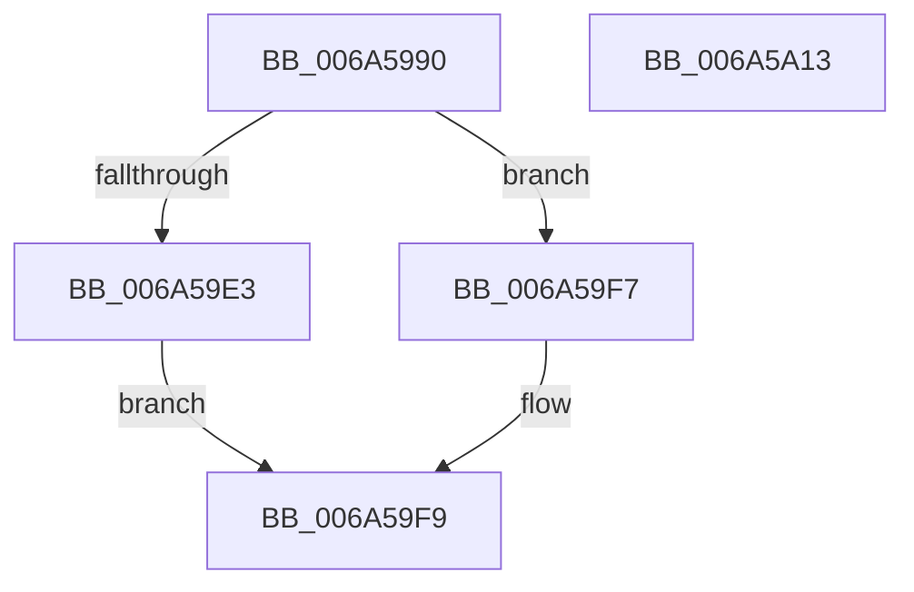

# SC_DEVICE::Initialize

- RVA: `0x006A5990`–`0x006A5A14` (길이 `132` bytes)
- VA: `0x00000001406A5990`
- 실행 섹션: `.text`
- PDB 이름 있음: `예`; PDB Function 태그: `아니요`
- unwind 정보 RVA: `0x000DACEC`
- 디코드: `36`개 명령, `132/132` bytes 표시
- 미해석 바이트: `0` (있으면 어셈블리에 `.byte`로 보존)

> 이 문서는 커널 이미지의 기계어와 PDB 기호를 분석해 생성했습니다. 4번과 5번은 함수 원형과 자료형을 바이너리 사용 방식에서 추정한 C 해석이며 원본 소스 복구 결과는 아닙니다.

## 1. Dependencies

- 직접 호출 지점: **3**; 고유 호출 대상: **3**
- 직접 호출자로 확인된 함수: **1**
- RIP 상대 이미지 참조: **3**

### Outgoing calls
- `0x006A59D8` → [guard_dispatch_icall](../6B/guard_dispatch_icall_function_006BAAD0.md) (function, `0x006BAAD0`)
- `0x006A59F0` → [AlpcpFreeBuffer](../../page/90/AlpcpFreeBuffer_function_009071C0.md) (function, `0x009071C0`)
- `0x006A5A03` → [_security_check_cookie](_security_check_cookie_function_006AC640.md) (function, `0x006AC640`)

### Direct callers
- [SC_DISK::Initialize](SC_DISK_Initialize_function_006A46C0.md) at `0x006A46F4`

### Static image references
- `0x006A599C` → RVA `0x00E0A740` (`.data`; read)
- `0x006A59AB` → RVA `0x00011698` (`.rdata`; read)
- `0x006A59B5` → RVA `0x00011688` (`.rdata`; read)

## 2. Other-region calls and transfers

- 다른 실행 섹션으로 향하는 call: **1**
  - `0x006A59F0` → [AlpcpFreeBuffer](../../page/90/AlpcpFreeBuffer_function_009071C0.md) (`.text` → `PAGE`)
- 별도 외부 분기/꼬리 이동을 확인하지 못했습니다.

## 3. Assembly (complete function range)

```asm
006A5990  4C 8B DC                        mov r11, rsp
006A5993  49 89 5B 10                     mov qword ptr [r11 + 0x10], rbx
006A5997  57                              push rdi
006A5998  48 83 EC 50                     sub rsp, 0x50
006A599C  48 8B 05 9D 4D 76 00            mov rax, qword ptr [rip + 0x764d9d]
006A59A3  48 33 C4                        xor rax, rsp
006A59A6  48 89 44 24 40                  mov qword ptr [rsp + 0x40], rax
006A59AB  8B 05 E7 BC 96 FF               mov eax, dword ptr [rip - 0x694319]
006A59B1  4D 8D 43 C8                     lea r8, [r11 - 0x38]
006A59B5  0F 10 05 CC BC 96 FF            movups xmm0, xmmword ptr [rip - 0x694334]
006A59BC  49 83 63 C8 00                  and qword ptr [r11 - 0x38], 0
006A59C1  49 8D 53 D0                     lea rdx, [r11 - 0x30]
006A59C5  89 44 24 38                     mov dword ptr [rsp + 0x38], eax
006A59C9  48 8B F9                        mov rdi, rcx
006A59CC  48 8B 01                        mov rax, qword ptr [rcx]
006A59CF  0F 11 44 24 28                  movups xmmword ptr [rsp + 0x28], xmm0
006A59D4  48 8B 40 18                     mov rax, qword ptr [rax + 0x18]
006A59D8  E8 F3 50 01 00                  call 0x1406baad0
006A59DD  8B D8                           mov ebx, eax
006A59DF  85 C0                           test eax, eax
006A59E1  78 14                           js 0x1406a59f7
006A59E3  48 8B 4C 24 20                  mov rcx, qword ptr [rsp + 0x20]
006A59E8  0F 10 01                        movups xmm0, xmmword ptr [rcx]
006A59EB  F3 0F 7F 47 08                  movdqu xmmword ptr [rdi + 8], xmm0
006A59F0  E8 CB 17 26 00                  call 0x1409071c0
006A59F5  EB 02                           jmp 0x1406a59f9
006A59F7  33 DB                           xor ebx, ebx
006A59F9  8B C3                           mov eax, ebx
006A59FB  48 8B 4C 24 40                  mov rcx, qword ptr [rsp + 0x40]
006A5A00  48 33 CC                        xor rcx, rsp
006A5A03  E8 38 6C 00 00                  call 0x1406ac640
006A5A08  48 8B 5C 24 68                  mov rbx, qword ptr [rsp + 0x68]
006A5A0D  48 83 C4 50                     add rsp, 0x50
006A5A11  5F                              pop rdi
006A5A12  C3                              ret
006A5A13  CC                              int3
```

## 4. C-style interpretation (structured pseudocode)

```c
__int64 __fastcall SC_DEVICE__Initialize(__int64 a1)
{
    __int64 result;
    __int64 v_rbx;
    __int64 v_rsp;
    unsigned __int64 v_stack_m18;
    unsigned int v_stack_m20;
    unsigned __int64 v_stack_m30;
    unsigned __int64 v_stack_m38;
    unsigned __int64 v_stack_p10;

    *(unsigned __int64 *)(v_rsp + 16) = v_rbx;
    v_rsp = (v_rsp) - (80);
    result = (*(unsigned __int64 *)(v_rip + 7753117)) ^ (v_rsp);
    v_stack_m18 = result;
    v_stack_m20 = (unsigned int)((unsigned int)(*(unsigned int *)(v_rip - 6898457)));
    v_stack_m30 = v_xmm0;
    result = guard_dispatch_icall(a1, v_rsp - 48, v_rsp - 56, a4);
    if (sign_flag) goto loc_006A59F7;
    *(unsigned __int64 *)(a1 + 8) = v_xmm0;
    result = AlpcpFreeBuffer(v_stack_m38, v_rsp - 48, v_rsp - 56, a4);
    goto loc_006A59F9;
loc_006A59F7:
    v_rbx = 0;
loc_006A59F9:
    a1 = (v_stack_m18) ^ (v_rsp);
    result = _security_check_cookie(a1, v_rsp - 48, v_rsp - 56, a4);
    v_rsp = (v_rsp) + (80);
    return result;
}
```

## 5. (Beta) C Style

```c
int64_t SC_DEVICE__Initialize(void *Arg1)
{
    uint8_t *arg1 = (uint8_t *)Arg1;

    int64_t result;
    int64_t local_rbx;
    int64_t local_rsp;
    uint64_t v_stack_m18;
    uint32_t v_stack_m20;
    uint64_t v_stack_m30;
    uint64_t v_stack_m38;
    uint64_t v_stack_p10;

    *(uint64_t *)(local_rsp + 0x10) = local_rbx;
    local_rsp = (local_rsp) - (80);
    result = (*(uint64_t *)(v_rip + 0x764D9D)) ^ (local_rsp);
    v_stack_m18 = result;
    v_stack_m20 = (uint32_t)((uint32_t)(*(uint32_t *)(v_rip - 0x694319)));
    v_stack_m30 = v_xmm0;
    result = guard_dispatch_icall(Arg1, local_rsp - 48, local_rsp - 56, a4);
    if (sign_flag) goto loc_006A59F7;
    *(uint64_t *)(arg1 + 0x8) = v_xmm0;
    result = AlpcpFreeBuffer(v_stack_m38, local_rsp - 48, local_rsp - 56, a4);
    goto loc_006A59F9;
loc_006A59F7:
    local_rbx = 0;
loc_006A59F9:
    Arg1 = (v_stack_m18) ^ (local_rsp);
    result = _security_check_cookie(Arg1, local_rsp - 48, local_rsp - 56, a4);
    local_rsp = (local_rsp) + (80);
    return result;
}
```

### 관측된 메모리 오프셋

구조체 형식이 확인되지 않은 접근은 인자 기준의 오프셋으로만 기록했습니다.

| 기준 인자 | 오프셋 표현 | 폭 (bit) | 접근 |
|---|---:|---:|---|
| `Arg1` | `+ 0x0` | `64` | `R` |
| `Arg1` | `+ 0x8` | `128` | `W` |

## 6. Execution-region graph

[열기: 2D/3D 그래프와 함수 탐색 컨트롤 패널](../../../control-panel.html?section=text&rva=0x006A5990&view=graph)

- 2D 그래프는 위에서 아래로 흐르고, 3D 그래프는 빈 공간을 드래그해 회전합니다. Shift+드래그는 이동, 휠은 확대·축소, 함수 노드 선택은 대상 보고서 이동입니다.

### Static fallback


