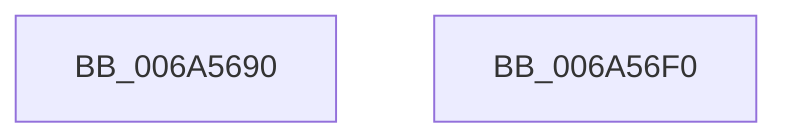

# SC_DEVICE::SC_DEVICE

- RVA: `0x006A5690`–`0x006A56F1` (길이 `97` bytes)
- VA: `0x00000001406A5690`
- 실행 섹션: `.text`
- PDB 이름 있음: `예`; PDB Function 태그: `아니요`
- unwind 정보 RVA: `0x000DB714`
- 디코드: `20`개 명령, `97/97` bytes 표시
- 미해석 바이트: `0` (있으면 어셈블리에 `.byte`로 보존)

> 이 문서는 커널 이미지의 기계어와 PDB 기호를 분석해 생성했습니다. 4번과 5번은 함수 원형과 자료형을 바이너리 사용 방식에서 추정한 C 해석이며 원본 소스 복구 결과는 아닙니다.

## 1. Dependencies

- 직접 호출 지점: **0**; 고유 호출 대상: **0**
- 직접 호출자로 확인된 함수: **1**
- RIP 상대 이미지 참조: **2**

### Outgoing calls
- 직접 디코드된 call 명령이 없습니다.

### Direct callers
- [SC_DISK::SC_DISK](SC_DISK_SC_DISK_function_006A41DC.md) at `0x006A41E0`

### Static image references
- `0x006A5690` → RVA `0x00009B38` (`.rdata`; read)
- `0x006A569F` → RVA `0x000112D0` (`.rdata`; read)

## 2. Other-region calls and transfers

- 다른 실행 섹션으로 향하는 call: **0**
- 별도 외부 분기/꼬리 이동을 확인하지 못했습니다.

## 3. Assembly (complete function range)

```asm
006A5690  48 8D 05 A1 44 96 FF            lea rax, [rip - 0x69bb5f]
006A5697  0F 57 C9                        xorps xmm1, xmm1
006A569A  48 89 01                        mov qword ptr [rcx], rax
006A569D  33 C0                           xor eax, eax
006A569F  0F 10 05 2A BC 96 FF            movups xmm0, xmmword ptr [rip - 0x6943d6]
006A56A6  48 89 81 98 00 00 00            mov qword ptr [rcx + 0x98], rax
006A56AD  48 89 81 A0 00 00 00            mov qword ptr [rcx + 0xa0], rax
006A56B4  F3 0F 7F 41 08                  movdqu xmmword ptr [rcx + 8], xmm0
006A56B9  48 89 81 A8 00 00 00            mov qword ptr [rcx + 0xa8], rax
006A56C0  0F 57 C0                        xorps xmm0, xmm0
006A56C3  48 89 81 B0 00 00 00            mov qword ptr [rcx + 0xb0], rax
006A56CA  48 89 81 B8 00 00 00            mov qword ptr [rcx + 0xb8], rax
006A56D1  48 89 81 C0 00 00 00            mov qword ptr [rcx + 0xc0], rax
006A56D8  48 8B C1                        mov rax, rcx
006A56DB  F3 0F 7F 41 28                  movdqu xmmword ptr [rcx + 0x28], xmm0
006A56E0  F3 0F 7F 41 48                  movdqu xmmword ptr [rcx + 0x48], xmm0
006A56E5  F3 0F 7F 49 18                  movdqu xmmword ptr [rcx + 0x18], xmm1
006A56EA  F3 0F 7F 49 38                  movdqu xmmword ptr [rcx + 0x38], xmm1
006A56EF  C3                              ret
006A56F0  CC                              int3
```

## 4. C-style interpretation (structured pseudocode)

```c
__int64 __fastcall SC_DEVICE__SC_DEVICE(__int64 a1)
{
    __int64 result;

    *(unsigned __int64 *)(a1) = v_rip - 6929247;
    result = 0;
    *(unsigned __int64 *)(a1 + 152) = 0;
    *(unsigned __int64 *)(a1 + 160) = 0;
    *(unsigned __int64 *)(a1 + 8) = v_xmm0;
    *(unsigned __int64 *)(a1 + 168) = 0;
    *(unsigned __int64 *)(a1 + 176) = 0;
    *(unsigned __int64 *)(a1 + 184) = 0;
    *(unsigned __int64 *)(a1 + 192) = 0;
    *(unsigned __int64 *)(a1 + 40) = v_xmm0;
    *(unsigned __int64 *)(a1 + 72) = v_xmm0;
    *(unsigned __int64 *)(a1 + 24) = v_xmm1;
    *(unsigned __int64 *)(a1 + 56) = v_xmm1;
    return a1;
}
```

## 5. (Beta) C Style

```c
void *SC_DEVICE__SC_DEVICE(void *Arg1)
{
    uint8_t *arg1 = (uint8_t *)Arg1;

    int64_t result;

    *(uint64_t *)(arg1) = v_rip - 6929247;
    result = 0;
    *(uint64_t *)(arg1 + 0x98) = 0;
    *(uint64_t *)(arg1 + 0xA0) = 0;
    *(uint64_t *)(arg1 + 0x8) = v_xmm0;
    *(uint64_t *)(arg1 + 0xA8) = 0;
    *(uint64_t *)(arg1 + 0xB0) = 0;
    *(uint64_t *)(arg1 + 0xB8) = 0;
    *(uint64_t *)(arg1 + 0xC0) = 0;
    *(uint64_t *)(arg1 + 0x28) = v_xmm0;
    *(uint64_t *)(arg1 + 0x48) = v_xmm0;
    *(uint64_t *)(arg1 + 0x18) = v_xmm1;
    *(uint64_t *)(arg1 + 0x38) = v_xmm1;
    return Arg1;
}
```

### 관측된 메모리 오프셋

구조체 형식이 확인되지 않은 접근은 인자 기준의 오프셋으로만 기록했습니다.

| 기준 인자 | 오프셋 표현 | 폭 (bit) | 접근 |
|---|---:|---:|---|
| `Arg1` | `+ 0x0` | `64` | `W` |
| `Arg1` | `+ 0x8` | `128` | `W` |
| `Arg1` | `+ 0x18` | `128` | `W` |
| `Arg1` | `+ 0x28` | `128` | `W` |
| `Arg1` | `+ 0x38` | `128` | `W` |
| `Arg1` | `+ 0x48` | `128` | `W` |
| `Arg1` | `+ 0x98` | `64` | `W` |
| `Arg1` | `+ 0xA0` | `64` | `W` |
| `Arg1` | `+ 0xA8` | `64` | `W` |
| `Arg1` | `+ 0xB0` | `64` | `W` |
| `Arg1` | `+ 0xB8` | `64` | `W` |
| `Arg1` | `+ 0xC0` | `64` | `W` |

## 6. Execution-region graph

[열기: 2D/3D 그래프와 함수 탐색 컨트롤 패널](../../../control-panel.html?section=text&rva=0x006A5690&view=graph)

- 2D 그래프는 위에서 아래로 흐르고, 3D 그래프는 빈 공간을 드래그해 회전합니다. Shift+드래그는 이동, 휠은 확대·축소, 함수 노드 선택은 대상 보고서 이동입니다.

### Static fallback


