# SC_DEVICE::~SC_DEVICE

- RVA: `0x006A56F8`–`0x006A57B0` (길이 `184` bytes)
- VA: `0x00000001406A56F8`
- 실행 섹션: `.text`
- PDB 이름 있음: `예`; PDB Function 태그: `아니요`
- unwind 정보 RVA: `0x0005CF00`
- 디코드: `49`개 명령, `184/184` bytes 표시
- 미해석 바이트: `0` (있으면 어셈블리에 `.byte`로 보존)

> 이 문서는 커널 이미지의 기계어와 PDB 기호를 분석해 생성했습니다. 4번과 5번은 함수 원형과 자료형을 바이너리 사용 방식에서 추정한 C 해석이며 원본 소스 복구 결과는 아닙니다.

## 1. Dependencies

- 직접 호출 지점: **10**; 고유 호출 대상: **1**
- 직접 호출자로 확인된 함수: **2**
- RIP 상대 이미지 참조: **1**

### Outgoing calls
- `0x006A5717` → [AlpcpFreeBuffer](../../page/90/AlpcpFreeBuffer_function_009071C0.md) (function, `0x009071C0`)
- `0x006A5728` → [AlpcpFreeBuffer](../../page/90/AlpcpFreeBuffer_function_009071C0.md) (function, `0x009071C0`)
- `0x006A5739` → [AlpcpFreeBuffer](../../page/90/AlpcpFreeBuffer_function_009071C0.md) (function, `0x009071C0`)
- `0x006A574A` → [AlpcpFreeBuffer](../../page/90/AlpcpFreeBuffer_function_009071C0.md) (function, `0x009071C0`)
- `0x006A575B` → [AlpcpFreeBuffer](../../page/90/AlpcpFreeBuffer_function_009071C0.md) (function, `0x009071C0`)
- `0x006A576C` → [AlpcpFreeBuffer](../../page/90/AlpcpFreeBuffer_function_009071C0.md) (function, `0x009071C0`)
- `0x006A577A` → [AlpcpFreeBuffer](../../page/90/AlpcpFreeBuffer_function_009071C0.md) (function, `0x009071C0`)
- `0x006A5788` → [AlpcpFreeBuffer](../../page/90/AlpcpFreeBuffer_function_009071C0.md) (function, `0x009071C0`)
- `0x006A5796` → [AlpcpFreeBuffer](../../page/90/AlpcpFreeBuffer_function_009071C0.md) (function, `0x009071C0`)
- `0x006A57A4` → [AlpcpFreeBuffer](../../page/90/AlpcpFreeBuffer_function_009071C0.md) (function, `0x009071C0`)

### Direct callers
- [SC_DISK::~SC_DISK](SC_DISK_SC_DISK_function_006A42C4.md) at `0x006A43A6`
- [SC_DEVICE::`scalar deleting destructor&#x27;](SC_DEVICE_scalar_deleting_destructor__function_006A57C0.md) at `0x006A57CF`

### Static image references
- `0x006A56FE` → RVA `0x00009B38` (`.rdata`; read)

## 2. Other-region calls and transfers

- 다른 실행 섹션으로 향하는 call: **10**
  - `0x006A5717` → [AlpcpFreeBuffer](../../page/90/AlpcpFreeBuffer_function_009071C0.md) (`.text` → `PAGE`)
  - `0x006A5728` → [AlpcpFreeBuffer](../../page/90/AlpcpFreeBuffer_function_009071C0.md) (`.text` → `PAGE`)
  - `0x006A5739` → [AlpcpFreeBuffer](../../page/90/AlpcpFreeBuffer_function_009071C0.md) (`.text` → `PAGE`)
  - `0x006A574A` → [AlpcpFreeBuffer](../../page/90/AlpcpFreeBuffer_function_009071C0.md) (`.text` → `PAGE`)
  - `0x006A575B` → [AlpcpFreeBuffer](../../page/90/AlpcpFreeBuffer_function_009071C0.md) (`.text` → `PAGE`)
  - `0x006A576C` → [AlpcpFreeBuffer](../../page/90/AlpcpFreeBuffer_function_009071C0.md) (`.text` → `PAGE`)
  - `0x006A577A` → [AlpcpFreeBuffer](../../page/90/AlpcpFreeBuffer_function_009071C0.md) (`.text` → `PAGE`)
  - `0x006A5788` → [AlpcpFreeBuffer](../../page/90/AlpcpFreeBuffer_function_009071C0.md) (`.text` → `PAGE`)
  - `0x006A5796` → [AlpcpFreeBuffer](../../page/90/AlpcpFreeBuffer_function_009071C0.md) (`.text` → `PAGE`)
  - `0x006A57A4` → [AlpcpFreeBuffer](../../page/90/AlpcpFreeBuffer_function_009071C0.md) (`.text` → `PAGE`)
- 별도 외부 분기/꼬리 이동을 확인하지 못했습니다.

## 3. Assembly (complete function range)

```asm
006A56F8  40 53                           push rbx
006A56FA  48 83 EC 20                     sub rsp, 0x20
006A56FE  48 8D 05 33 44 96 FF            lea rax, [rip - 0x69bbcd]
006A5705  48 8B D9                        mov rbx, rcx
006A5708  48 89 01                        mov qword ptr [rcx], rax
006A570B  48 8B 89 C0 00 00 00            mov rcx, qword ptr [rcx + 0xc0]
006A5712  48 85 C9                        test rcx, rcx
006A5715  74 05                           je 0x1406a571c
006A5717  E8 A4 1A 26 00                  call 0x1409071c0
006A571C  48 8B 8B B8 00 00 00            mov rcx, qword ptr [rbx + 0xb8]
006A5723  48 85 C9                        test rcx, rcx
006A5726  74 05                           je 0x1406a572d
006A5728  E8 93 1A 26 00                  call 0x1409071c0
006A572D  48 8B 8B B0 00 00 00            mov rcx, qword ptr [rbx + 0xb0]
006A5734  48 85 C9                        test rcx, rcx
006A5737  74 05                           je 0x1406a573e
006A5739  E8 82 1A 26 00                  call 0x1409071c0
006A573E  48 8B 8B A0 00 00 00            mov rcx, qword ptr [rbx + 0xa0]
006A5745  48 85 C9                        test rcx, rcx
006A5748  74 05                           je 0x1406a574f
006A574A  E8 71 1A 26 00                  call 0x1409071c0
006A574F  48 8B 8B 98 00 00 00            mov rcx, qword ptr [rbx + 0x98]
006A5756  48 85 C9                        test rcx, rcx
006A5759  74 05                           je 0x1406a5760
006A575B  E8 60 1A 26 00                  call 0x1409071c0
006A5760  48 8B 8B A8 00 00 00            mov rcx, qword ptr [rbx + 0xa8]
006A5767  48 85 C9                        test rcx, rcx
006A576A  74 05                           je 0x1406a5771
006A576C  E8 4F 1A 26 00                  call 0x1409071c0
006A5771  48 8B 4B 50                     mov rcx, qword ptr [rbx + 0x50]
006A5775  48 85 C9                        test rcx, rcx
006A5778  74 05                           je 0x1406a577f
006A577A  E8 41 1A 26 00                  call 0x1409071c0
006A577F  48 8B 4B 40                     mov rcx, qword ptr [rbx + 0x40]
006A5783  48 85 C9                        test rcx, rcx
006A5786  74 05                           je 0x1406a578d
006A5788  E8 33 1A 26 00                  call 0x1409071c0
006A578D  48 8B 4B 30                     mov rcx, qword ptr [rbx + 0x30]
006A5791  48 85 C9                        test rcx, rcx
006A5794  74 05                           je 0x1406a579b
006A5796  E8 25 1A 26 00                  call 0x1409071c0
006A579B  48 8B 4B 20                     mov rcx, qword ptr [rbx + 0x20]
006A579F  48 85 C9                        test rcx, rcx
006A57A2  74 05                           je 0x1406a57a9
006A57A4  E8 17 1A 26 00                  call 0x1409071c0
006A57A9  48 83 C4 20                     add rsp, 0x20
006A57AD  5B                              pop rbx
006A57AE  C3                              ret
006A57AF  CC                              int3
```

## 4. C-style interpretation (structured pseudocode)

```c
__int64 __fastcall SC_DEVICE___SC_DEVICE(__int64 a1)
{
    __int64 result;
    __int64 v_rsp;

    v_rsp = (v_rsp) - (32);
    *(unsigned __int64 *)(a1) = v_rip - 6929357;
    result = v_rip - 6929357;
    if (*(unsigned __int64 *)(a1 + 192) != 0) {
        result = AlpcpFreeBuffer(*(unsigned __int64 *)(a1 + 192), a2, a3, a4);
    }
    if (*(unsigned __int64 *)(a1 + 184) != 0) {
        result = AlpcpFreeBuffer(*(unsigned __int64 *)(a1 + 184), a2, a3, a4);
    }
    if (*(unsigned __int64 *)(a1 + 176) != 0) {
        result = AlpcpFreeBuffer(*(unsigned __int64 *)(a1 + 176), a2, a3, a4);
    }
    if (*(unsigned __int64 *)(a1 + 160) != 0) {
        result = AlpcpFreeBuffer(*(unsigned __int64 *)(a1 + 160), a2, a3, a4);
    }
    if (*(unsigned __int64 *)(a1 + 152) != 0) {
        result = AlpcpFreeBuffer(*(unsigned __int64 *)(a1 + 152), a2, a3, a4);
    }
    if (*(unsigned __int64 *)(a1 + 168) != 0) {
        result = AlpcpFreeBuffer(*(unsigned __int64 *)(a1 + 168), a2, a3, a4);
    }
    if (*(unsigned __int64 *)(a1 + 80) != 0) {
        result = AlpcpFreeBuffer(*(unsigned __int64 *)(a1 + 80), a2, a3, a4);
    }
    if (*(unsigned __int64 *)(a1 + 64) != 0) {
        result = AlpcpFreeBuffer(*(unsigned __int64 *)(a1 + 64), a2, a3, a4);
    }
    if (*(unsigned __int64 *)(a1 + 48) != 0) {
        result = AlpcpFreeBuffer(*(unsigned __int64 *)(a1 + 48), a2, a3, a4);
    }
    if (*(unsigned __int64 *)(a1 + 32) != 0) {
        result = AlpcpFreeBuffer(*(unsigned __int64 *)(a1 + 32), a2, a3, a4);
    }
    v_rsp = (v_rsp) + (32);
    return result;
}
```

## 5. (Beta) C Style

```c
int64_t SC_DEVICE___SC_DEVICE(void *Arg1)
{
    uint8_t *arg1 = (uint8_t *)Arg1;

    int64_t result;
    int64_t local_rsp;

    local_rsp = (local_rsp) - (32);
    *(uint64_t *)(arg1) = v_rip - 6929357;
    result = v_rip - 6929357;
    if (*(uint64_t *)(arg1 + 0xC0) != 0) {
        result = AlpcpFreeBuffer(*(uint64_t *)(arg1 + 0xC0), a2, a3, a4);
    }
    if (*(uint64_t *)(arg1 + 0xB8) != 0) {
        result = AlpcpFreeBuffer(*(uint64_t *)(arg1 + 0xB8), a2, a3, a4);
    }
    if (*(uint64_t *)(arg1 + 0xB0) != 0) {
        result = AlpcpFreeBuffer(*(uint64_t *)(arg1 + 0xB0), a2, a3, a4);
    }
    if (*(uint64_t *)(arg1 + 0xA0) != 0) {
        result = AlpcpFreeBuffer(*(uint64_t *)(arg1 + 0xA0), a2, a3, a4);
    }
    if (*(uint64_t *)(arg1 + 0x98) != 0) {
        result = AlpcpFreeBuffer(*(uint64_t *)(arg1 + 0x98), a2, a3, a4);
    }
    if (*(uint64_t *)(arg1 + 0xA8) != 0) {
        result = AlpcpFreeBuffer(*(uint64_t *)(arg1 + 0xA8), a2, a3, a4);
    }
    if (*(uint64_t *)(arg1 + 0x50) != 0) {
        result = AlpcpFreeBuffer(*(uint64_t *)(arg1 + 0x50), a2, a3, a4);
    }
    if (*(uint64_t *)(arg1 + 0x40) != 0) {
        result = AlpcpFreeBuffer(*(uint64_t *)(arg1 + 0x40), a2, a3, a4);
    }
    if (*(uint64_t *)(arg1 + 0x30) != 0) {
        result = AlpcpFreeBuffer(*(uint64_t *)(arg1 + 0x30), a2, a3, a4);
    }
    if (*(uint64_t *)(arg1 + 0x20) != 0) {
        result = AlpcpFreeBuffer(*(uint64_t *)(arg1 + 0x20), a2, a3, a4);
    }
    local_rsp = (local_rsp) + (32);
    return result;
}
```

### 관측된 메모리 오프셋

구조체 형식이 확인되지 않은 접근은 인자 기준의 오프셋으로만 기록했습니다.

| 기준 인자 | 오프셋 표현 | 폭 (bit) | 접근 |
|---|---:|---:|---|
| `Arg1` | `+ 0x0` | `64` | `W` |
| `Arg1` | `+ 0x20` | `64` | `R` |
| `Arg1` | `+ 0x30` | `64` | `R` |
| `Arg1` | `+ 0x40` | `64` | `R` |
| `Arg1` | `+ 0x50` | `64` | `R` |
| `Arg1` | `+ 0x98` | `64` | `R` |
| `Arg1` | `+ 0xA0` | `64` | `R` |
| `Arg1` | `+ 0xA8` | `64` | `R` |
| `Arg1` | `+ 0xB0` | `64` | `R` |
| `Arg1` | `+ 0xB8` | `64` | `R` |
| `Arg1` | `+ 0xC0` | `64` | `R` |

## 6. Execution-region graph

[열기: 2D/3D 그래프와 함수 탐색 컨트롤 패널](../../../control-panel.html?section=text&rva=0x006A56F8&view=graph)

- 2D 그래프는 위에서 아래로 흐르고, 3D 그래프는 빈 공간을 드래그해 회전합니다. Shift+드래그는 이동, 휠은 확대·축소, 함수 노드 선택은 대상 보고서 이동입니다.

### Static fallback

```mermaid
flowchart TD
  bb_006A56F8[BB_006A56F8]
  bb_006A5717[BB_006A5717]
  bb_006A571C[BB_006A571C]
  bb_006A5728[BB_006A5728]
  bb_006A572D[BB_006A572D]
  bb_006A5739[BB_006A5739]
  bb_006A573E[BB_006A573E]
  bb_006A574A[BB_006A574A]
  bb_006A574F[BB_006A574F]
  bb_006A575B[BB_006A575B]
  bb_006A5760[BB_006A5760]
  bb_006A576C[BB_006A576C]
  bb_006A5771[BB_006A5771]
  bb_006A577A[BB_006A577A]
  bb_006A577F[BB_006A577F]
  bb_006A5788[BB_006A5788]
  bb_006A578D[BB_006A578D]
  bb_006A5796[BB_006A5796]
  bb_006A579B[BB_006A579B]
  bb_006A57A4[BB_006A57A4]
  bb_006A57A9[BB_006A57A9]
  bb_006A57AF[BB_006A57AF]
  bb_006A56F8 -->|branch| bb_006A571C
  bb_006A56F8 -->|fallthrough| bb_006A5717
  bb_006A5717 -->|flow| bb_006A571C
  bb_006A571C -->|branch| bb_006A572D
  bb_006A571C -->|fallthrough| bb_006A5728
  bb_006A5728 -->|flow| bb_006A572D
  bb_006A572D -->|branch| bb_006A573E
  bb_006A572D -->|fallthrough| bb_006A5739
  bb_006A5739 -->|flow| bb_006A573E
  bb_006A573E -->|branch| bb_006A574F
  bb_006A573E -->|fallthrough| bb_006A574A
  bb_006A574A -->|flow| bb_006A574F
  bb_006A574F -->|branch| bb_006A5760
  bb_006A574F -->|fallthrough| bb_006A575B
  bb_006A575B -->|flow| bb_006A5760
  bb_006A5760 -->|branch| bb_006A5771
  bb_006A5760 -->|fallthrough| bb_006A576C
  bb_006A576C -->|flow| bb_006A5771
  bb_006A5771 -->|branch| bb_006A577F
  bb_006A5771 -->|fallthrough| bb_006A577A
  bb_006A577A -->|flow| bb_006A577F
  bb_006A577F -->|branch| bb_006A578D
  bb_006A577F -->|fallthrough| bb_006A5788
  bb_006A5788 -->|flow| bb_006A578D
  bb_006A578D -->|branch| bb_006A579B
  bb_006A578D -->|fallthrough| bb_006A5796
  bb_006A5796 -->|flow| bb_006A579B
  bb_006A579B -->|branch| bb_006A57A9
  bb_006A579B -->|fallthrough| bb_006A57A4
  bb_006A57A4 -->|flow| bb_006A57A9
```


