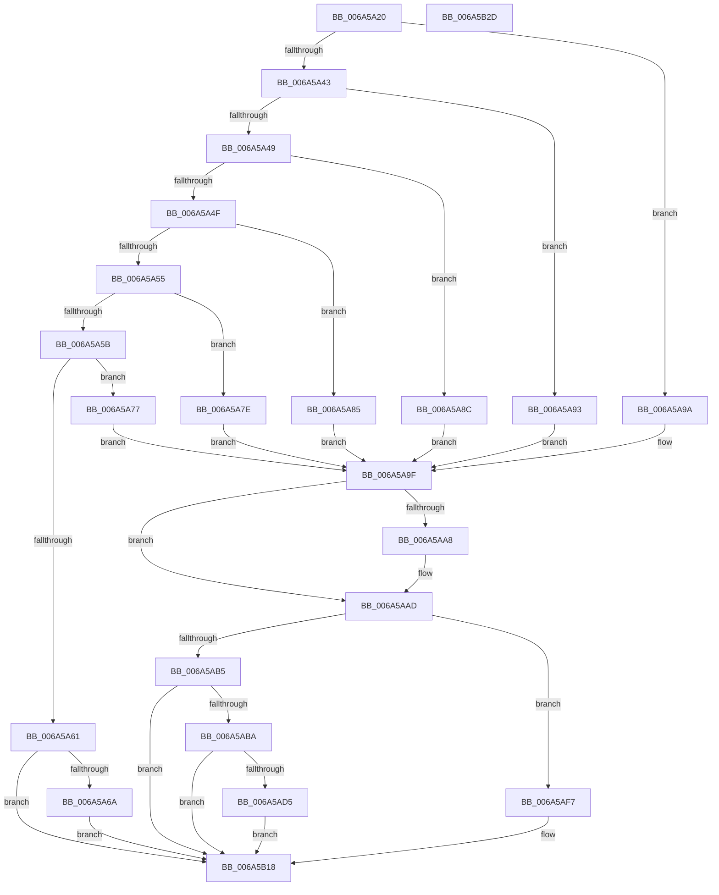

# SC_DEVICE::SaveStorageProperty

- RVA: `0x006A5A20`–`0x006A5B2E` (길이 `270` bytes)
- VA: `0x00000001406A5A20`
- 실행 섹션: `.text`
- PDB 이름 있음: `예`; PDB Function 태그: `아니요`
- unwind 정보 RVA: `0x00066400`
- 디코드: `77`개 명령, `270/270` bytes 표시
- 미해석 바이트: `0` (있으면 어셈블리에 `.byte`로 보존)

> 이 문서는 커널 이미지의 기계어와 PDB 기호를 분석해 생성했습니다. 4번과 5번은 함수 원형과 자료형을 바이너리 사용 방식에서 추정한 C 해석이며 원본 소스 복구 결과는 아닙니다.

## 1. Dependencies

- 직접 호출 지점: **5**; 고유 호출 대상: **4**
- 직접 호출자로 확인된 함수: **1**
- RIP 상대 이미지 참조: **0**

### Outgoing calls
- `0x006A5A6D` → [AlpcpFreeBuffer](../../page/90/AlpcpFreeBuffer_function_009071C0.md) (function, `0x009071C0`)
- `0x006A5AA8` → [AlpcpFreeBuffer](../../page/90/AlpcpFreeBuffer_function_009071C0.md) (function, `0x009071C0`)
- `0x006A5AC4` → [memset](../6C/memset_function_006C6C40.md) (function, `0x006C6C40`)
- `0x006A5AF0` → [memcpy](../6C/memcpy_function_006C6840.md) (function, `0x006C6840`)
- `0x006A5B13` → [ScExtractDeviceStrings](ScExtractDeviceStrings_function_006A4068.md) (function, `0x006A4068`)

### Direct callers
- [SC_DISK::SaveStorageProperty](SC_DISK_SaveStorageProperty_function_006A4B10.md) at `0x006A4B8B`

### Static image references
- 디코드된 RIP-relative 메모리 참조가 없습니다.

## 2. Other-region calls and transfers

- 다른 실행 섹션으로 향하는 call: **2**
  - `0x006A5A6D` → [AlpcpFreeBuffer](../../page/90/AlpcpFreeBuffer_function_009071C0.md) (`.text` → `PAGE`)
  - `0x006A5AA8` → [AlpcpFreeBuffer](../../page/90/AlpcpFreeBuffer_function_009071C0.md) (`.text` → `PAGE`)
- 별도 외부 분기/꼬리 이동을 확인하지 못했습니다.

## 3. Assembly (complete function range)

```asm
006A5A20  48 89 5C 24 08                  mov qword ptr [rsp + 8], rbx
006A5A25  48 89 6C 24 10                  mov qword ptr [rsp + 0x10], rbp
006A5A2A  48 89 74 24 18                  mov qword ptr [rsp + 0x18], rsi
006A5A2F  57                              push rdi
006A5A30  48 83 EC 30                     sub rsp, 0x30
006A5A34  49 8B F0                        mov rsi, r8
006A5A37  8B EA                           mov ebp, edx
006A5A39  48 8B F9                        mov rdi, rcx
006A5A3C  44 8B CA                        mov r9d, edx
006A5A3F  85 D2                           test edx, edx
006A5A41  74 57                           je 0x1406a5a9a
006A5A43  41 83 E9 01                     sub r9d, 1
006A5A47  74 4A                           je 0x1406a5a93
006A5A49  41 83 E9 01                     sub r9d, 1
006A5A4D  74 3D                           je 0x1406a5a8c
006A5A4F  41 83 E9 03                     sub r9d, 3
006A5A53  74 30                           je 0x1406a5a85
006A5A55  41 83 E9 0E                     sub r9d, 0xe
006A5A59  74 23                           je 0x1406a5a7e
006A5A5B  41 83 F9 2C                     cmp r9d, 0x2c
006A5A5F  74 16                           je 0x1406a5a77
006A5A61  4D 85 C0                        test r8, r8
006A5A64  0F 84 AE 00 00 00               je 0x1406a5b18
006A5A6A  49 8B C8                        mov rcx, r8
006A5A6D  E8 4E 17 26 00                  call 0x1409071c0
006A5A72  E9 A1 00 00 00                  jmp 0x1406a5b18
006A5A77  BB A8 00 00 00                  mov ebx, 0xa8
006A5A7C  EB 21                           jmp 0x1406a5a9f
006A5A7E  BB B0 00 00 00                  mov ebx, 0xb0
006A5A83  EB 1A                           jmp 0x1406a5a9f
006A5A85  BB C0 00 00 00                  mov ebx, 0xc0
006A5A8A  EB 13                           jmp 0x1406a5a9f
006A5A8C  BB B8 00 00 00                  mov ebx, 0xb8
006A5A91  EB 0C                           jmp 0x1406a5a9f
006A5A93  BB 98 00 00 00                  mov ebx, 0x98
006A5A98  EB 05                           jmp 0x1406a5a9f
006A5A9A  BB A0 00 00 00                  mov ebx, 0xa0
006A5A9F  48 8B 0C 0B                     mov rcx, qword ptr [rbx + rcx]
006A5AA3  48 85 C9                        test rcx, rcx
006A5AA6  74 05                           je 0x1406a5aad
006A5AA8  E8 13 17 26 00                  call 0x1409071c0
006A5AAD  48 89 34 3B                     mov qword ptr [rbx + rdi], rsi
006A5AB1  85 ED                           test ebp, ebp
006A5AB3  74 42                           je 0x1406a5af7
006A5AB5  83 FD 13                        cmp ebp, 0x13
006A5AB8  75 5E                           jne 0x1406a5b18
006A5ABA  33 D2                           xor edx, edx
006A5ABC  44 8D 45 2D                     lea r8d, [rbp + 0x2d]
006A5AC0  48 8D 4F 58                     lea rcx, [rdi + 0x58]
006A5AC4  E8 77 11 02 00                  call 0x1406c6c40
006A5AC9  4C 8B 8F B0 00 00 00            mov r9, qword ptr [rdi + 0xb0]
006A5AD0  4D 85 C9                        test r9, r9
006A5AD3  74 43                           je 0x1406a5b18
006A5AD5  41 8B 51 08                     mov edx, dword ptr [r9 + 8]
006A5AD9  8D 45 F1                        lea eax, [rbp - 0xf]
006A5ADC  3B D0                           cmp edx, eax
006A5ADE  48 8D 4F 58                     lea rcx, [rdi + 0x58]
006A5AE2  0F 42 C2                        cmovb eax, edx
006A5AE5  49 8D 51 0C                     lea rdx, [r9 + 0xc]
006A5AE9  44 8B C0                        mov r8d, eax
006A5AEC  49 C1 E0 04                     shl r8, 4
006A5AF0  E8 4B 0D 02 00                  call 0x1406c6840
006A5AF5  EB 21                           jmp 0x1406a5b18
006A5AF7  48 8B 8F A0 00 00 00            mov rcx, qword ptr [rdi + 0xa0]
006A5AFE  48 8D 47 48                     lea rax, [rdi + 0x48]
006A5B02  4C 8D 4F 38                     lea r9, [rdi + 0x38]
006A5B06  48 89 44 24 20                  mov qword ptr [rsp + 0x20], rax
006A5B0B  4C 8D 47 28                     lea r8, [rdi + 0x28]
006A5B0F  48 8D 57 18                     lea rdx, [rdi + 0x18]
006A5B13  E8 50 E5 FF FF                  call 0x1406a4068
006A5B18  48 8B 5C 24 40                  mov rbx, qword ptr [rsp + 0x40]
006A5B1D  48 8B 6C 24 48                  mov rbp, qword ptr [rsp + 0x48]
006A5B22  48 8B 74 24 50                  mov rsi, qword ptr [rsp + 0x50]
006A5B27  48 83 C4 30                     add rsp, 0x30
006A5B2B  5F                              pop rdi
006A5B2C  C3                              ret
006A5B2D  CC                              int3
```

## 4. C-style interpretation (structured pseudocode)

```c
__int64 __fastcall SC_DEVICE__SaveStorageProperty(__int64 a1, int a2, __int64 a3)
{
    __int64 result;
    __int64 v_rsp;
    unsigned __int64 v_stack_m18;
    unsigned __int64 v_stack_p10;
    unsigned __int64 v_stack_p18;
    unsigned __int64 v_stack_p8;

    v_stack_p8 = v_rbx;
    v_stack_p10 = v_rbp;
    v_stack_p18 = v_rsi;
    v_rsp = (v_rsp) - (48);
    if (a2 == 0) goto loc_006A5A9A;
    a4 = (unsigned int)(((unsigned int)(a2)) - (1));
    if (condition_is_equal) goto loc_006A5A93;
    a4 = (unsigned int)((a4) - (1));
    if (condition_is_equal) goto loc_006A5A8C;
    a4 = (unsigned int)((a4) - (3));
    if (condition_is_equal) goto loc_006A5A85;
    a4 = (unsigned int)((a4) - (14));
    if (condition_is_equal) goto loc_006A5A7E;
    if (((unsigned int)(a4)) == 44) goto loc_006A5A77;
    if (a3 == 0) goto loc_006A5B18;
    result = AlpcpFreeBuffer(a3, a2, a3, a4);
    goto loc_006A5B18;
loc_006A5A77:
    goto loc_006A5A9F;
loc_006A5A7E:
    goto loc_006A5A9F;
loc_006A5A85:
    goto loc_006A5A9F;
loc_006A5A8C:
    goto loc_006A5A9F;
loc_006A5A93:
    goto loc_006A5A9F;
loc_006A5A9A:
loc_006A5A9F:
    if (*(unsigned __int64 *)(160 + a3 * 1) != 0) {
        result = AlpcpFreeBuffer(*(unsigned __int64 *)(160 + a3 * 1), a2, a3, a4);
    }
    *(unsigned __int64 *)(160 + a1 * 1) = a3;
    if ((unsigned int)((unsigned int)(a2)) == 0) goto loc_006A5AF7;
    if (((unsigned int)((unsigned int)(a2))) != 19) goto loc_006A5B18;
    a2 = 0;
    result = memset(a1 + 88, a2, (unsigned int)(a2) + 45, a4);
    if (*(unsigned __int64 *)(a1 + 176) == 0) goto loc_006A5B18;
    result = (unsigned int)(a2) - 15;
    if (((unsigned int)((unsigned int)(*(unsigned int *)(*(unsigned __int64 *)(a1 + 176) + 8)))) < ((unsigned int)((unsigned int)(a2) - 15))) { result = (unsigned int)((unsigned int)(*(unsigned int *)(*(unsigned __int64 *)(a1 + 176) + 8))); }
    a3 = ((unsigned int)((unsigned int)(result))) << (4);
    result = memcpy(a1 + 88, *(unsigned __int64 *)(a1 + 176) + 12, a3, *(unsigned __int64 *)(a1 + 176));
    goto loc_006A5B18;
loc_006A5AF7:
    v_stack_m18 = a1 + 72;
    result = ScExtractDeviceStrings(*(unsigned __int64 *)(a1 + 160), a1 + 24, a1 + 40, a1 + 56);
loc_006A5B18:
    v_rsp = (v_rsp) + (48);
    return result;
}
```

## 5. (Beta) C Style

```c
int64_t SC_DEVICE__SaveStorageProperty(void *Arg1, int32_t Arg2, int64_t Arg3)
{
    uint8_t *arg1 = (uint8_t *)Arg1;

    int64_t result;
    int64_t local_rsp;
    uint64_t v_stack_m18;
    uint64_t v_stack_p10;
    uint64_t v_stack_p18;
    uint64_t v_stack_p8;

    v_stack_p8 = local_rbx;
    v_stack_p10 = local_rbp;
    v_stack_p18 = local_rsi;
    local_rsp = (local_rsp) - (48);
    if (Arg2 == 0) goto loc_006A5A9A;
    a4 = (uint32_t)(((uint32_t)(Arg2)) - (1));
    if (condition_is_equal) goto loc_006A5A93;
    a4 = (uint32_t)((a4) - (1));
    if (condition_is_equal) goto loc_006A5A8C;
    a4 = (uint32_t)((a4) - (3));
    if (condition_is_equal) goto loc_006A5A85;
    a4 = (uint32_t)((a4) - (14));
    if (condition_is_equal) goto loc_006A5A7E;
    if (((uint32_t)(a4)) == 44) goto loc_006A5A77;
    if (Arg3 == 0) goto loc_006A5B18;
    result = AlpcpFreeBuffer(Arg3, Arg2, Arg3, a4);
    goto loc_006A5B18;
loc_006A5A77:
    goto loc_006A5A9F;
loc_006A5A7E:
    goto loc_006A5A9F;
loc_006A5A85:
    goto loc_006A5A9F;
loc_006A5A8C:
    goto loc_006A5A9F;
loc_006A5A93:
    goto loc_006A5A9F;
loc_006A5A9A:
loc_006A5A9F:
    if (*(uint64_t *)(160 + Arg3 * 1) != 0) {
        result = AlpcpFreeBuffer(*(uint64_t *)(160 + Arg3 * 1), Arg2, Arg3, a4);
    }
    *(uint64_t *)(160 + arg1 * 1) = Arg3;
    if ((uint32_t)((uint32_t)(Arg2)) == 0) goto loc_006A5AF7;
    if (((uint32_t)((uint32_t)(Arg2))) != 19) goto loc_006A5B18;
    Arg2 = 0;
    result = memset(Arg1 + 88, Arg2, (uint32_t)(Arg2) + 45, a4);
    if (*(uint64_t *)(arg1 + 0xB0) == 0) goto loc_006A5B18;
    result = (uint32_t)(Arg2) - 15;
    if (((uint32_t)((uint32_t)(*(uint32_t *)(*(uint64_t *)(arg1 + 0xB0) + 0x8)))) < ((uint32_t)((uint32_t)(Arg2) - 15))) { result = (uint32_t)((uint32_t)(*(uint32_t *)(*(uint64_t *)(arg1 + 0xB0) + 0x8))); }
    Arg3 = ((uint32_t)((uint32_t)(result))) << (4);
    result = memcpy(Arg1 + 88, *(uint64_t *)(arg1 + 0xB0) + 12, Arg3, *(uint64_t *)(arg1 + 0xB0));
    goto loc_006A5B18;
loc_006A5AF7:
    v_stack_m18 = Arg1 + 72;
    result = ScExtractDeviceStrings(*(uint64_t *)(arg1 + 0xA0), Arg1 + 24, Arg1 + 40, Arg1 + 56);
loc_006A5B18:
    local_rsp = (local_rsp) + (48);
    return result;
}
```

### 관측된 메모리 오프셋

구조체 형식이 확인되지 않은 접근은 인자 기준의 오프셋으로만 기록했습니다.

| 기준 인자 | 오프셋 표현 | 폭 (bit) | 접근 |
|---|---:|---:|---|
| `Arg1` | `+ 0x18` | `64` | `R` |
| `Arg1` | `+ 0x28` | `64` | `R` |
| `Arg1` | `+ 0x38` | `64` | `R` |
| `Arg1` | `+ 0x48` | `64` | `R` |
| `Arg1` | `+ 0x58` | `64` | `R` |
| `Arg1` | `+ 0xA0` | `64` | `R` |
| `Arg1` | `+ 0xB0` | `64` | `R` |

## 6. Execution-region graph

[열기: 2D/3D 그래프와 함수 탐색 컨트롤 패널](../../../control-panel.html?section=text&rva=0x006A5A20&view=graph)

- 2D 그래프는 위에서 아래로 흐르고, 3D 그래프는 빈 공간을 드래그해 회전합니다. Shift+드래그는 이동, 휠은 확대·축소, 함수 노드 선택은 대상 보고서 이동입니다.

### Static fallback


