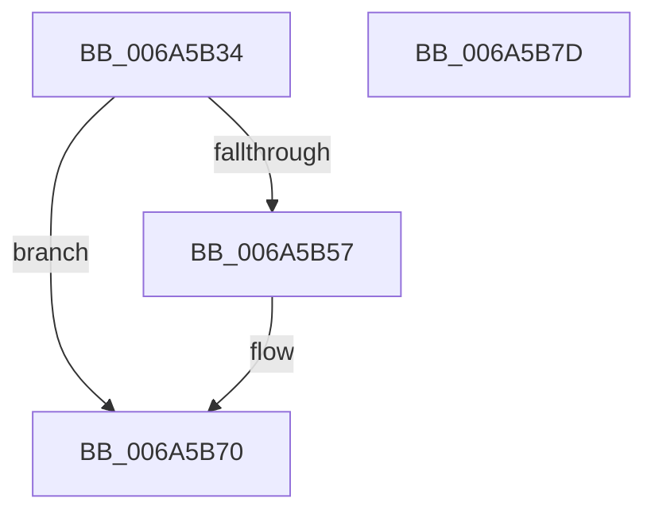

# SC_DEVICE::UpdateStorageProperty

- RVA: `0x006A5B34`–`0x006A5B7E` (길이 `74` bytes)
- VA: `0x00000001406A5B34`
- 실행 섹션: `.text`
- PDB 이름 있음: `예`; PDB Function 태그: `아니요`
- unwind 정보 RVA: `0x0005CAAC`
- 디코드: `22`개 명령, `74/74` bytes 표시
- 미해석 바이트: `0` (있으면 어셈블리에 `.byte`로 보존)

> 이 문서는 커널 이미지의 기계어와 PDB 기호를 분석해 생성했습니다. 4번과 5번은 함수 원형과 자료형을 바이너리 사용 방식에서 추정한 C 해석이며 원본 소스 복구 결과는 아닙니다.

## 1. Dependencies

- 직접 호출 지점: **2**; 고유 호출 대상: **2**
- 직접 호출자로 확인된 함수: **1**
- RIP 상대 이미지 참조: **0**

### Outgoing calls
- `0x006A5B4C` → [SC_DEVICE::GetStorageProperty](SC_DEVICE_GetStorageProperty_function_006A57F8.md) (function, `0x006A57F8`)
- `0x006A5B6B` → [guard_dispatch_icall](../6B/guard_dispatch_icall_function_006BAAD0.md) (function, `0x006BAAD0`)

### Direct callers
- [SC_DISK::Initialize](SC_DISK_Initialize_function_006A46C0.md) at `0x006A4815`

### Static image references
- 디코드된 RIP-relative 메모리 참조가 없습니다.

## 2. Other-region calls and transfers

- 다른 실행 섹션으로 향하는 call: **0**
- 별도 외부 분기/꼬리 이동을 확인하지 못했습니다.

## 3. Assembly (complete function range)

```asm
006A5B34  48 89 5C 24 08                  mov qword ptr [rsp + 8], rbx
006A5B39  57                              push rdi
006A5B3A  48 83 EC 20                     sub rsp, 0x20
006A5B3E  48 83 64 24 40 00               and qword ptr [rsp + 0x40], 0
006A5B44  4C 8D 44 24 40                  lea r8, [rsp + 0x40]
006A5B49  48 8B F9                        mov rdi, rcx
006A5B4C  E8 A7 FC FF FF                  call 0x1406a57f8
006A5B51  8B D8                           mov ebx, eax
006A5B53  85 C0                           test eax, eax
006A5B55  78 19                           js 0x1406a5b70
006A5B57  48 8B 17                        mov rdx, qword ptr [rdi]
006A5B5A  48 8B CF                        mov rcx, rdi
006A5B5D  4C 8B 44 24 40                  mov r8, qword ptr [rsp + 0x40]
006A5B62  48 8B 42 30                     mov rax, qword ptr [rdx + 0x30]
006A5B66  BA 06 00 00 00                  mov edx, 6
006A5B6B  E8 60 4F 01 00                  call 0x1406baad0
006A5B70  8B C3                           mov eax, ebx
006A5B72  48 8B 5C 24 30                  mov rbx, qword ptr [rsp + 0x30]
006A5B77  48 83 C4 20                     add rsp, 0x20
006A5B7B  5F                              pop rdi
006A5B7C  C3                              ret
006A5B7D  CC                              int3
```

## 4. C-style interpretation (structured pseudocode)

```c
__int64 __fastcall SC_DEVICE__UpdateStorageProperty(__int64 a1)
{
    __int64 result;
    __int64 v_rsp;
    unsigned __int64 v_stack_p18;
    unsigned __int64 v_stack_p8;

    v_stack_p8 = v_rbx;
    v_rsp = (v_rsp) - (32);
    result = SC_DEVICE__GetStorageProperty(a1, a2, v_stack_p18, a4);
    if (!(sign_flag)) {
        a2 = *(unsigned __int64 *)(a1);
        a1 = a1;
        a3 = v_stack_p18;
        result = *(unsigned __int64 *)(a2 + 48);
        a2 = 6;
        result = guard_dispatch_icall(a1, a2, a3, a4);
    }
    v_rsp = (v_rsp) + (32);
    return (unsigned int)((unsigned int)((unsigned int)((unsigned int)(result))));
}
```

## 5. (Beta) C Style

```c
int64_t SC_DEVICE__UpdateStorageProperty(void *Arg1)
{
    uint8_t *arg1 = (uint8_t *)Arg1;

    int64_t result;
    int64_t local_rsp;
    uint64_t v_stack_p18;
    uint64_t v_stack_p8;

    v_stack_p8 = local_rbx;
    local_rsp = (local_rsp) - (32);
    result = SC_DEVICE__GetStorageProperty(Arg1, a2, v_stack_p18, a4);
    if (!(sign_flag)) {
        a2 = *(uint64_t *)(arg1);
        Arg1 = Arg1;
        a3 = v_stack_p18;
        result = *(uint64_t *)(a2 + 0x30);
        a2 = 6;
        result = guard_dispatch_icall(Arg1, a2, a3, a4);
    }
    local_rsp = (local_rsp) + (32);
    return (uint32_t)((uint32_t)((uint32_t)((uint32_t)(result))));
}
```

### 관측된 메모리 오프셋

구조체 형식이 확인되지 않은 접근은 인자 기준의 오프셋으로만 기록했습니다.

| 기준 인자 | 오프셋 표현 | 폭 (bit) | 접근 |
|---|---:|---:|---|
| `Arg1` | `+ 0x0` | `64` | `R` |

## 6. Execution-region graph

[열기: 2D/3D 그래프와 함수 탐색 컨트롤 패널](../../../control-panel.html?section=text&rva=0x006A5B34&view=graph)

- 2D 그래프는 위에서 아래로 흐르고, 3D 그래프는 빈 공간을 드래그해 회전합니다. Shift+드래그는 이동, 휠은 확대·축소, 함수 노드 선택은 대상 보고서 이동입니다.

### Static fallback


