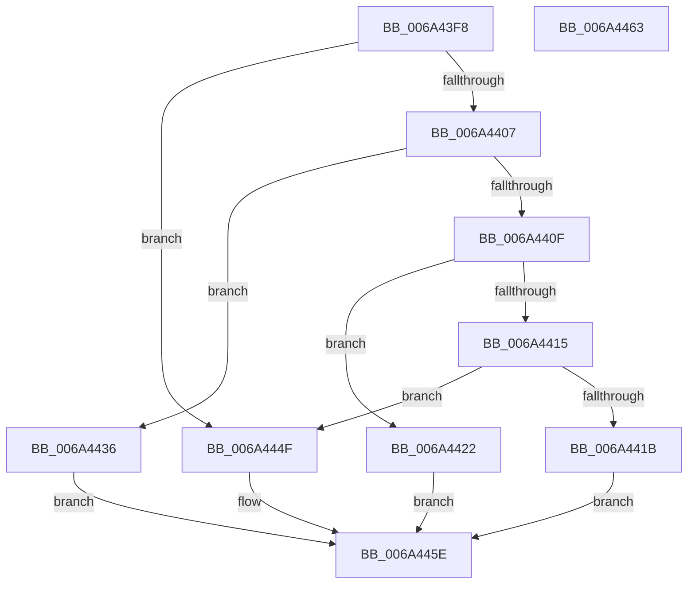

# SC_DISK::CreatePartitionTable

- RVA: `0x006A43F8`–`0x006A4464` (길이 `108` bytes)
- VA: `0x00000001406A43F8`
- 실행 섹션: `.text`
- PDB 이름 있음: `예`; PDB Function 태그: `아니요`
- unwind 정보 RVA: `0x0005C788`
- 디코드: `31`개 명령, `108/108` bytes 표시
- 미해석 바이트: `0` (있으면 어셈블리에 `.byte`로 보존)

> 이 문서는 커널 이미지의 기계어와 PDB 기호를 분석해 생성했습니다. 4번과 5번은 함수 원형과 자료형을 바이너리 사용 방식에서 추정한 C 해석이며 원본 소스 복구 결과는 아닙니다.

## 1. Dependencies

- 직접 호출 지점: **4**; 고유 호출 대상: **4**
- 직접 호출자로 확인된 함수: **2**
- RIP 상대 이미지 참조: **0**

### Outgoing calls
- `0x006A442F` → [SC_GPT::CreatePartitionTable](SC_GPT_CreatePartitionTable_function_006A3238.md) (function, `0x006A3238`)
- `0x006A443B` → [SC_MBR::Initialize](SC_MBR_Initialize_function_006A509C.md) (function, `0x006A509C`)
- `0x006A4448` → [SC_MBR::CreatePartitionTable](SC_MBR_CreatePartitionTable_function_006A4FEC.md) (function, `0x006A4FEC`)
- `0x006A4459` → [SC_RAW::CreatePartitionTable](SC_RAW_CreatePartitionTable_function_006A5B84.md) (function, `0x006A5B84`)

### Direct callers
- [SC_DISK::WritePartitionTable](SC_DISK_WritePartitionTable_function_006A4D4C.md) at `0x006A4D7F`
- [IoCreateDisk](../../page/71/IoCreateDisk_function_00717250.md) at `0x007172B4`

### Static image references
- 디코드된 RIP-relative 메모리 참조가 없습니다.

## 2. Other-region calls and transfers

- 다른 실행 섹션으로 향하는 call: **0**
- 별도 외부 분기/꼬리 이동을 확인하지 못했습니다.

## 3. Assembly (complete function range)

```asm
006A43F8  48 83 EC 28                     sub rsp, 0x28
006A43FC  4C 8B CA                        mov r9, rdx
006A43FF  48 8B D1                        mov rdx, rcx
006A4402  4D 85 C9                        test r9, r9
006A4405  74 48                           je 0x1406a444f
006A4407  45 8B 01                        mov r8d, dword ptr [r9]
006A440A  45 85 C0                        test r8d, r8d
006A440D  74 27                           je 0x1406a4436
006A440F  41 83 E8 01                     sub r8d, 1
006A4413  74 0D                           je 0x1406a4422
006A4415  41 83 F8 01                     cmp r8d, 1
006A4419  74 34                           je 0x1406a444f
006A441B  B8 BB 00 00 C0                  mov eax, 0xc00000bb
006A4420  EB 3C                           jmp 0x1406a445e
006A4422  48 89 54 24 38                  mov qword ptr [rsp + 0x38], rdx
006A4427  48 8D 4C 24 38                  lea rcx, [rsp + 0x38]
006A442C  49 8B D1                        mov rdx, r9
006A442F  E8 04 EE FF FF                  call 0x1406a3238
006A4434  EB 28                           jmp 0x1406a445e
006A4436  48 8D 4C 24 38                  lea rcx, [rsp + 0x38]
006A443B  E8 5C 0C 00 00                  call 0x1406a509c
006A4440  48 8D 4C 24 38                  lea rcx, [rsp + 0x38]
006A4445  49 8B D1                        mov rdx, r9
006A4448  E8 9F 0B 00 00                  call 0x1406a4fec
006A444D  EB 0F                           jmp 0x1406a445e
006A444F  48 8D 4C 24 38                  lea rcx, [rsp + 0x38]
006A4454  48 89 54 24 38                  mov qword ptr [rsp + 0x38], rdx
006A4459  E8 26 17 00 00                  call 0x1406a5b84
006A445E  48 83 C4 28                     add rsp, 0x28
006A4462  C3                              ret
006A4463  CC                              int3
```

## 4. C-style interpretation (structured pseudocode)

```c
__int64 __fastcall SC_DISK__CreatePartitionTable(__int64 a1, __int64 a2)
{
    __int64 result;
    __int64 v_rsp;
    unsigned __int64 v_stack_p10;

    v_rsp = (v_rsp) - (40);
    if (a2 == 0) goto loc_006A444F;
    if ((unsigned int)((unsigned int)(*(unsigned int *)(a2))) == 0) goto loc_006A4436;
    a3 = (unsigned int)(((unsigned int)(*(unsigned int *)(a2))) - (1));
    if (condition_is_equal) goto loc_006A4422;
    if (((unsigned int)(a3)) == 1) goto loc_006A444F;
    goto loc_006A445E;
loc_006A4422:
    v_stack_p10 = a1;
    result = SC_GPT__CreatePartitionTable(v_stack_p10, a2, a3, a2);
    goto loc_006A445E;
loc_006A4436:
    result = SC_MBR__Initialize(v_stack_p10, a2, a3, a2);
    result = SC_MBR__CreatePartitionTable(v_stack_p10, a2, a3, a2);
    goto loc_006A445E;
loc_006A444F:
    v_stack_p10 = a2;
    result = SC_RAW__CreatePartitionTable(v_stack_p10, a2, a3, a2);
loc_006A445E:
    v_rsp = (v_rsp) + (40);
    return result;
}
```

## 5. (Beta) C Style

```c
int64_t SC_DISK__CreatePartitionTable(int64_t Arg1, int64_t Arg2)
{
    int64_t result;
    int64_t local_rsp;
    uint64_t v_stack_p10;

    local_rsp = (local_rsp) - (40);
    if (Arg2 == 0) goto loc_006A444F;
    if ((uint32_t)((uint32_t)(*(uint32_t *)(Arg2))) == 0) goto loc_006A4436;
    a3 = (uint32_t)(((uint32_t)(*(uint32_t *)(Arg2))) - (1));
    if (condition_is_equal) goto loc_006A4422;
    if (((uint32_t)(a3)) == 1) goto loc_006A444F;
    goto loc_006A445E;
loc_006A4422:
    v_stack_p10 = Arg1;
    result = SC_GPT__CreatePartitionTable(v_stack_p10, Arg2, a3, Arg2);
    goto loc_006A445E;
loc_006A4436:
    result = SC_MBR__Initialize(v_stack_p10, Arg2, a3, Arg2);
    result = SC_MBR__CreatePartitionTable(v_stack_p10, Arg2, a3, Arg2);
    goto loc_006A445E;
loc_006A444F:
    v_stack_p10 = Arg2;
    result = SC_RAW__CreatePartitionTable(v_stack_p10, Arg2, a3, Arg2);
loc_006A445E:
    local_rsp = (local_rsp) + (40);
    return result;
}
```

## 6. Execution-region graph

[열기: 2D/3D 그래프와 함수 탐색 컨트롤 패널](../../../control-panel.html?section=text&rva=0x006A43F8&view=graph)

- 2D 그래프는 위에서 아래로 흐르고, 3D 그래프는 빈 공간을 드래그해 회전합니다. Shift+드래그는 이동, 휠은 확대·축소, 함수 노드 선택은 대상 보고서 이동입니다.

### Static fallback


