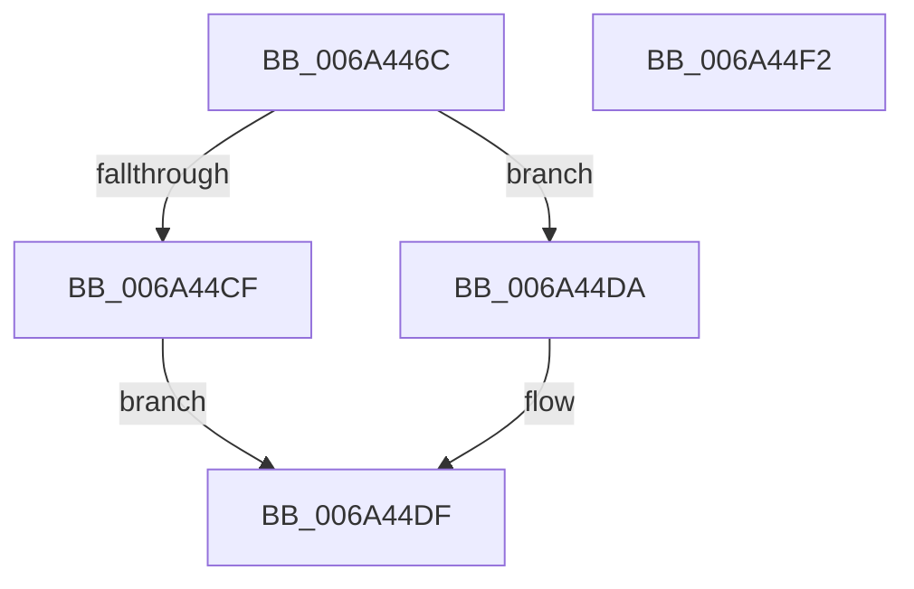

# SC_DISK::GenerateId

- RVA: `0x006A446C`–`0x006A44F3` (길이 `135` bytes)
- VA: `0x00000001406A446C`
- 실행 섹션: `.text`
- PDB 이름 있음: `예`; PDB Function 태그: `아니요`
- unwind 정보 RVA: `0x0009DFE8`
- 디코드: `35`개 명령, `135/135` bytes 표시
- 미해석 바이트: `0` (있으면 어셈블리에 `.byte`로 보존)

> 이 문서는 커널 이미지의 기계어와 PDB 기호를 분석해 생성했습니다. 4번과 5번은 함수 원형과 자료형을 바이너리 사용 방식에서 추정한 C 해석이며 원본 소스 복구 결과는 아닙니다.

## 1. Dependencies

- 직접 호출 지점: **3**; 고유 호출 대상: **3**
- 직접 호출자로 확인된 함수: **1**
- RIP 상대 이미지 참조: **1**

### Outgoing calls
- `0x006A44BF` → [guard_dispatch_icall](../6B/guard_dispatch_icall_function_006BAAD0.md) (function, `0x006BAAD0`)
- `0x006A44DA` → [SC_ENV::CreateGuid](../../page/71/SC_ENV_CreateGuid_function_007170B0.md) (function, `0x007170B0`)
- `0x006A44E7` → [_security_check_cookie](_security_check_cookie_function_006AC640.md) (function, `0x006AC640`)

### Direct callers
- [SC_DISK::Initialize](SC_DISK_Initialize_function_006A46C0.md) at `0x006A481D`

### Static image references
- `0x006A4472` → RVA `0x00E0A740` (`.data`; read)

## 2. Other-region calls and transfers

- 다른 실행 섹션으로 향하는 call: **1**
  - `0x006A44DA` → [SC_ENV::CreateGuid](../../page/71/SC_ENV_CreateGuid_function_007170B0.md) (`.text` → `PAGE`)
- 별도 외부 분기/꼬리 이동을 확인하지 못했습니다.

## 3. Assembly (complete function range)

```asm
006A446C  40 53                           push rbx
006A446E  48 83 EC 70                     sub rsp, 0x70
006A4472  48 8B 05 C7 62 76 00            mov rax, qword ptr [rip + 0x7662c7]
006A4479  48 33 C4                        xor rax, rsp
006A447C  48 89 44 24 68                  mov qword ptr [rsp + 0x68], rax
006A4481  33 C0                           xor eax, eax
006A4483  C7 44 24 28 28 00 00 00         mov dword ptr [rsp + 0x28], 0x28
006A448B  48 89 44 24 60                  mov qword ptr [rsp + 0x60], rax
006A4490  48 8B D9                        mov rbx, rcx
006A4493  48 8B 01                        mov rax, qword ptr [rcx]
006A4496  0F 57 C0                        xorps xmm0, xmm0
006A4499  48 8D 4C 24 40                  lea rcx, [rsp + 0x40]
006A449E  45 33 C9                        xor r9d, r9d
006A44A1  48 89 4C 24 20                  mov qword ptr [rsp + 0x20], rcx
006A44A6  45 33 C0                        xor r8d, r8d
006A44A9  BA 84 10 2D 00                  mov edx, 0x2d1084
006A44AE  48 8B CB                        mov rcx, rbx
006A44B1  48 8B 40 10                     mov rax, qword ptr [rax + 0x10]
006A44B5  0F 11 44 24 40                  movups xmmword ptr [rsp + 0x40], xmm0
006A44BA  0F 11 44 24 50                  movups xmmword ptr [rsp + 0x50], xmm0
006A44BF  E8 0C 66 01 00                  call 0x1406baad0
006A44C4  48 8D 8B 10 01 00 00            lea rcx, [rbx + 0x110]
006A44CB  85 C0                           test eax, eax
006A44CD  78 0B                           js 0x1406a44da
006A44CF  0F 10 44 24 54                  movups xmm0, xmmword ptr [rsp + 0x54]
006A44D4  F3 0F 7F 01                     movdqu xmmword ptr [rcx], xmm0
006A44D8  EB 05                           jmp 0x1406a44df
006A44DA  E8 D1 2B 07 00                  call 0x1407170b0
006A44DF  48 8B 4C 24 68                  mov rcx, qword ptr [rsp + 0x68]
006A44E4  48 33 CC                        xor rcx, rsp
006A44E7  E8 54 81 00 00                  call 0x1406ac640
006A44EC  48 83 C4 70                     add rsp, 0x70
006A44F0  5B                              pop rbx
006A44F1  C3                              ret
006A44F2  CC                              int3
```

## 4. C-style interpretation (structured pseudocode)

```c
__int64 __fastcall SC_DISK__GenerateId(__int64 a1, __int64 a2, int a3, int a4)
{
    __int64 result;
    __int64 v_rsp;
    unsigned __int64 v_stack_m10;
    unsigned __int64 v_stack_m18;
    unsigned __int64 v_stack_m24;
    unsigned __int64 v_stack_m28;
    unsigned __int64 v_stack_m38;
    unsigned int v_stack_m50;
    unsigned __int64 v_stack_m58;

    v_rsp = (v_rsp) - (112);
    result = (*(unsigned __int64 *)(v_rip + 7758535)) ^ (v_rsp);
    v_stack_m10 = result;
    result = 0;
    v_stack_m50 = 40;
    v_stack_m18 = 0;
    a4 = 0;
    v_stack_m58 = v_stack_m38;
    a3 = 0;
    v_stack_m38 = v_xmm0;
    v_stack_m28 = v_xmm0;
    result = guard_dispatch_icall(a1, (unsigned int)(0x2D1084ULL), a3, a4);
    if (sign_flag) goto loc_006A44DA;
    *(unsigned __int64 *)(a1 + 272) = v_xmm0;
    goto loc_006A44DF;
loc_006A44DA:
    result = SC_ENV__CreateGuid(a1 + 272, (unsigned int)(0x2D1084ULL), a3, a4);
loc_006A44DF:
    a1 = (v_stack_m10) ^ (v_rsp);
    result = _security_check_cookie(a1, (unsigned int)(0x2D1084ULL), a3, a4);
    v_rsp = (v_rsp) + (112);
    return result;
}
```

## 5. (Beta) C Style

```c
int64_t SC_DISK__GenerateId(void *Arg1, int64_t Arg2, int32_t Arg3, int32_t Arg4)
{
    uint8_t *arg1 = (uint8_t *)Arg1;

    int64_t result;
    int64_t local_rsp;
    uint64_t v_stack_m10;
    uint64_t v_stack_m18;
    uint64_t v_stack_m24;
    uint64_t v_stack_m28;
    uint64_t v_stack_m38;
    uint32_t v_stack_m50;
    uint64_t v_stack_m58;

    local_rsp = (local_rsp) - (112);
    result = (*(uint64_t *)(v_rip + 0x7662C7)) ^ (local_rsp);
    v_stack_m10 = result;
    result = 0;
    v_stack_m50 = 40;
    v_stack_m18 = 0;
    Arg4 = 0;
    v_stack_m58 = v_stack_m38;
    Arg3 = 0;
    v_stack_m38 = v_xmm0;
    v_stack_m28 = v_xmm0;
    result = guard_dispatch_icall(Arg1, (uint32_t)(0x2D1084ULL), Arg3, Arg4);
    if (sign_flag) goto loc_006A44DA;
    *(uint64_t *)(arg1 + 0x110) = v_xmm0;
    goto loc_006A44DF;
loc_006A44DA:
    result = SC_ENV__CreateGuid(Arg1 + 272, (uint32_t)(0x2D1084ULL), Arg3, Arg4);
loc_006A44DF:
    Arg1 = (v_stack_m10) ^ (local_rsp);
    result = _security_check_cookie(Arg1, (uint32_t)(0x2D1084ULL), Arg3, Arg4);
    local_rsp = (local_rsp) + (112);
    return result;
}
```

### 관측된 메모리 오프셋

구조체 형식이 확인되지 않은 접근은 인자 기준의 오프셋으로만 기록했습니다.

| 기준 인자 | 오프셋 표현 | 폭 (bit) | 접근 |
|---|---:|---:|---|
| `Arg1` | `+ 0x0` | `64` | `R` |
| `Arg1` | `+ 0x0` | `128` | `W` |
| `Arg1` | `+ 0x110` | `64` | `R` |

## 6. Execution-region graph

[열기: 2D/3D 그래프와 함수 탐색 컨트롤 패널](../../../control-panel.html?section=text&rva=0x006A446C&view=graph)

- 2D 그래프는 위에서 아래로 흐르고, 3D 그래프는 빈 공간을 드래그해 회전합니다. Shift+드래그는 이동, 휠은 확대·축소, 함수 노드 선택은 대상 보고서 이동입니다.

### Static fallback


