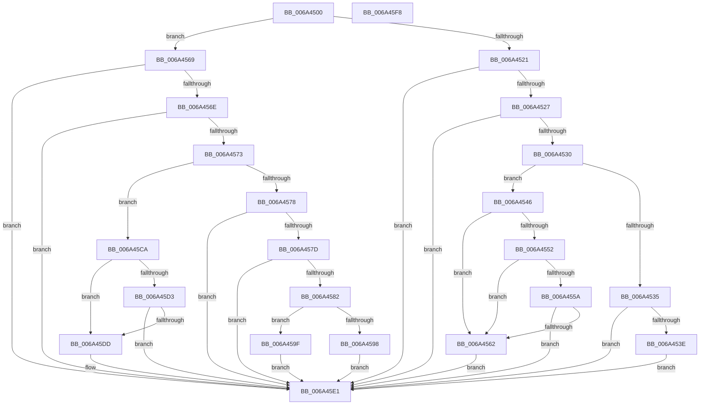

# SC_DISK::GetStoragePropertyPost

- RVA: `0x006A4500`–`0x006A45F9` (길이 `249` bytes)
- VA: `0x00000001406A4500`
- 실행 섹션: `.text`
- PDB 이름 있음: `예`; PDB Function 태그: `아니요`
- unwind 정보 RVA: `0x0005C954`
- 디코드: `77`개 명령, `249/249` bytes 표시
- 미해석 바이트: `0` (있으면 어셈블리에 `.byte`로 보존)

> 이 문서는 커널 이미지의 기계어와 PDB 기호를 분석해 생성했습니다. 4번과 5번은 함수 원형과 자료형을 바이너리 사용 방식에서 추정한 C 해석이며 원본 소스 복구 결과는 아닙니다.

## 1. Dependencies

- 직접 호출 지점: **4**; 고유 호출 대상: **4**
- 직접 호출자로 확인된 함수: **0**
- RIP 상대 이미지 참조: **0**

### Outgoing calls
- `0x006A458B` → [SC_ENV::Allocate](../../page/71/SC_ENV_Allocate_function_00716F90.md) (function, `0x00716F90`)
- `0x006A45AA` → [memcpy](../6C/memcpy_function_006C6840.md) (function, `0x006C6840`)
- `0x006A45B9` → [ScAnsiToUnicodeString](ScAnsiToUnicodeString_function_006A3FB0.md) (function, `0x006A3FB0`)
- `0x006A45C3` → [AlpcpFreeBuffer](../../page/90/AlpcpFreeBuffer_function_009071C0.md) (function, `0x009071C0`)

### Direct callers
- 이 함수 시작 RVA로 연결되는 직접 call은 확인되지 않았습니다. 간접 호출은 완전히 역산할 수 없습니다.

### Static image references
- 디코드된 RIP-relative 메모리 참조가 없습니다.

## 2. Other-region calls and transfers

- 다른 실행 섹션으로 향하는 call: **2**
  - `0x006A458B` → [SC_ENV::Allocate](../../page/71/SC_ENV_Allocate_function_00716F90.md) (`.text` → `PAGE`)
  - `0x006A45C3` → [AlpcpFreeBuffer](../../page/90/AlpcpFreeBuffer_function_009071C0.md) (`.text` → `PAGE`)
- 별도 외부 분기/꼬리 이동을 확인하지 못했습니다.

## 3. Assembly (complete function range)

```asm
006A4500  48 89 5C 24 08                  mov qword ptr [rsp + 8], rbx
006A4505  48 89 6C 24 10                  mov qword ptr [rsp + 0x10], rbp
006A450A  48 89 74 24 18                  mov qword ptr [rsp + 0x18], rsi
006A450F  57                              push rdi
006A4510  48 83 EC 20                     sub rsp, 0x20
006A4514  33 DB                           xor ebx, ebx
006A4516  49 8B F8                        mov rdi, r8
006A4519  48 8B E9                        mov rbp, rcx
006A451C  83 FA 0E                        cmp edx, 0xe
006A451F  7F 48                           jg 0x1406a4569
006A4521  0F 84 BA 00 00 00               je 0x1406a45e1
006A4527  83 EA 04                        sub edx, 4
006A452A  0F 84 B1 00 00 00               je 0x1406a45e1
006A4530  83 EA 02                        sub edx, 2
006A4533  74 11                           je 0x1406a4546
006A4535  83 EA 01                        sub edx, 1
006A4538  0F 84 A3 00 00 00               je 0x1406a45e1
006A453E  83 EA 01                        sub edx, 1
006A4541  E9 9B 00 00 00                  jmp 0x1406a45e1
006A4546  8B 89 EC 00 00 00               mov ecx, dword ptr [rcx + 0xec]
006A454C  41 39 48 10                     cmp dword ptr [r8 + 0x10], ecx
006A4550  75 10                           jne 0x1406a4562
006A4552  41 8B 40 14                     mov eax, dword ptr [r8 + 0x14]
006A4556  3B C1                           cmp eax, ecx
006A4558  72 08                           jb 0x1406a4562
006A455A  33 D2                           xor edx, edx
006A455C  F7 F1                           div ecx
006A455E  85 D2                           test edx, edx
006A4560  74 7F                           je 0x1406a45e1
006A4562  BB 0B 09 00 C0                  mov ebx, 0xc000090b
006A4567  EB 78                           jmp 0x1406a45e1
006A4569  83 EA 15                        sub edx, 0x15
006A456C  74 73                           je 0x1406a45e1
006A456E  83 EA 24                        sub edx, 0x24
006A4571  74 6E                           je 0x1406a45e1
006A4573  83 EA 01                        sub edx, 1
006A4576  74 52                           je 0x1406a45ca
006A4578  83 EA 02                        sub edx, 2
006A457B  74 64                           je 0x1406a45e1
006A457D  83 FA 05                        cmp edx, 5
006A4580  75 5F                           jne 0x1406a45e1
006A4582  41 8B 48 08                     mov ecx, dword ptr [r8 + 8]
006A4586  45 33 C9                        xor r9d, r9d
006A4589  FF C1                           inc ecx
006A458B  E8 00 2A 07 00                  call 0x140716f90
006A4590  48 8B F0                        mov rsi, rax
006A4593  48 85 C0                        test rax, rax
006A4596  75 07                           jne 0x1406a459f
006A4598  BB 9A 00 00 C0                  mov ebx, 0xc000009a
006A459D  EB 42                           jmp 0x1406a45e1
006A459F  44 8B 47 08                     mov r8d, dword ptr [rdi + 8]
006A45A3  48 8D 57 0C                     lea rdx, [rdi + 0xc]
006A45A7  48 8B CE                        mov rcx, rsi
006A45AA  E8 91 22 02 00                  call 0x1406c6840
006A45AF  48 8D 95 20 01 00 00            lea rdx, [rbp + 0x120]
006A45B6  48 8B CE                        mov rcx, rsi
006A45B9  E8 F2 F9 FF FF                  call 0x1406a3fb0
006A45BE  8B D8                           mov ebx, eax
006A45C0  48 8B CE                        mov rcx, rsi
006A45C3  E8 F8 2B 26 00                  call 0x1409071c0
006A45C8  EB 17                           jmp 0x1406a45e1
006A45CA  41 8B 50 20                     mov edx, dword ptr [r8 + 0x20]
006A45CE  41 3B 10                        cmp edx, dword ptr [r8]
006A45D1  72 0A                           jb 0x1406a45dd
006A45D3  41 8B 48 04                     mov ecx, dword ptr [r8 + 4]
006A45D7  FF C9                           dec ecx
006A45D9  3B D1                           cmp edx, ecx
006A45DB  76 04                           jbe 0x1406a45e1
006A45DD  41 89 58 20                     mov dword ptr [r8 + 0x20], ebx
006A45E1  48 8B 6C 24 38                  mov rbp, qword ptr [rsp + 0x38]
006A45E6  8B C3                           mov eax, ebx
006A45E8  48 8B 5C 24 30                  mov rbx, qword ptr [rsp + 0x30]
006A45ED  48 8B 74 24 40                  mov rsi, qword ptr [rsp + 0x40]
006A45F2  48 83 C4 20                     add rsp, 0x20
006A45F6  5F                              pop rdi
006A45F7  C3                              ret
006A45F8  CC                              int3
```

## 4. C-style interpretation (structured pseudocode)

```c
__int64 __fastcall SC_DISK__GetStoragePropertyPost(__int64 a1, int a2, __int64 a3, int a4)
{
    __int64 result;
    __int64 v_rbx;
    __int64 v_rsp;
    unsigned __int64 v_stack_p10;
    unsigned __int64 v_stack_p18;
    unsigned __int64 v_stack_p8;

    v_stack_p8 = v_rbx;
    v_stack_p10 = v_rbp;
    v_stack_p18 = v_rsi;
    v_rsp = (v_rsp) - (32);
    v_rbx = 0;
    if (a2 > 14) goto loc_006A4569;
    if (a2 == 14) goto loc_006A45E1;
    a2 = (unsigned int)((a2) - (4));
    if (condition_is_equal) goto loc_006A45E1;
    a2 = (unsigned int)((a2) - (2));
    if (condition_is_equal) goto loc_006A4546;
    a2 = (unsigned int)((a2) - (1));
    if (condition_is_equal) goto loc_006A45E1;
    a2 = (unsigned int)((a2) - (1));
    goto loc_006A45E1;
loc_006A4546:
    if ((*(unsigned int *)(a3 + 16)) != ((unsigned int)((unsigned int)(*(unsigned int *)(a1 + 236))))) goto loc_006A4562;
    if (((unsigned int)((unsigned int)(*(unsigned int *)(a3 + 20)))) < ((unsigned int)((unsigned int)(*(unsigned int *)(a1 + 236))))) goto loc_006A4562;
    a2 = 0;
    if (0 == 0) goto loc_006A45E1;
loc_006A4562:
    goto loc_006A45E1;
loc_006A4569:
    a2 = (unsigned int)((a2) - (21));
    if (condition_is_equal) goto loc_006A45E1;
    a2 = (unsigned int)((a2) - (36));
    if (condition_is_equal) goto loc_006A45E1;
    a2 = (unsigned int)((a2) - (1));
    if (condition_is_equal) goto loc_006A45CA;
    a2 = (unsigned int)((a2) - (2));
    if (condition_is_equal) goto loc_006A45E1;
    if (a2 != 5) goto loc_006A45E1;
    a4 = 0;
    a1 = (unsigned int)(((unsigned int)(*(unsigned int *)(a3 + 8))) + 1);
    result = SC_ENV__Allocate(a1, a2, a3, a4);
    if (result != 0) goto loc_006A459F;
    goto loc_006A45E1;
loc_006A459F:
    result = memcpy(result, a3 + 12, (unsigned int)(*(unsigned int *)(a3 + 8)), a4);
    result = ScAnsiToUnicodeString(result, a1 + 288, (unsigned int)(*(unsigned int *)(a3 + 8)), a4);
    result = AlpcpFreeBuffer(result, a1 + 288, (unsigned int)(*(unsigned int *)(a3 + 8)), a4);
    goto loc_006A45E1;
loc_006A45CA:
    if (((unsigned int)((unsigned int)(*(unsigned int *)((unsigned int)(*(unsigned int *)(a3 + 8)) + 32)))) < (*(unsigned int *)((unsigned int)(*(unsigned int *)(a3 + 8))))) goto loc_006A45DD;
    a1 = (unsigned int)(((unsigned int)(*(unsigned int *)((unsigned int)(*(unsigned int *)(a3 + 8)) + 4))) - 1);
    if (((unsigned int)((unsigned int)(*(unsigned int *)((unsigned int)(*(unsigned int *)(a3 + 8)) + 32)))) >= = ((unsigned int)(a1))) {
        *(unsigned int *)((unsigned int)(*(unsigned int *)(a3 + 8)) + 32) = (unsigned int)((unsigned int)((unsigned int)(result)));
    }
    v_rsp = (v_rsp) + (32);
    return (unsigned int)((unsigned int)((unsigned int)((unsigned int)(result))));
}
```

## 5. (Beta) C Style

```c
int64_t SC_DISK__GetStoragePropertyPost(void *Arg1, int32_t Arg2, void *Arg3, int32_t Arg4)
{
    uint8_t *arg1 = (uint8_t *)Arg1;
    uint8_t *arg3 = (uint8_t *)Arg3;

    int64_t result;
    int64_t local_rbx;
    int64_t local_rsp;
    uint64_t v_stack_p10;
    uint64_t v_stack_p18;
    uint64_t v_stack_p8;

    v_stack_p8 = local_rbx;
    v_stack_p10 = local_rbp;
    v_stack_p18 = local_rsi;
    local_rsp = (local_rsp) - (32);
    local_rbx = 0;
    if (Arg2 > 14) goto loc_006A4569;
    if (Arg2 == 14) goto loc_006A45E1;
    Arg2 = (uint32_t)((Arg2) - (4));
    if (condition_is_equal) goto loc_006A45E1;
    Arg2 = (uint32_t)((Arg2) - (2));
    if (condition_is_equal) goto loc_006A4546;
    Arg2 = (uint32_t)((Arg2) - (1));
    if (condition_is_equal) goto loc_006A45E1;
    Arg2 = (uint32_t)((Arg2) - (1));
    goto loc_006A45E1;
loc_006A4546:
    if ((*(uint32_t *)(arg3 + 0x10)) != ((uint32_t)((uint32_t)(*(uint32_t *)(arg1 + 0xEC))))) goto loc_006A4562;
    if (((uint32_t)((uint32_t)(*(uint32_t *)(arg3 + 0x14)))) < ((uint32_t)((uint32_t)(*(uint32_t *)(arg1 + 0xEC))))) goto loc_006A4562;
    Arg2 = 0;
    if (0 == 0) goto loc_006A45E1;
loc_006A4562:
    goto loc_006A45E1;
loc_006A4569:
    Arg2 = (uint32_t)((Arg2) - (21));
    if (condition_is_equal) goto loc_006A45E1;
    Arg2 = (uint32_t)((Arg2) - (36));
    if (condition_is_equal) goto loc_006A45E1;
    Arg2 = (uint32_t)((Arg2) - (1));
    if (condition_is_equal) goto loc_006A45CA;
    Arg2 = (uint32_t)((Arg2) - (2));
    if (condition_is_equal) goto loc_006A45E1;
    if (Arg2 != 5) goto loc_006A45E1;
    Arg4 = 0;
    Arg1 = (uint32_t)(((uint32_t)(*(uint32_t *)(arg3 + 0x8))) + 1);
    result = SC_ENV__Allocate(Arg1, Arg2, Arg3, Arg4);
    if (result != 0) goto loc_006A459F;
    goto loc_006A45E1;
loc_006A459F:
    result = memcpy(result, Arg3 + 12, (uint32_t)(*(uint32_t *)(arg3 + 0x8)), Arg4);
    result = ScAnsiToUnicodeString(result, Arg1 + 288, (uint32_t)(*(uint32_t *)(arg3 + 0x8)), Arg4);
    result = AlpcpFreeBuffer(result, Arg1 + 288, (uint32_t)(*(uint32_t *)(arg3 + 0x8)), Arg4);
    goto loc_006A45E1;
loc_006A45CA:
    if (((uint32_t)((uint32_t)(*(uint32_t *)((uint32_t)(*(uint32_t *)(arg3 + 0x8)) + 0x20)))) < (*(uint32_t *)((uint32_t)(*(uint32_t *)(arg3 + 0x8))))) goto loc_006A45DD;
    Arg1 = (uint32_t)(((uint32_t)(*(uint32_t *)((uint32_t)(*(uint32_t *)(arg3 + 0x8)) + 0x4))) - 1);
    if (((uint32_t)((uint32_t)(*(uint32_t *)((uint32_t)(*(uint32_t *)(arg3 + 0x8)) + 0x20)))) >= = ((uint32_t)(Arg1))) {
        *(uint32_t *)((uint32_t)(*(uint32_t *)(arg3 + 0x8)) + 0x20) = (uint32_t)((uint32_t)((uint32_t)(result)));
    }
    local_rsp = (local_rsp) + (32);
    return (uint32_t)((uint32_t)((uint32_t)((uint32_t)(result))));
}
```

### 관측된 메모리 오프셋

구조체 형식이 확인되지 않은 접근은 인자 기준의 오프셋으로만 기록했습니다.

| 기준 인자 | 오프셋 표현 | 폭 (bit) | 접근 |
|---|---:|---:|---|
| `Arg1` | `+ 0xEC` | `32` | `R` |
| `Arg1` | `+ 0x120` | `64` | `R` |
| `Arg3` | `+ 0x0` | `32` | `R` |
| `Arg3` | `+ 0x4` | `32` | `R` |
| `Arg3` | `+ 0x8` | `32` | `R` |
| `Arg3` | `+ 0xC` | `64` | `R` |
| `Arg3` | `+ 0x10` | `32` | `R` |
| `Arg3` | `+ 0x14` | `32` | `R` |
| `Arg3` | `+ 0x20` | `32` | `R` |
| `Arg3` | `+ 0x20` | `32` | `W` |

## 6. Execution-region graph

[열기: 2D/3D 그래프와 함수 탐색 컨트롤 패널](../../../control-panel.html?section=text&rva=0x006A4500&view=graph)

- 2D 그래프는 위에서 아래로 흐르고, 3D 그래프는 빈 공간을 드래그해 회전합니다. Shift+드래그는 이동, 휠은 확대·축소, 함수 노드 선택은 대상 보고서 이동입니다.

### Static fallback


