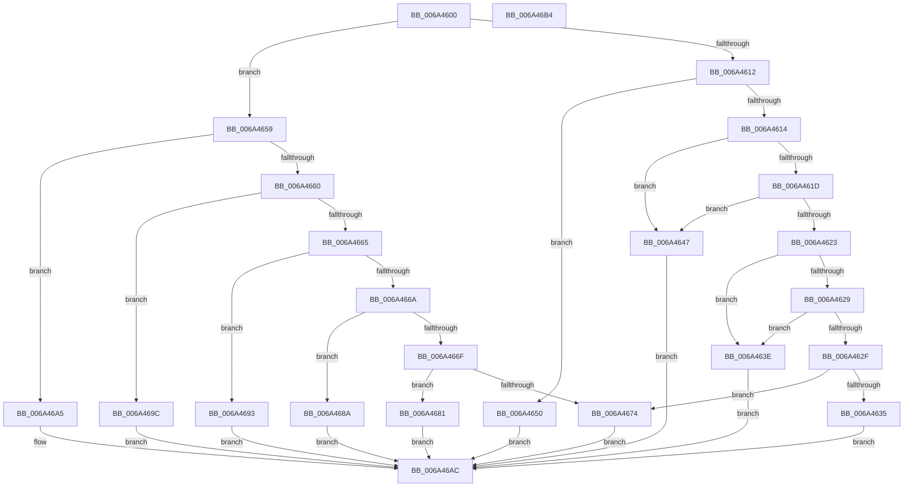

# SC_DISK::GetStoragePropertyPre

- RVA: `0x006A4600`–`0x006A46B5` (길이 `181` bytes)
- VA: `0x00000001406A4600`
- 실행 섹션: `.text`
- PDB 이름 있음: `예`; PDB Function 태그: `아니요`
- unwind 정보 RVA: `0x0005C788`
- 디코드: `54`개 명령, `181/181` bytes 표시
- 미해석 바이트: `0` (있으면 어셈블리에 `.byte`로 보존)

> 이 문서는 커널 이미지의 기계어와 PDB 기호를 분석해 생성했습니다. 4번과 5번은 함수 원형과 자료형을 바이너리 사용 방식에서 추정한 C 해석이며 원본 소스 복구 결과는 아닙니다.

## 1. Dependencies

- 직접 호출 지점: **1**; 고유 호출 대상: **1**
- 직접 호출자로 확인된 함수: **0**
- RIP 상대 이미지 참조: **0**

### Outgoing calls
- `0x006A4677` → [SC_DEVICE::GetStoragePropertyPre](SC_DEVICE_GetStoragePropertyPre_function_006A5930.md) (function, `0x006A5930`)

### Direct callers
- 이 함수 시작 RVA로 연결되는 직접 call은 확인되지 않았습니다. 간접 호출은 완전히 역산할 수 없습니다.

### Static image references
- 디코드된 RIP-relative 메모리 참조가 없습니다.

## 2. Other-region calls and transfers

- 다른 실행 섹션으로 향하는 call: **0**
- 별도 외부 분기/꼬리 이동을 확인하지 못했습니다.

## 3. Assembly (complete function range)

```asm
006A4600  48 83 EC 28                     sub rsp, 0x28
006A4604  45 33 D2                        xor r10d, r10d
006A4607  4C 8B D9                        mov r11, rcx
006A460A  45 89 10                        mov dword ptr [r8], r10d
006A460D  83 FA 0E                        cmp edx, 0xe
006A4610  7F 47                           jg 0x1406a4659
006A4612  74 3C                           je 0x1406a4650
006A4614  44 8B CA                        mov r9d, edx
006A4617  41 83 E9 04                     sub r9d, 4
006A461B  74 2A                           je 0x1406a4647
006A461D  41 83 E9 02                     sub r9d, 2
006A4621  74 24                           je 0x1406a4647
006A4623  41 83 E9 01                     sub r9d, 1
006A4627  74 15                           je 0x1406a463e
006A4629  41 83 E9 01                     sub r9d, 1
006A462D  74 0F                           je 0x1406a463e
006A462F  41 83 F9 03                     cmp r9d, 3
006A4633  75 3F                           jne 0x1406a4674
006A4635  41 C7 00 28 00 00 00            mov dword ptr [r8], 0x28
006A463C  EB 6E                           jmp 0x1406a46ac
006A463E  41 C7 00 0C 00 00 00            mov dword ptr [r8], 0xc
006A4645  EB 65                           jmp 0x1406a46ac
006A4647  41 C7 00 1C 00 00 00            mov dword ptr [r8], 0x1c
006A464E  EB 5C                           jmp 0x1406a46ac
006A4650  41 C7 00 20 00 00 00            mov dword ptr [r8], 0x20
006A4657  EB 53                           jmp 0x1406a46ac
006A4659  8B CA                           mov ecx, edx
006A465B  83 E9 15                        sub ecx, 0x15
006A465E  74 45                           je 0x1406a46a5
006A4660  83 E9 24                        sub ecx, 0x24
006A4663  74 37                           je 0x1406a469c
006A4665  83 E9 01                        sub ecx, 1
006A4668  74 29                           je 0x1406a4693
006A466A  83 E9 02                        sub ecx, 2
006A466D  74 1B                           je 0x1406a468a
006A466F  83 F9 05                        cmp ecx, 5
006A4672  74 0D                           je 0x1406a4681
006A4674  49 8B CB                        mov rcx, r11
006A4677  E8 B4 12 00 00                  call 0x1406a5930
006A467C  44 8B D0                        mov r10d, eax
006A467F  EB 2B                           jmp 0x1406a46ac
006A4681  41 C7 00 10 00 00 00            mov dword ptr [r8], 0x10
006A4688  EB 22                           jmp 0x1406a46ac
006A468A  41 C7 00 30 00 00 00            mov dword ptr [r8], 0x30
006A4691  EB 19                           jmp 0x1406a46ac
006A4693  41 C7 00 24 00 00 00            mov dword ptr [r8], 0x24
006A469A  EB 10                           jmp 0x1406a46ac
006A469C  41 C7 00 08 01 00 00            mov dword ptr [r8], 0x108
006A46A3  EB 07                           jmp 0x1406a46ac
006A46A5  41 C7 00 18 00 00 00            mov dword ptr [r8], 0x18
006A46AC  41 8B C2                        mov eax, r10d
006A46AF  48 83 C4 28                     add rsp, 0x28
006A46B3  C3                              ret
006A46B4  CC                              int3
```

## 4. C-style interpretation (structured pseudocode)

```c
__int64 __fastcall SC_DISK__GetStoragePropertyPre(__int64 a1, int a2, __int64 a3)
{
    __int64 result;
    __int64 v_r10;
    __int64 v_rsp;

    v_rsp = (v_rsp) - (40);
    v_r10 = 0;
    *(unsigned int *)(a3) = 0;
    if (a2 > 14) goto loc_006A4659;
    if (a2 == 14) goto loc_006A4650;
    a4 = (unsigned int)(((unsigned int)(a2)) - (4));
    if (condition_is_equal) goto loc_006A4647;
    a4 = (unsigned int)((a4) - (2));
    if (condition_is_equal) goto loc_006A4647;
    a4 = (unsigned int)((a4) - (1));
    if (condition_is_equal) goto loc_006A463E;
    a4 = (unsigned int)((a4) - (1));
    if (condition_is_equal) goto loc_006A463E;
    if (((unsigned int)(a4)) != 3) goto loc_006A4674;
    *(unsigned int *)(a3) = 40;
    goto loc_006A46AC;
loc_006A463E:
    *(unsigned int *)(a3) = 12;
    goto loc_006A46AC;
loc_006A4647:
    *(unsigned int *)(a3) = 28;
    goto loc_006A46AC;
loc_006A4650:
    *(unsigned int *)(a3) = 32;
    goto loc_006A46AC;
loc_006A4659:
    a1 = (unsigned int)(((unsigned int)(a2)) - (21));
    if (condition_is_equal) goto loc_006A46A5;
    a1 = (unsigned int)((a1) - (36));
    if (condition_is_equal) goto loc_006A469C;
    a1 = (unsigned int)((a1) - (1));
    if (condition_is_equal) goto loc_006A4693;
    a1 = (unsigned int)((a1) - (2));
    if (condition_is_equal) goto loc_006A468A;
    if (((unsigned int)(a1)) == 5) goto loc_006A4681;
loc_006A4674:
    result = SC_DEVICE__GetStoragePropertyPre(a1, a2, a3, a4);
    goto loc_006A46AC;
loc_006A4681:
    *(unsigned int *)(a3) = 16;
    goto loc_006A46AC;
loc_006A468A:
    *(unsigned int *)(a3) = 48;
    goto loc_006A46AC;
loc_006A4693:
    *(unsigned int *)(a3) = 36;
    goto loc_006A46AC;
loc_006A469C:
    *(unsigned int *)(a3) = 264;
    goto loc_006A46AC;
loc_006A46A5:
    *(unsigned int *)(a3) = 24;
loc_006A46AC:
    v_rsp = (v_rsp) + (40);
    return (unsigned int)((unsigned int)((unsigned int)((unsigned int)(result))));
}
```

## 5. (Beta) C Style

```c
int64_t SC_DISK__GetStoragePropertyPre(int64_t Arg1, int32_t Arg2, void *Arg3)
{
    uint8_t *arg3 = (uint8_t *)Arg3;

    int64_t result;
    int64_t local_r10;
    int64_t local_rsp;

    local_rsp = (local_rsp) - (40);
    local_r10 = 0;
    *(uint32_t *)(arg3) = 0;
    if (Arg2 > 14) goto loc_006A4659;
    if (Arg2 == 14) goto loc_006A4650;
    a4 = (uint32_t)(((uint32_t)(Arg2)) - (4));
    if (condition_is_equal) goto loc_006A4647;
    a4 = (uint32_t)((a4) - (2));
    if (condition_is_equal) goto loc_006A4647;
    a4 = (uint32_t)((a4) - (1));
    if (condition_is_equal) goto loc_006A463E;
    a4 = (uint32_t)((a4) - (1));
    if (condition_is_equal) goto loc_006A463E;
    if (((uint32_t)(a4)) != 3) goto loc_006A4674;
    *(uint32_t *)(arg3) = 40;
    goto loc_006A46AC;
loc_006A463E:
    *(uint32_t *)(arg3) = 12;
    goto loc_006A46AC;
loc_006A4647:
    *(uint32_t *)(arg3) = 28;
    goto loc_006A46AC;
loc_006A4650:
    *(uint32_t *)(arg3) = 32;
    goto loc_006A46AC;
loc_006A4659:
    Arg1 = (uint32_t)(((uint32_t)(Arg2)) - (21));
    if (condition_is_equal) goto loc_006A46A5;
    Arg1 = (uint32_t)((Arg1) - (36));
    if (condition_is_equal) goto loc_006A469C;
    Arg1 = (uint32_t)((Arg1) - (1));
    if (condition_is_equal) goto loc_006A4693;
    Arg1 = (uint32_t)((Arg1) - (2));
    if (condition_is_equal) goto loc_006A468A;
    if (((uint32_t)(Arg1)) == 5) goto loc_006A4681;
loc_006A4674:
    result = SC_DEVICE__GetStoragePropertyPre(Arg1, Arg2, Arg3, a4);
    goto loc_006A46AC;
loc_006A4681:
    *(uint32_t *)(arg3) = 16;
    goto loc_006A46AC;
loc_006A468A:
    *(uint32_t *)(arg3) = 48;
    goto loc_006A46AC;
loc_006A4693:
    *(uint32_t *)(arg3) = 36;
    goto loc_006A46AC;
loc_006A469C:
    *(uint32_t *)(arg3) = 264;
    goto loc_006A46AC;
loc_006A46A5:
    *(uint32_t *)(arg3) = 24;
loc_006A46AC:
    local_rsp = (local_rsp) + (40);
    return (uint32_t)((uint32_t)((uint32_t)((uint32_t)(result))));
}
```

### 관측된 메모리 오프셋

구조체 형식이 확인되지 않은 접근은 인자 기준의 오프셋으로만 기록했습니다.

| 기준 인자 | 오프셋 표현 | 폭 (bit) | 접근 |
|---|---:|---:|---|
| `Arg3` | `+ 0x0` | `32` | `W` |

## 6. Execution-region graph

[열기: 2D/3D 그래프와 함수 탐색 컨트롤 패널](../../../control-panel.html?section=text&rva=0x006A4600&view=graph)

- 2D 그래프는 위에서 아래로 흐르고, 3D 그래프는 빈 공간을 드래그해 회전합니다. Shift+드래그는 이동, 휠은 확대·축소, 함수 노드 선택은 대상 보고서 이동입니다.

### Static fallback


