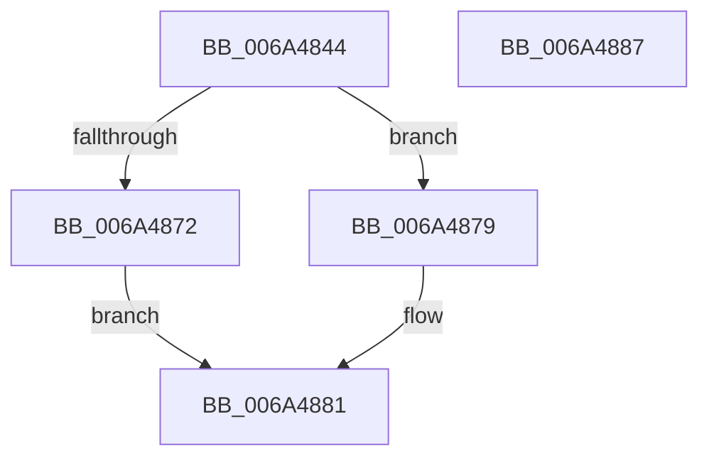

# SC_DISK::InitializePartitionCache

- RVA: `0x006A4844`–`0x006A4888` (길이 `68` bytes)
- VA: `0x00000001406A4844`
- 실행 섹션: `.text`
- PDB 이름 있음: `예`; PDB Function 태그: `아니요`
- unwind 정보 RVA: `0x0005CF00`
- 디코드: `20`개 명령, `68/68` bytes 표시
- 미해석 바이트: `0` (있으면 어셈블리에 `.byte`로 보존)

> 이 문서는 커널 이미지의 기계어와 PDB 기호를 분석해 생성했습니다. 4번과 5번은 함수 원형과 자료형을 바이너리 사용 방식에서 추정한 C 해석이며 원본 소스 복구 결과는 아닙니다.

## 1. Dependencies

- 직접 호출 지점: **2**; 고유 호출 대상: **2**
- 직접 호출자로 확인된 함수: **1**
- RIP 상대 이미지 참조: **0**

### Outgoing calls
- `0x006A4861` → [SC_ENV::Allocate](../../page/71/SC_ENV_Allocate_function_00716F90.md) (function, `0x00716F90`)
- `0x006A487C` → [SC_DISK::ResetPartitionCache](SC_DISK_ResetPartitionCache_function_006A4A70.md) (function, `0x006A4A70`)

### Direct callers
- [NT_DISK::Initialize](../../page/71/NT_DISK_Initialize_function_007170C8.md) at `0x007170E4`

### Static image references
- 디코드된 RIP-relative 메모리 참조가 없습니다.

## 2. Other-region calls and transfers

- 다른 실행 섹션으로 향하는 call: **1**
  - `0x006A4861` → [SC_ENV::Allocate](../../page/71/SC_ENV_Allocate_function_00716F90.md) (`.text` → `PAGE`)
- 별도 외부 분기/꼬리 이동을 확인하지 못했습니다.

## 3. Assembly (complete function range)

```asm
006A4844  40 53                           push rbx
006A4846  48 83 EC 20                     sub rsp, 0x20
006A484A  48 8B D9                        mov rbx, rcx
006A484D  41 B9 01 00 00 00               mov r9d, 1
006A4853  8B 89 F0 00 00 00               mov ecx, dword ptr [rcx + 0xf0]
006A4859  41 8B C1                        mov eax, r9d
006A485C  D3 E0                           shl eax, cl
006A485E  48 63 C8                        movsxd rcx, eax
006A4861  E8 2A 27 07 00                  call 0x140716f90
006A4866  48 89 83 08 01 00 00            mov qword ptr [rbx + 0x108], rax
006A486D  48 85 C0                        test rax, rax
006A4870  75 07                           jne 0x1406a4879
006A4872  B8 9A 00 00 C0                  mov eax, 0xc000009a
006A4877  EB 08                           jmp 0x1406a4881
006A4879  48 8B CB                        mov rcx, rbx
006A487C  E8 EF 01 00 00                  call 0x1406a4a70
006A4881  48 83 C4 20                     add rsp, 0x20
006A4885  5B                              pop rbx
006A4886  C3                              ret
006A4887  CC                              int3
```

## 4. C-style interpretation (structured pseudocode)

```c
__int64 __fastcall SC_DISK__InitializePartitionCache(__int64 a1)
{
    __int64 result;
    __int64 v_rsp;

    v_rsp = (v_rsp) - (32);
    result = (unsigned int)((1) << ((unsigned __int8)((unsigned int)(*(unsigned int *)(a1 + 240)))));
    result = SC_ENV__Allocate((int)((unsigned int)(result)), a2, a3, 1);
    *(unsigned __int64 *)(a1 + 264) = result;
    if (result != 0) goto loc_006A4879;
    goto loc_006A4881;
loc_006A4879:
    result = SC_DISK__ResetPartitionCache(a1, a2, a3, 1);
loc_006A4881:
    v_rsp = (v_rsp) + (32);
    return result;
}
```

## 5. (Beta) C Style

```c
int64_t SC_DISK__InitializePartitionCache(void *Arg1)
{
    uint8_t *arg1 = (uint8_t *)Arg1;

    int64_t result;
    int64_t local_rsp;

    local_rsp = (local_rsp) - (32);
    result = (uint32_t)((1) << ((uint8_t)((uint32_t)(*(uint32_t *)(arg1 + 0xF0)))));
    result = SC_ENV__Allocate((int32_t)((uint32_t)(result)), a2, a3, 1);
    *(uint64_t *)(arg1 + 0x108) = result;
    if (result != 0) goto loc_006A4879;
    goto loc_006A4881;
loc_006A4879:
    result = SC_DISK__ResetPartitionCache(Arg1, a2, a3, 1);
loc_006A4881:
    local_rsp = (local_rsp) + (32);
    return result;
}
```

### 관측된 메모리 오프셋

구조체 형식이 확인되지 않은 접근은 인자 기준의 오프셋으로만 기록했습니다.

| 기준 인자 | 오프셋 표현 | 폭 (bit) | 접근 |
|---|---:|---:|---|
| `Arg1` | `+ 0xF0` | `32` | `R` |
| `Arg1` | `+ 0x108` | `64` | `W` |

## 6. Execution-region graph

[열기: 2D/3D 그래프와 함수 탐색 컨트롤 패널](../../../control-panel.html?section=text&rva=0x006A4844&view=graph)

- 2D 그래프는 위에서 아래로 흐르고, 3D 그래프는 빈 공간을 드래그해 회전합니다. Shift+드래그는 이동, 휠은 확대·축소, 함수 노드 선택은 대상 보고서 이동입니다.

### Static fallback


