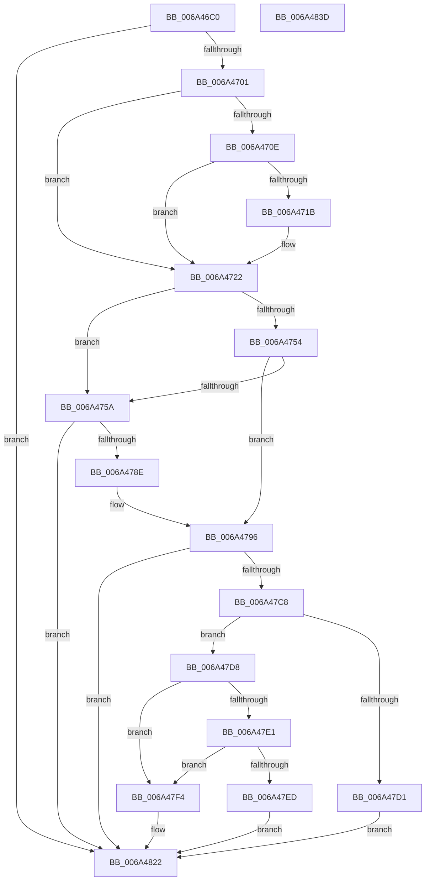

# SC_DISK::Initialize

- RVA: `0x006A46C0`–`0x006A483E` (길이 `382` bytes)
- VA: `0x00000001406A46C0`
- 실행 섹션: `.text`
- PDB 이름 있음: `예`; PDB Function 태그: `아니요`
- unwind 정보 RVA: `0x0009EB30`
- 디코드: `93`개 명령, `382/382` bytes 표시
- 미해석 바이트: `0` (있으면 어셈블리에 `.byte`로 보존)

> 이 문서는 커널 이미지의 기계어와 PDB 기호를 분석해 생성했습니다. 4번과 5번은 함수 원형과 자료형을 바이너리 사용 방식에서 추정한 C 해석이며 원본 소스 복구 결과는 아닙니다.

## 1. Dependencies

- 직접 호출 지점: **8**; 고유 호출 대상: **6**
- 직접 호출자로 확인된 함수: **1**
- RIP 상대 이미지 참조: **3**

### Outgoing calls
- `0x006A46F4` → [SC_DEVICE::Initialize](SC_DEVICE_Initialize_function_006A5990.md) (function, `0x006A5990`)
- `0x006A474B` → [guard_dispatch_icall](../6B/guard_dispatch_icall_function_006BAAD0.md) (function, `0x006BAAD0`)
- `0x006A4781` → [guard_dispatch_icall](../6B/guard_dispatch_icall_function_006BAAD0.md) (function, `0x006BAAD0`)
- `0x006A47BF` → [guard_dispatch_icall](../6B/guard_dispatch_icall_function_006BAAD0.md) (function, `0x006BAAD0`)
- `0x006A47D8` → [Feature_3266732347__private_IsEnabledDeviceUsageNoInline](Feature_3266732347__private_IsEnabledDeviceUsageNoInline_function_006A4E70.md) (function, `0x006A4E70`)
- `0x006A4815` → [SC_DEVICE::UpdateStorageProperty](SC_DEVICE_UpdateStorageProperty_function_006A5B34.md) (function, `0x006A5B34`)
- `0x006A481D` → [SC_DISK::GenerateId](SC_DISK_GenerateId_function_006A446C.md) (function, `0x006A446C`)
- `0x006A482A` → [_security_check_cookie](_security_check_cookie_function_006AC640.md) (function, `0x006AC640`)

### Direct callers
- [NT_DISK::Initialize](../../page/71/NT_DISK_Initialize_function_007170C8.md) at `0x007170D8`

### Static image references
- `0x006A46CA` → RVA `0x00E0A740` (`.data`; read)
- `0x006A4705` → RVA `0x00026BB0` (`.rdata`; read)
- `0x006A4712` → RVA `0x00026BB8` (`.rdata`; read)

## 2. Other-region calls and transfers

- 다른 실행 섹션으로 향하는 call: **0**
- 별도 외부 분기/꼬리 이동을 확인하지 못했습니다.

## 3. Assembly (complete function range)

```asm
006A46C0  48 89 5C 24 10                  mov qword ptr [rsp + 0x10], rbx
006A46C5  57                              push rdi
006A46C6  48 83 EC 70                     sub rsp, 0x70
006A46CA  48 8B 05 6F 60 76 00            mov rax, qword ptr [rip + 0x76606f]
006A46D1  48 33 C4                        xor rax, rsp
006A46D4  48 89 44 24 68                  mov qword ptr [rsp + 0x68], rax
006A46D9  83 64 24 40 00                  and dword ptr [rsp + 0x40], 0
006A46DE  0F 57 C0                        xorps xmm0, xmm0
006A46E1  33 C0                           xor eax, eax
006A46E3  48 8B D9                        mov rbx, rcx
006A46E6  0F 11 44 24 44                  movups xmmword ptr [rsp + 0x44], xmm0
006A46EB  89 44 24 64                     mov dword ptr [rsp + 0x64], eax
006A46EF  0F 11 44 24 54                  movups xmmword ptr [rsp + 0x54], xmm0
006A46F4  E8 97 12 00 00                  call 0x1406a5990
006A46F9  85 C0                           test eax, eax
006A46FB  0F 88 21 01 00 00               js 0x1406a4822
006A4701  48 8B 43 08                     mov rax, qword ptr [rbx + 8]
006A4705  48 3B 05 A4 24 98 FF            cmp rax, qword ptr [rip - 0x67db5c]
006A470C  75 14                           jne 0x1406a4722
006A470E  48 8B 43 10                     mov rax, qword ptr [rbx + 0x10]
006A4712  48 3B 05 9F 24 98 FF            cmp rax, qword ptr [rip - 0x67db61]
006A4719  75 07                           jne 0x1406a4722
006A471B  83 8B C8 00 00 00 01            or dword ptr [rbx + 0xc8], 1
006A4722  48 8B 03                        mov rax, qword ptr [rbx]
006A4725  48 8D BB D0 00 00 00            lea rdi, [rbx + 0xd0]
006A472C  C7 44 24 28 08 00 00 00         mov dword ptr [rsp + 0x28], 8
006A4734  45 33 C9                        xor r9d, r9d
006A4737  45 33 C0                        xor r8d, r8d
006A473A  48 89 7C 24 20                  mov qword ptr [rsp + 0x20], rdi
006A473F  BA 5C 40 07 00                  mov edx, 0x7405c
006A4744  48 8B CB                        mov rcx, rbx
006A4747  48 8B 40 10                     mov rax, qword ptr [rax + 0x10]
006A474B  E8 80 63 01 00                  call 0x1406baad0
006A4750  85 C0                           test eax, eax
006A4752  78 06                           js 0x1406a475a
006A4754  48 83 3F 00                     cmp qword ptr [rdi], 0
006A4758  75 3C                           jne 0x1406a4796
006A475A  48 8B 03                        mov rax, qword ptr [rbx]
006A475D  48 8D 4C 24 40                  lea rcx, [rsp + 0x40]
006A4762  C7 44 24 28 28 00 00 00         mov dword ptr [rsp + 0x28], 0x28
006A476A  45 33 C9                        xor r9d, r9d
006A476D  48 89 4C 24 20                  mov qword ptr [rsp + 0x20], rcx
006A4772  45 33 C0                        xor r8d, r8d
006A4775  BA A0 00 07 00                  mov edx, 0x700a0
006A477A  48 8B CB                        mov rcx, rbx
006A477D  48 8B 40 10                     mov rax, qword ptr [rax + 0x10]
006A4781  E8 4A 63 01 00                  call 0x1406baad0
006A4786  85 C0                           test eax, eax
006A4788  0F 88 94 00 00 00               js 0x1406a4822
006A478E  48 8B 44 24 58                  mov rax, qword ptr [rsp + 0x58]
006A4793  48 89 07                        mov qword ptr [rdi], rax
006A4796  48 8B 03                        mov rax, qword ptr [rbx]
006A4799  48 8D 8B D8 00 00 00            lea rcx, [rbx + 0xd8]
006A47A0  C7 44 24 28 18 00 00 00         mov dword ptr [rsp + 0x28], 0x18
006A47A8  45 33 C9                        xor r9d, r9d
006A47AB  48 89 4C 24 20                  mov qword ptr [rsp + 0x20], rcx
006A47B0  45 33 C0                        xor r8d, r8d
006A47B3  BA 00 00 07 00                  mov edx, 0x70000
006A47B8  48 8B CB                        mov rcx, rbx
006A47BB  48 8B 40 10                     mov rax, qword ptr [rax + 0x10]
006A47BF  E8 0C 63 01 00                  call 0x1406baad0
006A47C4  85 C0                           test eax, eax
006A47C6  78 5A                           js 0x1406a4822
006A47C8  83 BB EC 00 00 00 00            cmp dword ptr [rbx + 0xec], 0
006A47CF  75 07                           jne 0x1406a47d8
006A47D1  B8 A3 00 00 C0                  mov eax, 0xc00000a3
006A47D6  EB 4A                           jmp 0x1406a4822
006A47D8  E8 93 06 00 00                  call 0x1406a4e70
006A47DD  85 C0                           test eax, eax
006A47DF  74 13                           je 0x1406a47f4
006A47E1  81 BB EC 00 00 00 00 02 00 00   cmp dword ptr [rbx + 0xec], 0x200
006A47EB  73 07                           jae 0x1406a47f4
006A47ED  B8 14 00 00 C0                  mov eax, 0xc0000014
006A47F2  EB 2E                           jmp 0x1406a4822
006A47F4  8B 83 EC 00 00 00               mov eax, dword ptr [rbx + 0xec]
006A47FA  0F BD D0                        bsr edx, eax
006A47FD  89 93 F0 00 00 00               mov dword ptr [rbx + 0xf0], edx
006A4803  8B CA                           mov ecx, edx
006A4805  48 8B 07                        mov rax, qword ptr [rdi]
006A4808  48 D3 E8                        shr rax, cl
006A480B  48 8B CB                        mov rcx, rbx
006A480E  48 89 83 F8 00 00 00            mov qword ptr [rbx + 0xf8], rax
006A4815  E8 1A 13 00 00                  call 0x1406a5b34
006A481A  48 8B CB                        mov rcx, rbx
006A481D  E8 4A FC FF FF                  call 0x1406a446c
006A4822  48 8B 4C 24 68                  mov rcx, qword ptr [rsp + 0x68]
006A4827  48 33 CC                        xor rcx, rsp
006A482A  E8 11 7E 00 00                  call 0x1406ac640
006A482F  48 8B 9C 24 88 00 00 00         mov rbx, qword ptr [rsp + 0x88]
006A4837  48 83 C4 70                     add rsp, 0x70
006A483B  5F                              pop rdi
006A483C  C3                              ret
006A483D  CC                              int3
```

## 4. C-style interpretation (structured pseudocode)

```c
__int64 __fastcall SC_DISK__Initialize(__int64 a1, __int64 a2, int a3, int a4)
{
    __int64 result;
    __int64 v_rsp;
    unsigned __int64 v_stack_m10;
    unsigned int v_stack_m14;
    unsigned __int64 v_stack_m20;
    unsigned __int64 v_stack_m24;
    unsigned __int64 v_stack_m34;
    unsigned int v_stack_m38;
    unsigned int v_stack_m50;
    unsigned __int64 v_stack_m58;
    unsigned __int64 v_stack_p10;

    v_stack_p10 = v_rbx;
    v_rsp = (v_rsp) - (112);
    result = (*(unsigned __int64 *)(v_rip + 7757935)) ^ (v_rsp);
    v_stack_m10 = result;
    result = 0;
    v_stack_m34 = v_xmm0;
    v_stack_m14 = 0;
    v_stack_m24 = v_xmm0;
    result = SC_DEVICE__Initialize(a1, a2, a3, a4);
    if (sign_flag) goto loc_006A4822;
    if ((*(unsigned __int64 *)(a1 + 8)) != (*(unsigned __int64 *)(v_rip - 6806364))) goto loc_006A4722;
    if ((*(unsigned __int64 *)(a1 + 16)) == (*(unsigned __int64 *)(v_rip - 6806369))) {
    }
    v_stack_m50 = 8;
    a4 = 0;
    a3 = 0;
    v_stack_m58 = a1 + 208;
    result = guard_dispatch_icall(a1, (unsigned int)(0x7405CULL), a3, a4);
    if (sign_flag) goto loc_006A475A;
    if ((*(unsigned __int64 *)(a1 + 208)) != 0) goto loc_006A4796;
loc_006A475A:
    v_stack_m50 = 40;
    a4 = 0;
    v_stack_m58 = v_stack_m38;
    a3 = 0;
    result = guard_dispatch_icall(a1, (unsigned int)(0x700A0ULL), a3, a4);
    if (sign_flag) goto loc_006A4822;
    *(unsigned __int64 *)(a1 + 208) = v_stack_m20;
loc_006A4796:
    v_stack_m50 = 24;
    a4 = 0;
    v_stack_m58 = a1 + 216;
    a3 = 0;
    result = guard_dispatch_icall(a1, (unsigned int)(0x70000ULL), a3, a4);
    if (sign_flag) goto loc_006A4822;
    if ((*(unsigned int *)(a1 + 236)) != 0) goto loc_006A47D8;
    goto loc_006A4822;
loc_006A47D8:
    result = Feature_3266732347__private_IsEnabledDeviceUsageNoInline(a1, (unsigned int)(0x70000ULL), a3, a4);
    if ((unsigned int)(result) == 0) goto loc_006A47F4;
    if ((*(unsigned int *)(a1 + 236)) >= 512) goto loc_006A47F4;
    goto loc_006A4822;
loc_006A47F4:
    *(unsigned int *)(a1 + 240) = (unsigned int)((unsigned int)(0x70000ULL));
    result = (*(unsigned __int64 *)(a1 + 208)) >> ((unsigned __int8)((unsigned int)((unsigned int)((unsigned int)(0x70000ULL)))));
    *(unsigned __int64 *)(a1 + 248) = result;
    result = SC_DEVICE__UpdateStorageProperty(a1, (unsigned int)(0x70000ULL), a3, a4);
    result = SC_DISK__GenerateId(a1, (unsigned int)(0x70000ULL), a3, a4);
loc_006A4822:
    a1 = (v_stack_m10) ^ (v_rsp);
    result = _security_check_cookie(a1, (unsigned int)(0x70000ULL), a3, a4);
    v_rsp = (v_rsp) + (112);
    return result;
}
```

## 5. (Beta) C Style

```c
int64_t SC_DISK__Initialize(void *Arg1, int64_t Arg2, int32_t Arg3, int32_t Arg4)
{
    uint8_t *arg1 = (uint8_t *)Arg1;

    int64_t result;
    int64_t local_rsp;
    uint64_t v_stack_m10;
    uint32_t v_stack_m14;
    uint64_t v_stack_m20;
    uint64_t v_stack_m24;
    uint64_t v_stack_m34;
    uint32_t v_stack_m38;
    uint32_t v_stack_m50;
    uint64_t v_stack_m58;
    uint64_t v_stack_p10;

    v_stack_p10 = local_rbx;
    local_rsp = (local_rsp) - (112);
    result = (*(uint64_t *)(v_rip + 0x76606F)) ^ (local_rsp);
    v_stack_m10 = result;
    result = 0;
    v_stack_m34 = v_xmm0;
    v_stack_m14 = 0;
    v_stack_m24 = v_xmm0;
    result = SC_DEVICE__Initialize(Arg1, Arg2, Arg3, Arg4);
    if (sign_flag) goto loc_006A4822;
    if ((*(uint64_t *)(arg1 + 0x8)) != (*(uint64_t *)(v_rip - 0x67DB5C))) goto loc_006A4722;
    if ((*(uint64_t *)(arg1 + 0x10)) == (*(uint64_t *)(v_rip - 0x67DB61))) {
    }
    v_stack_m50 = 8;
    Arg4 = 0;
    Arg3 = 0;
    v_stack_m58 = Arg1 + 208;
    result = guard_dispatch_icall(Arg1, (uint32_t)(0x7405CULL), Arg3, Arg4);
    if (sign_flag) goto loc_006A475A;
    if ((*(uint64_t *)(arg1 + 0xD0)) != 0) goto loc_006A4796;
loc_006A475A:
    v_stack_m50 = 40;
    Arg4 = 0;
    v_stack_m58 = v_stack_m38;
    Arg3 = 0;
    result = guard_dispatch_icall(Arg1, (uint32_t)(0x700A0ULL), Arg3, Arg4);
    if (sign_flag) goto loc_006A4822;
    *(uint64_t *)(arg1 + 0xD0) = v_stack_m20;
loc_006A4796:
    v_stack_m50 = 24;
    Arg4 = 0;
    v_stack_m58 = Arg1 + 216;
    Arg3 = 0;
    result = guard_dispatch_icall(Arg1, (uint32_t)(0x70000ULL), Arg3, Arg4);
    if (sign_flag) goto loc_006A4822;
    if ((*(uint32_t *)(arg1 + 0xEC)) != 0) goto loc_006A47D8;
    goto loc_006A4822;
loc_006A47D8:
    result = Feature_3266732347__private_IsEnabledDeviceUsageNoInline(Arg1, (uint32_t)(0x70000ULL), Arg3, Arg4);
    if ((uint32_t)(result) == 0) goto loc_006A47F4;
    if ((*(uint32_t *)(arg1 + 0xEC)) >= 512) goto loc_006A47F4;
    goto loc_006A4822;
loc_006A47F4:
    *(uint32_t *)(arg1 + 0xF0) = (uint32_t)((uint32_t)(0x70000ULL));
    result = (*(uint64_t *)(arg1 + 0xD0)) >> ((uint8_t)((uint32_t)((uint32_t)((uint32_t)(0x70000ULL)))));
    *(uint64_t *)(arg1 + 0xF8) = result;
    result = SC_DEVICE__UpdateStorageProperty(Arg1, (uint32_t)(0x70000ULL), Arg3, Arg4);
    result = SC_DISK__GenerateId(Arg1, (uint32_t)(0x70000ULL), Arg3, Arg4);
loc_006A4822:
    Arg1 = (v_stack_m10) ^ (local_rsp);
    result = _security_check_cookie(Arg1, (uint32_t)(0x70000ULL), Arg3, Arg4);
    local_rsp = (local_rsp) + (112);
    return result;
}
```

### 관측된 메모리 오프셋

구조체 형식이 확인되지 않은 접근은 인자 기준의 오프셋으로만 기록했습니다.

| 기준 인자 | 오프셋 표현 | 폭 (bit) | 접근 |
|---|---:|---:|---|
| `Arg1` | `+ 0x0` | `64` | `R` |
| `Arg1` | `+ 0x0` | `64` | `W` |
| `Arg1` | `+ 0x8` | `64` | `R` |
| `Arg1` | `+ 0x10` | `64` | `R` |
| `Arg1` | `+ 0xC8` | `32` | `R/W` |
| `Arg1` | `+ 0xD0` | `64` | `R` |
| `Arg1` | `+ 0xD8` | `64` | `R` |
| `Arg1` | `+ 0xEC` | `32` | `R` |
| `Arg1` | `+ 0xF0` | `32` | `W` |
| `Arg1` | `+ 0xF8` | `64` | `W` |

## 6. Execution-region graph

[열기: 2D/3D 그래프와 함수 탐색 컨트롤 패널](../../../control-panel.html?section=text&rva=0x006A46C0&view=graph)

- 2D 그래프는 위에서 아래로 흐르고, 3D 그래프는 빈 공간을 드래그해 회전합니다. Shift+드래그는 이동, 휠은 확대·축소, 함수 노드 선택은 대상 보고서 이동입니다.

### Static fallback


