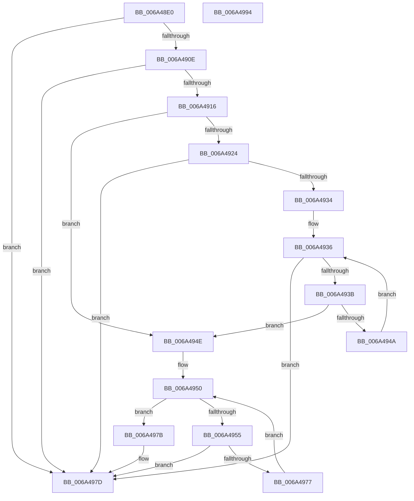

# SC_DISK::IsVbr

- RVA: `0x006A48E0`–`0x006A4995` (길이 `181` bytes)
- VA: `0x00000001406A48E0`
- 실행 섹션: `.text`
- PDB 이름 있음: `예`; PDB Function 태그: `아니요`
- unwind 정보 RVA: `0x0005C954`
- 디코드: `53`개 명령, `181/181` bytes 표시
- 미해석 바이트: `0` (있으면 어셈블리에 `.byte`로 보존)

> 이 문서는 커널 이미지의 기계어와 PDB 기호를 분석해 생성했습니다. 4번과 5번은 함수 원형과 자료형을 바이너리 사용 방식에서 추정한 C 해석이며 원본 소스 복구 결과는 아닙니다.

## 1. Dependencies

- 직접 호출 지점: **1**; 고유 호출 대상: **1**
- 직접 호출자로 확인된 함수: **1**
- RIP 상대 이미지 참조: **0**

### Outgoing calls
- `0x006A496E` → [MBR_ENTRY::Validate](MBR_ENTRY_Validate_function_006A53E0.md) (function, `0x006A53E0`)

### Direct callers
- [SC_DISK::ResetPartitionCache](SC_DISK_ResetPartitionCache_function_006A4A70.md) at `0x006A4AE5`

### Static image references
- 디코드된 RIP-relative 메모리 참조가 없습니다.

## 2. Other-region calls and transfers

- 다른 실행 섹션으로 향하는 call: **0**
- 별도 외부 분기/꼬리 이동을 확인하지 못했습니다.

## 3. Assembly (complete function range)

```asm
006A48E0  48 89 5C 24 08                  mov qword ptr [rsp + 8], rbx
006A48E5  48 89 6C 24 10                  mov qword ptr [rsp + 0x10], rbp
006A48EA  48 89 74 24 18                  mov qword ptr [rsp + 0x18], rsi
006A48EF  57                              push rdi
006A48F0  48 83 EC 20                     sub rsp, 0x20
006A48F4  48 8B B1 08 01 00 00            mov rsi, qword ptr [rcx + 0x108]
006A48FB  32 DB                           xor bl, bl
006A48FD  B8 55 AA 00 00                  mov eax, 0xaa55
006A4902  48 8B E9                        mov rbp, rcx
006A4905  66 39 86 FE 01 00 00            cmp word ptr [rsi + 0x1fe], ax
006A490C  75 6F                           jne 0x1406a497d
006A490E  8A 06                           mov al, byte ptr [rsi]
006A4910  04 17                           add al, 0x17
006A4912  A8 FD                           test al, 0xfd
006A4914  75 67                           jne 0x1406a497d
006A4916  83 B9 E0 00 00 00 0B            cmp dword ptr [rcx + 0xe0], 0xb
006A491D  BB 01 00 00 00                  mov ebx, 1
006A4922  75 2A                           jne 0x1406a494e
006A4924  48 B9 4E 54 46 53 20 20 20 20   movabs rcx, 0x202020205346544e
006A492E  48 39 4E 03                     cmp qword ptr [rsi + 3], rcx
006A4932  74 49                           je 0x1406a497d
006A4934  33 C9                           xor ecx, ecx
006A4936  83 F9 04                        cmp ecx, 4
006A4939  73 42                           jae 0x1406a497d
006A493B  8B C1                           mov eax, ecx
006A493D  48 03 C0                        add rax, rax
006A4940  80 BC C6 C2 01 00 00 00         cmp byte ptr [rsi + rax*8 + 0x1c2], 0
006A4948  75 04                           jne 0x1406a494e
006A494A  03 CB                           add ecx, ebx
006A494C  EB E8                           jmp 0x1406a4936
006A494E  33 FF                           xor edi, edi
006A4950  83 FF 04                        cmp edi, 4
006A4953  73 26                           jae 0x1406a497b
006A4955  4C 8B 85 F8 00 00 00            mov r8, qword ptr [rbp + 0xf8]
006A495C  33 D2                           xor edx, edx
006A495E  8B CF                           mov ecx, edi
006A4960  48 C1 E1 04                     shl rcx, 4
006A4964  48 81 C1 BE 01 00 00            add rcx, 0x1be
006A496B  48 03 CE                        add rcx, rsi
006A496E  E8 6D 0A 00 00                  call 0x1406a53e0
006A4973  84 C0                           test al, al
006A4975  74 06                           je 0x1406a497d
006A4977  03 FB                           add edi, ebx
006A4979  EB D5                           jmp 0x1406a4950
006A497B  32 DB                           xor bl, bl
006A497D  48 8B 6C 24 38                  mov rbp, qword ptr [rsp + 0x38]
006A4982  8A C3                           mov al, bl
006A4984  48 8B 5C 24 30                  mov rbx, qword ptr [rsp + 0x30]
006A4989  48 8B 74 24 40                  mov rsi, qword ptr [rsp + 0x40]
006A498E  48 83 C4 20                     add rsp, 0x20
006A4992  5F                              pop rdi
006A4993  C3                              ret
006A4994  CC                              int3
```

## 4. C-style interpretation (structured pseudocode)

```c
__int64 __fastcall SC_DISK__IsVbr(__int64 a1, int a2)
{
    __int64 result;
    __int64 v_rbx;
    __int64 v_rdi;
    __int64 v_rsp;
    unsigned __int64 v_stack_p10;
    unsigned __int64 v_stack_p18;
    unsigned __int64 v_stack_p8;

    v_stack_p8 = v_rbx;
    v_stack_p10 = v_rbp;
    v_stack_p18 = v_rsi;
    v_rsp = (v_rsp) - (32);
    v_rbx = 0;
    if ((*(unsigned __int16 *)(*(unsigned __int64 *)(a1 + 264) + 510)) != ((unsigned __int16)((unsigned int)(0xAA55ULL)))) goto loc_006A497D;
    result = (unsigned __int8)((*(unsigned __int8 *)(*(unsigned __int64 *)(a1 + 264))) + (23));
    if ((((unsigned __int8)(result)) & (253)) != 0) goto loc_006A497D;
    if ((*(unsigned int *)(a1 + 224)) != 11) goto loc_006A494E;
    if ((*(unsigned __int64 *)(*(unsigned __int64 *)(a1 + 264) + 3)) == a1) goto loc_006A497D;
    a1 = 0;
loc_006A4936:
    if (0 >= 4) goto loc_006A497D;
    result = (0) + (0);
    if ((*(unsigned __int8 *)(*(unsigned __int64 *)(a1 + 264) + result * 8 + 450)) != 0) goto loc_006A494E;
    a1 = (unsigned int)((a1) + (1));
    goto loc_006A4936;
loc_006A494E:
    v_rdi = 0;
loc_006A4950:
    if (0 >= 4) goto loc_006A497B;
    a2 = 0;
    a1 = (0) << (4);
    a1 = (a1) + (446);
    a1 = (a1) + (*(unsigned __int64 *)(a1 + 264));
    result = MBR_ENTRY__Validate(a1, a2, *(unsigned __int64 *)(a1 + 248), a4);
    if ((unsigned __int8)(result) == 0) goto loc_006A497D;
    v_rdi = (unsigned int)((v_rdi) + (1));
    goto loc_006A4950;
loc_006A497B:
    v_rbx = 0;
loc_006A497D:
    v_rsp = (v_rsp) + (32);
    return 0;
}
```

## 5. (Beta) C Style

```c
int64_t SC_DISK__IsVbr(void *Arg1, int32_t Arg2)
{
    uint8_t *arg1 = (uint8_t *)Arg1;

    int64_t result;
    int64_t local_rbx;
    int64_t local_rdi;
    int64_t local_rsp;
    uint64_t v_stack_p10;
    uint64_t v_stack_p18;
    uint64_t v_stack_p8;

    v_stack_p8 = local_rbx;
    v_stack_p10 = local_rbp;
    v_stack_p18 = local_rsi;
    local_rsp = (local_rsp) - (32);
    local_rbx = 0;
    if ((*(uint16_t *)(*(uint64_t *)(arg1 + 0x108) + 0x1FE)) != ((uint16_t)((uint32_t)(0xAA55ULL)))) goto loc_006A497D;
    result = (uint8_t)((*(uint8_t *)(*(uint64_t *)(arg1 + 0x108))) + (23));
    if ((((uint8_t)(result)) & (253)) != 0) goto loc_006A497D;
    if ((*(uint32_t *)(arg1 + 0xE0)) != 11) goto loc_006A494E;
    if ((*(uint64_t *)(*(uint64_t *)(arg1 + 0x108) + 0x3)) == Arg1) goto loc_006A497D;
    Arg1 = 0;
loc_006A4936:
    if (0 >= 4) goto loc_006A497D;
    result = (0) + (0);
    if ((*(uint8_t *)(*(uint64_t *)(arg1 + 0x108) + result * 8 + 0x1C2)) != 0) goto loc_006A494E;
    Arg1 = (uint32_t)((Arg1) + (1));
    goto loc_006A4936;
loc_006A494E:
    local_rdi = 0;
loc_006A4950:
    if (0 >= 4) goto loc_006A497B;
    Arg2 = 0;
    Arg1 = (0) << (4);
    Arg1 = (Arg1) + (446);
    Arg1 = (Arg1) + (*(uint64_t *)(arg1 + 0x108));
    result = MBR_ENTRY__Validate(Arg1, Arg2, *(uint64_t *)(arg1 + 0xF8), a4);
    if ((uint8_t)(result) == 0) goto loc_006A497D;
    local_rdi = (uint32_t)((local_rdi) + (1));
    goto loc_006A4950;
loc_006A497B:
    local_rbx = 0;
loc_006A497D:
    local_rsp = (local_rsp) + (32);
    return 0;
}
```

### 관측된 메모리 오프셋

구조체 형식이 확인되지 않은 접근은 인자 기준의 오프셋으로만 기록했습니다.

| 기준 인자 | 오프셋 표현 | 폭 (bit) | 접근 |
|---|---:|---:|---|
| `Arg1` | `+ 0xE0` | `32` | `R` |
| `Arg1` | `+ 0xF8` | `64` | `R` |
| `Arg1` | `+ 0x108` | `64` | `R` |

## 6. Execution-region graph

[열기: 2D/3D 그래프와 함수 탐색 컨트롤 패널](../../../control-panel.html?section=text&rva=0x006A48E0&view=graph)

- 2D 그래프는 위에서 아래로 흐르고, 3D 그래프는 빈 공간을 드래그해 회전합니다. Shift+드래그는 이동, 휠은 확대·축소, 함수 노드 선택은 대상 보고서 이동입니다.

### Static fallback


