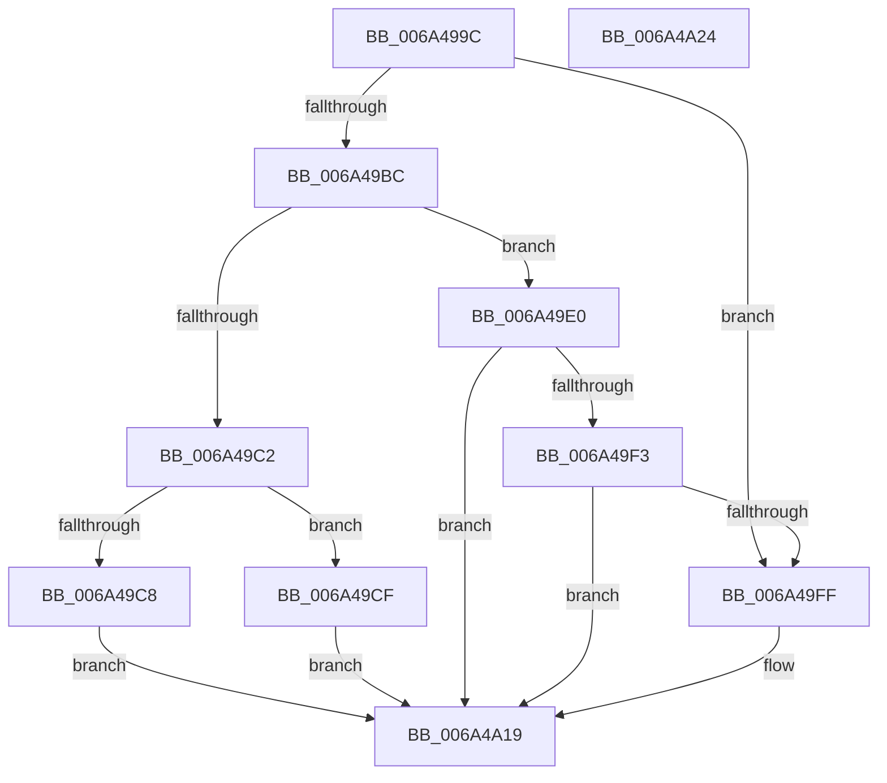

# SC_DISK::ReadPartitionTable

- RVA: `0x006A499C`–`0x006A4A25` (길이 `137` bytes)
- VA: `0x00000001406A499C`
- 실행 섹션: `.text`
- PDB 이름 있음: `예`; PDB Function 태그: `아니요`
- unwind 정보 RVA: `0x00068D5C`
- 디코드: `39`개 명령, `137/137` bytes 표시
- 미해석 바이트: `0` (있으면 어셈블리에 `.byte`로 보존)

> 이 문서는 커널 이미지의 기계어와 PDB 기호를 분석해 생성했습니다. 4번과 5번은 함수 원형과 자료형을 바이너리 사용 방식에서 추정한 C 해석이며 원본 소스 복구 결과는 아닙니다.

## 1. Dependencies

- 직접 호출 지점: **5**; 고유 호출 대상: **5**
- 직접 호출자로 확인된 함수: **4**
- RIP 상대 이미지 참조: **0**

### Outgoing calls
- `0x006A49D9` → [SC_RAW::ReadPartitionTable](SC_RAW_ReadPartitionTable_function_006A5C54.md) (function, `0x006A5C54`)
- `0x006A49EA` → [SC_GPT::ReadPartitionTable](SC_GPT_ReadPartitionTable_function_006A34E4.md) (function, `0x006A34E4`)
- `0x006A49F6` → [SC_DISK::ResetPartitionCache](SC_DISK_ResetPartitionCache_function_006A4A70.md) (function, `0x006A4A70`)
- `0x006A4A07` → [SC_MBR::Initialize](SC_MBR_Initialize_function_006A509C.md) (function, `0x006A509C`)
- `0x006A4A14` → [SC_MBR::ReadPartitionTable](SC_MBR_ReadPartitionTable_function_006A5100.md) (function, `0x006A5100`)

### Direct callers
- [SC_DISK::SetPartition](SC_DISK_SetPartition_function_006A4BDC.md) at `0x006A4C2D`
- [IoReadDiskSignature](../../page/71/IoReadDiskSignature_function_00717300.md) at `0x0071736C`
- [IoReadPartitionTable](../../page/71/IoReadPartitionTable_function_00717400.md) at `0x00717480`
- [IoReadPartitionTableEx](../../page/71/IoReadPartitionTableEx_function_007175D0.md) at `0x00717634`

### Static image references
- 디코드된 RIP-relative 메모리 참조가 없습니다.

## 2. Other-region calls and transfers

- 다른 실행 섹션으로 향하는 call: **0**
- 별도 외부 분기/꼬리 이동을 확인하지 못했습니다.

## 3. Assembly (complete function range)

```asm
006A499C  48 89 5C 24 10                  mov qword ptr [rsp + 0x10], rbx
006A49A1  57                              push rdi
006A49A2  48 83 EC 20                     sub rsp, 0x20
006A49A6  48 83 22 00                     and qword ptr [rdx], 0
006A49AA  48 8B FA                        mov rdi, rdx
006A49AD  44 8B 81 00 01 00 00            mov r8d, dword ptr [rcx + 0x100]
006A49B4  48 8B D9                        mov rbx, rcx
006A49B7  45 85 C0                        test r8d, r8d
006A49BA  74 43                           je 0x1406a49ff
006A49BC  41 83 E8 01                     sub r8d, 1
006A49C0  74 1E                           je 0x1406a49e0
006A49C2  41 83 F8 01                     cmp r8d, 1
006A49C6  74 07                           je 0x1406a49cf
006A49C8  B8 BB 00 00 C0                  mov eax, 0xc00000bb
006A49CD  EB 4A                           jmp 0x1406a4a19
006A49CF  48 8D 4C 24 30                  lea rcx, [rsp + 0x30]
006A49D4  48 89 5C 24 30                  mov qword ptr [rsp + 0x30], rbx
006A49D9  E8 76 12 00 00                  call 0x1406a5c54
006A49DE  EB 39                           jmp 0x1406a4a19
006A49E0  48 8D 4C 24 30                  lea rcx, [rsp + 0x30]
006A49E5  48 89 5C 24 30                  mov qword ptr [rsp + 0x30], rbx
006A49EA  E8 F5 EA FF FF                  call 0x1406a34e4
006A49EF  85 C0                           test eax, eax
006A49F1  79 26                           jns 0x1406a4a19
006A49F3  48 8B CB                        mov rcx, rbx
006A49F6  E8 75 00 00 00                  call 0x1406a4a70
006A49FB  85 C0                           test eax, eax
006A49FD  78 1A                           js 0x1406a4a19
006A49FF  48 8B D3                        mov rdx, rbx
006A4A02  48 8D 4C 24 30                  lea rcx, [rsp + 0x30]
006A4A07  E8 90 06 00 00                  call 0x1406a509c
006A4A0C  48 8D 4C 24 30                  lea rcx, [rsp + 0x30]
006A4A11  48 8B D7                        mov rdx, rdi
006A4A14  E8 E7 06 00 00                  call 0x1406a5100
006A4A19  48 8B 5C 24 38                  mov rbx, qword ptr [rsp + 0x38]
006A4A1E  48 83 C4 20                     add rsp, 0x20
006A4A22  5F                              pop rdi
006A4A23  C3                              ret
006A4A24  CC                              int3
```

## 4. C-style interpretation (structured pseudocode)

```c
__int64 __fastcall SC_DISK__ReadPartitionTable(__int64 a1, __int64 a2)
{
    __int64 result;
    __int64 v_rsp;
    unsigned __int64 v_stack_p10;
    unsigned __int64 v_stack_p8;

    v_stack_p10 = v_rbx;
    v_rsp = (v_rsp) - (32);
    if ((unsigned int)((unsigned int)(*(unsigned int *)(a1 + 256))) == 0) goto loc_006A49FF;
    a3 = (unsigned int)(((unsigned int)(*(unsigned int *)(a1 + 256))) - (1));
    if (condition_is_equal) goto loc_006A49E0;
    if (((unsigned int)(a3)) == 1) goto loc_006A49CF;
    goto loc_006A4A19;
loc_006A49CF:
    v_stack_p8 = a1;
    result = SC_RAW__ReadPartitionTable(v_stack_p8, a2, a3, a4);
    goto loc_006A4A19;
loc_006A49E0:
    v_stack_p8 = a1;
    result = SC_GPT__ReadPartitionTable(v_stack_p8, a2, a3, a4);
    if (!sign_flag) goto loc_006A4A19;
    result = SC_DISK__ResetPartitionCache(a1, a2, a3, a4);
    if (!(sign_flag)) {
        a2 = a1;
        a1 = v_stack_p8;
        result = SC_MBR__Initialize(a1, a2, a3, a4);
        a1 = v_stack_p8;
        a2 = a2;
        result = SC_MBR__ReadPartitionTable(a1, a2, a3, a4);
    }
    v_rsp = (v_rsp) + (32);
    return result;
}
```

## 5. (Beta) C Style

```c
int64_t SC_DISK__ReadPartitionTable(void *Arg1, void *Arg2)
{
    uint8_t *arg1 = (uint8_t *)Arg1;
    uint8_t *arg2 = (uint8_t *)Arg2;

    int64_t result;
    int64_t local_rsp;
    uint64_t v_stack_p10;
    uint64_t v_stack_p8;

    v_stack_p10 = local_rbx;
    local_rsp = (local_rsp) - (32);
    if ((uint32_t)((uint32_t)(*(uint32_t *)(arg1 + 0x100))) == 0) goto loc_006A49FF;
    a3 = (uint32_t)(((uint32_t)(*(uint32_t *)(arg1 + 0x100))) - (1));
    if (condition_is_equal) goto loc_006A49E0;
    if (((uint32_t)(a3)) == 1) goto loc_006A49CF;
    goto loc_006A4A19;
loc_006A49CF:
    v_stack_p8 = Arg1;
    result = SC_RAW__ReadPartitionTable(v_stack_p8, Arg2, a3, a4);
    goto loc_006A4A19;
loc_006A49E0:
    v_stack_p8 = Arg1;
    result = SC_GPT__ReadPartitionTable(v_stack_p8, Arg2, a3, a4);
    if (!sign_flag) goto loc_006A4A19;
    result = SC_DISK__ResetPartitionCache(Arg1, Arg2, a3, a4);
    if (!(sign_flag)) {
        Arg2 = Arg1;
        Arg1 = v_stack_p8;
        result = SC_MBR__Initialize(Arg1, Arg2, a3, a4);
        Arg1 = v_stack_p8;
        Arg2 = Arg2;
        result = SC_MBR__ReadPartitionTable(Arg1, Arg2, a3, a4);
    }
    local_rsp = (local_rsp) + (32);
    return result;
}
```

### 관측된 메모리 오프셋

구조체 형식이 확인되지 않은 접근은 인자 기준의 오프셋으로만 기록했습니다.

| 기준 인자 | 오프셋 표현 | 폭 (bit) | 접근 |
|---|---:|---:|---|
| `Arg1` | `+ 0x100` | `32` | `R` |
| `Arg2` | `+ 0x0` | `64` | `R/W` |

## 6. Execution-region graph

[열기: 2D/3D 그래프와 함수 탐색 컨트롤 패널](../../../control-panel.html?section=text&rva=0x006A499C&view=graph)

- 2D 그래프는 위에서 아래로 흐르고, 3D 그래프는 빈 공간을 드래그해 회전합니다. Shift+드래그는 이동, 휠은 확대·축소, 함수 노드 선택은 대상 보고서 이동입니다.

### Static fallback


