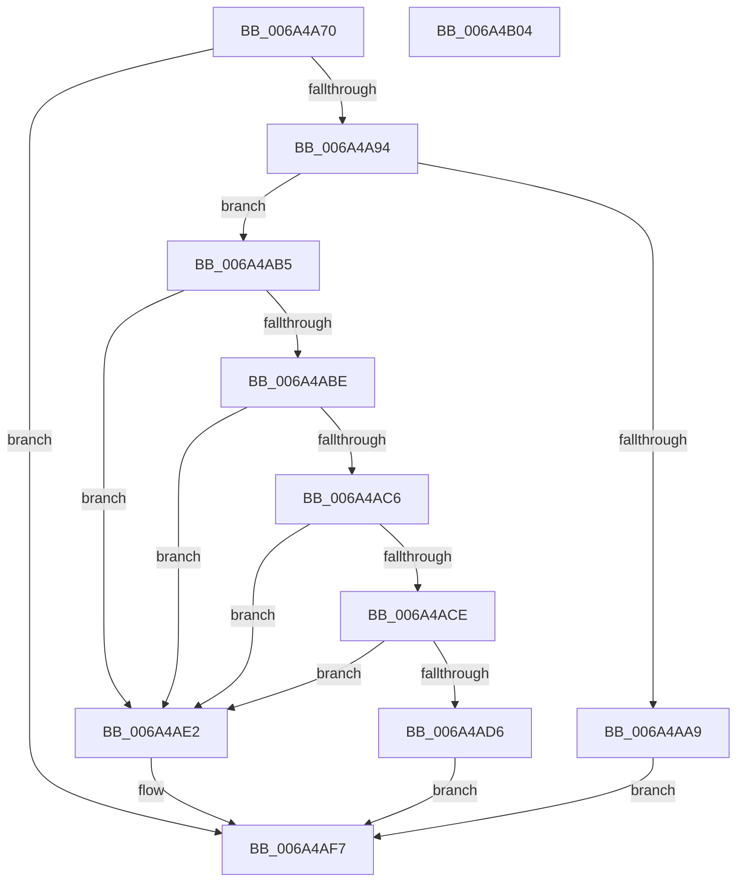

# SC_DISK::ResetPartitionCache

- RVA: `0x006A4A70`–`0x006A4B05` (길이 `149` bytes)
- VA: `0x00000001406A4A70`
- 실행 섹션: `.text`
- PDB 이름 있음: `예`; PDB Function 태그: `아니요`
- unwind 정보 RVA: `0x0005CAAC`
- 디코드: `40`개 명령, `149/149` bytes 표시
- 미해석 바이트: `0` (있으면 어셈블리에 `.byte`로 보존)

> 이 문서는 커널 이미지의 기계어와 PDB 기호를 분석해 생성했습니다. 4번과 5번은 함수 원형과 자료형을 바이너리 사용 방식에서 추정한 C 해석이며 원본 소스 복구 결과는 아닙니다.

## 1. Dependencies

- 직접 호출 지점: **2**; 고유 호출 대상: **2**
- 직접 호출자로 확인된 함수: **4**
- RIP 상대 이미지 참조: **0**

### Outgoing calls
- `0x006A4A87` → [SC_DISK::ReadSectors](SC_DISK_ReadSectors_function_006A4A2C.md) (function, `0x006A4A2C`)
- `0x006A4AE5` → [SC_DISK::IsVbr](SC_DISK_IsVbr_function_006A48E0.md) (function, `0x006A48E0`)

### Direct callers
- [SC_DISK::InitializePartitionCache](SC_DISK_InitializePartitionCache_function_006A4844.md) at `0x006A487C`
- [SC_DISK::ReadPartitionTable](SC_DISK_ReadPartitionTable_function_006A499C.md) at `0x006A49F6`
- [SC_DISK::SetPartition](SC_DISK_SetPartition_function_006A4BDC.md) at `0x006A4CC5`
- [SC_DISK::WritePartitionTable](SC_DISK_WritePartitionTable_function_006A4D4C.md) at `0x006A4D91`

### Static image references
- 디코드된 RIP-relative 메모리 참조가 없습니다.

## 2. Other-region calls and transfers

- 다른 실행 섹션으로 향하는 call: **0**
- 별도 외부 분기/꼬리 이동을 확인하지 못했습니다.

## 3. Assembly (complete function range)

```asm
006A4A70  48 89 5C 24 08                  mov qword ptr [rsp + 8], rbx
006A4A75  57                              push rdi
006A4A76  48 83 EC 20                     sub rsp, 0x20
006A4A7A  45 33 C9                        xor r9d, r9d
006A4A7D  45 33 C0                        xor r8d, r8d
006A4A80  48 8B D9                        mov rbx, rcx
006A4A83  41 8D 51 01                     lea edx, [r9 + 1]
006A4A87  E8 A0 FF FF FF                  call 0x1406a4a2c
006A4A8C  33 C9                           xor ecx, ecx
006A4A8E  8B F8                           mov edi, eax
006A4A90  85 C0                           test eax, eax
006A4A92  78 63                           js 0x1406a4af7
006A4A94  48 8B 93 08 01 00 00            mov rdx, qword ptr [rbx + 0x108]
006A4A9B  B8 55 AA 00 00                  mov eax, 0xaa55
006A4AA0  66 39 82 FE 01 00 00            cmp word ptr [rdx + 0x1fe], ax
006A4AA7  74 0C                           je 0x1406a4ab5
006A4AA9  C7 83 00 01 00 00 02 00 00 00   mov dword ptr [rbx + 0x100], 2
006A4AB3  EB 42                           jmp 0x1406a4af7
006A4AB5  80 BA C2 01 00 00 EE            cmp byte ptr [rdx + 0x1c2], 0xee
006A4ABC  75 24                           jne 0x1406a4ae2
006A4ABE  38 8A D2 01 00 00               cmp byte ptr [rdx + 0x1d2], cl
006A4AC4  75 1C                           jne 0x1406a4ae2
006A4AC6  38 8A E2 01 00 00               cmp byte ptr [rdx + 0x1e2], cl
006A4ACC  75 14                           jne 0x1406a4ae2
006A4ACE  38 8A F2 01 00 00               cmp byte ptr [rdx + 0x1f2], cl
006A4AD4  75 0C                           jne 0x1406a4ae2
006A4AD6  C7 83 00 01 00 00 01 00 00 00   mov dword ptr [rbx + 0x100], 1
006A4AE0  EB 15                           jmp 0x1406a4af7
006A4AE2  48 8B CB                        mov rcx, rbx
006A4AE5  E8 F6 FD FF FF                  call 0x1406a48e0
006A4AEA  F6 D8                           neg al
006A4AEC  1B C9                           sbb ecx, ecx
006A4AEE  83 E1 02                        and ecx, 2
006A4AF1  89 8B 00 01 00 00               mov dword ptr [rbx + 0x100], ecx
006A4AF7  48 8B 5C 24 30                  mov rbx, qword ptr [rsp + 0x30]
006A4AFC  8B C7                           mov eax, edi
006A4AFE  48 83 C4 20                     add rsp, 0x20
006A4B02  5F                              pop rdi
006A4B03  C3                              ret
006A4B04  CC                              int3
```

## 4. C-style interpretation (structured pseudocode)

```c
__int64 __fastcall SC_DISK__ResetPartitionCache(__int64 a1, __int64 a2, int a3, int a4)
{
    __int64 result;
    __int64 v_rsp;
    unsigned __int64 v_stack_p8;

    v_stack_p8 = v_rbx;
    v_rsp = (v_rsp) - (32);
    a4 = 0;
    a3 = 0;
    result = SC_DISK__ReadSectors(a1, a4 + 1, a3, a4);
    a1 = 0;
    if (sign_flag) goto loc_006A4AF7;
    if ((*(unsigned __int16 *)(*(unsigned __int64 *)(a1 + 264) + 510)) == ((unsigned __int16)((unsigned int)(0xAA55ULL)))) goto loc_006A4AB5;
    *(unsigned int *)(a1 + 256) = 2;
    goto loc_006A4AF7;
loc_006A4AB5:
    if ((*(unsigned __int8 *)(*(unsigned __int64 *)(a1 + 264) + 450)) != 238) goto loc_006A4AE2;
    if ((*(unsigned __int8 *)(*(unsigned __int64 *)(a1 + 264) + 466)) != 0) goto loc_006A4AE2;
    if ((*(unsigned __int8 *)(*(unsigned __int64 *)(a1 + 264) + 482)) != 0) goto loc_006A4AE2;
    if ((*(unsigned __int8 *)(*(unsigned __int64 *)(a1 + 264) + 498)) != 0) goto loc_006A4AE2;
    *(unsigned int *)(a1 + 256) = 1;
    goto loc_006A4AF7;
loc_006A4AE2:
    result = SC_DISK__IsVbr(0, *(unsigned __int64 *)(a1 + 264), a3, a4);
    result = (unsigned __int8)(-(result));
    a1 = (unsigned int)((0) & (2));
    *(unsigned int *)(a1 + 256) = (unsigned int)(a1);
loc_006A4AF7:
    v_rsp = (v_rsp) + (32);
    return (unsigned int)((unsigned int)((unsigned int)((unsigned int)(result))));
}
```

## 5. (Beta) C Style

```c
int64_t SC_DISK__ResetPartitionCache(void *Arg1, int64_t Arg2, int32_t Arg3, int32_t Arg4)
{
    uint8_t *arg1 = (uint8_t *)Arg1;

    int64_t result;
    int64_t local_rsp;
    uint64_t v_stack_p8;

    v_stack_p8 = local_rbx;
    local_rsp = (local_rsp) - (32);
    Arg4 = 0;
    Arg3 = 0;
    result = SC_DISK__ReadSectors(Arg1, Arg4 + 1, Arg3, Arg4);
    Arg1 = 0;
    if (sign_flag) goto loc_006A4AF7;
    if ((*(uint16_t *)(*(uint64_t *)(arg1 + 0x108) + 0x1FE)) == ((uint16_t)((uint32_t)(0xAA55ULL)))) goto loc_006A4AB5;
    *(uint32_t *)(arg1 + 0x100) = 2;
    goto loc_006A4AF7;
loc_006A4AB5:
    if ((*(uint8_t *)(*(uint64_t *)(arg1 + 0x108) + 0x1C2)) != 238) goto loc_006A4AE2;
    if ((*(uint8_t *)(*(uint64_t *)(arg1 + 0x108) + 0x1D2)) != 0) goto loc_006A4AE2;
    if ((*(uint8_t *)(*(uint64_t *)(arg1 + 0x108) + 0x1E2)) != 0) goto loc_006A4AE2;
    if ((*(uint8_t *)(*(uint64_t *)(arg1 + 0x108) + 0x1F2)) != 0) goto loc_006A4AE2;
    *(uint32_t *)(arg1 + 0x100) = 1;
    goto loc_006A4AF7;
loc_006A4AE2:
    result = SC_DISK__IsVbr(0, *(uint64_t *)(arg1 + 0x108), Arg3, Arg4);
    result = (uint8_t)(-(result));
    Arg1 = (uint32_t)((0) & (2));
    *(uint32_t *)(arg1 + 0x100) = (uint32_t)(Arg1);
loc_006A4AF7:
    local_rsp = (local_rsp) + (32);
    return (uint32_t)((uint32_t)((uint32_t)((uint32_t)(result))));
}
```

### 관측된 메모리 오프셋

구조체 형식이 확인되지 않은 접근은 인자 기준의 오프셋으로만 기록했습니다.

| 기준 인자 | 오프셋 표현 | 폭 (bit) | 접근 |
|---|---:|---:|---|
| `Arg1` | `+ 0x100` | `32` | `W` |
| `Arg1` | `+ 0x108` | `64` | `R` |

## 6. Execution-region graph

[열기: 2D/3D 그래프와 함수 탐색 컨트롤 패널](../../../control-panel.html?section=text&rva=0x006A4A70&view=graph)

- 2D 그래프는 위에서 아래로 흐르고, 3D 그래프는 빈 공간을 드래그해 회전합니다. Shift+드래그는 이동, 휠은 확대·축소, 함수 노드 선택은 대상 보고서 이동입니다.

### Static fallback


