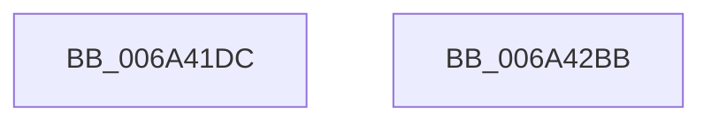

# SC_DISK::SC_DISK

- RVA: `0x006A41DC`–`0x006A42BC` (길이 `224` bytes)
- VA: `0x00000001406A41DC`
- 실행 섹션: `.text`
- PDB 이름 있음: `예`; PDB Function 태그: `아니요`
- unwind 정보 RVA: `0x00063458`
- 디코드: `41`개 명령, `224/224` bytes 표시
- 미해석 바이트: `0` (있으면 어셈블리에 `.byte`로 보존)

> 이 문서는 커널 이미지의 기계어와 PDB 기호를 분석해 생성했습니다. 4번과 5번은 함수 원형과 자료형을 바이너리 사용 방식에서 추정한 C 해석이며 원본 소스 복구 결과는 아닙니다.

## 1. Dependencies

- 직접 호출 지점: **1**; 고유 호출 대상: **1**
- 직접 호출자로 확인된 함수: **9**
- RIP 상대 이미지 참조: **1**

### Outgoing calls
- `0x006A41E0` → [SC_DEVICE::SC_DEVICE](SC_DEVICE_SC_DEVICE_function_006A5690.md) (function, `0x006A5690`)

### Direct callers
- [IoCreateDisk](../../page/71/IoCreateDisk_function_00717250.md) at `0x0071727F`
- [IoReadDiskSignature](../../page/71/IoReadDiskSignature_function_00717300.md) at `0x0071732F`
- [IoReadPartitionTable](../../page/71/IoReadPartitionTable_function_00717400.md) at `0x0071743B`
- [IoReadPartitionTableEx](../../page/71/IoReadPartitionTableEx_function_007175D0.md) at `0x007175FF`
- [IoSetPartitionInformation](../../page/71/IoSetPartitionInformation_function_00717680.md) at `0x007176BB`
- [IoSetPartitionInformationEx](../../page/71/IoSetPartitionInformationEx_function_00717760.md) at `0x0071778E`
- [IoVerifyPartitionTable](../../page/71/IoVerifyPartitionTable_function_00717810.md) at `0x0071783F`
- [IoWritePartitionTable](../../page/71/IoWritePartitionTable_function_007178C0.md) at `0x007178FA`
- [IoWritePartitionTableEx](../../page/71/IoWritePartitionTableEx_function_00717A20.md) at `0x00717A4F`

### Static image references
- `0x006A41F9` → RVA `0x00009AF0` (`.rdata`; read)

## 2. Other-region calls and transfers

- 다른 실행 섹션으로 향하는 call: **0**
- 별도 외부 분기/꼬리 이동을 확인하지 못했습니다.

## 3. Assembly (complete function range)

```asm
006A41DC  48 83 EC 48                     sub rsp, 0x48
006A41E0  E8 AB 14 00 00                  call 0x1406a5690
006A41E5  0F 57 C0                        xorps xmm0, xmm0
006A41E8  C7 81 00 01 00 00 02 00 00 00   mov dword ptr [rcx + 0x100], 2
006A41F2  0F 11 44 24 24                  movups xmmword ptr [rsp + 0x24], xmm0
006A41F7  33 C0                           xor eax, eax
006A41F9  48 8D 15 F0 58 96 FF            lea rdx, [rip - 0x69a710]
006A4200  89 44 24 34                     mov dword ptr [rsp + 0x34], eax
006A4204  F2 0F 10 4C 24 30               movsd xmm1, qword ptr [rsp + 0x30]
006A420A  48 89 11                        mov qword ptr [rcx], rdx
006A420D  33 D2                           xor edx, edx
006A420F  83 C8 FF                        or eax, 0xffffffff
006A4212  89 54 24 20                     mov dword ptr [rsp + 0x20], edx
006A4216  0F 10 44 24 20                  movups xmm0, xmmword ptr [rsp + 0x20]
006A421B  89 81 30 01 00 00               mov dword ptr [rcx + 0x130], eax
006A4221  89 81 34 01 00 00               mov dword ptr [rcx + 0x134], eax
006A4227  48 8B C1                        mov rax, rcx
006A422A  0F 11 81 D8 00 00 00            movups xmmword ptr [rcx + 0xd8], xmm0
006A4231  89 91 C8 00 00 00               mov dword ptr [rcx + 0xc8], edx
006A4237  F2 0F 11 89 E8 00 00 00         movsd qword ptr [rcx + 0xe8], xmm1
006A423F  0F 57 C0                        xorps xmm0, xmm0
006A4242  0F 57 C9                        xorps xmm1, xmm1
006A4245  48 89 91 D0 00 00 00            mov qword ptr [rcx + 0xd0], rdx
006A424C  F3 0F 7F 89 20 01 00 00         movdqu xmmword ptr [rcx + 0x120], xmm1
006A4254  89 91 F0 00 00 00               mov dword ptr [rcx + 0xf0], edx
006A425A  48 89 91 F8 00 00 00            mov qword ptr [rcx + 0xf8], rdx
006A4261  48 89 91 08 01 00 00            mov qword ptr [rcx + 0x108], rdx
006A4268  F3 0F 7F 81 10 01 00 00         movdqu xmmword ptr [rcx + 0x110], xmm0
006A4270  48 89 91 38 01 00 00            mov qword ptr [rcx + 0x138], rdx
006A4277  48 89 91 40 01 00 00            mov qword ptr [rcx + 0x140], rdx
006A427E  48 89 91 48 01 00 00            mov qword ptr [rcx + 0x148], rdx
006A4285  48 89 91 50 01 00 00            mov qword ptr [rcx + 0x150], rdx
006A428C  48 89 91 58 01 00 00            mov qword ptr [rcx + 0x158], rdx
006A4293  48 89 91 60 01 00 00            mov qword ptr [rcx + 0x160], rdx
006A429A  48 89 91 68 01 00 00            mov qword ptr [rcx + 0x168], rdx
006A42A1  48 89 91 70 01 00 00            mov qword ptr [rcx + 0x170], rdx
006A42A8  48 89 91 78 01 00 00            mov qword ptr [rcx + 0x178], rdx
006A42AF  48 89 91 80 01 00 00            mov qword ptr [rcx + 0x180], rdx
006A42B6  48 83 C4 48                     add rsp, 0x48
006A42BA  C3                              ret
006A42BB  CC                              int3
```

## 4. C-style interpretation (structured pseudocode)

```c
__int64 __fastcall SC_DISK__SC_DISK(__int64 a1)
{
    __int64 result;
    __int64 v_rsp;
    unsigned int v_stack_m14;
    unsigned __int64 v_stack_m18;
    unsigned __int64 v_stack_m24;
    unsigned int v_stack_m28;

    v_rsp = (v_rsp) - (72);
    result = SC_DEVICE__SC_DEVICE(a1, a2, a3, a4);
    *(unsigned int *)(a1 + 256) = 2;
    v_stack_m24 = v_xmm0;
    result = 0;
    v_stack_m14 = 0;
    *(unsigned __int64 *)(a1) = v_rip - 6924048;
    a2 = 0;
    result = (unsigned int)((result) | (0xFFFFFFFFULL));
    v_stack_m28 = 0;
    *(unsigned int *)(a1 + 304) = (unsigned int)(result);
    *(unsigned int *)(a1 + 308) = (unsigned int)(result);
    *(unsigned __int64 *)(a1 + 216) = v_xmm0;
    *(unsigned int *)(a1 + 200) = 0;
    *(unsigned __int64 *)(a1 + 232) = v_xmm1;
    *(unsigned __int64 *)(a1 + 208) = 0;
    *(unsigned __int64 *)(a1 + 288) = v_xmm1;
    *(unsigned int *)(a1 + 240) = 0;
    *(unsigned __int64 *)(a1 + 248) = 0;
    *(unsigned __int64 *)(a1 + 264) = 0;
    *(unsigned __int64 *)(a1 + 272) = v_xmm0;
    *(unsigned __int64 *)(a1 + 312) = 0;
    *(unsigned __int64 *)(a1 + 320) = 0;
    *(unsigned __int64 *)(a1 + 328) = 0;
    *(unsigned __int64 *)(a1 + 336) = 0;
    *(unsigned __int64 *)(a1 + 344) = 0;
    *(unsigned __int64 *)(a1 + 352) = 0;
    *(unsigned __int64 *)(a1 + 360) = 0;
    *(unsigned __int64 *)(a1 + 368) = 0;
    *(unsigned __int64 *)(a1 + 376) = 0;
    *(unsigned __int64 *)(a1 + 384) = 0;
    v_rsp = (v_rsp) + (72);
    return a1;
}
```

## 5. (Beta) C Style

```c
int64_t SC_DISK__SC_DISK(int64_t Arg1)
{
    int64_t result;
    int64_t local_rsp;
    uint32_t v_stack_m14;
    uint64_t v_stack_m18;
    uint64_t v_stack_m24;
    uint32_t v_stack_m28;

    local_rsp = (local_rsp) - (72);
    result = SC_DEVICE__SC_DEVICE(Arg1, a2, a3, a4);
    *(uint32_t *)(Arg1 + 0x100) = 2;
    v_stack_m24 = v_xmm0;
    result = 0;
    v_stack_m14 = 0;
    *(uint64_t *)(Arg1) = v_rip - 6924048;
    a2 = 0;
    result = (uint32_t)((result) | (0xFFFFFFFFULL));
    v_stack_m28 = 0;
    *(uint32_t *)(Arg1 + 0x130) = (uint32_t)(result);
    *(uint32_t *)(Arg1 + 0x134) = (uint32_t)(result);
    *(uint64_t *)(Arg1 + 0xD8) = v_xmm0;
    *(uint32_t *)(Arg1 + 0xC8) = 0;
    *(uint64_t *)(Arg1 + 0xE8) = v_xmm1;
    *(uint64_t *)(Arg1 + 0xD0) = 0;
    *(uint64_t *)(Arg1 + 0x120) = v_xmm1;
    *(uint32_t *)(Arg1 + 0xF0) = 0;
    *(uint64_t *)(Arg1 + 0xF8) = 0;
    *(uint64_t *)(Arg1 + 0x108) = 0;
    *(uint64_t *)(Arg1 + 0x110) = v_xmm0;
    *(uint64_t *)(Arg1 + 0x138) = 0;
    *(uint64_t *)(Arg1 + 0x140) = 0;
    *(uint64_t *)(Arg1 + 0x148) = 0;
    *(uint64_t *)(Arg1 + 0x150) = 0;
    *(uint64_t *)(Arg1 + 0x158) = 0;
    *(uint64_t *)(Arg1 + 0x160) = 0;
    *(uint64_t *)(Arg1 + 0x168) = 0;
    *(uint64_t *)(Arg1 + 0x170) = 0;
    *(uint64_t *)(Arg1 + 0x178) = 0;
    *(uint64_t *)(Arg1 + 0x180) = 0;
    local_rsp = (local_rsp) + (72);
    return Arg1;
}
```

## 6. Execution-region graph

[열기: 2D/3D 그래프와 함수 탐색 컨트롤 패널](../../../control-panel.html?section=text&rva=0x006A41DC&view=graph)

- 2D 그래프는 위에서 아래로 흐르고, 3D 그래프는 빈 공간을 드래그해 회전합니다. Shift+드래그는 이동, 휠은 확대·축소, 함수 노드 선택은 대상 보고서 이동입니다.

### Static fallback


