# SC_DISK::~SC_DISK

- RVA: `0x006A42C4`–`0x006A43B2` (길이 `238` bytes)
- VA: `0x00000001406A42C4`
- 실행 섹션: `.text`
- PDB 이름 있음: `예`; PDB Function 태그: `아니요`
- unwind 정보 RVA: `0x0005CF00`
- 디코드: `59`개 명령, `238/238` bytes 표시
- 미해석 바이트: `0` (있으면 어셈블리에 `.byte`로 보존)

> 이 문서는 커널 이미지의 기계어와 PDB 기호를 분석해 생성했습니다. 4번과 5번은 함수 원형과 자료형을 바이너리 사용 방식에서 추정한 C 해석이며 원본 소스 복구 결과는 아닙니다.

## 1. Dependencies

- 직접 호출 지점: **13**; 고유 호출 대상: **2**
- 직접 호출자로 확인된 함수: **11**
- RIP 상대 이미지 참조: **1**

### Outgoing calls
- `0x006A42E3` → [AlpcpFreeBuffer](../../page/90/AlpcpFreeBuffer_function_009071C0.md) (function, `0x009071C0`)
- `0x006A42F4` → [AlpcpFreeBuffer](../../page/90/AlpcpFreeBuffer_function_009071C0.md) (function, `0x009071C0`)
- `0x006A4305` → [AlpcpFreeBuffer](../../page/90/AlpcpFreeBuffer_function_009071C0.md) (function, `0x009071C0`)
- `0x006A4316` → [AlpcpFreeBuffer](../../page/90/AlpcpFreeBuffer_function_009071C0.md) (function, `0x009071C0`)
- `0x006A4327` → [AlpcpFreeBuffer](../../page/90/AlpcpFreeBuffer_function_009071C0.md) (function, `0x009071C0`)
- `0x006A4338` → [AlpcpFreeBuffer](../../page/90/AlpcpFreeBuffer_function_009071C0.md) (function, `0x009071C0`)
- `0x006A4349` → [AlpcpFreeBuffer](../../page/90/AlpcpFreeBuffer_function_009071C0.md) (function, `0x009071C0`)
- `0x006A435A` → [AlpcpFreeBuffer](../../page/90/AlpcpFreeBuffer_function_009071C0.md) (function, `0x009071C0`)
- `0x006A436B` → [AlpcpFreeBuffer](../../page/90/AlpcpFreeBuffer_function_009071C0.md) (function, `0x009071C0`)
- `0x006A437C` → [AlpcpFreeBuffer](../../page/90/AlpcpFreeBuffer_function_009071C0.md) (function, `0x009071C0`)
- `0x006A438D` → [AlpcpFreeBuffer](../../page/90/AlpcpFreeBuffer_function_009071C0.md) (function, `0x009071C0`)
- `0x006A439E` → [AlpcpFreeBuffer](../../page/90/AlpcpFreeBuffer_function_009071C0.md) (function, `0x009071C0`)
- `0x006A43A6` → [SC_DEVICE::~SC_DEVICE](SC_DEVICE_SC_DEVICE_function_006A56F8.md) (function, `0x006A56F8`)

### Direct callers
- [SC_DISK::`scalar deleting destructor&#x27;](SC_DISK_scalar_deleting_destructor__function_006A43C0.md) at `0x006A43CF`
- [NT_DISK::`scalar deleting destructor&#x27;](../../page/71/NT_DISK_scalar_deleting_destructor__function_00716F50.md) at `0x00716F69`
- [IoCreateDisk](../../page/71/IoCreateDisk_function_00717250.md) at `0x007172C5`
- [IoReadDiskSignature](../../page/71/IoReadDiskSignature_function_00717300.md) at `0x007173BF`
- [IoReadPartitionTable](../../page/71/IoReadPartitionTable_function_00717400.md) at `0x00717588`
- [IoReadPartitionTableEx](../../page/71/IoReadPartitionTableEx_function_007175D0.md) at `0x00717645`
- [IoSetPartitionInformation](../../page/71/IoSetPartitionInformation_function_00717680.md) at `0x0071771F`
- [IoSetPartitionInformationEx](../../page/71/IoSetPartitionInformationEx_function_00717760.md) at `0x007177D6`
- [IoVerifyPartitionTable](../../page/71/IoVerifyPartitionTable_function_00717810.md) at `0x00717885`
- [IoWritePartitionTable](../../page/71/IoWritePartitionTable_function_007178C0.md) at `0x007179E4`
- [IoWritePartitionTableEx](../../page/71/IoWritePartitionTableEx_function_00717A20.md) at `0x00717A95`

### Static image references
- `0x006A42CA` → RVA `0x00009AF0` (`.rdata`; read)

## 2. Other-region calls and transfers

- 다른 실행 섹션으로 향하는 call: **12**
  - `0x006A42E3` → [AlpcpFreeBuffer](../../page/90/AlpcpFreeBuffer_function_009071C0.md) (`.text` → `PAGE`)
  - `0x006A42F4` → [AlpcpFreeBuffer](../../page/90/AlpcpFreeBuffer_function_009071C0.md) (`.text` → `PAGE`)
  - `0x006A4305` → [AlpcpFreeBuffer](../../page/90/AlpcpFreeBuffer_function_009071C0.md) (`.text` → `PAGE`)
  - `0x006A4316` → [AlpcpFreeBuffer](../../page/90/AlpcpFreeBuffer_function_009071C0.md) (`.text` → `PAGE`)
  - `0x006A4327` → [AlpcpFreeBuffer](../../page/90/AlpcpFreeBuffer_function_009071C0.md) (`.text` → `PAGE`)
  - `0x006A4338` → [AlpcpFreeBuffer](../../page/90/AlpcpFreeBuffer_function_009071C0.md) (`.text` → `PAGE`)
  - `0x006A4349` → [AlpcpFreeBuffer](../../page/90/AlpcpFreeBuffer_function_009071C0.md) (`.text` → `PAGE`)
  - `0x006A435A` → [AlpcpFreeBuffer](../../page/90/AlpcpFreeBuffer_function_009071C0.md) (`.text` → `PAGE`)
  - `0x006A436B` → [AlpcpFreeBuffer](../../page/90/AlpcpFreeBuffer_function_009071C0.md) (`.text` → `PAGE`)
  - `0x006A437C` → [AlpcpFreeBuffer](../../page/90/AlpcpFreeBuffer_function_009071C0.md) (`.text` → `PAGE`)
  - `0x006A438D` → [AlpcpFreeBuffer](../../page/90/AlpcpFreeBuffer_function_009071C0.md) (`.text` → `PAGE`)
  - `0x006A439E` → [AlpcpFreeBuffer](../../page/90/AlpcpFreeBuffer_function_009071C0.md) (`.text` → `PAGE`)
- 별도 외부 분기/꼬리 이동을 확인하지 못했습니다.

## 3. Assembly (complete function range)

```asm
006A42C4  40 53                           push rbx
006A42C6  48 83 EC 20                     sub rsp, 0x20
006A42CA  48 8D 05 1F 58 96 FF            lea rax, [rip - 0x69a7e1]
006A42D1  48 8B D9                        mov rbx, rcx
006A42D4  48 89 01                        mov qword ptr [rcx], rax
006A42D7  48 8B 89 80 01 00 00            mov rcx, qword ptr [rcx + 0x180]
006A42DE  48 85 C9                        test rcx, rcx
006A42E1  74 05                           je 0x1406a42e8
006A42E3  E8 D8 2E 26 00                  call 0x1409071c0
006A42E8  48 8B 8B 78 01 00 00            mov rcx, qword ptr [rbx + 0x178]
006A42EF  48 85 C9                        test rcx, rcx
006A42F2  74 05                           je 0x1406a42f9
006A42F4  E8 C7 2E 26 00                  call 0x1409071c0
006A42F9  48 8B 8B 70 01 00 00            mov rcx, qword ptr [rbx + 0x170]
006A4300  48 85 C9                        test rcx, rcx
006A4303  74 05                           je 0x1406a430a
006A4305  E8 B6 2E 26 00                  call 0x1409071c0
006A430A  48 8B 8B 68 01 00 00            mov rcx, qword ptr [rbx + 0x168]
006A4311  48 85 C9                        test rcx, rcx
006A4314  74 05                           je 0x1406a431b
006A4316  E8 A5 2E 26 00                  call 0x1409071c0
006A431B  48 8B 8B 60 01 00 00            mov rcx, qword ptr [rbx + 0x160]
006A4322  48 85 C9                        test rcx, rcx
006A4325  74 05                           je 0x1406a432c
006A4327  E8 94 2E 26 00                  call 0x1409071c0
006A432C  48 8B 8B 58 01 00 00            mov rcx, qword ptr [rbx + 0x158]
006A4333  48 85 C9                        test rcx, rcx
006A4336  74 05                           je 0x1406a433d
006A4338  E8 83 2E 26 00                  call 0x1409071c0
006A433D  48 8B 8B 50 01 00 00            mov rcx, qword ptr [rbx + 0x150]
006A4344  48 85 C9                        test rcx, rcx
006A4347  74 05                           je 0x1406a434e
006A4349  E8 72 2E 26 00                  call 0x1409071c0
006A434E  48 8B 8B 48 01 00 00            mov rcx, qword ptr [rbx + 0x148]
006A4355  48 85 C9                        test rcx, rcx
006A4358  74 05                           je 0x1406a435f
006A435A  E8 61 2E 26 00                  call 0x1409071c0
006A435F  48 8B 8B 40 01 00 00            mov rcx, qword ptr [rbx + 0x140]
006A4366  48 85 C9                        test rcx, rcx
006A4369  74 05                           je 0x1406a4370
006A436B  E8 50 2E 26 00                  call 0x1409071c0
006A4370  48 8B 8B 38 01 00 00            mov rcx, qword ptr [rbx + 0x138]
006A4377  48 85 C9                        test rcx, rcx
006A437A  74 05                           je 0x1406a4381
006A437C  E8 3F 2E 26 00                  call 0x1409071c0
006A4381  48 8B 8B 28 01 00 00            mov rcx, qword ptr [rbx + 0x128]
006A4388  48 85 C9                        test rcx, rcx
006A438B  74 05                           je 0x1406a4392
006A438D  E8 2E 2E 26 00                  call 0x1409071c0
006A4392  48 8B 8B 08 01 00 00            mov rcx, qword ptr [rbx + 0x108]
006A4399  48 85 C9                        test rcx, rcx
006A439C  74 05                           je 0x1406a43a3
006A439E  E8 1D 2E 26 00                  call 0x1409071c0
006A43A3  48 8B CB                        mov rcx, rbx
006A43A6  E8 4D 13 00 00                  call 0x1406a56f8
006A43AB  48 83 C4 20                     add rsp, 0x20
006A43AF  5B                              pop rbx
006A43B0  C3                              ret
006A43B1  CC                              int3
```

## 4. C-style interpretation (structured pseudocode)

```c
__int64 __fastcall SC_DISK___SC_DISK(__int64 a1)
{
    __int64 result;
    __int64 v_rsp;

    v_rsp = (v_rsp) - (32);
    *(unsigned __int64 *)(a1) = v_rip - 6924257;
    result = v_rip - 6924257;
    if (*(unsigned __int64 *)(a1 + 384) != 0) {
        result = AlpcpFreeBuffer(*(unsigned __int64 *)(a1 + 384), a2, a3, a4);
    }
    if (*(unsigned __int64 *)(a1 + 376) != 0) {
        result = AlpcpFreeBuffer(*(unsigned __int64 *)(a1 + 376), a2, a3, a4);
    }
    if (*(unsigned __int64 *)(a1 + 368) != 0) {
        result = AlpcpFreeBuffer(*(unsigned __int64 *)(a1 + 368), a2, a3, a4);
    }
    if (*(unsigned __int64 *)(a1 + 360) != 0) {
        result = AlpcpFreeBuffer(*(unsigned __int64 *)(a1 + 360), a2, a3, a4);
    }
    if (*(unsigned __int64 *)(a1 + 352) != 0) {
        result = AlpcpFreeBuffer(*(unsigned __int64 *)(a1 + 352), a2, a3, a4);
    }
    if (*(unsigned __int64 *)(a1 + 344) != 0) {
        result = AlpcpFreeBuffer(*(unsigned __int64 *)(a1 + 344), a2, a3, a4);
    }
    if (*(unsigned __int64 *)(a1 + 336) != 0) {
        result = AlpcpFreeBuffer(*(unsigned __int64 *)(a1 + 336), a2, a3, a4);
    }
    if (*(unsigned __int64 *)(a1 + 328) != 0) {
        result = AlpcpFreeBuffer(*(unsigned __int64 *)(a1 + 328), a2, a3, a4);
    }
    if (*(unsigned __int64 *)(a1 + 320) != 0) {
        result = AlpcpFreeBuffer(*(unsigned __int64 *)(a1 + 320), a2, a3, a4);
    }
    if (*(unsigned __int64 *)(a1 + 312) != 0) {
        result = AlpcpFreeBuffer(*(unsigned __int64 *)(a1 + 312), a2, a3, a4);
    }
    if (*(unsigned __int64 *)(a1 + 296) != 0) {
        result = AlpcpFreeBuffer(*(unsigned __int64 *)(a1 + 296), a2, a3, a4);
    }
    if (*(unsigned __int64 *)(a1 + 264) != 0) {
        result = AlpcpFreeBuffer(*(unsigned __int64 *)(a1 + 264), a2, a3, a4);
    }
    result = SC_DEVICE___SC_DEVICE(a1, a2, a3, a4);
    v_rsp = (v_rsp) + (32);
    return result;
}
```

## 5. (Beta) C Style

```c
int64_t SC_DISK___SC_DISK(void *Arg1)
{
    uint8_t *arg1 = (uint8_t *)Arg1;

    int64_t result;
    int64_t local_rsp;

    local_rsp = (local_rsp) - (32);
    *(uint64_t *)(arg1) = v_rip - 6924257;
    result = v_rip - 6924257;
    if (*(uint64_t *)(arg1 + 0x180) != 0) {
        result = AlpcpFreeBuffer(*(uint64_t *)(arg1 + 0x180), a2, a3, a4);
    }
    if (*(uint64_t *)(arg1 + 0x178) != 0) {
        result = AlpcpFreeBuffer(*(uint64_t *)(arg1 + 0x178), a2, a3, a4);
    }
    if (*(uint64_t *)(arg1 + 0x170) != 0) {
        result = AlpcpFreeBuffer(*(uint64_t *)(arg1 + 0x170), a2, a3, a4);
    }
    if (*(uint64_t *)(arg1 + 0x168) != 0) {
        result = AlpcpFreeBuffer(*(uint64_t *)(arg1 + 0x168), a2, a3, a4);
    }
    if (*(uint64_t *)(arg1 + 0x160) != 0) {
        result = AlpcpFreeBuffer(*(uint64_t *)(arg1 + 0x160), a2, a3, a4);
    }
    if (*(uint64_t *)(arg1 + 0x158) != 0) {
        result = AlpcpFreeBuffer(*(uint64_t *)(arg1 + 0x158), a2, a3, a4);
    }
    if (*(uint64_t *)(arg1 + 0x150) != 0) {
        result = AlpcpFreeBuffer(*(uint64_t *)(arg1 + 0x150), a2, a3, a4);
    }
    if (*(uint64_t *)(arg1 + 0x148) != 0) {
        result = AlpcpFreeBuffer(*(uint64_t *)(arg1 + 0x148), a2, a3, a4);
    }
    if (*(uint64_t *)(arg1 + 0x140) != 0) {
        result = AlpcpFreeBuffer(*(uint64_t *)(arg1 + 0x140), a2, a3, a4);
    }
    if (*(uint64_t *)(arg1 + 0x138) != 0) {
        result = AlpcpFreeBuffer(*(uint64_t *)(arg1 + 0x138), a2, a3, a4);
    }
    if (*(uint64_t *)(arg1 + 0x128) != 0) {
        result = AlpcpFreeBuffer(*(uint64_t *)(arg1 + 0x128), a2, a3, a4);
    }
    if (*(uint64_t *)(arg1 + 0x108) != 0) {
        result = AlpcpFreeBuffer(*(uint64_t *)(arg1 + 0x108), a2, a3, a4);
    }
    result = SC_DEVICE___SC_DEVICE(Arg1, a2, a3, a4);
    local_rsp = (local_rsp) + (32);
    return result;
}
```

### 관측된 메모리 오프셋

구조체 형식이 확인되지 않은 접근은 인자 기준의 오프셋으로만 기록했습니다.

| 기준 인자 | 오프셋 표현 | 폭 (bit) | 접근 |
|---|---:|---:|---|
| `Arg1` | `+ 0x0` | `64` | `W` |
| `Arg1` | `+ 0x108` | `64` | `R` |
| `Arg1` | `+ 0x128` | `64` | `R` |
| `Arg1` | `+ 0x138` | `64` | `R` |
| `Arg1` | `+ 0x140` | `64` | `R` |
| `Arg1` | `+ 0x148` | `64` | `R` |
| `Arg1` | `+ 0x150` | `64` | `R` |
| `Arg1` | `+ 0x158` | `64` | `R` |
| `Arg1` | `+ 0x160` | `64` | `R` |
| `Arg1` | `+ 0x168` | `64` | `R` |
| `Arg1` | `+ 0x170` | `64` | `R` |
| `Arg1` | `+ 0x178` | `64` | `R` |
| `Arg1` | `+ 0x180` | `64` | `R` |

## 6. Execution-region graph

[열기: 2D/3D 그래프와 함수 탐색 컨트롤 패널](../../../control-panel.html?section=text&rva=0x006A42C4&view=graph)

- 2D 그래프는 위에서 아래로 흐르고, 3D 그래프는 빈 공간을 드래그해 회전합니다. Shift+드래그는 이동, 휠은 확대·축소, 함수 노드 선택은 대상 보고서 이동입니다.

### Static fallback

```mermaid
flowchart TD
  bb_006A42C4[BB_006A42C4]
  bb_006A42E3[BB_006A42E3]
  bb_006A42E8[BB_006A42E8]
  bb_006A42F4[BB_006A42F4]
  bb_006A42F9[BB_006A42F9]
  bb_006A4305[BB_006A4305]
  bb_006A430A[BB_006A430A]
  bb_006A4316[BB_006A4316]
  bb_006A431B[BB_006A431B]
  bb_006A4327[BB_006A4327]
  bb_006A432C[BB_006A432C]
  bb_006A4338[BB_006A4338]
  bb_006A433D[BB_006A433D]
  bb_006A4349[BB_006A4349]
  bb_006A434E[BB_006A434E]
  bb_006A435A[BB_006A435A]
  bb_006A435F[BB_006A435F]
  bb_006A436B[BB_006A436B]
  bb_006A4370[BB_006A4370]
  bb_006A437C[BB_006A437C]
  bb_006A4381[BB_006A4381]
  bb_006A438D[BB_006A438D]
  bb_006A4392[BB_006A4392]
  bb_006A439E[BB_006A439E]
  bb_006A43A3[BB_006A43A3]
  bb_006A43B1[BB_006A43B1]
  bb_006A42C4 -->|branch| bb_006A42E8
  bb_006A42C4 -->|fallthrough| bb_006A42E3
  bb_006A42E3 -->|flow| bb_006A42E8
  bb_006A42E8 -->|branch| bb_006A42F9
  bb_006A42E8 -->|fallthrough| bb_006A42F4
  bb_006A42F4 -->|flow| bb_006A42F9
  bb_006A42F9 -->|branch| bb_006A430A
  bb_006A42F9 -->|fallthrough| bb_006A4305
  bb_006A4305 -->|flow| bb_006A430A
  bb_006A430A -->|branch| bb_006A431B
  bb_006A430A -->|fallthrough| bb_006A4316
  bb_006A4316 -->|flow| bb_006A431B
  bb_006A431B -->|branch| bb_006A432C
  bb_006A431B -->|fallthrough| bb_006A4327
  bb_006A4327 -->|flow| bb_006A432C
  bb_006A432C -->|branch| bb_006A433D
  bb_006A432C -->|fallthrough| bb_006A4338
  bb_006A4338 -->|flow| bb_006A433D
  bb_006A433D -->|branch| bb_006A434E
  bb_006A433D -->|fallthrough| bb_006A4349
  bb_006A4349 -->|flow| bb_006A434E
  bb_006A434E -->|branch| bb_006A435F
  bb_006A434E -->|fallthrough| bb_006A435A
  bb_006A435A -->|flow| bb_006A435F
  bb_006A435F -->|branch| bb_006A4370
  bb_006A435F -->|fallthrough| bb_006A436B
  bb_006A436B -->|flow| bb_006A4370
  bb_006A4370 -->|branch| bb_006A4381
  bb_006A4370 -->|fallthrough| bb_006A437C
  bb_006A437C -->|flow| bb_006A4381
  bb_006A4381 -->|branch| bb_006A4392
  bb_006A4381 -->|fallthrough| bb_006A438D
  bb_006A438D -->|flow| bb_006A4392
  bb_006A4392 -->|branch| bb_006A43A3
  bb_006A4392 -->|fallthrough| bb_006A439E
  bb_006A439E -->|flow| bb_006A43A3
```


