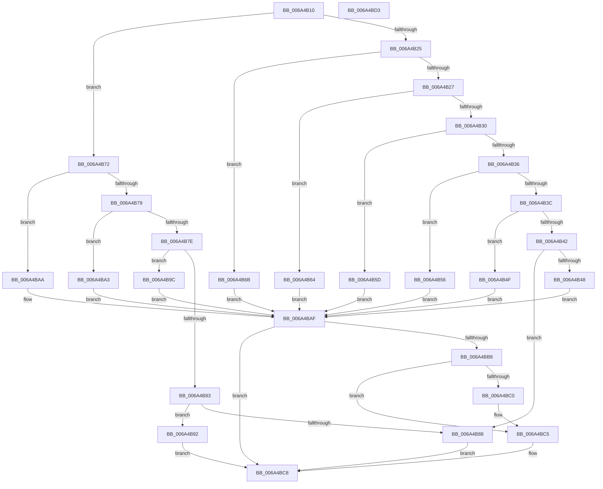

# SC_DISK::SaveStorageProperty

- RVA: `0x006A4B10`–`0x006A4BD4` (길이 `196` bytes)
- VA: `0x00000001406A4B10`
- 실행 섹션: `.text`
- PDB 이름 있음: `예`; PDB Function 태그: `아니요`
- unwind 정보 RVA: `0x0005CAAC`
- 디코드: `64`개 명령, `196/196` bytes 표시
- 미해석 바이트: `0` (있으면 어셈블리에 `.byte`로 보존)

> 이 문서는 커널 이미지의 기계어와 PDB 기호를 분석해 생성했습니다. 4번과 5번은 함수 원형과 자료형을 바이너리 사용 방식에서 추정한 C 해석이며 원본 소스 복구 결과는 아닙니다.

## 1. Dependencies

- 직접 호출 지점: **3**; 고유 호출 대상: **2**
- 직접 호출자로 확인된 함수: **0**
- RIP 상대 이미지 참조: **0**

### Outgoing calls
- `0x006A4B8B` → [SC_DEVICE::SaveStorageProperty](SC_DEVICE_SaveStorageProperty_function_006A5A20.md) (function, `0x006A5A20`)
- `0x006A4B95` → [AlpcpFreeBuffer](../../page/90/AlpcpFreeBuffer_function_009071C0.md) (function, `0x009071C0`)
- `0x006A4BC0` → [AlpcpFreeBuffer](../../page/90/AlpcpFreeBuffer_function_009071C0.md) (function, `0x009071C0`)

### Direct callers
- 이 함수 시작 RVA로 연결되는 직접 call은 확인되지 않았습니다. 간접 호출은 완전히 역산할 수 없습니다.

### Static image references
- 디코드된 RIP-relative 메모리 참조가 없습니다.

## 2. Other-region calls and transfers

- 다른 실행 섹션으로 향하는 call: **2**
  - `0x006A4B95` → [AlpcpFreeBuffer](../../page/90/AlpcpFreeBuffer_function_009071C0.md) (`.text` → `PAGE`)
  - `0x006A4BC0` → [AlpcpFreeBuffer](../../page/90/AlpcpFreeBuffer_function_009071C0.md) (`.text` → `PAGE`)
- 별도 외부 분기/꼬리 이동을 확인하지 못했습니다.

## 3. Assembly (complete function range)

```asm
006A4B10  48 89 5C 24 08                  mov qword ptr [rsp + 8], rbx
006A4B15  57                              push rdi
006A4B16  48 83 EC 20                     sub rsp, 0x20
006A4B1A  49 8B F8                        mov rdi, r8
006A4B1D  4C 8B D1                        mov r10, rcx
006A4B20  83 FA 0E                        cmp edx, 0xe
006A4B23  7F 4D                           jg 0x1406a4b72
006A4B25  74 44                           je 0x1406a4b6b
006A4B27  44 8B CA                        mov r9d, edx
006A4B2A  41 83 E9 04                     sub r9d, 4
006A4B2E  74 34                           je 0x1406a4b64
006A4B30  41 83 E9 02                     sub r9d, 2
006A4B34  74 27                           je 0x1406a4b5d
006A4B36  41 83 E9 01                     sub r9d, 1
006A4B3A  74 1A                           je 0x1406a4b56
006A4B3C  41 83 E9 01                     sub r9d, 1
006A4B40  74 0D                           je 0x1406a4b4f
006A4B42  41 83 F9 03                     cmp r9d, 3
006A4B46  75 40                           jne 0x1406a4b88
006A4B48  B8 70 01 00 00                  mov eax, 0x170
006A4B4D  EB 60                           jmp 0x1406a4baf
006A4B4F  B8 78 01 00 00                  mov eax, 0x178
006A4B54  EB 59                           jmp 0x1406a4baf
006A4B56  B8 68 01 00 00                  mov eax, 0x168
006A4B5B  EB 52                           jmp 0x1406a4baf
006A4B5D  B8 38 01 00 00                  mov eax, 0x138
006A4B62  EB 4B                           jmp 0x1406a4baf
006A4B64  B8 48 01 00 00                  mov eax, 0x148
006A4B69  EB 44                           jmp 0x1406a4baf
006A4B6B  B8 60 01 00 00                  mov eax, 0x160
006A4B70  EB 3D                           jmp 0x1406a4baf
006A4B72  8B CA                           mov ecx, edx
006A4B74  83 E9 39                        sub ecx, 0x39
006A4B77  74 31                           je 0x1406a4baa
006A4B79  83 E9 01                        sub ecx, 1
006A4B7C  74 25                           je 0x1406a4ba3
006A4B7E  83 E9 02                        sub ecx, 2
006A4B81  74 19                           je 0x1406a4b9c
006A4B83  83 F9 05                        cmp ecx, 5
006A4B86  74 0A                           je 0x1406a4b92
006A4B88  49 8B CA                        mov rcx, r10
006A4B8B  E8 90 0E 00 00                  call 0x1406a5a20
006A4B90  EB 36                           jmp 0x1406a4bc8
006A4B92  48 8B CF                        mov rcx, rdi
006A4B95  E8 26 26 26 00                  call 0x1409071c0
006A4B9A  EB 2C                           jmp 0x1406a4bc8
006A4B9C  B8 80 01 00 00                  mov eax, 0x180
006A4BA1  EB 0C                           jmp 0x1406a4baf
006A4BA3  B8 58 01 00 00                  mov eax, 0x158
006A4BA8  EB 05                           jmp 0x1406a4baf
006A4BAA  B8 40 01 00 00                  mov eax, 0x140
006A4BAF  49 8D 1C 02                     lea rbx, [r10 + rax]
006A4BB3  48 85 DB                        test rbx, rbx
006A4BB6  74 10                           je 0x1406a4bc8
006A4BB8  48 8B 0B                        mov rcx, qword ptr [rbx]
006A4BBB  48 85 C9                        test rcx, rcx
006A4BBE  74 05                           je 0x1406a4bc5
006A4BC0  E8 FB 25 26 00                  call 0x1409071c0
006A4BC5  48 89 3B                        mov qword ptr [rbx], rdi
006A4BC8  48 8B 5C 24 30                  mov rbx, qword ptr [rsp + 0x30]
006A4BCD  48 83 C4 20                     add rsp, 0x20
006A4BD1  5F                              pop rdi
006A4BD2  C3                              ret
006A4BD3  CC                              int3
```

## 4. C-style interpretation (structured pseudocode)

```c
__int64 __fastcall SC_DISK__SaveStorageProperty(__int64 a1, int a2, __int64 a3)
{
    __int64 result;
    __int64 v_rsp;
    unsigned __int64 v_stack_p8;

    v_stack_p8 = v_rbx;
    v_rsp = (v_rsp) - (32);
    if (a2 > 14) goto loc_006A4B72;
    if (a2 == 14) goto loc_006A4B6B;
    a4 = (unsigned int)(((unsigned int)(a2)) - (4));
    if (condition_is_equal) goto loc_006A4B64;
    a4 = (unsigned int)((a4) - (2));
    if (condition_is_equal) goto loc_006A4B5D;
    a4 = (unsigned int)((a4) - (1));
    if (condition_is_equal) goto loc_006A4B56;
    a4 = (unsigned int)((a4) - (1));
    if (condition_is_equal) goto loc_006A4B4F;
    if (((unsigned int)(a4)) != 3) goto loc_006A4B88;
    goto loc_006A4BAF;
loc_006A4B4F:
    goto loc_006A4BAF;
loc_006A4B56:
    goto loc_006A4BAF;
loc_006A4B5D:
    goto loc_006A4BAF;
loc_006A4B64:
    goto loc_006A4BAF;
loc_006A4B6B:
    goto loc_006A4BAF;
loc_006A4B72:
    a1 = (unsigned int)(((unsigned int)(a2)) - (57));
    if (condition_is_equal) goto loc_006A4BAA;
    a1 = (unsigned int)((a1) - (1));
    if (condition_is_equal) goto loc_006A4BA3;
    a1 = (unsigned int)((a1) - (2));
    if (condition_is_equal) goto loc_006A4B9C;
    if (((unsigned int)(a1)) == 5) goto loc_006A4B92;
loc_006A4B88:
    result = SC_DEVICE__SaveStorageProperty(a1, a2, a3, a4);
    goto loc_006A4BC8;
loc_006A4B92:
    result = AlpcpFreeBuffer(a3, a2, a3, a4);
    goto loc_006A4BC8;
loc_006A4B9C:
    goto loc_006A4BAF;
loc_006A4BA3:
    goto loc_006A4BAF;
loc_006A4BAA:
loc_006A4BAF:
    if (a1 + 320 * 1 == 0) goto loc_006A4BC8;
    result = 320;
    if (*(unsigned __int64 *)(a1 + 320 * 1) != 0) {
        result = AlpcpFreeBuffer(*(unsigned __int64 *)(a1 + 320 * 1), a2, a3, a4);
    }
    *(unsigned __int64 *)(a1 + 320 * 1) = a3;
loc_006A4BC8:
    v_rsp = (v_rsp) + (32);
    return result;
}
```

## 5. (Beta) C Style

```c
int64_t SC_DISK__SaveStorageProperty(void *Arg1, int32_t Arg2, int64_t Arg3)
{
    uint8_t *arg1 = (uint8_t *)Arg1;

    int64_t result;
    int64_t local_rsp;
    uint64_t v_stack_p8;

    v_stack_p8 = local_rbx;
    local_rsp = (local_rsp) - (32);
    if (Arg2 > 14) goto loc_006A4B72;
    if (Arg2 == 14) goto loc_006A4B6B;
    a4 = (uint32_t)(((uint32_t)(Arg2)) - (4));
    if (condition_is_equal) goto loc_006A4B64;
    a4 = (uint32_t)((a4) - (2));
    if (condition_is_equal) goto loc_006A4B5D;
    a4 = (uint32_t)((a4) - (1));
    if (condition_is_equal) goto loc_006A4B56;
    a4 = (uint32_t)((a4) - (1));
    if (condition_is_equal) goto loc_006A4B4F;
    if (((uint32_t)(a4)) != 3) goto loc_006A4B88;
    goto loc_006A4BAF;
loc_006A4B4F:
    goto loc_006A4BAF;
loc_006A4B56:
    goto loc_006A4BAF;
loc_006A4B5D:
    goto loc_006A4BAF;
loc_006A4B64:
    goto loc_006A4BAF;
loc_006A4B6B:
    goto loc_006A4BAF;
loc_006A4B72:
    Arg1 = (uint32_t)(((uint32_t)(Arg2)) - (57));
    if (condition_is_equal) goto loc_006A4BAA;
    Arg1 = (uint32_t)((Arg1) - (1));
    if (condition_is_equal) goto loc_006A4BA3;
    Arg1 = (uint32_t)((Arg1) - (2));
    if (condition_is_equal) goto loc_006A4B9C;
    if (((uint32_t)(Arg1)) == 5) goto loc_006A4B92;
loc_006A4B88:
    result = SC_DEVICE__SaveStorageProperty(Arg1, Arg2, Arg3, a4);
    goto loc_006A4BC8;
loc_006A4B92:
    result = AlpcpFreeBuffer(Arg3, Arg2, Arg3, a4);
    goto loc_006A4BC8;
loc_006A4B9C:
    goto loc_006A4BAF;
loc_006A4BA3:
    goto loc_006A4BAF;
loc_006A4BAA:
loc_006A4BAF:
    if (Arg1 + 320 * 1 == 0) goto loc_006A4BC8;
    result = 320;
    if (*(uint64_t *)(arg1 + 0x140 * 1) != 0) {
        result = AlpcpFreeBuffer(*(uint64_t *)(arg1 + 0x140 * 1), Arg2, Arg3, a4);
    }
    *(uint64_t *)(arg1 + 0x140 * 1) = Arg3;
loc_006A4BC8:
    local_rsp = (local_rsp) + (32);
    return result;
}
```

### 관측된 메모리 오프셋

구조체 형식이 확인되지 않은 접근은 인자 기준의 오프셋으로만 기록했습니다.

| 기준 인자 | 오프셋 표현 | 폭 (bit) | 접근 |
|---|---:|---:|---|
| `Arg1` | `+ 0x0 + rax*1` | `64` | `R` |

## 6. Execution-region graph

[열기: 2D/3D 그래프와 함수 탐색 컨트롤 패널](../../../control-panel.html?section=text&rva=0x006A4B10&view=graph)

- 2D 그래프는 위에서 아래로 흐르고, 3D 그래프는 빈 공간을 드래그해 회전합니다. Shift+드래그는 이동, 휠은 확대·축소, 함수 노드 선택은 대상 보고서 이동입니다.

### Static fallback


