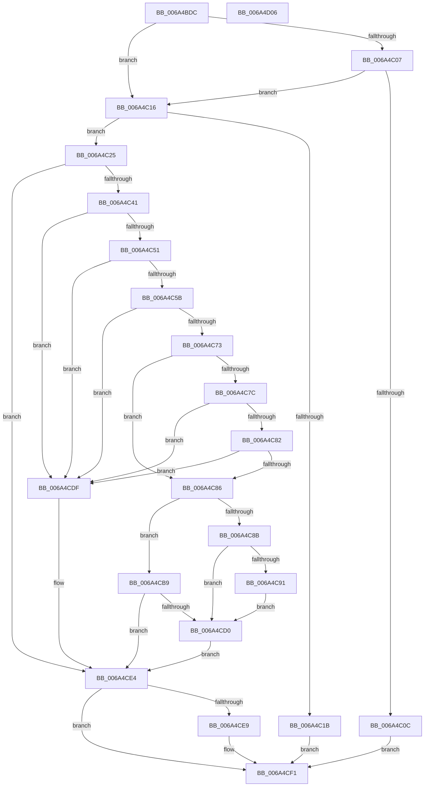

# SC_DISK::SetPartition

- RVA: `0x006A4BDC`–`0x006A4D07` (길이 `299` bytes)
- VA: `0x00000001406A4BDC`
- 실행 섹션: `.text`
- PDB 이름 있음: `예`; PDB Function 태그: `아니요`
- unwind 정보 RVA: `0x000701D4`
- 디코드: `89`개 명령, `299/299` bytes 표시
- 미해석 바이트: `0` (있으면 어셈블리에 `.byte`로 보존)

> 이 문서는 커널 이미지의 기계어와 PDB 기호를 분석해 생성했습니다. 4번과 5번은 함수 원형과 자료형을 바이너리 사용 방식에서 추정한 C 해석이며 원본 소스 복구 결과는 아닙니다.

## 1. Dependencies

- 직접 호출 지점: **6**; 고유 호출 대상: **6**
- 직접 호출자로 확인된 함수: **2**
- RIP 상대 이미지 참조: **0**

### Outgoing calls
- `0x006A4C2D` → [SC_DISK::ReadPartitionTable](SC_DISK_ReadPartitionTable_function_006A499C.md) (function, `0x006A499C`)
- `0x006A4C6A` → [SC_PART_ENTRY::IsUnused](SC_PART_ENTRY_IsUnused_function_006A4890.md) (function, `0x006A4890`)
- `0x006A4CB2` → [RtlStringCbCopyW](RtlStringCbCopyW_function_006A37B0.md) (function, `0x006A37B0`)
- `0x006A4CC5` → [SC_DISK::ResetPartitionCache](SC_DISK_ResetPartitionCache_function_006A4A70.md) (function, `0x006A4A70`)
- `0x006A4CD6` → [SC_DISK::WritePartitionTable](SC_DISK_WritePartitionTable_function_006A4D4C.md) (function, `0x006A4D4C`)
- `0x006A4CEC` → [AlpcpFreeBuffer](../../page/90/AlpcpFreeBuffer_function_009071C0.md) (function, `0x009071C0`)

### Direct callers
- [IoSetPartitionInformation](../../page/71/IoSetPartitionInformation_function_00717680.md) at `0x00717710`
- [IoSetPartitionInformationEx](../../page/71/IoSetPartitionInformationEx_function_00717760.md) at `0x007177C5`

### Static image references
- 디코드된 RIP-relative 메모리 참조가 없습니다.

## 2. Other-region calls and transfers

- 다른 실행 섹션으로 향하는 call: **1**
  - `0x006A4CEC` → [AlpcpFreeBuffer](../../page/90/AlpcpFreeBuffer_function_009071C0.md) (`.text` → `PAGE`)
- 별도 외부 분기/꼬리 이동을 확인하지 못했습니다.

## 3. Assembly (complete function range)

```asm
006A4BDC  48 89 5C 24 10                  mov qword ptr [rsp + 0x10], rbx
006A4BE1  48 89 6C 24 18                  mov qword ptr [rsp + 0x18], rbp
006A4BE6  56                              push rsi
006A4BE7  57                              push rdi
006A4BE8  41 56                           push r14
006A4BEA  48 83 EC 20                     sub rsp, 0x20
006A4BEE  48 83 64 24 40 00               and qword ptr [rsp + 0x40], 0
006A4BF4  48 8B E9                        mov rbp, rcx
006A4BF7  8B 89 00 01 00 00               mov ecx, dword ptr [rcx + 0x100]
006A4BFD  49 8B F0                        mov rsi, r8
006A4C00  44 8B F2                        mov r14d, edx
006A4C03  85 C9                           test ecx, ecx
006A4C05  74 0F                           je 0x1406a4c16
006A4C07  83 F9 01                        cmp ecx, 1
006A4C0A  74 0A                           je 0x1406a4c16
006A4C0C  BB BB 00 00 C0                  mov ebx, 0xc00000bb
006A4C11  E9 DB 00 00 00                  jmp 0x1406a4cf1
006A4C16  41 3B 08                        cmp ecx, dword ptr [r8]
006A4C19  74 0A                           je 0x1406a4c25
006A4C1B  BB 0D 00 00 C0                  mov ebx, 0xc000000d
006A4C20  E9 CC 00 00 00                  jmp 0x1406a4cf1
006A4C25  48 8D 54 24 40                  lea rdx, [rsp + 0x40]
006A4C2A  48 8B CD                        mov rcx, rbp
006A4C2D  E8 6A FD FF FF                  call 0x1406a499c
006A4C32  48 8B 7C 24 40                  mov rdi, qword ptr [rsp + 0x40]
006A4C37  8B D8                           mov ebx, eax
006A4C39  85 C0                           test eax, eax
006A4C3B  0F 88 A3 00 00 00               js 0x1406a4ce4
006A4C41  44 8B 8D 00 01 00 00            mov r9d, dword ptr [rbp + 0x100]
006A4C48  44 39 0F                        cmp dword ptr [rdi], r9d
006A4C4B  0F 85 8E 00 00 00               jne 0x1406a4cdf
006A4C51  44 3B 77 04                     cmp r14d, dword ptr [rdi + 4]
006A4C55  0F 83 84 00 00 00               jae 0x1406a4cdf
006A4C5B  4B 8D 0C F6                     lea rcx, [r14 + r14*8]
006A4C5F  48 C1 E1 04                     shl rcx, 4
006A4C63  48 83 C1 30                     add rcx, 0x30
006A4C67  48 03 CF                        add rcx, rdi
006A4C6A  E8 21 FC FF FF                  call 0x1406a4890
006A4C6F  84 C0                           test al, al
006A4C71  75 6C                           jne 0x1406a4cdf
006A4C73  83 39 00                        cmp dword ptr [rcx], 0
006A4C76  48 8D 51 20                     lea rdx, [rcx + 0x20]
006A4C7A  75 0A                           jne 0x1406a4c86
006A4C7C  8A 02                           mov al, byte ptr [rdx]
006A4C7E  3C 05                           cmp al, 5
006A4C80  74 5D                           je 0x1406a4cdf
006A4C82  3C 0F                           cmp al, 0xf
006A4C84  74 59                           je 0x1406a4cdf
006A4C86  45 85 C9                        test r9d, r9d
006A4C89  74 2E                           je 0x1406a4cb9
006A4C8B  41 83 F9 01                     cmp r9d, 1
006A4C8F  75 3F                           jne 0x1406a4cd0
006A4C91  0F 10 46 08                     movups xmm0, xmmword ptr [rsi + 8]
006A4C95  4C 8D 46 30                     lea r8, [rsi + 0x30]
006A4C99  F3 0F 7F 02                     movdqu xmmword ptr [rdx], xmm0
006A4C9D  0F 10 4E 18                     movups xmm1, xmmword ptr [rsi + 0x18]
006A4CA1  F3 0F 7F 49 30                  movdqu xmmword ptr [rcx + 0x30], xmm1
006A4CA6  48 8B 46 28                     mov rax, qword ptr [rsi + 0x28]
006A4CAA  48 89 41 40                     mov qword ptr [rcx + 0x40], rax
006A4CAE  48 83 C1 48                     add rcx, 0x48
006A4CB2  E8 F9 EA FF FF                  call 0x1406a37b0
006A4CB7  EB 17                           jmp 0x1406a4cd0
006A4CB9  8A 46 08                        mov al, byte ptr [rsi + 8]
006A4CBC  C6 41 1C 01                     mov byte ptr [rcx + 0x1c], 1
006A4CC0  48 8B CD                        mov rcx, rbp
006A4CC3  88 02                           mov byte ptr [rdx], al
006A4CC5  E8 A6 FD FF FF                  call 0x1406a4a70
006A4CCA  8B D8                           mov ebx, eax
006A4CCC  85 C0                           test eax, eax
006A4CCE  78 14                           js 0x1406a4ce4
006A4CD0  48 8B D7                        mov rdx, rdi
006A4CD3  48 8B CD                        mov rcx, rbp
006A4CD6  E8 71 00 00 00                  call 0x1406a4d4c
006A4CDB  8B D8                           mov ebx, eax
006A4CDD  EB 05                           jmp 0x1406a4ce4
006A4CDF  BB 0D 00 00 C0                  mov ebx, 0xc000000d
006A4CE4  48 85 FF                        test rdi, rdi
006A4CE7  74 08                           je 0x1406a4cf1
006A4CE9  48 8B CF                        mov rcx, rdi
006A4CEC  E8 CF 24 26 00                  call 0x1409071c0
006A4CF1  48 8B 6C 24 50                  mov rbp, qword ptr [rsp + 0x50]
006A4CF6  8B C3                           mov eax, ebx
006A4CF8  48 8B 5C 24 48                  mov rbx, qword ptr [rsp + 0x48]
006A4CFD  48 83 C4 20                     add rsp, 0x20
006A4D01  41 5E                           pop r14
006A4D03  5F                              pop rdi
006A4D04  5E                              pop rsi
006A4D05  C3                              ret
006A4D06  CC                              int3
```

## 4. C-style interpretation (structured pseudocode)

```c
__int64 __fastcall SC_DISK__SetPartition(__int64 a1, int a2, __int64 a3)
{
    __int64 result;
    __int64 v_rsp;
    unsigned __int64 v_stack_p10;
    unsigned __int64 v_stack_p18;
    unsigned __int64 v_stack_p8;

    v_stack_p10 = v_rbx;
    v_stack_p18 = v_rbp;
    v_rsp = (v_rsp) - (32);
    if ((unsigned int)((unsigned int)(*(unsigned int *)(a1 + 256))) == 0) goto loc_006A4C16;
    if (((unsigned int)((unsigned int)(*(unsigned int *)(a1 + 256)))) == 1) goto loc_006A4C16;
    goto loc_006A4CF1;
loc_006A4C16:
    if (((unsigned int)((unsigned int)(*(unsigned int *)(a1 + 256)))) == (*(unsigned int *)(a3))) goto loc_006A4C25;
    goto loc_006A4CF1;
loc_006A4C25:
    result = SC_DISK__ReadPartitionTable(a1, v_stack_p8, a3, a4);
    if (sign_flag) goto loc_006A4CE4;
    if ((*(unsigned int *)(v_stack_p8)) != ((unsigned int)((unsigned int)(*(unsigned int *)(a1 + 256))))) goto loc_006A4CDF;
    if (((unsigned int)((unsigned int)(a2))) >= (*(unsigned int *)(v_stack_p8 + 4))) goto loc_006A4CDF;
    a1 = ((unsigned int)(a2) + (unsigned int)(a2) * 8) << (4);
    a1 = (a1) + (48);
    a1 = (a1) + (v_stack_p8);
    result = SC_PART_ENTRY__IsUnused(a1, v_stack_p8, a3, (unsigned int)(*(unsigned int *)(a1 + 256)));
    if ((unsigned __int8)(result) != 0) goto loc_006A4CDF;
    if ((*(unsigned int *)(a1)) != 0) goto loc_006A4C86;
    if (((unsigned __int8)(*(unsigned __int8 *)(a1 + 32))) == 5) goto loc_006A4CDF;
    if (((unsigned __int8)(*(unsigned __int8 *)(a1 + 32))) == 15) goto loc_006A4CDF;
loc_006A4C86:
    if ((unsigned int)((unsigned int)(*(unsigned int *)(a1 + 256))) == 0) goto loc_006A4CB9;
    if (((unsigned int)((unsigned int)(*(unsigned int *)(a1 + 256)))) != 1) goto loc_006A4CD0;
    *(unsigned __int64 *)(a1 + 32) = v_xmm0;
    *(unsigned __int64 *)(a1 + 48) = v_xmm1;
    *(unsigned __int64 *)(a1 + 64) = *(unsigned __int64 *)(a3 + 40);
    a1 = (a1) + (72);
    result = RtlStringCbCopyW(a1, a1 + 32, a3 + 48, (unsigned int)(*(unsigned int *)(a1 + 256)));
    goto loc_006A4CD0;
loc_006A4CB9:
    *(unsigned __int8 *)(a1 + 28) = 1;
    *(unsigned __int8 *)(a1 + 32) = (unsigned __int8)(*(unsigned __int8 *)(a3 + 8));
    result = SC_DISK__ResetPartitionCache(a1, a1 + 32, a3 + 48, (unsigned int)(*(unsigned int *)(a1 + 256)));
    if (sign_flag) goto loc_006A4CE4;
loc_006A4CD0:
    result = SC_DISK__WritePartitionTable(a1, v_stack_p8, a3 + 48, (unsigned int)(*(unsigned int *)(a1 + 256)));
    goto loc_006A4CE4;
loc_006A4CDF:
loc_006A4CE4:
    if (v_stack_p8 != 0) {
        a1 = v_stack_p8;
        result = AlpcpFreeBuffer(a1, v_stack_p8, a3 + 48, (unsigned int)(*(unsigned int *)(a1 + 256)));
    }
    v_rsp = (v_rsp) + (32);
    return (unsigned int)((unsigned int)((unsigned int)(0xC000000DULL)));
}
```

## 5. (Beta) C Style

```c
int64_t SC_DISK__SetPartition(void *Arg1, int32_t Arg2, void *Arg3)
{
    uint8_t *arg1 = (uint8_t *)Arg1;
    uint8_t *arg3 = (uint8_t *)Arg3;

    int64_t result;
    int64_t local_rsp;
    uint64_t v_stack_p10;
    uint64_t v_stack_p18;
    uint64_t v_stack_p8;

    v_stack_p10 = local_rbx;
    v_stack_p18 = local_rbp;
    local_rsp = (local_rsp) - (32);
    if ((uint32_t)((uint32_t)(*(uint32_t *)(arg1 + 0x100))) == 0) goto loc_006A4C16;
    if (((uint32_t)((uint32_t)(*(uint32_t *)(arg1 + 0x100)))) == 1) goto loc_006A4C16;
    goto loc_006A4CF1;
loc_006A4C16:
    if (((uint32_t)((uint32_t)(*(uint32_t *)(arg1 + 0x100)))) == (*(uint32_t *)(arg3))) goto loc_006A4C25;
    goto loc_006A4CF1;
loc_006A4C25:
    result = SC_DISK__ReadPartitionTable(Arg1, v_stack_p8, Arg3, a4);
    if (sign_flag) goto loc_006A4CE4;
    if ((*(uint32_t *)(v_stack_p8)) != ((uint32_t)((uint32_t)(*(uint32_t *)(arg1 + 0x100))))) goto loc_006A4CDF;
    if (((uint32_t)((uint32_t)(Arg2))) >= (*(uint32_t *)(v_stack_p8 + 0x4))) goto loc_006A4CDF;
    Arg1 = ((uint32_t)(Arg2) + (uint32_t)(Arg2) * 8) << (4);
    Arg1 = (Arg1) + (48);
    Arg1 = (Arg1) + (v_stack_p8);
    result = SC_PART_ENTRY__IsUnused(Arg1, v_stack_p8, Arg3, (uint32_t)(*(uint32_t *)(arg1 + 0x100)));
    if ((uint8_t)(result) != 0) goto loc_006A4CDF;
    if ((*(uint32_t *)(arg1)) != 0) goto loc_006A4C86;
    if (((uint8_t)(*(uint8_t *)(arg1 + 0x20))) == 5) goto loc_006A4CDF;
    if (((uint8_t)(*(uint8_t *)(arg1 + 0x20))) == 15) goto loc_006A4CDF;
loc_006A4C86:
    if ((uint32_t)((uint32_t)(*(uint32_t *)(arg1 + 0x100))) == 0) goto loc_006A4CB9;
    if (((uint32_t)((uint32_t)(*(uint32_t *)(arg1 + 0x100)))) != 1) goto loc_006A4CD0;
    *(uint64_t *)(arg1 + 0x20) = v_xmm0;
    *(uint64_t *)(arg1 + 0x30) = v_xmm1;
    *(uint64_t *)(arg1 + 0x40) = *(uint64_t *)(arg3 + 0x28);
    Arg1 = (Arg1) + (72);
    result = RtlStringCbCopyW(Arg1, Arg1 + 32, Arg3 + 48, (uint32_t)(*(uint32_t *)(arg1 + 0x100)));
    goto loc_006A4CD0;
loc_006A4CB9:
    *(uint8_t *)(arg1 + 0x1C) = 1;
    *(uint8_t *)(arg1 + 0x20) = (uint8_t)(*(uint8_t *)(arg3 + 0x8));
    result = SC_DISK__ResetPartitionCache(Arg1, Arg1 + 32, Arg3 + 48, (uint32_t)(*(uint32_t *)(arg1 + 0x100)));
    if (sign_flag) goto loc_006A4CE4;
loc_006A4CD0:
    result = SC_DISK__WritePartitionTable(Arg1, v_stack_p8, Arg3 + 48, (uint32_t)(*(uint32_t *)(arg1 + 0x100)));
    goto loc_006A4CE4;
loc_006A4CDF:
loc_006A4CE4:
    if (v_stack_p8 != 0) {
        Arg1 = v_stack_p8;
        result = AlpcpFreeBuffer(Arg1, v_stack_p8, Arg3 + 48, (uint32_t)(*(uint32_t *)(arg1 + 0x100)));
    }
    local_rsp = (local_rsp) + (32);
    return (uint32_t)((uint32_t)((uint32_t)(0xC000000DULL)));
}
```

### 관측된 메모리 오프셋

구조체 형식이 확인되지 않은 접근은 인자 기준의 오프셋으로만 기록했습니다.

| 기준 인자 | 오프셋 표현 | 폭 (bit) | 접근 |
|---|---:|---:|---|
| `Arg1` | `+ 0x100` | `32` | `R` |
| `Arg3` | `+ 0x0` | `32` | `R` |
| `Arg3` | `+ 0x8` | `8` | `R` |
| `Arg3` | `+ 0x8` | `128` | `R` |
| `Arg3` | `+ 0x18` | `128` | `R` |
| `Arg3` | `+ 0x28` | `64` | `R` |
| `Arg3` | `+ 0x30` | `64` | `R` |

## 6. Execution-region graph

[열기: 2D/3D 그래프와 함수 탐색 컨트롤 패널](../../../control-panel.html?section=text&rva=0x006A4BDC&view=graph)

- 2D 그래프는 위에서 아래로 흐르고, 3D 그래프는 빈 공간을 드래그해 회전합니다. Shift+드래그는 이동, 휠은 확대·축소, 함수 노드 선택은 대상 보고서 이동입니다.

### Static fallback


