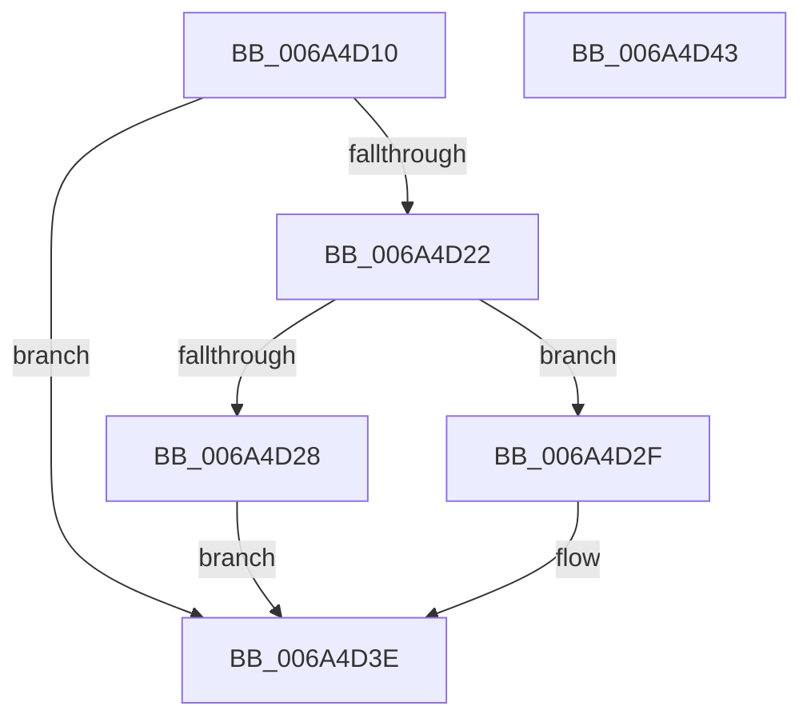

# SC_DISK::VerifyPartitionTable

- RVA: `0x006A4D10`–`0x006A4D44` (길이 `52` bytes)
- VA: `0x00000001406A4D10`
- 실행 섹션: `.text`
- PDB 이름 있음: `예`; PDB Function 태그: `아니요`
- unwind 정보 RVA: `0x0005C788`
- 디코드: `15`개 명령, `52/52` bytes 표시
- 미해석 바이트: `0` (있으면 어셈블리에 `.byte`로 보존)

> 이 문서는 커널 이미지의 기계어와 PDB 기호를 분석해 생성했습니다. 4번과 5번은 함수 원형과 자료형을 바이너리 사용 방식에서 추정한 C 해석이며 원본 소스 복구 결과는 아닙니다.

## 1. Dependencies

- 직접 호출 지점: **1**; 고유 호출 대상: **1**
- 직접 호출자로 확인된 함수: **1**
- RIP 상대 이미지 참조: **0**

### Outgoing calls
- `0x006A4D39` → [SC_GPT::VerifyPartitionTable](SC_GPT_VerifyPartitionTable_function_006A3804.md) (function, `0x006A3804`)

### Direct callers
- [IoVerifyPartitionTable](../../page/71/IoVerifyPartitionTable_function_00717810.md) at `0x00717874`

### Static image references
- 디코드된 RIP-relative 메모리 참조가 없습니다.

## 2. Other-region calls and transfers

- 다른 실행 섹션으로 향하는 call: **0**
- 별도 외부 분기/꼬리 이동을 확인하지 못했습니다.

## 3. Assembly (complete function range)

```asm
006A4D10  48 83 EC 28                     sub rsp, 0x28
006A4D14  44 8B 81 00 01 00 00            mov r8d, dword ptr [rcx + 0x100]
006A4D1B  33 C0                           xor eax, eax
006A4D1D  45 85 C0                        test r8d, r8d
006A4D20  74 1C                           je 0x1406a4d3e
006A4D22  41 83 F8 01                     cmp r8d, 1
006A4D26  74 07                           je 0x1406a4d2f
006A4D28  B8 BB 00 00 C0                  mov eax, 0xc00000bb
006A4D2D  EB 0F                           jmp 0x1406a4d3e
006A4D2F  48 89 4C 24 30                  mov qword ptr [rsp + 0x30], rcx
006A4D34  48 8D 4C 24 30                  lea rcx, [rsp + 0x30]
006A4D39  E8 C6 EA FF FF                  call 0x1406a3804
006A4D3E  48 83 C4 28                     add rsp, 0x28
006A4D42  C3                              ret
006A4D43  CC                              int3
```

## 4. C-style interpretation (structured pseudocode)

```c
__int64 __fastcall SC_DISK__VerifyPartitionTable(__int64 a1)
{
    __int64 result;
    __int64 v_rsp;
    unsigned __int64 v_stack_p8;

    v_rsp = (v_rsp) - (40);
    result = 0;
    if ((unsigned int)((unsigned int)(*(unsigned int *)(a1 + 256))) == 0) goto loc_006A4D3E;
    if (((unsigned int)((unsigned int)(*(unsigned int *)(a1 + 256)))) == 1) goto loc_006A4D2F;
    goto loc_006A4D3E;
loc_006A4D2F:
    v_stack_p8 = a1;
    result = SC_GPT__VerifyPartitionTable(v_stack_p8, a2, (unsigned int)(*(unsigned int *)(a1 + 256)), a4);
loc_006A4D3E:
    v_rsp = (v_rsp) + (40);
    return result;
}
```

## 5. (Beta) C Style

```c
int64_t SC_DISK__VerifyPartitionTable(void *Arg1)
{
    uint8_t *arg1 = (uint8_t *)Arg1;

    int64_t result;
    int64_t local_rsp;
    uint64_t v_stack_p8;

    local_rsp = (local_rsp) - (40);
    result = 0;
    if ((uint32_t)((uint32_t)(*(uint32_t *)(arg1 + 0x100))) == 0) goto loc_006A4D3E;
    if (((uint32_t)((uint32_t)(*(uint32_t *)(arg1 + 0x100)))) == 1) goto loc_006A4D2F;
    goto loc_006A4D3E;
loc_006A4D2F:
    v_stack_p8 = Arg1;
    result = SC_GPT__VerifyPartitionTable(v_stack_p8, a2, (uint32_t)(*(uint32_t *)(arg1 + 0x100)), a4);
loc_006A4D3E:
    local_rsp = (local_rsp) + (40);
    return result;
}
```

### 관측된 메모리 오프셋

구조체 형식이 확인되지 않은 접근은 인자 기준의 오프셋으로만 기록했습니다.

| 기준 인자 | 오프셋 표현 | 폭 (bit) | 접근 |
|---|---:|---:|---|
| `Arg1` | `+ 0x100` | `32` | `R` |

## 6. Execution-region graph

[열기: 2D/3D 그래프와 함수 탐색 컨트롤 패널](../../../control-panel.html?section=text&rva=0x006A4D10&view=graph)

- 2D 그래프는 위에서 아래로 흐르고, 3D 그래프는 빈 공간을 드래그해 회전합니다. Shift+드래그는 이동, 휠은 확대·축소, 함수 노드 선택은 대상 보고서 이동입니다.

### Static fallback


