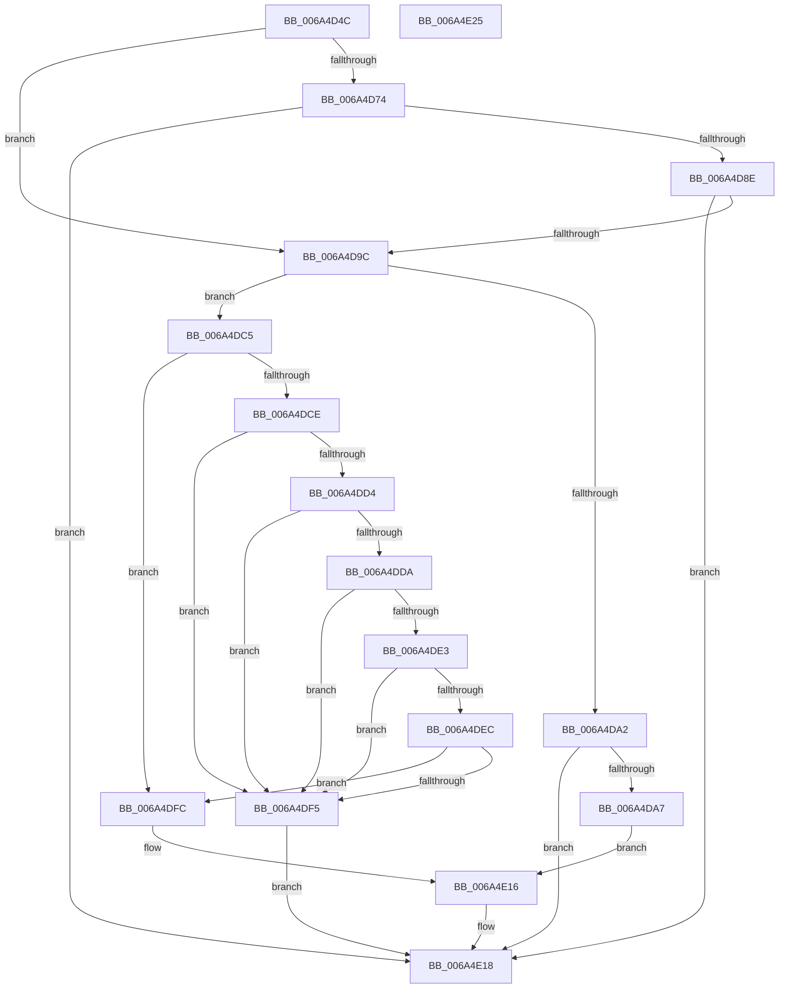

# SC_DISK::WritePartitionTable

- RVA: `0x006A4D4C`–`0x006A4E26` (길이 `218` bytes)
- VA: `0x00000001406A4D4C`
- 실행 섹션: `.text`
- PDB 이름 있음: `예`; PDB Function 태그: `아니요`
- unwind 정보 RVA: `0x000BED58`
- 디코드: `62`개 명령, `218/218` bytes 표시
- 미해석 바이트: `0` (있으면 어셈블리에 `.byte`로 보존)

> 이 문서는 커널 이미지의 기계어와 PDB 기호를 분석해 생성했습니다. 4번과 5번은 함수 원형과 자료형을 바이너리 사용 방식에서 추정한 C 해석이며 원본 소스 복구 결과는 아닙니다.

## 1. Dependencies

- 직접 호출 지점: **5**; 고유 호출 대상: **5**
- 직접 호출자로 확인된 함수: **3**
- RIP 상대 이미지 참조: **0**

### Outgoing calls
- `0x006A4D7F` → [SC_DISK::CreatePartitionTable](SC_DISK_CreatePartitionTable_function_006A43F8.md) (function, `0x006A43F8`)
- `0x006A4D91` → [SC_DISK::ResetPartitionCache](SC_DISK_ResetPartitionCache_function_006A4A70.md) (function, `0x006A4A70`)
- `0x006A4DBE` → [SC_GPT::WritePartitionTable](SC_GPT_WritePartitionTable_function_006A3AD4.md) (function, `0x006A3AD4`)
- `0x006A4E04` → [SC_MBR::Initialize](SC_MBR_Initialize_function_006A509C.md) (function, `0x006A509C`)
- `0x006A4E11` → [SC_MBR::WritePartitionTable](SC_MBR_WritePartitionTable_function_006A5440.md) (function, `0x006A5440`)

### Direct callers
- [SC_DISK::SetPartition](SC_DISK_SetPartition_function_006A4BDC.md) at `0x006A4CD6`
- [IoWritePartitionTable](../../page/71/IoWritePartitionTable_function_007178C0.md) at `0x007179C9`
- [IoWritePartitionTableEx](../../page/71/IoWritePartitionTableEx_function_00717A20.md) at `0x00717A84`

### Static image references
- 디코드된 RIP-relative 메모리 참조가 없습니다.

## 2. Other-region calls and transfers

- 다른 실행 섹션으로 향하는 call: **0**
- 별도 외부 분기/꼬리 이동을 확인하지 못했습니다.

## 3. Assembly (complete function range)

```asm
006A4D4C  48 89 5C 24 10                  mov qword ptr [rsp + 0x10], rbx
006A4D51  57                              push rdi
006A4D52  48 83 EC 40                     sub rsp, 0x40
006A4D56  83 64 24 24 00                  and dword ptr [rsp + 0x24], 0
006A4D5B  48 8B DA                        mov rbx, rdx
006A4D5E  33 D2                           xor edx, edx
006A4D60  0F 57 C0                        xorps xmm0, xmm0
006A4D63  83 B9 00 01 00 00 02            cmp dword ptr [rcx + 0x100], 2
006A4D6A  48 8B F9                        mov rdi, rcx
006A4D6D  0F 11 44 24 28                  movups xmmword ptr [rsp + 0x28], xmm0
006A4D72  75 28                           jne 0x1406a4d9c
006A4D74  8B 03                           mov eax, dword ptr [rbx]
006A4D76  48 8D 54 24 20                  lea rdx, [rsp + 0x20]
006A4D7B  89 44 24 20                     mov dword ptr [rsp + 0x20], eax
006A4D7F  E8 74 F6 FF FF                  call 0x1406a43f8
006A4D84  8B D0                           mov edx, eax
006A4D86  85 C0                           test eax, eax
006A4D88  0F 88 8A 00 00 00               js 0x1406a4e18
006A4D8E  48 8B CF                        mov rcx, rdi
006A4D91  E8 DA FC FF FF                  call 0x1406a4a70
006A4D96  8B D0                           mov edx, eax
006A4D98  85 C0                           test eax, eax
006A4D9A  78 7C                           js 0x1406a4e18
006A4D9C  8B 0B                           mov ecx, dword ptr [rbx]
006A4D9E  85 C9                           test ecx, ecx
006A4DA0  74 23                           je 0x1406a4dc5
006A4DA2  83 F9 01                        cmp ecx, 1
006A4DA5  75 71                           jne 0x1406a4e18
006A4DA7  39 8F 00 01 00 00               cmp dword ptr [rdi + 0x100], ecx
006A4DAD  48 8B D3                        mov rdx, rbx
006A4DB0  48 8D 4C 24 50                  lea rcx, [rsp + 0x50]
006A4DB5  48 89 7C 24 50                  mov qword ptr [rsp + 0x50], rdi
006A4DBA  41 0F 95 C0                     setne r8b
006A4DBE  E8 11 ED FF FF                  call 0x1406a3ad4
006A4DC3  EB 51                           jmp 0x1406a4e16
006A4DC5  83 BF 00 01 00 00 00            cmp dword ptr [rdi + 0x100], 0
006A4DCC  74 2E                           je 0x1406a4dfc
006A4DCE  83 7B 04 04                     cmp dword ptr [rbx + 4], 4
006A4DD2  75 21                           jne 0x1406a4df5
006A4DD4  80 7B 50 EE                     cmp byte ptr [rbx + 0x50], 0xee
006A4DD8  75 1B                           jne 0x1406a4df5
006A4DDA  80 BB E0 00 00 00 00            cmp byte ptr [rbx + 0xe0], 0
006A4DE1  75 12                           jne 0x1406a4df5
006A4DE3  80 BB 70 01 00 00 00            cmp byte ptr [rbx + 0x170], 0
006A4DEA  75 09                           jne 0x1406a4df5
006A4DEC  80 BB 00 02 00 00 00            cmp byte ptr [rbx + 0x200], 0
006A4DF3  74 07                           je 0x1406a4dfc
006A4DF5  BA BB 00 00 C0                  mov edx, 0xc00000bb
006A4DFA  EB 1C                           jmp 0x1406a4e18
006A4DFC  48 8B D7                        mov rdx, rdi
006A4DFF  48 8D 4C 24 50                  lea rcx, [rsp + 0x50]
006A4E04  E8 93 02 00 00                  call 0x1406a509c
006A4E09  48 8D 4C 24 50                  lea rcx, [rsp + 0x50]
006A4E0E  48 8B D3                        mov rdx, rbx
006A4E11  E8 2A 06 00 00                  call 0x1406a5440
006A4E16  8B D0                           mov edx, eax
006A4E18  48 8B 5C 24 58                  mov rbx, qword ptr [rsp + 0x58]
006A4E1D  8B C2                           mov eax, edx
006A4E1F  48 83 C4 40                     add rsp, 0x40
006A4E23  5F                              pop rdi
006A4E24  C3                              ret
006A4E25  CC                              int3
```

## 4. C-style interpretation (structured pseudocode)

```c
__int64 __fastcall SC_DISK__WritePartitionTable(__int64 a1, __int64 a2)
{
    __int64 result;
    __int64 v_rsp;
    unsigned __int64 v_stack_m20;
    unsigned int v_stack_m24;
    unsigned __int64 v_stack_m28;
    unsigned __int64 v_stack_p10;
    unsigned __int64 v_stack_p8;

    v_stack_p10 = v_rbx;
    v_rsp = (v_rsp) - (64);
    a2 = 0;
    v_stack_m20 = v_xmm0;
    if ((*(unsigned int *)(a1 + 256)) != 2) goto loc_006A4D9C;
    v_stack_m28 = (unsigned int)((unsigned int)(*(unsigned int *)(a2)));
    result = SC_DISK__CreatePartitionTable(a1, v_stack_m28, a3, a4);
    if (sign_flag) goto loc_006A4E18;
    result = SC_DISK__ResetPartitionCache(a1, (unsigned int)((unsigned int)(result)), a3, a4);
    if (sign_flag) goto loc_006A4E18;
loc_006A4D9C:
    if ((unsigned int)((unsigned int)(*(unsigned int *)(a2))) == 0) goto loc_006A4DC5;
    if (((unsigned int)((unsigned int)(*(unsigned int *)(a2)))) != 1) goto loc_006A4E18;
    v_stack_p8 = a1;
    a3 = ((*(unsigned int *)(a1 + 256)) != ((unsigned int)((unsigned int)(*(unsigned int *)(a2))))) ? 1 : 0;
    result = SC_GPT__WritePartitionTable(v_stack_p8, 0, a3, a4);
    goto loc_006A4E16;
loc_006A4DC5:
    if ((*(unsigned int *)(a1 + 256)) == 0) goto loc_006A4DFC;
    if ((*(unsigned int *)(a2 + 4)) != 4) goto loc_006A4DF5;
    if ((*(unsigned __int8 *)(a2 + 80)) != 238) goto loc_006A4DF5;
    if ((*(unsigned __int8 *)(a2 + 224)) != 0) goto loc_006A4DF5;
    if ((*(unsigned __int8 *)(a2 + 368)) != 0) goto loc_006A4DF5;
    if ((*(unsigned __int8 *)(a2 + 512)) == 0) goto loc_006A4DFC;
loc_006A4DF5:
    goto loc_006A4E18;
loc_006A4DFC:
    result = SC_MBR__Initialize(v_stack_p8, a1, a3, a4);
    result = SC_MBR__WritePartitionTable(v_stack_p8, 0, a3, a4);
loc_006A4E16:
loc_006A4E18:
    v_rsp = (v_rsp) + (64);
    return (unsigned int)((unsigned int)((unsigned int)((unsigned int)(result))));
}
```

## 5. (Beta) C Style

```c
int64_t SC_DISK__WritePartitionTable(void *Arg1, void *Arg2)
{
    uint8_t *arg1 = (uint8_t *)Arg1;
    uint8_t *arg2 = (uint8_t *)Arg2;

    int64_t result;
    int64_t local_rsp;
    uint64_t v_stack_m20;
    uint32_t v_stack_m24;
    uint64_t v_stack_m28;
    uint64_t v_stack_p10;
    uint64_t v_stack_p8;

    v_stack_p10 = local_rbx;
    local_rsp = (local_rsp) - (64);
    Arg2 = 0;
    v_stack_m20 = v_xmm0;
    if ((*(uint32_t *)(arg1 + 0x100)) != 2) goto loc_006A4D9C;
    v_stack_m28 = (uint32_t)((uint32_t)(*(uint32_t *)(arg2)));
    result = SC_DISK__CreatePartitionTable(Arg1, v_stack_m28, a3, a4);
    if (sign_flag) goto loc_006A4E18;
    result = SC_DISK__ResetPartitionCache(Arg1, (uint32_t)((uint32_t)(result)), a3, a4);
    if (sign_flag) goto loc_006A4E18;
loc_006A4D9C:
    if ((uint32_t)((uint32_t)(*(uint32_t *)(arg2))) == 0) goto loc_006A4DC5;
    if (((uint32_t)((uint32_t)(*(uint32_t *)(arg2)))) != 1) goto loc_006A4E18;
    v_stack_p8 = Arg1;
    a3 = ((*(uint32_t *)(arg1 + 0x100)) != ((uint32_t)((uint32_t)(*(uint32_t *)(arg2))))) ? 1 : 0;
    result = SC_GPT__WritePartitionTable(v_stack_p8, 0, a3, a4);
    goto loc_006A4E16;
loc_006A4DC5:
    if ((*(uint32_t *)(arg1 + 0x100)) == 0) goto loc_006A4DFC;
    if ((*(uint32_t *)(arg2 + 0x4)) != 4) goto loc_006A4DF5;
    if ((*(uint8_t *)(arg2 + 0x50)) != 238) goto loc_006A4DF5;
    if ((*(uint8_t *)(arg2 + 0xE0)) != 0) goto loc_006A4DF5;
    if ((*(uint8_t *)(arg2 + 0x170)) != 0) goto loc_006A4DF5;
    if ((*(uint8_t *)(arg2 + 0x200)) == 0) goto loc_006A4DFC;
loc_006A4DF5:
    goto loc_006A4E18;
loc_006A4DFC:
    result = SC_MBR__Initialize(v_stack_p8, Arg1, a3, a4);
    result = SC_MBR__WritePartitionTable(v_stack_p8, 0, a3, a4);
loc_006A4E16:
loc_006A4E18:
    local_rsp = (local_rsp) + (64);
    return (uint32_t)((uint32_t)((uint32_t)((uint32_t)(result))));
}
```

### 관측된 메모리 오프셋

구조체 형식이 확인되지 않은 접근은 인자 기준의 오프셋으로만 기록했습니다.

| 기준 인자 | 오프셋 표현 | 폭 (bit) | 접근 |
|---|---:|---:|---|
| `Arg1` | `+ 0x100` | `32` | `R` |
| `Arg2` | `+ 0x0` | `32` | `R` |
| `Arg2` | `+ 0x4` | `32` | `R` |
| `Arg2` | `+ 0x50` | `8` | `R` |
| `Arg2` | `+ 0xE0` | `8` | `R` |
| `Arg2` | `+ 0x170` | `8` | `R` |
| `Arg2` | `+ 0x200` | `8` | `R` |

## 6. Execution-region graph

[열기: 2D/3D 그래프와 함수 탐색 컨트롤 패널](../../../control-panel.html?section=text&rva=0x006A4D4C&view=graph)

- 2D 그래프는 위에서 아래로 흐르고, 3D 그래프는 빈 공간을 드래그해 회전합니다. Shift+드래그는 이동, 휠은 확대·축소, 함수 노드 선택은 대상 보고서 이동입니다.

### Static fallback


