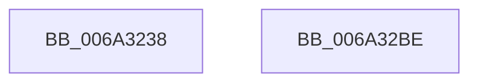

# SC_GPT::CreatePartitionTable

- RVA: `0x006A3238`–`0x006A32BF` (길이 `135` bytes)
- VA: `0x00000001406A3238`
- 실행 섹션: `.text`
- PDB 이름 있음: `예`; PDB Function 태그: `아니요`
- unwind 정보 RVA: `0x000DAC6C`
- 디코드: `30`개 명령, `135/135` bytes 표시
- 미해석 바이트: `0` (있으면 어셈블리에 `.byte`로 보존)

> 이 문서는 커널 이미지의 기계어와 PDB 기호를 분석해 생성했습니다. 4번과 5번은 함수 원형과 자료형을 바이너리 사용 방식에서 추정한 C 해석이며 원본 소스 복구 결과는 아닙니다.

## 1. Dependencies

- 직접 호출 지점: **3**; 고유 호출 대상: **3**
- 직접 호출자로 확인된 함수: **1**
- RIP 상대 이미지 참조: **1**

### Outgoing calls
- `0x006A326A` → [memset](../6C/memset_function_006C6C40.md) (function, `0x006C6C40`)
- `0x006A3298` → [SC_GPT::WritePartitionTable](SC_GPT_WritePartitionTable_function_006A3AD4.md) (function, `0x006A3AD4`)
- `0x006A32A8` → [_security_check_cookie](_security_check_cookie_function_006AC640.md) (function, `0x006AC640`)

### Direct callers
- [SC_DISK::CreatePartitionTable](SC_DISK_CreatePartitionTable_function_006A43F8.md) at `0x006A442F`

### Static image references
- `0x006A3245` → RVA `0x00E0A740` (`.data`; read)

## 2. Other-region calls and transfers

- 다른 실행 섹션으로 향하는 call: **0**
- 별도 외부 분기/꼬리 이동을 확인하지 못했습니다.

## 3. Assembly (complete function range)

```asm
006A3238  48 89 5C 24 10                  mov qword ptr [rsp + 0x10], rbx
006A323D  57                              push rdi
006A323E  48 81 EC F0 00 00 00            sub rsp, 0xf0
006A3245  48 8B 05 F4 74 76 00            mov rax, qword ptr [rip + 0x7674f4]
006A324C  48 33 C4                        xor rax, rsp
006A324F  48 89 84 24 E0 00 00 00         mov qword ptr [rsp + 0xe0], rax
006A3257  48 8B DA                        mov rbx, rdx
006A325A  48 8B F9                        mov rdi, rcx
006A325D  33 D2                           xor edx, edx
006A325F  48 8D 4C 24 20                  lea rcx, [rsp + 0x20]
006A3264  41 B8 C0 00 00 00               mov r8d, 0xc0
006A326A  E8 D1 39 02 00                  call 0x1406c6c40
006A326F  0F 10 43 04                     movups xmm0, xmmword ptr [rbx + 4]
006A3273  8B 43 14                        mov eax, dword ptr [rbx + 0x14]
006A3276  48 8D 54 24 20                  lea rdx, [rsp + 0x20]
006A327B  83 64 24 24 00                  and dword ptr [rsp + 0x24], 0
006A3280  41 B0 01                        mov r8b, 1
006A3283  48 8B CF                        mov rcx, rdi
006A3286  C7 44 24 20 01 00 00 00         mov dword ptr [rsp + 0x20], 1
006A328E  F3 0F 7F 44 24 28               movdqu xmmword ptr [rsp + 0x28], xmm0
006A3294  89 44 24 48                     mov dword ptr [rsp + 0x48], eax
006A3298  E8 37 08 00 00                  call 0x1406a3ad4
006A329D  48 8B 8C 24 E0 00 00 00         mov rcx, qword ptr [rsp + 0xe0]
006A32A5  48 33 CC                        xor rcx, rsp
006A32A8  E8 93 93 00 00                  call 0x1406ac640
006A32AD  48 8B 9C 24 08 01 00 00         mov rbx, qword ptr [rsp + 0x108]
006A32B5  48 81 C4 F0 00 00 00            add rsp, 0xf0
006A32BC  5F                              pop rdi
006A32BD  C3                              ret
006A32BE  CC                              int3
```

## 4. C-style interpretation (structured pseudocode)

```c
__int64 __fastcall SC_GPT__CreatePartitionTable(__int64 a1, __int64 a2)
{
    __int64 result;
    __int64 v_rsp;
    unsigned __int64 v_stack_m18;
    unsigned int v_stack_mB0;
    unsigned __int64 v_stack_mD0;
    unsigned int v_stack_mD4;
    unsigned __int64 v_stack_mD8;
    unsigned __int64 v_stack_p10;

    v_stack_p10 = v_rbx;
    v_rsp = (v_rsp) - (240);
    result = (*(unsigned __int64 *)(v_rip + 7763188)) ^ (v_rsp);
    v_stack_m18 = result;
    a2 = 0;
    result = memset(v_stack_mD8, a2, 192, a4);
    v_stack_mD8 = 1;
    v_stack_mD0 = v_xmm0;
    v_stack_mB0 = (unsigned int)((unsigned int)(*(unsigned int *)(a2 + 20)));
    result = SC_GPT__WritePartitionTable(a1, v_stack_mD8, 1, a4);
    a1 = (v_stack_m18) ^ (v_rsp);
    result = _security_check_cookie(a1, v_stack_mD8, 1, a4);
    v_rsp = (v_rsp) + (240);
    return result;
}
```

## 5. (Beta) C Style

```c
int64_t SC_GPT__CreatePartitionTable(int64_t Arg1, void *Arg2)
{
    uint8_t *arg2 = (uint8_t *)Arg2;

    int64_t result;
    int64_t local_rsp;
    uint64_t v_stack_m18;
    uint32_t v_stack_mB0;
    uint64_t v_stack_mD0;
    uint32_t v_stack_mD4;
    uint64_t v_stack_mD8;
    uint64_t v_stack_p10;

    v_stack_p10 = local_rbx;
    local_rsp = (local_rsp) - (240);
    result = (*(uint64_t *)(v_rip + 0x7674F4)) ^ (local_rsp);
    v_stack_m18 = result;
    Arg2 = 0;
    result = memset(v_stack_mD8, Arg2, 192, a4);
    v_stack_mD8 = 1;
    v_stack_mD0 = v_xmm0;
    v_stack_mB0 = (uint32_t)((uint32_t)(*(uint32_t *)(arg2 + 0x14)));
    result = SC_GPT__WritePartitionTable(Arg1, v_stack_mD8, 1, a4);
    Arg1 = (v_stack_m18) ^ (local_rsp);
    result = _security_check_cookie(Arg1, v_stack_mD8, 1, a4);
    local_rsp = (local_rsp) + (240);
    return result;
}
```

### 관측된 메모리 오프셋

구조체 형식이 확인되지 않은 접근은 인자 기준의 오프셋으로만 기록했습니다.

| 기준 인자 | 오프셋 표현 | 폭 (bit) | 접근 |
|---|---:|---:|---|
| `Arg2` | `+ 0x4` | `128` | `R` |
| `Arg2` | `+ 0x14` | `32` | `R` |

## 6. Execution-region graph

[열기: 2D/3D 그래프와 함수 탐색 컨트롤 패널](../../../control-panel.html?section=text&rva=0x006A3238&view=graph)

- 2D 그래프는 위에서 아래로 흐르고, 3D 그래프는 빈 공간을 드래그해 회전합니다. Shift+드래그는 이동, 휠은 확대·축소, 함수 노드 선택은 대상 보고서 이동입니다.

### Static fallback


