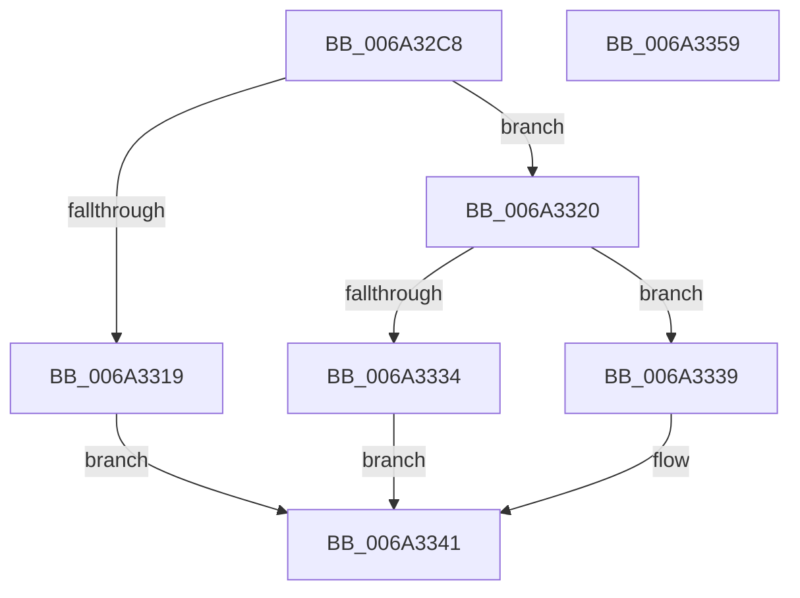

# SC_GPT::ReadEntries

- RVA: `0x006A32C8`–`0x006A335A` (길이 `146` bytes)
- VA: `0x00000001406A32C8`
- 실행 섹션: `.text`
- PDB 이름 있음: `예`; PDB Function 태그: `아니요`
- unwind 정보 RVA: `0x0006F978`
- 디코드: `43`개 명령, `146/146` bytes 표시
- 미해석 바이트: `0` (있으면 어셈블리에 `.byte`로 보존)

> 이 문서는 커널 이미지의 기계어와 PDB 기호를 분석해 생성했습니다. 4번과 5번은 함수 원형과 자료형을 바이너리 사용 방식에서 추정한 C 해석이며 원본 소스 복구 결과는 아닙니다.

## 1. Dependencies

- 직접 호출 지점: **3**; 고유 호출 대상: **3**
- 직접 호출자로 확인된 함수: **1**
- RIP 상대 이미지 참조: **0**

### Outgoing calls
- `0x006A330C` → [SC_ENV::Allocate](../../page/71/SC_ENV_Allocate_function_00716F90.md) (function, `0x00716F90`)
- `0x006A3329` → [SC_GPT::ReadEntries](SC_GPT_ReadEntries_function_006A3360.md) (function, `0x006A3360`)
- `0x006A333C` → [AlpcpFreeBuffer](../../page/90/AlpcpFreeBuffer_function_009071C0.md) (function, `0x009071C0`)

### Direct callers
- [SC_GPT::ReadPartitionTable](SC_GPT_ReadPartitionTable_function_006A34E4.md) at `0x006A356A`

### Static image references
- 디코드된 RIP-relative 메모리 참조가 없습니다.

## 2. Other-region calls and transfers

- 다른 실행 섹션으로 향하는 call: **2**
  - `0x006A330C` → [SC_ENV::Allocate](../../page/71/SC_ENV_Allocate_function_00716F90.md) (`.text` → `PAGE`)
  - `0x006A333C` → [AlpcpFreeBuffer](../../page/90/AlpcpFreeBuffer_function_009071C0.md) (`.text` → `PAGE`)
- 별도 외부 분기/꼬리 이동을 확인하지 못했습니다.

## 3. Assembly (complete function range)

```asm
006A32C8  48 89 5C 24 08                  mov qword ptr [rsp + 8], rbx
006A32CD  48 89 74 24 10                  mov qword ptr [rsp + 0x10], rsi
006A32D2  48 89 7C 24 18                  mov qword ptr [rsp + 0x18], rdi
006A32D7  41 56                           push r14
006A32D9  48 83 EC 20                     sub rsp, 0x20
006A32DD  48 8B 01                        mov rax, qword ptr [rcx]
006A32E0  4C 8B F1                        mov r14, rcx
006A32E3  8B 4A 54                        mov ecx, dword ptr [rdx + 0x54]
006A32E6  41 B9 01 00 00 00               mov r9d, 1
006A32EC  0F AF 4A 50                     imul ecx, dword ptr [rdx + 0x50]
006A32F0  49 8B F0                        mov rsi, r8
006A32F3  49 83 20 00                     and qword ptr [r8], 0
006A32F7  48 8B DA                        mov rbx, rdx
006A32FA  44 8B 90 EC 00 00 00            mov r10d, dword ptr [rax + 0xec]
006A3301  FF C9                           dec ecx
006A3303  41 03 CA                        add ecx, r10d
006A3306  41 F7 DA                        neg r10d
006A3309  41 23 CA                        and ecx, r10d
006A330C  E8 7F 3C 07 00                  call 0x140716f90
006A3311  48 8B F8                        mov rdi, rax
006A3314  48 85 C0                        test rax, rax
006A3317  75 07                           jne 0x1406a3320
006A3319  BB 9A 00 00 C0                  mov ebx, 0xc000009a
006A331E  EB 21                           jmp 0x1406a3341
006A3320  4C 8B C7                        mov r8, rdi
006A3323  48 8B D3                        mov rdx, rbx
006A3326  49 8B CE                        mov rcx, r14
006A3329  E8 32 00 00 00                  call 0x1406a3360
006A332E  8B D8                           mov ebx, eax
006A3330  85 C0                           test eax, eax
006A3332  78 05                           js 0x1406a3339
006A3334  48 89 3E                        mov qword ptr [rsi], rdi
006A3337  EB 08                           jmp 0x1406a3341
006A3339  48 8B CF                        mov rcx, rdi
006A333C  E8 7F 3E 26 00                  call 0x1409071c0
006A3341  48 8B 74 24 38                  mov rsi, qword ptr [rsp + 0x38]
006A3346  8B C3                           mov eax, ebx
006A3348  48 8B 5C 24 30                  mov rbx, qword ptr [rsp + 0x30]
006A334D  48 8B 7C 24 40                  mov rdi, qword ptr [rsp + 0x40]
006A3352  48 83 C4 20                     add rsp, 0x20
006A3356  41 5E                           pop r14
006A3358  C3                              ret
006A3359  CC                              int3
```

## 4. C-style interpretation (structured pseudocode)

```c
__int64 __fastcall SC_GPT__ReadEntries(__int64 a1, __int64 a2, __int64 a3)
{
    __int64 result;
    __int64 v_r10;
    __int64 v_rsp;
    unsigned __int64 v_stack_p10;
    unsigned __int64 v_stack_p18;
    unsigned __int64 v_stack_p8;

    v_stack_p8 = v_rbx;
    v_stack_p10 = v_rsi;
    v_stack_p18 = v_rdi;
    v_rsp = (v_rsp) - (32);
    a1 = (unsigned int)(((unsigned int)(*(unsigned int *)(a2 + 84))) * (*(unsigned int *)(a2 + 80)));
    a1 = (unsigned int)((a1) - 1);
    a1 = (unsigned int)((a1) + ((unsigned int)((unsigned int)(*(unsigned int *)(*(unsigned __int64 *)(a1) + 236)))));
    v_r10 = (unsigned int)(-((unsigned int)(*(unsigned int *)(*(unsigned __int64 *)(a1) + 236))));
    a1 = (unsigned int)((a1) & ((unsigned int)(v_r10)));
    result = SC_ENV__Allocate(a1, a2, a3, 1);
    if (result != 0) goto loc_006A3320;
    goto loc_006A3341;
loc_006A3320:
    result = SC_GPT__ReadEntries(a1, (unsigned int)(0xC000009AULL), result, 1);
    if (sign_flag) goto loc_006A3339;
    *(unsigned __int64 *)(a3) = result;
    goto loc_006A3341;
loc_006A3339:
    result = AlpcpFreeBuffer(result, (unsigned int)(0xC000009AULL), result, 1);
loc_006A3341:
    v_rsp = (v_rsp) + (32);
    return (unsigned int)((unsigned int)((unsigned int)((unsigned int)(result))));
}
```

## 5. (Beta) C Style

```c
int64_t SC_GPT__ReadEntries(void *Arg1, void *Arg2, void *Arg3)
{
    uint8_t *arg1 = (uint8_t *)Arg1;
    uint8_t *arg2 = (uint8_t *)Arg2;
    uint8_t *arg3 = (uint8_t *)Arg3;

    int64_t result;
    int64_t local_r10;
    int64_t local_rsp;
    uint64_t v_stack_p10;
    uint64_t v_stack_p18;
    uint64_t v_stack_p8;

    v_stack_p8 = local_rbx;
    v_stack_p10 = local_rsi;
    v_stack_p18 = local_rdi;
    local_rsp = (local_rsp) - (32);
    Arg1 = (uint32_t)(((uint32_t)(*(uint32_t *)(arg2 + 0x54))) * (*(uint32_t *)(arg2 + 0x50)));
    Arg1 = (uint32_t)((Arg1) - 1);
    Arg1 = (uint32_t)((Arg1) + ((uint32_t)((uint32_t)(*(uint32_t *)(*(uint64_t *)(arg1) + 0xEC)))));
    local_r10 = (uint32_t)(-((uint32_t)(*(uint32_t *)(*(uint64_t *)(arg1) + 0xEC))));
    Arg1 = (uint32_t)((Arg1) & ((uint32_t)(local_r10)));
    result = SC_ENV__Allocate(Arg1, Arg2, Arg3, 1);
    if (result != 0) goto loc_006A3320;
    goto loc_006A3341;
loc_006A3320:
    result = SC_GPT__ReadEntries(Arg1, (uint32_t)(0xC000009AULL), result, 1);
    if (sign_flag) goto loc_006A3339;
    *(uint64_t *)(arg3) = result;
    goto loc_006A3341;
loc_006A3339:
    result = AlpcpFreeBuffer(result, (uint32_t)(0xC000009AULL), result, 1);
loc_006A3341:
    local_rsp = (local_rsp) + (32);
    return (uint32_t)((uint32_t)((uint32_t)((uint32_t)(result))));
}
```

### 관측된 메모리 오프셋

구조체 형식이 확인되지 않은 접근은 인자 기준의 오프셋으로만 기록했습니다.

| 기준 인자 | 오프셋 표현 | 폭 (bit) | 접근 |
|---|---:|---:|---|
| `Arg1` | `+ 0x0` | `64` | `R` |
| `Arg2` | `+ 0x50` | `32` | `R` |
| `Arg2` | `+ 0x54` | `32` | `R` |
| `Arg3` | `+ 0x0` | `64` | `R/W` |
| `Arg3` | `+ 0x0` | `64` | `W` |

## 6. Execution-region graph

[열기: 2D/3D 그래프와 함수 탐색 컨트롤 패널](../../../control-panel.html?section=text&rva=0x006A32C8&view=graph)

- 2D 그래프는 위에서 아래로 흐르고, 3D 그래프는 빈 공간을 드래그해 회전합니다. Shift+드래그는 이동, 휠은 확대·축소, 함수 노드 선택은 대상 보고서 이동입니다.

### Static fallback


