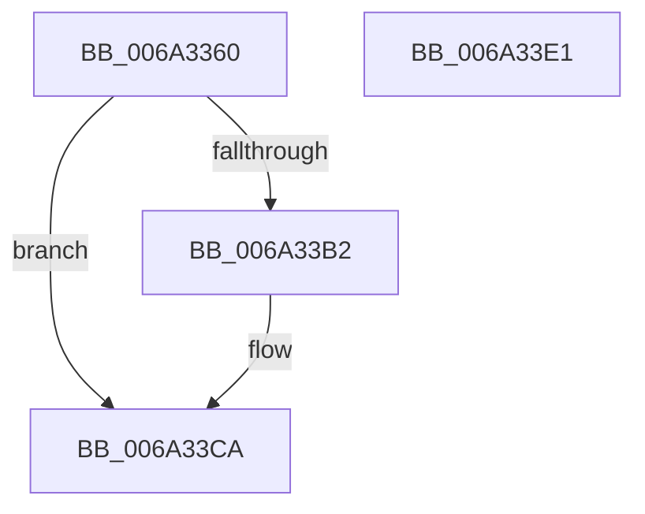

# SC_GPT::ReadEntries

- RVA: `0x006A3360`–`0x006A33E2` (길이 `130` bytes)
- VA: `0x00000001406A3360`
- 실행 섹션: `.text`
- PDB 이름 있음: `예`; PDB Function 태그: `아니요`
- unwind 정보 RVA: `0x0005C954`
- 디코드: `39`개 명령, `130/130` bytes 표시
- 미해석 바이트: `0` (있으면 어셈블리에 `.byte`로 보존)

> 이 문서는 커널 이미지의 기계어와 PDB 기호를 분석해 생성했습니다. 4번과 5번은 함수 원형과 자료형을 바이너리 사용 방식에서 추정한 C 해석이며 원본 소스 복구 결과는 아닙니다.

## 1. Dependencies

- 직접 호출 지점: **2**; 고유 호출 대상: **2**
- 직접 호출자로 확인된 함수: **2**
- RIP 상대 이미지 참조: **0**

### Outgoing calls
- `0x006A33A7` → [SC_DISK::ReadSectors](SC_DISK_ReadSectors_function_006A4A2C.md) (function, `0x006A4A2C`)
- `0x006A33BA` → [crc32](../46/crc32_function_00468F58.md) (function, `0x00468F58`)

### Direct callers
- [SC_GPT::ReadEntries](SC_GPT_ReadEntries_function_006A32C8.md) at `0x006A3329`
- [SC_GPT::VerifyPartitionTable](SC_GPT_VerifyPartitionTable_function_006A3804.md) at `0x006A3920`

### Static image references
- 디코드된 RIP-relative 메모리 참조가 없습니다.

## 2. Other-region calls and transfers

- 다른 실행 섹션으로 향하는 call: **0**
- 별도 외부 분기/꼬리 이동을 확인하지 못했습니다.

## 3. Assembly (complete function range)

```asm
006A3360  48 89 5C 24 08                  mov qword ptr [rsp + 8], rbx
006A3365  48 89 6C 24 10                  mov qword ptr [rsp + 0x10], rbp
006A336A  48 89 74 24 18                  mov qword ptr [rsp + 0x18], rsi
006A336F  57                              push rdi
006A3370  48 83 EC 20                     sub rsp, 0x20
006A3374  8B 72 54                        mov esi, dword ptr [rdx + 0x54]
006A3377  48 8B FA                        mov rdi, rdx
006A337A  0F AF 72 50                     imul esi, dword ptr [rdx + 0x50]
006A337E  49 8B E8                        mov rbp, r8
006A3381  4C 8B 11                        mov r10, qword ptr [rcx]
006A3384  4D 8B C8                        mov r9, r8
006A3387  4C 8B 47 48                     mov r8, qword ptr [rdi + 0x48]
006A338B  41 8B 82 EC 00 00 00            mov eax, dword ptr [r10 + 0xec]
006A3392  41 8B 8A F0 00 00 00            mov ecx, dword ptr [r10 + 0xf0]
006A3399  8D 50 FF                        lea edx, [rax - 1]
006A339C  F7 D8                           neg eax
006A339E  03 D6                           add edx, esi
006A33A0  23 D0                           and edx, eax
006A33A2  D3 EA                           shr edx, cl
006A33A4  49 8B CA                        mov rcx, r10
006A33A7  E8 80 16 00 00                  call 0x1406a4a2c
006A33AC  8B D8                           mov ebx, eax
006A33AE  85 C0                           test eax, eax
006A33B0  78 18                           js 0x1406a33ca
006A33B2  44 8B C6                        mov r8d, esi
006A33B5  48 8B D5                        mov rdx, rbp
006A33B8  33 C9                           xor ecx, ecx
006A33BA  E8 99 5B DC FF                  call 0x140468f58
006A33BF  3B 47 58                        cmp eax, dword ptr [rdi + 0x58]
006A33C2  B9 32 00 00 C0                  mov ecx, 0xc0000032
006A33C7  0F 45 D9                        cmovne ebx, ecx
006A33CA  48 8B 6C 24 38                  mov rbp, qword ptr [rsp + 0x38]
006A33CF  8B C3                           mov eax, ebx
006A33D1  48 8B 5C 24 30                  mov rbx, qword ptr [rsp + 0x30]
006A33D6  48 8B 74 24 40                  mov rsi, qword ptr [rsp + 0x40]
006A33DB  48 83 C4 20                     add rsp, 0x20
006A33DF  5F                              pop rdi
006A33E0  C3                              ret
006A33E1  CC                              int3
```

## 4. C-style interpretation (structured pseudocode)

```c
__int64 __fastcall SC_GPT__ReadEntries(__int64 a1, __int64 a2, __int64 a3)
{
    __int64 result;
    __int64 v_rbx;
    __int64 v_rsi;
    __int64 v_rsp;
    unsigned __int64 v_stack_p10;
    unsigned __int64 v_stack_p18;
    unsigned __int64 v_stack_p8;

    v_stack_p8 = v_rbx;
    v_stack_p10 = v_rbp;
    v_stack_p18 = v_rsi;
    v_rsp = (v_rsp) - (32);
    v_rsi = (unsigned int)(((unsigned int)(*(unsigned int *)(a2 + 84))) * (*(unsigned int *)(a2 + 80)));
    result = (unsigned int)(-((unsigned int)(*(unsigned int *)(*(unsigned __int64 *)(a1) + 236))));
    a2 = (unsigned int)(((unsigned int)(*(unsigned int *)(*(unsigned __int64 *)(a1) + 236)) - 1) + ((unsigned int)(v_rsi)));
    a2 = (unsigned int)((a2) & ((unsigned int)(result)));
    a2 = (unsigned int)((a2) >> ((unsigned __int8)((unsigned int)(*(unsigned int *)(*(unsigned __int64 *)(a1) + 240)))));
    result = SC_DISK__ReadSectors(*(unsigned __int64 *)(a1), a2, *(unsigned __int64 *)(a2 + 72), a3);
    v_rbx = (unsigned int)((unsigned int)(result));
    if (!(sign_flag)) {
        a3 = (unsigned int)(v_rsi);
        a2 = a3;
        a1 = 0;
        result = crc32(a1, a2, a3, a3);
        a1 = 0xC0000032ULL;
        v_rbx = (unsigned int)((unsigned int)(result));
        if (((unsigned int)(result)) != (*(unsigned int *)(a2 + 88))) { v_rbx = (unsigned int)(a1); }
    }
    v_rsp = (v_rsp) + (32);
    return (unsigned int)((unsigned int)(v_rbx));
}
```

## 5. (Beta) C Style

```c
int64_t SC_GPT__ReadEntries(void *Arg1, void *Arg2, int64_t Arg3)
{
    uint8_t *arg1 = (uint8_t *)Arg1;
    uint8_t *arg2 = (uint8_t *)Arg2;

    int64_t result;
    int64_t local_rbx;
    int64_t local_rsi;
    int64_t local_rsp;
    uint64_t v_stack_p10;
    uint64_t v_stack_p18;
    uint64_t v_stack_p8;

    v_stack_p8 = local_rbx;
    v_stack_p10 = local_rbp;
    v_stack_p18 = local_rsi;
    local_rsp = (local_rsp) - (32);
    local_rsi = (uint32_t)(((uint32_t)(*(uint32_t *)(arg2 + 0x54))) * (*(uint32_t *)(arg2 + 0x50)));
    result = (uint32_t)(-((uint32_t)(*(uint32_t *)(*(uint64_t *)(arg1) + 0xEC))));
    Arg2 = (uint32_t)(((uint32_t)(*(uint32_t *)(*(uint64_t *)(arg1) + 0xEC)) - 1) + ((uint32_t)(local_rsi)));
    Arg2 = (uint32_t)((Arg2) & ((uint32_t)(result)));
    Arg2 = (uint32_t)((Arg2) >> ((uint8_t)((uint32_t)(*(uint32_t *)(*(uint64_t *)(arg1) + 0xF0)))));
    result = SC_DISK__ReadSectors(*(uint64_t *)(arg1), Arg2, *(uint64_t *)(arg2 + 0x48), Arg3);
    local_rbx = (uint32_t)((uint32_t)(result));
    if (!(sign_flag)) {
        Arg3 = (uint32_t)(local_rsi);
        Arg2 = Arg3;
        Arg1 = 0;
        result = crc32(Arg1, Arg2, Arg3, Arg3);
        Arg1 = 0xC0000032ULL;
        local_rbx = (uint32_t)((uint32_t)(result));
        if (((uint32_t)(result)) != (*(uint32_t *)(arg2 + 0x58))) { local_rbx = (uint32_t)(Arg1); }
    }
    local_rsp = (local_rsp) + (32);
    return (uint32_t)((uint32_t)(local_rbx));
}
```

### 관측된 메모리 오프셋

구조체 형식이 확인되지 않은 접근은 인자 기준의 오프셋으로만 기록했습니다.

| 기준 인자 | 오프셋 표현 | 폭 (bit) | 접근 |
|---|---:|---:|---|
| `Arg1` | `+ 0x0` | `64` | `R` |
| `Arg2` | `+ 0x48` | `64` | `R` |
| `Arg2` | `+ 0x50` | `32` | `R` |
| `Arg2` | `+ 0x54` | `32` | `R` |
| `Arg2` | `+ 0x58` | `32` | `R` |

## 6. Execution-region graph

[열기: 2D/3D 그래프와 함수 탐색 컨트롤 패널](../../../control-panel.html?section=text&rva=0x006A3360&view=graph)

- 2D 그래프는 위에서 아래로 흐르고, 3D 그래프는 빈 공간을 드래그해 회전합니다. Shift+드래그는 이동, 휠은 확대·축소, 함수 노드 선택은 대상 보고서 이동입니다.

### Static fallback


