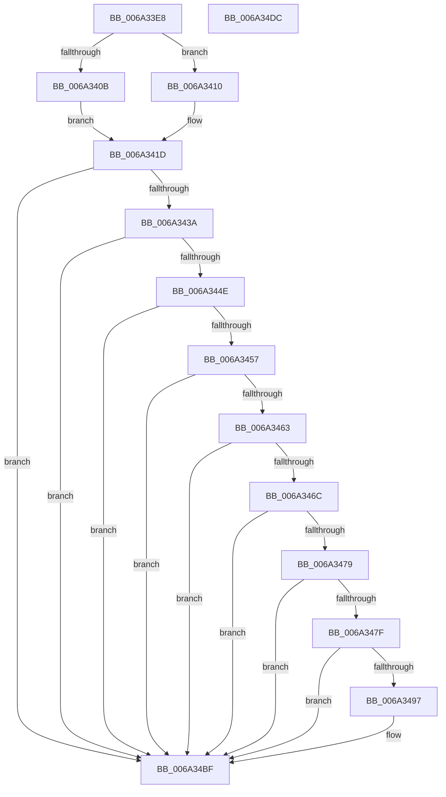

# SC_GPT::ReadHeader

- RVA: `0x006A33E8`–`0x006A34DD` (길이 `245` bytes)
- VA: `0x00000001406A33E8`
- 실행 섹션: `.text`
- PDB 이름 있음: `예`; PDB Function 태그: `아니요`
- unwind 정보 RVA: `0x0005E6B4`
- 디코드: `71`개 명령, `245/245` bytes 표시
- 미해석 바이트: `0` (있으면 어셈블리에 `.byte`로 보존)

> 이 문서는 커널 이미지의 기계어와 PDB 기호를 분석해 생성했습니다. 4번과 5번은 함수 원형과 자료형을 바이너리 사용 방식에서 추정한 C 해석이며 원본 소스 복구 결과는 아닙니다.

## 1. Dependencies

- 직접 호출 지점: **2**; 고유 호출 대상: **2**
- 직접 호출자로 확인된 함수: **3**
- RIP 상대 이미지 참조: **0**

### Outgoing calls
- `0x006A342B` → [SC_DISK::ReadSectors](SC_DISK_ReadSectors_function_006A4A2C.md) (function, `0x006A4A2C`)
- `0x006A348B` → [crc32](../46/crc32_function_00468F58.md) (function, `0x00468F58`)

### Direct callers
- [SC_GPT::ReadPartitionTable](SC_GPT_ReadPartitionTable_function_006A34E4.md) at `0x006A3541`
- [SC_GPT::VerifyPartitionTable](SC_GPT_VerifyPartitionTable_function_006A3804.md) at `0x006A3878`
- [SC_GPT::WritePartitionTable](SC_GPT_WritePartitionTable_function_006A3AD4.md) at `0x006A3B98`

### Static image references
- 디코드된 RIP-relative 메모리 참조가 없습니다.

## 2. Other-region calls and transfers

- 다른 실행 섹션으로 향하는 call: **0**
- 별도 외부 분기/꼬리 이동을 확인하지 못했습니다.

## 3. Assembly (complete function range)

```asm
006A33E8  48 8B C4                        mov rax, rsp
006A33EB  48 89 58 08                     mov qword ptr [rax + 8], rbx
006A33EF  48 89 68 10                     mov qword ptr [rax + 0x10], rbp
006A33F3  48 89 70 18                     mov qword ptr [rax + 0x18], rsi
006A33F7  48 89 78 20                     mov qword ptr [rax + 0x20], rdi
006A33FB  41 56                           push r14
006A33FD  48 83 EC 20                     sub rsp, 0x20
006A3401  49 8B F8                        mov rdi, r8
006A3404  4C 8B F1                        mov r14, rcx
006A3407  85 D2                           test edx, edx
006A3409  75 05                           jne 0x1406a3410
006A340B  8D 5A 01                        lea ebx, [rdx + 1]
006A340E  EB 0D                           jmp 0x1406a341d
006A3410  48 8B 01                        mov rax, qword ptr [rcx]
006A3413  48 8B 98 F8 00 00 00            mov rbx, qword ptr [rax + 0xf8]
006A341A  48 FF CB                        dec rbx
006A341D  48 8B 09                        mov rcx, qword ptr [rcx]
006A3420  4C 8B CF                        mov r9, rdi
006A3423  4C 8B C3                        mov r8, rbx
006A3426  BA 01 00 00 00                  mov edx, 1
006A342B  E8 FC 15 00 00                  call 0x1406a4a2c
006A3430  8B F0                           mov esi, eax
006A3432  85 C0                           test eax, eax
006A3434  0F 88 85 00 00 00               js 0x1406a34bf
006A343A  48 B8 45 46 49 20 50 41 52 54   movabs rax, 0x5452415020494645
006A3444  BE 32 00 00 C0                  mov esi, 0xc0000032
006A3449  48 39 07                        cmp qword ptr [rdi], rax
006A344C  75 71                           jne 0x1406a34bf
006A344E  81 7F 08 00 00 01 00            cmp dword ptr [rdi + 8], 0x10000
006A3455  75 68                           jne 0x1406a34bf
006A3457  41 B8 5C 00 00 00               mov r8d, 0x5c
006A345D  44 39 47 0C                     cmp dword ptr [rdi + 0xc], r8d
006A3461  75 5C                           jne 0x1406a34bf
006A3463  81 7F 54 80 00 00 00            cmp dword ptr [rdi + 0x54], 0x80
006A346A  75 53                           jne 0x1406a34bf
006A346C  8B 6F 50                        mov ebp, dword ptr [rdi + 0x50]
006A346F  8D 45 FF                        lea eax, [rbp - 1]
006A3472  3D FF 03 00 00                  cmp eax, 0x3ff
006A3477  77 46                           ja 0x1406a34bf
006A3479  48 39 5F 18                     cmp qword ptr [rdi + 0x18], rbx
006A347D  75 40                           jne 0x1406a34bf
006A347F  8B 5F 10                        mov ebx, dword ptr [rdi + 0x10]
006A3482  48 8B D7                        mov rdx, rdi
006A3485  83 67 10 00                     and dword ptr [rdi + 0x10], 0
006A3489  33 C9                           xor ecx, ecx
006A348B  E8 C8 5A DC FF                  call 0x140468f58
006A3490  89 5F 10                        mov dword ptr [rdi + 0x10], ebx
006A3493  3B C3                           cmp eax, ebx
006A3495  75 28                           jne 0x1406a34bf
006A3497  49 8B 0E                        mov rcx, qword ptr [r14]
006A349A  C1 E5 07                        shl ebp, 7
006A349D  8B 81 EC 00 00 00               mov eax, dword ptr [rcx + 0xec]
006A34A3  8B 89 F0 00 00 00               mov ecx, dword ptr [rcx + 0xf0]
006A34A9  8D 50 FF                        lea edx, [rax - 1]
006A34AC  F7 D8                           neg eax
006A34AE  03 D5                           add edx, ebp
006A34B0  23 C2                           and eax, edx
006A34B2  D3 E8                           shr eax, cl
006A34B4  83 C0 02                        add eax, 2
006A34B7  48 39 47 28                     cmp qword ptr [rdi + 0x28], rax
006A34BB  1B C0                           sbb eax, eax
006A34BD  23 F0                           and esi, eax
006A34BF  48 8B 5C 24 30                  mov rbx, qword ptr [rsp + 0x30]
006A34C4  8B C6                           mov eax, esi
006A34C6  48 8B 74 24 40                  mov rsi, qword ptr [rsp + 0x40]
006A34CB  48 8B 6C 24 38                  mov rbp, qword ptr [rsp + 0x38]
006A34D0  48 8B 7C 24 48                  mov rdi, qword ptr [rsp + 0x48]
006A34D5  48 83 C4 20                     add rsp, 0x20
006A34D9  41 5E                           pop r14
006A34DB  C3                              ret
006A34DC  CC                              int3
```

## 4. C-style interpretation (structured pseudocode)

```c
__int64 __fastcall SC_GPT__ReadHeader(__int64 a1, __int64 a2, __int64 a3)
{
    __int64 result;
    __int64 v_rbp;
    __int64 v_rbx;
    __int64 v_rsi;
    __int64 v_rsp;
    unsigned __int64 v_stack_p10;
    unsigned __int64 v_stack_p18;
    unsigned __int64 v_stack_p20;
    unsigned __int64 v_stack_p8;

    *(unsigned __int64 *)(v_rsp + 8) = v_rbx;
    *(unsigned __int64 *)(v_rsp + 16) = v_rbp;
    *(unsigned __int64 *)(v_rsp + 24) = v_rsi;
    *(unsigned __int64 *)(v_rsp + 32) = v_rdi;
    v_rsp = (v_rsp) - (32);
    if ((unsigned int)(a2) != 0) goto loc_006A3410;
    goto loc_006A341D;
loc_006A3410:
    v_rbx = (*(unsigned __int64 *)(*(unsigned __int64 *)(a1) + 248)) - 1;
loc_006A341D:
    result = SC_DISK__ReadSectors(*(unsigned __int64 *)(a1), 1, v_rbx, a3);
    if (sign_flag) goto loc_006A34BF;
    if ((*(unsigned __int64 *)(a3)) != result) goto loc_006A34BF;
    if ((*(unsigned int *)(a3 + 8)) != 0x10000ULL) goto loc_006A34BF;
    if ((*(unsigned int *)(a3 + 12)) != 92) goto loc_006A34BF;
    if ((*(unsigned int *)(a3 + 84)) != 128) goto loc_006A34BF;
    if (((unsigned int)((unsigned int)(*(unsigned int *)(a3 + 80)) - 1)) > 0x3FFULL) goto loc_006A34BF;
    if ((*(unsigned __int64 *)(a3 + 24)) != v_rbx) goto loc_006A34BF;
    a1 = 0;
    result = crc32(a1, a3, 92, a3);
    *(unsigned int *)(a3 + 16) = (unsigned int)((unsigned int)(*(unsigned int *)(a3 + 16)));
    v_rsi = (unsigned int)(0xC0000032ULL);
    v_rbp = (unsigned int)(*(unsigned int *)(a3 + 80));
    if (((unsigned int)(result)) == ((unsigned int)((unsigned int)(*(unsigned int *)(a3 + 16))))) {
        a1 = *(unsigned __int64 *)(a1);
        v_rbp = (unsigned int)(((unsigned int)(*(unsigned int *)(a3 + 80))) << (7));
        result = *(unsigned int *)(a1 + 236);
        a1 = *(unsigned int *)(a1 + 240);
        a2 = result - 1;
        result = (unsigned int)(-(result));
        a2 = (unsigned int)((a2) + ((unsigned int)(v_rbp)));
        result = (unsigned int)((result) & ((unsigned int)(a2)));
        result = (unsigned int)((result) >> ((unsigned __int8)(a1)));
        result = (unsigned int)((result) + (2));
        v_rsi = (unsigned int)(((unsigned int)(0xC0000032ULL)) & ((unsigned int)(result)));
    }
    v_rsp = (v_rsp) + (32);
    return (unsigned int)((unsigned int)(v_rsi));
}
```

## 5. (Beta) C Style

```c
int64_t SC_GPT__ReadHeader(void *Arg1, int64_t Arg2, void *Arg3)
{
    uint8_t *arg1 = (uint8_t *)Arg1;
    uint8_t *arg3 = (uint8_t *)Arg3;

    int64_t result;
    int64_t local_rbp;
    int64_t local_rbx;
    int64_t local_rsi;
    int64_t local_rsp;
    uint64_t v_stack_p10;
    uint64_t v_stack_p18;
    uint64_t v_stack_p20;
    uint64_t v_stack_p8;

    *(uint64_t *)(local_rsp + 0x8) = local_rbx;
    *(uint64_t *)(local_rsp + 0x10) = local_rbp;
    *(uint64_t *)(local_rsp + 0x18) = local_rsi;
    *(uint64_t *)(local_rsp + 0x20) = local_rdi;
    local_rsp = (local_rsp) - (32);
    if ((uint32_t)(Arg2) != 0) goto loc_006A3410;
    goto loc_006A341D;
loc_006A3410:
    local_rbx = (*(uint64_t *)(*(uint64_t *)(arg1) + 0xF8)) - 1;
loc_006A341D:
    result = SC_DISK__ReadSectors(*(uint64_t *)(arg1), 1, local_rbx, Arg3);
    if (sign_flag) goto loc_006A34BF;
    if ((*(uint64_t *)(arg3)) != result) goto loc_006A34BF;
    if ((*(uint32_t *)(arg3 + 0x8)) != 0x10000ULL) goto loc_006A34BF;
    if ((*(uint32_t *)(arg3 + 0xC)) != 92) goto loc_006A34BF;
    if ((*(uint32_t *)(arg3 + 0x54)) != 128) goto loc_006A34BF;
    if (((uint32_t)((uint32_t)(*(uint32_t *)(arg3 + 0x50)) - 1)) > 0x3FFULL) goto loc_006A34BF;
    if ((*(uint64_t *)(arg3 + 0x18)) != local_rbx) goto loc_006A34BF;
    Arg1 = 0;
    result = crc32(Arg1, Arg3, 92, Arg3);
    *(uint32_t *)(arg3 + 0x10) = (uint32_t)((uint32_t)(*(uint32_t *)(arg3 + 0x10)));
    local_rsi = (uint32_t)(0xC0000032ULL);
    local_rbp = (uint32_t)(*(uint32_t *)(arg3 + 0x50));
    if (((uint32_t)(result)) == ((uint32_t)((uint32_t)(*(uint32_t *)(arg3 + 0x10))))) {
        Arg1 = *(uint64_t *)(arg1);
        local_rbp = (uint32_t)(((uint32_t)(*(uint32_t *)(arg3 + 0x50))) << (7));
        result = *(uint32_t *)(arg1 + 0xEC);
        Arg1 = *(uint32_t *)(arg1 + 0xF0);
        Arg2 = result - 1;
        result = (uint32_t)(-(result));
        Arg2 = (uint32_t)((Arg2) + ((uint32_t)(local_rbp)));
        result = (uint32_t)((result) & ((uint32_t)(Arg2)));
        result = (uint32_t)((result) >> ((uint8_t)(Arg1)));
        result = (uint32_t)((result) + (2));
        local_rsi = (uint32_t)(((uint32_t)(0xC0000032ULL)) & ((uint32_t)(result)));
    }
    local_rsp = (local_rsp) + (32);
    return (uint32_t)((uint32_t)(local_rsi));
}
```

### 관측된 메모리 오프셋

구조체 형식이 확인되지 않은 접근은 인자 기준의 오프셋으로만 기록했습니다.

| 기준 인자 | 오프셋 표현 | 폭 (bit) | 접근 |
|---|---:|---:|---|
| `Arg1` | `+ 0x0` | `64` | `R` |
| `Arg3` | `+ 0x0` | `64` | `R` |
| `Arg3` | `+ 0x8` | `32` | `R` |
| `Arg3` | `+ 0xC` | `32` | `R` |
| `Arg3` | `+ 0x10` | `32` | `R` |
| `Arg3` | `+ 0x10` | `32` | `R/W` |
| `Arg3` | `+ 0x10` | `32` | `W` |
| `Arg3` | `+ 0x18` | `64` | `R` |
| `Arg3` | `+ 0x28` | `64` | `R` |
| `Arg3` | `+ 0x50` | `32` | `R` |
| `Arg3` | `+ 0x54` | `32` | `R` |

## 6. Execution-region graph

[열기: 2D/3D 그래프와 함수 탐색 컨트롤 패널](../../../control-panel.html?section=text&rva=0x006A33E8&view=graph)

- 2D 그래프는 위에서 아래로 흐르고, 3D 그래프는 빈 공간을 드래그해 회전합니다. Shift+드래그는 이동, 휠은 확대·축소, 함수 노드 선택은 대상 보고서 이동입니다.

### Static fallback


