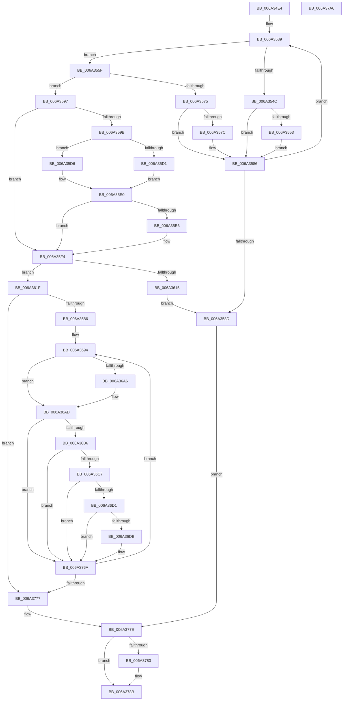

# SC_GPT::ReadPartitionTable

- RVA: `0x006A34E4`–`0x006A37A7` (길이 `707` bytes)
- VA: `0x00000001406A34E4`
- 실행 섹션: `.text`
- PDB 이름 있음: `예`; PDB Function 태그: `아니요`
- unwind 정보 RVA: `0x0006B074`
- 디코드: `184`개 명령, `707/707` bytes 표시
- 미해석 바이트: `0` (있으면 어셈블리에 `.byte`로 보존)

> 이 문서는 커널 이미지의 기계어와 PDB 기호를 분석해 생성했습니다. 4번과 5번은 함수 원형과 자료형을 바이너리 사용 방식에서 추정한 C 해석이며 원본 소스 복구 결과는 아닙니다.

## 1. Dependencies

- 직접 호출 지점: **6**; 고유 호출 대상: **6**
- 직접 호출자로 확인된 함수: **1**
- RIP 상대 이미지 참조: **2**

### Outgoing calls
- `0x006A3541` → [SC_GPT::ReadHeader](SC_GPT_ReadHeader_function_006A33E8.md) (function, `0x006A33E8`)
- `0x006A356A` → [SC_GPT::ReadEntries](SC_GPT_ReadEntries_function_006A32C8.md) (function, `0x006A32C8`)
- `0x006A3608` → [SC_ENV::Allocate](../../page/71/SC_ENV_Allocate_function_00716F90.md) (function, `0x00716F90`)
- `0x006A3627` → [memset](../6C/memset_function_006C6C40.md) (function, `0x006C6C40`)
- `0x006A3755` → [RtlStringCbCopyW](RtlStringCbCopyW_function_006A37B0.md) (function, `0x006A37B0`)
- `0x006A3786` → [AlpcpFreeBuffer](../../page/90/AlpcpFreeBuffer_function_009071C0.md) (function, `0x009071C0`)

### Direct callers
- [SC_DISK::ReadPartitionTable](SC_DISK_ReadPartitionTable_function_006A499C.md) at `0x006A49EA`

### Static image references
- `0x006A3686` → RVA `0x000112D8` (`.rdata`; read)
- `0x006A368D` → RVA `0x000112D0` (`.rdata`; read)

## 2. Other-region calls and transfers

- 다른 실행 섹션으로 향하는 call: **2**
  - `0x006A3608` → [SC_ENV::Allocate](../../page/71/SC_ENV_Allocate_function_00716F90.md) (`.text` → `PAGE`)
  - `0x006A3786` → [AlpcpFreeBuffer](../../page/90/AlpcpFreeBuffer_function_009071C0.md) (`.text` → `PAGE`)
- 별도 외부 분기/꼬리 이동을 확인하지 못했습니다.

## 3. Assembly (complete function range)

```asm
006A34E4  48 8B C4                        mov rax, rsp
006A34E7  48 89 58 10                     mov qword ptr [rax + 0x10], rbx
006A34EB  48 89 68 18                     mov qword ptr [rax + 0x18], rbp
006A34EF  48 89 70 20                     mov qword ptr [rax + 0x20], rsi
006A34F3  57                              push rdi
006A34F4  41 56                           push r14
006A34F6  41 57                           push r15
006A34F8  48 83 EC 20                     sub rsp, 0x20
006A34FC  48 83 60 08 00                  and qword ptr [rax + 8], 0
006A3501  4C 8B FA                        mov r15, rdx
006A3504  48 8B 01                        mov rax, qword ptr [rcx]
006A3507  48 8B F9                        mov rdi, rcx
006A350A  48 8B 98 08 01 00 00            mov rbx, qword ptr [rax + 0x108]
006A3511  48 83 22 00                     and qword ptr [rdx], 0
006A3515  48 8B 01                        mov rax, qword ptr [rcx]
006A3518  83 A0 C8 00 00 00 FD            and dword ptr [rax + 0xc8], 0xfffffffd
006A351F  48 8B 01                        mov rax, qword ptr [rcx]
006A3522  44 8A 80 C8 00 00 00            mov r8b, byte ptr [rax + 0xc8]
006A3529  41 80 E0 01                     and r8b, 1
006A352D  41 F6 D8                        neg r8b
006A3530  45 1B F6                        sbb r14d, r14d
006A3533  41 83 C6 02                     add r14d, 2
006A3537  33 ED                           xor ebp, ebp
006A3539  4C 8B C3                        mov r8, rbx
006A353C  8B D5                           mov edx, ebp
006A353E  48 8B CF                        mov rcx, rdi
006A3541  E8 A2 FE FF FF                  call 0x1406a33e8
006A3546  8B F0                           mov esi, eax
006A3548  85 C0                           test eax, eax
006A354A  79 13                           jns 0x1406a355f
006A354C  3D 32 00 00 C0                  cmp eax, 0xc0000032
006A3551  75 33                           jne 0x1406a3586
006A3553  48 8B 0F                        mov rcx, qword ptr [rdi]
006A3556  83 89 C8 00 00 00 02            or dword ptr [rcx + 0xc8], 2
006A355D  EB 27                           jmp 0x1406a3586
006A355F  4C 8D 44 24 40                  lea r8, [rsp + 0x40]
006A3564  48 8B D3                        mov rdx, rbx
006A3567  48 8B CF                        mov rcx, rdi
006A356A  E8 59 FD FF FF                  call 0x1406a32c8
006A356F  8B F0                           mov esi, eax
006A3571  85 C0                           test eax, eax
006A3573  79 22                           jns 0x1406a3597
006A3575  3D 32 00 00 C0                  cmp eax, 0xc0000032
006A357A  75 0A                           jne 0x1406a3586
006A357C  48 8B 07                        mov rax, qword ptr [rdi]
006A357F  83 88 C8 00 00 00 02            or dword ptr [rax + 0xc8], 2
006A3586  FF C5                           inc ebp
006A3588  41 3B EE                        cmp ebp, r14d
006A358B  72 AC                           jb 0x1406a3539
006A358D  4C 8B 54 24 40                  mov r10, qword ptr [rsp + 0x40]
006A3592  E9 E7 01 00 00                  jmp 0x1406a377e
006A3597  85 ED                           test ebp, ebp
006A3599  75 59                           jne 0x1406a35f4
006A359B  48 8B 17                        mov rdx, qword ptr [rdi]
006A359E  8B 43 54                        mov eax, dword ptr [rbx + 0x54]
006A35A1  0F AF 43 50                     imul eax, dword ptr [rbx + 0x50]
006A35A5  8B 8A EC 00 00 00               mov ecx, dword ptr [rdx + 0xec]
006A35AB  44 8D 41 FF                     lea r8d, [rcx - 1]
006A35AF  F7 D9                           neg ecx
006A35B1  44 03 C0                        add r8d, eax
006A35B4  8B 82 C8 00 00 00               mov eax, dword ptr [rdx + 0xc8]
006A35BA  44 23 C1                        and r8d, ecx
006A35BD  8B 8A F0 00 00 00               mov ecx, dword ptr [rdx + 0xf0]
006A35C3  41 D3 E8                        shr r8d, cl
006A35C6  48 8B 8A F8 00 00 00            mov rcx, qword ptr [rdx + 0xf8]
006A35CD  A8 01                           test al, 1
006A35CF  74 05                           je 0x1406a35d6
006A35D1  48 FF C9                        dec rcx
006A35D4  EB 0A                           jmp 0x1406a35e0
006A35D6  41 8B C0                        mov eax, r8d
006A35D9  48 2B C8                        sub rcx, rax
006A35DC  48 83 E9 02                     sub rcx, 2
006A35E0  48 39 4B 30                     cmp qword ptr [rbx + 0x30], rcx
006A35E4  74 0E                           je 0x1406a35f4
006A35E6  48 89 4B 30                     mov qword ptr [rbx + 0x30], rcx
006A35EA  48 8B 07                        mov rax, qword ptr [rdi]
006A35ED  83 88 C8 00 00 00 02            or dword ptr [rax + 0xc8], 2
006A35F4  8B 43 50                        mov eax, dword ptr [rbx + 0x50]
006A35F7  41 B9 01 00 00 00               mov r9d, 1
006A35FD  8D 0C C0                        lea ecx, [rax + rax*8]
006A3600  C1 E1 04                        shl ecx, 4
006A3603  83 C1 30                        add ecx, 0x30
006A3606  8B E9                           mov ebp, ecx
006A3608  E8 83 39 07 00                  call 0x140716f90
006A360D  4C 8B F0                        mov r14, rax
006A3610  48 85 C0                        test rax, rax
006A3613  75 0A                           jne 0x1406a361f
006A3615  BE 9A 00 00 C0                  mov esi, 0xc000009a
006A361A  E9 6E FF FF FF                  jmp 0x1406a358d
006A361F  4C 8B C5                        mov r8, rbp
006A3622  33 D2                           xor edx, edx
006A3624  49 8B CE                        mov rcx, r14
006A3627  E8 14 36 02 00                  call 0x1406c6c40
006A362C  4C 8B 54 24 40                  mov r10, qword ptr [rsp + 0x40]
006A3631  33 ED                           xor ebp, ebp
006A3633  41 C7 06 01 00 00 00            mov dword ptr [r14], 1
006A363A  45 33 DB                        xor r11d, r11d
006A363D  0F 10 43 38                     movups xmm0, xmmword ptr [rbx + 0x38]
006A3641  F3 41 0F 7F 46 08               movdqu xmmword ptr [r14 + 8], xmm0
006A3647  48 8B 0F                        mov rcx, qword ptr [rdi]
006A364A  48 8B 43 28                     mov rax, qword ptr [rbx + 0x28]
006A364E  8B 89 F0 00 00 00               mov ecx, dword ptr [rcx + 0xf0]
006A3654  48 D3 E0                        shl rax, cl
006A3657  49 89 46 18                     mov qword ptr [r14 + 0x18], rax
006A365B  48 8B 53 30                     mov rdx, qword ptr [rbx + 0x30]
006A365F  48 2B 53 28                     sub rdx, qword ptr [rbx + 0x28]
006A3663  48 8B 0F                        mov rcx, qword ptr [rdi]
006A3666  48 FF C2                        inc rdx
006A3669  8B 89 F0 00 00 00               mov ecx, dword ptr [rcx + 0xf0]
006A366F  48 D3 E2                        shl rdx, cl
006A3672  49 89 56 20                     mov qword ptr [r14 + 0x20], rdx
006A3676  8B 43 50                        mov eax, dword ptr [rbx + 0x50]
006A3679  41 89 46 28                     mov dword ptr [r14 + 0x28], eax
006A367D  39 6B 50                        cmp dword ptr [rbx + 0x50], ebp
006A3680  0F 86 F1 00 00 00               jbe 0x1406a3777
006A3686  48 8B 15 4B DC 96 FF            mov rdx, qword ptr [rip - 0x6923b5]
006A368D  4C 8B 0D 3C DC 96 FF            mov r9, qword ptr [rip - 0x6923c4]
006A3694  45 8B C3                        mov r8d, r11d
006A3697  49 C1 E0 07                     shl r8, 7
006A369B  4D 03 C2                        add r8, r10
006A369E  49 8B 00                        mov rax, qword ptr [r8]
006A36A1  49 2B C1                        sub rax, r9
006A36A4  75 07                           jne 0x1406a36ad
006A36A6  49 8B 40 08                     mov rax, qword ptr [r8 + 8]
006A36AA  48 2B C2                        sub rax, rdx
006A36AD  48 85 C0                        test rax, rax
006A36B0  0F 84 B4 00 00 00               je 0x1406a376a
006A36B6  49 8B 40 20                     mov rax, qword ptr [r8 + 0x20]
006A36BA  49 8B 48 28                     mov rcx, qword ptr [r8 + 0x28]
006A36BE  48 3B C1                        cmp rax, rcx
006A36C1  0F 87 A3 00 00 00               ja 0x1406a376a
006A36C7  48 3B 43 28                     cmp rax, qword ptr [rbx + 0x28]
006A36CB  0F 82 99 00 00 00               jb 0x1406a376a
006A36D1  48 3B 4B 30                     cmp rcx, qword ptr [rbx + 0x30]
006A36D5  0F 87 8F 00 00 00               ja 0x1406a376a
006A36DB  4C 8D 0C ED 00 00 00 00         lea r9, [rbp*8]
006A36E3  4C 03 CD                        add r9, rbp
006A36E6  49 C1 E1 04                     shl r9, 4
006A36EA  43 C7 44 31 30 01 00 00 00      mov dword ptr [r9 + r14 + 0x30], 1
006A36F3  48 8B 0F                        mov rcx, qword ptr [rdi]
006A36F6  49 8B 40 20                     mov rax, qword ptr [r8 + 0x20]
006A36FA  8B 89 F0 00 00 00               mov ecx, dword ptr [rcx + 0xf0]
006A3700  48 D3 E0                        shl rax, cl
006A3703  4B 89 44 31 38                  mov qword ptr [r9 + r14 + 0x38], rax
006A3708  49 8B 50 28                     mov rdx, qword ptr [r8 + 0x28]
006A370C  49 2B 50 20                     sub rdx, qword ptr [r8 + 0x20]
006A3710  48 8B 0F                        mov rcx, qword ptr [rdi]
006A3713  48 FF C2                        inc rdx
006A3716  8B 89 F0 00 00 00               mov ecx, dword ptr [rcx + 0xf0]
006A371C  43 83 64 31 48 00               and dword ptr [r9 + r14 + 0x48], 0
006A3722  48 D3 E2                        shl rdx, cl
006A3725  49 8D 4E 78                     lea rcx, [r14 + 0x78]
006A3729  4B 89 54 31 40                  mov qword ptr [r9 + r14 + 0x40], rdx
006A372E  49 03 C9                        add rcx, r9
006A3731  41 0F 10 00                     movups xmm0, xmmword ptr [r8]
006A3735  F3 43 0F 7F 44 31 50            movdqu xmmword ptr [r9 + r14 + 0x50], xmm0
006A373C  41 0F 10 48 10                  movups xmm1, xmmword ptr [r8 + 0x10]
006A3741  F3 43 0F 7F 4C 31 60            movdqu xmmword ptr [r9 + r14 + 0x60], xmm1
006A3748  49 8B 40 30                     mov rax, qword ptr [r8 + 0x30]
006A374C  49 83 C0 38                     add r8, 0x38
006A3750  4B 89 44 31 70                  mov qword ptr [r9 + r14 + 0x70], rax
006A3755  E8 56 00 00 00                  call 0x1406a37b0
006A375A  48 8B 15 77 DB 96 FF            mov rdx, qword ptr [rip - 0x692489]
006A3761  FF C5                           inc ebp
006A3763  4C 8B 0D 66 DB 96 FF            mov r9, qword ptr [rip - 0x69249a]
006A376A  41 FF C3                        inc r11d
006A376D  44 3B 5B 50                     cmp r11d, dword ptr [rbx + 0x50]
006A3771  0F 82 1D FF FF FF               jb 0x1406a3694
006A3777  41 89 6E 04                     mov dword ptr [r14 + 4], ebp
006A377B  4D 89 37                        mov qword ptr [r15], r14
006A377E  4D 85 D2                        test r10, r10
006A3781  74 08                           je 0x1406a378b
006A3783  49 8B CA                        mov rcx, r10
006A3786  E8 35 3A 26 00                  call 0x1409071c0
006A378B  48 8B 5C 24 48                  mov rbx, qword ptr [rsp + 0x48]
006A3790  8B C6                           mov eax, esi
006A3792  48 8B 74 24 58                  mov rsi, qword ptr [rsp + 0x58]
006A3797  48 8B 6C 24 50                  mov rbp, qword ptr [rsp + 0x50]
006A379C  48 83 C4 20                     add rsp, 0x20
006A37A0  41 5F                           pop r15
006A37A2  41 5E                           pop r14
006A37A4  5F                              pop rdi
006A37A5  C3                              ret
006A37A6  CC                              int3
```

## 4. C-style interpretation (structured pseudocode)

```c
__int64 __fastcall SC_GPT__ReadPartitionTable(__int64 a1, __int64 a2)
{
    __int64 result;
    __int64 v_r11;
    __int64 v_r14;
    __int64 v_rbp;
    __int64 v_rsp;
    unsigned __int64 v_stack_p10;
    unsigned __int64 v_stack_p18;
    unsigned __int64 v_stack_p20;
    unsigned __int64 v_stack_p8;

    *(unsigned __int64 *)(v_rsp + 16) = v_rbx;
    *(unsigned __int64 *)(v_rsp + 24) = v_rbp;
    *(unsigned __int64 *)(v_rsp + 32) = v_rsi;
    v_rsp = (v_rsp) - (32);
    a3 = (unsigned __int8)((*(unsigned __int8 *)(*(unsigned __int64 *)(a1) + 200)) & (1));
    a3 = (unsigned __int8)(-(a3));
    v_r14 = (unsigned int)((v_r14) + (2));
    v_rbp = 0;
loc_006A3539:
    result = SC_GPT__ReadHeader(a1, 0, *(unsigned __int64 *)(*(unsigned __int64 *)(a1) + 264), a4);
    if (!sign_flag) goto loc_006A355F;
    if (((unsigned int)(result)) != 0xC0000032ULL) goto loc_006A3586;
    goto loc_006A3586;
loc_006A355F:
    result = SC_GPT__ReadEntries(a1, *(unsigned __int64 *)(*(unsigned __int64 *)(a1) + 264), v_stack_p8, a4);
    if (!sign_flag) goto loc_006A3597;
    if (((unsigned int)(result)) == 0xC0000032ULL) {
        result = *(unsigned __int64 *)(a1);
    }
    v_rbp = (unsigned int)((v_rbp) + 1);
    if (((unsigned int)(v_rbp)) < ((unsigned int)(v_r14))) goto loc_006A3539;
loc_006A358D:
    goto loc_006A377E;
loc_006A3597:
    if ((unsigned int)(v_rbp) != 0) goto loc_006A35F4;
    result = (unsigned int)(((unsigned int)(*(unsigned int *)(*(unsigned __int64 *)(*(unsigned __int64 *)(a1) + 264) + 84))) * (*(unsigned int *)(*(unsigned __int64 *)(*(unsigned __int64 *)(a1) + 264) + 80)));
    a1 = (unsigned int)(-((unsigned int)(*(unsigned int *)(*(unsigned __int64 *)(a1) + 236))));
    a3 = (unsigned int)(((unsigned int)(*(unsigned int *)(*(unsigned __int64 *)(a1) + 236)) - 1) + ((unsigned int)(result)));
    a3 = (unsigned int)((a3) & ((unsigned int)(a1)));
    a3 = (unsigned int)((a3) >> ((unsigned __int8)((unsigned int)(*(unsigned int *)(*(unsigned __int64 *)(a1) + 240)))));
    if ((((unsigned __int8)((unsigned int)(*(unsigned int *)(*(unsigned __int64 *)(a1) + 200)))) & (1)) == 0) goto loc_006A35D6;
    a1 = (*(unsigned __int64 *)(*(unsigned __int64 *)(a1) + 248)) - 1;
    goto loc_006A35E0;
loc_006A35D6:
    a1 = (a1) - ((unsigned int)((unsigned int)(a3)));
    a1 = (a1) - (2);
loc_006A35E0:
    result = (unsigned int)((unsigned int)(a3));
    if ((*(unsigned __int64 *)(*(unsigned __int64 *)(*(unsigned __int64 *)(a1) + 264) + 48)) != a1) {
        *(unsigned __int64 *)(*(unsigned __int64 *)(*(unsigned __int64 *)(a1) + 264) + 48) = a1;
        result = *(unsigned __int64 *)(a1);
    }
    a1 = (unsigned int)(((unsigned int)(*(unsigned int *)(*(unsigned __int64 *)(*(unsigned __int64 *)(a1) + 264) + 80)) + (unsigned int)(*(unsigned int *)(*(unsigned __int64 *)(*(unsigned __int64 *)(a1) + 264) + 80)) * 8) << (4));
    a1 = (unsigned int)((a1) + (48));
    result = SC_ENV__Allocate(a1, *(unsigned __int64 *)(a1), a3, 1);
    if (result != 0) goto loc_006A361F;
    goto loc_006A358D;
loc_006A361F:
    a2 = 0;
    result = memset(result, a2, (unsigned int)((unsigned int)(a1)), 1);
    v_rbp = 0;
    *(unsigned int *)(result) = 1;
    v_r11 = 0;
    *(unsigned __int64 *)(result + 8) = v_xmm0;
    result = (*(unsigned __int64 *)(*(unsigned __int64 *)(*(unsigned __int64 *)(a1) + 264) + 40)) << ((unsigned __int8)((unsigned int)(*(unsigned int *)(*(unsigned __int64 *)(a1) + 240))));
    *(unsigned __int64 *)(result + 24) = result;
    a2 = (*(unsigned __int64 *)(*(unsigned __int64 *)(*(unsigned __int64 *)(a1) + 264) + 48)) - (*(unsigned __int64 *)(*(unsigned __int64 *)(*(unsigned __int64 *)(a1) + 264) + 40));
    a2 = (a2) + 1;
    a2 = (a2) << ((unsigned __int8)((unsigned int)(*(unsigned int *)(*(unsigned __int64 *)(a1) + 240))));
    *(unsigned __int64 *)(result + 32) = a2;
    *(unsigned int *)(result + 40) = (unsigned int)((unsigned int)(*(unsigned int *)(*(unsigned __int64 *)(*(unsigned __int64 *)(a1) + 264) + 80)));
    if ((*(unsigned int *)(*(unsigned __int64 *)(*(unsigned __int64 *)(a1) + 264) + 80)) <= 0) goto loc_006A3777;
loc_006A3694:
    a3 = (0) << (7);
    a3 = (a3) + (v_stack_p8);
    result = (*(unsigned __int64 *)(a3)) - (*(unsigned __int64 *)(v_rip - 6890436));
    if (!(condition_is_not_equal)) {
        result = *(unsigned __int64 *)(a3 + 8);
        result = (result) - (*(unsigned __int64 *)(v_rip - 6890421));
    }
    if (result == 0) goto loc_006A376A;
    if ((*(unsigned __int64 *)(a3 + 32)) > (*(unsigned __int64 *)(a3 + 40))) goto loc_006A376A;
    if ((*(unsigned __int64 *)(a3 + 32)) < (*(unsigned __int64 *)(*(unsigned __int64 *)(*(unsigned __int64 *)(a1) + 264) + 40))) goto loc_006A376A;
    result = *(unsigned __int64 *)(a3 + 32);
    if ((*(unsigned __int64 *)(a3 + 40)) <= (*(unsigned __int64 *)(*(unsigned __int64 *)(*(unsigned __int64 *)(a1) + 264) + 48))) {
        a4 = v_rbp * 8;
        a4 = (a4) + (0);
        a4 = (a4) << (4);
        *(unsigned int *)(a4 + result * 1 + 48) = 1;
        a1 = *(unsigned __int64 *)(a1);
        result = *(unsigned __int64 *)(a3 + 32);
        a1 = *(unsigned int *)(a1 + 240);
        result = (result) << ((unsigned __int8)(a1));
        *(unsigned __int64 *)(a4 + result * 1 + 56) = result;
        a2 = *(unsigned __int64 *)(a3 + 40);
        a2 = (a2) - (*(unsigned __int64 *)(a3 + 32));
        a1 = *(unsigned __int64 *)(a1);
        a2 = (a2) + 1;
        a1 = *(unsigned int *)(a1 + 240);
        a2 = (a2) << ((unsigned __int8)(a1));
        a1 = result + 120;
        *(unsigned __int64 *)(a4 + result * 1 + 64) = a2;
        a1 = (a1) + (a4);
        *(unsigned __int64 *)(a4 + result * 1 + 80) = v_xmm0;
        *(unsigned __int64 *)(a4 + result * 1 + 96) = v_xmm1;
        result = *(unsigned __int64 *)(a3 + 48);
        a3 = (a3) + (56);
        *(unsigned __int64 *)(a4 + result * 1 + 112) = result;
        result = RtlStringCbCopyW(a1, a2, a3, a4);
        a2 = *(unsigned __int64 *)(v_rip - 6890633);
        v_rbp = (unsigned int)((v_rbp) + 1);
        a4 = *(unsigned __int64 *)(v_rip - 6890650);
    }
    v_r11 = (unsigned int)((v_r11) + 1);
    if (((unsigned int)(v_r11)) < (*(unsigned int *)(*(unsigned __int64 *)(*(unsigned __int64 *)(a1) + 264) + 80))) goto loc_006A3694;
loc_006A3777:
    *(unsigned int *)(result + 4) = (unsigned int)(v_rbp);
    *(unsigned __int64 *)(a2) = result;
loc_006A377E:
    if (v_stack_p8 != 0) {
        a1 = v_stack_p8;
        result = AlpcpFreeBuffer(a1, a2, a3, a4);
    }
    v_rsp = (v_rsp) + (32);
    return (unsigned int)((unsigned int)((unsigned int)(0xC000009AULL)));
}
```

## 5. (Beta) C Style

```c
int64_t SC_GPT__ReadPartitionTable(void *Arg1, void *Arg2)
{
    uint8_t *arg1 = (uint8_t *)Arg1;
    uint8_t *arg2 = (uint8_t *)Arg2;

    int64_t result;
    int64_t local_r11;
    int64_t local_r14;
    int64_t local_rbp;
    int64_t local_rsp;
    uint64_t v_stack_p10;
    uint64_t v_stack_p18;
    uint64_t v_stack_p20;
    uint64_t v_stack_p8;

    *(uint64_t *)(local_rsp + 0x10) = local_rbx;
    *(uint64_t *)(local_rsp + 0x18) = local_rbp;
    *(uint64_t *)(local_rsp + 0x20) = local_rsi;
    local_rsp = (local_rsp) - (32);
    a3 = (uint8_t)((*(uint8_t *)(*(uint64_t *)(arg1) + 0xC8)) & (1));
    a3 = (uint8_t)(-(a3));
    local_r14 = (uint32_t)((local_r14) + (2));
    local_rbp = 0;
loc_006A3539:
    result = SC_GPT__ReadHeader(Arg1, 0, *(uint64_t *)(*(uint64_t *)(arg1) + 0x108), a4);
    if (!sign_flag) goto loc_006A355F;
    if (((uint32_t)(result)) != 0xC0000032ULL) goto loc_006A3586;
    goto loc_006A3586;
loc_006A355F:
    result = SC_GPT__ReadEntries(Arg1, *(uint64_t *)(*(uint64_t *)(arg1) + 0x108), v_stack_p8, a4);
    if (!sign_flag) goto loc_006A3597;
    if (((uint32_t)(result)) == 0xC0000032ULL) {
        result = *(uint64_t *)(arg1);
    }
    local_rbp = (uint32_t)((local_rbp) + 1);
    if (((uint32_t)(local_rbp)) < ((uint32_t)(local_r14))) goto loc_006A3539;
loc_006A358D:
    goto loc_006A377E;
loc_006A3597:
    if ((uint32_t)(local_rbp) != 0) goto loc_006A35F4;
    result = (uint32_t)(((uint32_t)(*(uint32_t *)(*(uint64_t *)(*(uint64_t *)(arg1) + 0x108) + 0x54))) * (*(uint32_t *)(*(uint64_t *)(*(uint64_t *)(arg1) + 0x108) + 0x50)));
    Arg1 = (uint32_t)(-((uint32_t)(*(uint32_t *)(*(uint64_t *)(arg1) + 0xEC))));
    a3 = (uint32_t)(((uint32_t)(*(uint32_t *)(*(uint64_t *)(arg1) + 0xEC)) - 1) + ((uint32_t)(result)));
    a3 = (uint32_t)((a3) & ((uint32_t)(Arg1)));
    a3 = (uint32_t)((a3) >> ((uint8_t)((uint32_t)(*(uint32_t *)(*(uint64_t *)(arg1) + 0xF0)))));
    if ((((uint8_t)((uint32_t)(*(uint32_t *)(*(uint64_t *)(arg1) + 0xC8)))) & (1)) == 0) goto loc_006A35D6;
    Arg1 = (*(uint64_t *)(*(uint64_t *)(arg1) + 0xF8)) - 1;
    goto loc_006A35E0;
loc_006A35D6:
    Arg1 = (Arg1) - ((uint32_t)((uint32_t)(a3)));
    Arg1 = (Arg1) - (2);
loc_006A35E0:
    result = (uint32_t)((uint32_t)(a3));
    if ((*(uint64_t *)(*(uint64_t *)(*(uint64_t *)(arg1) + 0x108) + 0x30)) != Arg1) {
        *(void **)(*(uint64_t *)(*(uint64_t *)(arg1) + 0x108) + 0x30) = Arg1;
        result = *(uint64_t *)(arg1);
    }
    Arg1 = (uint32_t)(((uint32_t)(*(uint32_t *)(*(uint64_t *)(*(uint64_t *)(arg1) + 0x108) + 0x50)) + (uint32_t)(*(uint32_t *)(*(uint64_t *)(*(uint64_t *)(arg1) + 0x108) + 0x50)) * 8) << (4));
    Arg1 = (uint32_t)((Arg1) + (48));
    result = SC_ENV__Allocate(Arg1, *(uint64_t *)(arg1), a3, 1);
    if (result != 0) goto loc_006A361F;
    goto loc_006A358D;
loc_006A361F:
    Arg2 = 0;
    result = memset(result, Arg2, (uint32_t)((uint32_t)(Arg1)), 1);
    local_rbp = 0;
    *(uint32_t *)(result) = 1;
    local_r11 = 0;
    *(uint64_t *)(result + 0x8) = v_xmm0;
    result = (*(uint64_t *)(*(uint64_t *)(*(uint64_t *)(arg1) + 0x108) + 0x28)) << ((uint8_t)((uint32_t)(*(uint32_t *)(*(uint64_t *)(arg1) + 0xF0))));
    *(uint64_t *)(result + 0x18) = result;
    Arg2 = (*(uint64_t *)(*(uint64_t *)(*(uint64_t *)(arg1) + 0x108) + 0x30)) - (*(uint64_t *)(*(uint64_t *)(*(uint64_t *)(arg1) + 0x108) + 0x28));
    Arg2 = (Arg2) + 1;
    Arg2 = (Arg2) << ((uint8_t)((uint32_t)(*(uint32_t *)(*(uint64_t *)(arg1) + 0xF0))));
    *(void **)(result + 0x20) = Arg2;
    *(uint32_t *)(result + 0x28) = (uint32_t)((uint32_t)(*(uint32_t *)(*(uint64_t *)(*(uint64_t *)(arg1) + 0x108) + 0x50)));
    if ((*(uint32_t *)(*(uint64_t *)(*(uint64_t *)(arg1) + 0x108) + 0x50)) <= 0) goto loc_006A3777;
loc_006A3694:
    a3 = (0) << (7);
    a3 = (a3) + (v_stack_p8);
    result = (*(uint64_t *)(a3)) - (*(uint64_t *)(v_rip - 0x6923C4));
    if (!(condition_is_not_equal)) {
        result = *(uint64_t *)(a3 + 0x8);
        result = (result) - (*(uint64_t *)(v_rip - 0x6923B5));
    }
    if (result == 0) goto loc_006A376A;
    if ((*(uint64_t *)(a3 + 0x20)) > (*(uint64_t *)(a3 + 0x28))) goto loc_006A376A;
    if ((*(uint64_t *)(a3 + 0x20)) < (*(uint64_t *)(*(uint64_t *)(*(uint64_t *)(arg1) + 0x108) + 0x28))) goto loc_006A376A;
    result = *(uint64_t *)(a3 + 0x20);
    if ((*(uint64_t *)(a3 + 0x28)) <= (*(uint64_t *)(*(uint64_t *)(*(uint64_t *)(arg1) + 0x108) + 0x30))) {
        a4 = local_rbp * 8;
        a4 = (a4) + (0);
        a4 = (a4) << (4);
        *(uint32_t *)(a4 + result * 1 + 0x30) = 1;
        Arg1 = *(uint64_t *)(arg1);
        result = *(uint64_t *)(a3 + 0x20);
        Arg1 = *(uint32_t *)(arg1 + 0xF0);
        result = (result) << ((uint8_t)(Arg1));
        *(uint64_t *)(a4 + result * 1 + 0x38) = result;
        Arg2 = *(uint64_t *)(a3 + 0x28);
        Arg2 = (Arg2) - (*(uint64_t *)(a3 + 0x20));
        Arg1 = *(uint64_t *)(arg1);
        Arg2 = (Arg2) + 1;
        Arg1 = *(uint32_t *)(arg1 + 0xF0);
        Arg2 = (Arg2) << ((uint8_t)(Arg1));
        Arg1 = result + 120;
        *(void **)(a4 + result * 1 + 0x40) = Arg2;
        Arg1 = (Arg1) + (a4);
        *(uint64_t *)(a4 + result * 1 + 0x50) = v_xmm0;
        *(uint64_t *)(a4 + result * 1 + 0x60) = v_xmm1;
        result = *(uint64_t *)(a3 + 0x30);
        a3 = (a3) + (56);
        *(uint64_t *)(a4 + result * 1 + 0x70) = result;
        result = RtlStringCbCopyW(Arg1, Arg2, a3, a4);
        Arg2 = *(uint64_t *)(v_rip - 0x692489);
        local_rbp = (uint32_t)((local_rbp) + 1);
        a4 = *(uint64_t *)(v_rip - 0x69249A);
    }
    local_r11 = (uint32_t)((local_r11) + 1);
    if (((uint32_t)(local_r11)) < (*(uint32_t *)(*(uint64_t *)(*(uint64_t *)(arg1) + 0x108) + 0x50))) goto loc_006A3694;
loc_006A3777:
    *(uint32_t *)(result + 0x4) = (uint32_t)(local_rbp);
    *(uint64_t *)(arg2) = result;
loc_006A377E:
    if (v_stack_p8 != 0) {
        Arg1 = v_stack_p8;
        result = AlpcpFreeBuffer(Arg1, Arg2, a3, a4);
    }
    local_rsp = (local_rsp) + (32);
    return (uint32_t)((uint32_t)((uint32_t)(0xC000009AULL)));
}
```

### 관측된 메모리 오프셋

구조체 형식이 확인되지 않은 접근은 인자 기준의 오프셋으로만 기록했습니다.

| 기준 인자 | 오프셋 표현 | 폭 (bit) | 접근 |
|---|---:|---:|---|
| `Arg1` | `+ 0x0` | `64` | `R` |
| `Arg2` | `+ 0x0` | `64` | `R/W` |
| `Arg2` | `+ 0x0` | `64` | `W` |

## 6. Execution-region graph

[열기: 2D/3D 그래프와 함수 탐색 컨트롤 패널](../../../control-panel.html?section=text&rva=0x006A34E4&view=graph)

- 2D 그래프는 위에서 아래로 흐르고, 3D 그래프는 빈 공간을 드래그해 회전합니다. Shift+드래그는 이동, 휠은 확대·축소, 함수 노드 선택은 대상 보고서 이동입니다.

### Static fallback


