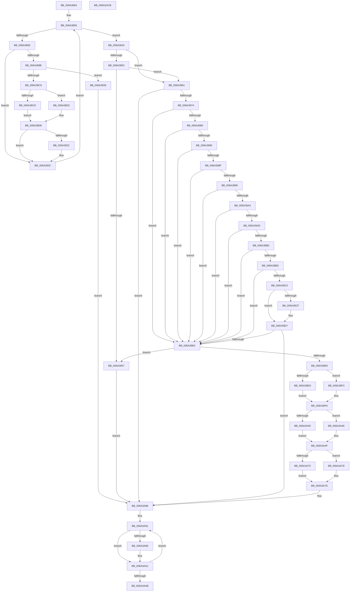

# SC_GPT::VerifyPartitionTable

- RVA: `0x006A3804`–`0x006A3ACC` (길이 `712` bytes)
- VA: `0x00000001406A3804`
- 실행 섹션: `.text`
- PDB 이름 있음: `예`; PDB Function 태그: `아니요`
- unwind 정보 RVA: `0x000CD730`
- 디코드: `210`개 명령, `712/712` bytes 표시
- 미해석 바이트: `0` (있으면 어셈블리에 `.byte`로 보존)

> 이 문서는 커널 이미지의 기계어와 PDB 기호를 분석해 생성했습니다. 4번과 5번은 함수 원형과 자료형을 바이너리 사용 방식에서 추정한 C 해석이며 원본 소스 복구 결과는 아닙니다.

## 1. Dependencies

- 직접 호출 지점: **7**; 고유 호출 대상: **7**
- 직접 호출자로 확인된 함수: **1**
- RIP 상대 이미지 참조: **0**

### Outgoing calls
- `0x006A3878` → [SC_GPT::ReadHeader](SC_GPT_ReadHeader_function_006A33E8.md) (function, `0x006A33E8`)
- `0x006A38B4` → [SC_ENV::Allocate](../../page/71/SC_ENV_Allocate_function_00716F90.md) (function, `0x00716F90`)
- `0x006A3912` → [memcpy](../6C/memcpy_function_006C6840.md) (function, `0x006C6840`)
- `0x006A3920` → [SC_GPT::ReadEntries](SC_GPT_ReadEntries_function_006A3360.md) (function, `0x006A3360`)
- `0x006A3A5C` → [crc32](../46/crc32_function_00468F58.md) (function, `0x00468F58`)
- `0x006A3A7E` → [SC_DISK::WriteSectors](SC_DISK_WriteSectors_function_006A4E2C.md) (function, `0x006A4E2C`)
- `0x006A3A99` → [AlpcpFreeBuffer](../../page/90/AlpcpFreeBuffer_function_009071C0.md) (function, `0x009071C0`)

### Direct callers
- [SC_DISK::VerifyPartitionTable](SC_DISK_VerifyPartitionTable_function_006A4D10.md) at `0x006A4D39`

### Static image references
- 디코드된 RIP-relative 메모리 참조가 없습니다.

## 2. Other-region calls and transfers

- 다른 실행 섹션으로 향하는 call: **2**
  - `0x006A38B4` → [SC_ENV::Allocate](../../page/71/SC_ENV_Allocate_function_00716F90.md) (`.text` → `PAGE`)
  - `0x006A3A99` → [AlpcpFreeBuffer](../../page/90/AlpcpFreeBuffer_function_009071C0.md) (`.text` → `PAGE`)
- 별도 외부 분기/꼬리 이동을 확인하지 못했습니다.

## 3. Assembly (complete function range)

```asm
006A3804  48 89 5C 24 10                  mov qword ptr [rsp + 0x10], rbx
006A3809  48 89 74 24 18                  mov qword ptr [rsp + 0x18], rsi
006A380E  48 89 7C 24 20                  mov qword ptr [rsp + 0x20], rdi
006A3813  55                              push rbp
006A3814  41 54                           push r12
006A3816  41 55                           push r13
006A3818  41 56                           push r14
006A381A  41 57                           push r15
006A381C  48 8B EC                        mov rbp, rsp
006A381F  48 83 EC 50                     sub rsp, 0x50
006A3823  48 8B 01                        mov rax, qword ptr [rcx]
006A3826  45 33 D2                        xor r10d, r10d
006A3829  0F 57 C0                        xorps xmm0, xmm0
006A382C  66 44 89 55 30                  mov word ptr [rbp + 0x30], r10w
006A3831  0F 57 C9                        xorps xmm1, xmm1
006A3834  44 8A EA                        mov r13b, dl
006A3837  4C 8B F9                        mov r15, rcx
006A383A  41 8B DA                        mov ebx, r10d
006A383D  8B B8 C8 00 00 00               mov edi, dword ptr [rax + 0xc8]
006A3843  F7 D7                           not edi
006A3845  83 E7 01                        and edi, 1
006A3848  FF C7                           inc edi
006A384A  0F 11 45 F0                     movups xmmword ptr [rbp - 0x10], xmm0
006A384E  0F 11 4D E0                     movups xmmword ptr [rbp - 0x20], xmm1
006A3852  0F 11 45 D0                     movups xmmword ptr [rbp - 0x30], xmm0
006A3856  3B DF                           cmp ebx, edi
006A3858  0F 83 E5 00 00 00               jae 0x1406a3943
006A385E  49 8B 07                        mov rax, qword ptr [r15]
006A3861  8B D3                           mov edx, ebx
006A3863  44 8B E3                        mov r12d, ebx
006A3866  49 8B CF                        mov rcx, r15
006A3869  48 8B B0 08 01 00 00            mov rsi, qword ptr [rax + 0x108]
006A3870  4C 8B C6                        mov r8, rsi
006A3873  4A 89 74 E5 D0                  mov qword ptr [rbp + r12*8 - 0x30], rsi
006A3878  E8 6B FB FF FF                  call 0x1406a33e8
006A387D  45 33 D2                        xor r10d, r10d
006A3880  85 C0                           test eax, eax
006A3882  0F 88 AA 00 00 00               js 0x1406a3932
006A3888  8B 46 54                        mov eax, dword ptr [rsi + 0x54]
006A388B  45 8D 4A 01                     lea r9d, [r10 + 1]
006A388F  0F AF 46 50                     imul eax, dword ptr [rsi + 0x50]
006A3893  49 8B 0F                        mov rcx, qword ptr [r15]
006A3896  8B 91 EC 00 00 00               mov edx, dword ptr [rcx + 0xec]
006A389C  8B 89 F0 00 00 00               mov ecx, dword ptr [rcx + 0xf0]
006A38A2  8D 72 FF                        lea esi, [rdx - 1]
006A38A5  F7 DA                           neg edx
006A38A7  03 F0                           add esi, eax
006A38A9  41 8D 42 01                     lea eax, [r10 + 1]
006A38AD  D3 E0                           shl eax, cl
006A38AF  23 F2                           and esi, edx
006A38B1  8D 0C 06                        lea ecx, [rsi + rax]
006A38B4  E8 D7 36 07 00                  call 0x140716f90
006A38B9  45 33 D2                        xor r10d, r10d
006A38BC  4A 89 44 E5 F0                  mov qword ptr [rbp + r12*8 - 0x10], rax
006A38C1  4C 8B F0                        mov r14, rax
006A38C4  48 85 C0                        test rax, rax
006A38C7  74 70                           je 0x1406a3939
006A38C9  85 DB                           test ebx, ebx
006A38CB  75 05                           jne 0x1406a38d2
006A38CD  48 03 F0                        add rsi, rax
006A38D0  EB 19                           jmp 0x1406a38eb
006A38D2  49 8B 0F                        mov rcx, qword ptr [r15]
006A38D5  B8 01 00 00 00                  mov eax, 1
006A38DA  49 8B F6                        mov rsi, r14
006A38DD  8B 89 F0 00 00 00               mov ecx, dword ptr [rcx + 0xf0]
006A38E3  D3 E0                           shl eax, cl
006A38E5  48 63 C8                        movsxd rcx, eax
006A38E8  4C 03 F1                        add r14, rcx
006A38EB  4A 89 74 E5 D0                  mov qword ptr [rbp + r12*8 - 0x30], rsi
006A38F0  B8 01 00 00 00                  mov eax, 1
006A38F5  4E 89 74 E5 E0                  mov qword ptr [rbp + r12*8 - 0x20], r14
006A38FA  49 8B 17                        mov rdx, qword ptr [r15]
006A38FD  8B 8A F0 00 00 00               mov ecx, dword ptr [rdx + 0xf0]
006A3903  48 8B 92 08 01 00 00            mov rdx, qword ptr [rdx + 0x108]
006A390A  D3 E0                           shl eax, cl
006A390C  48 8B CE                        mov rcx, rsi
006A390F  4C 63 C0                        movsxd r8, eax
006A3912  E8 29 2F 02 00                  call 0x1406c6840
006A3917  4D 8B C6                        mov r8, r14
006A391A  48 8B D6                        mov rdx, rsi
006A391D  49 8B CF                        mov rcx, r15
006A3920  E8 3B FA FF FF                  call 0x1406a3360
006A3925  45 33 D2                        xor r10d, r10d
006A3928  85 C0                           test eax, eax
006A392A  78 06                           js 0x1406a3932
006A392C  42 C6 44 25 30 01               mov byte ptr [rbp + r12 + 0x30], 1
006A3932  FF C3                           inc ebx
006A3934  E9 1D FF FF FF                  jmp 0x1406a3856
006A3939  BF 9A 00 00 C0                  mov edi, 0xc000009a
006A393E  E9 45 01 00 00                  jmp 0x1406a3a88
006A3943  0F B7 45 30                     movzx eax, word ptr [rbp + 0x30]
006A3947  41 8B FA                        mov edi, r10d
006A394A  44 8A 45 31                     mov r8b, byte ptr [rbp + 0x31]
006A394E  84 C0                           test al, al
006A3950  75 0F                           jne 0x1406a3961
006A3952  45 84 C0                        test r8b, r8b
006A3955  75 0A                           jne 0x1406a3961
006A3957  BF 32 00 00 C0                  mov edi, 0xc0000032
006A395C  E9 27 01 00 00                  jmp 0x1406a3a88
006A3961  4D 8B 0F                        mov r9, qword ptr [r15]
006A3964  41 8B 89 C8 00 00 00            mov ecx, dword ptr [r9 + 0xc8]
006A396B  F6 C1 01                        test cl, 1
006A396E  0F 85 14 01 00 00               jne 0x1406a3a88
006A3974  48 8B 55 D8                     mov rdx, qword ptr [rbp - 0x28]
006A3978  48 8B 5D D0                     mov rbx, qword ptr [rbp - 0x30]
006A397C  84 C0                           test al, al
006A397E  74 60                           je 0x1406a39e0
006A3980  45 84 C0                        test r8b, r8b
006A3983  74 5B                           je 0x1406a39e0
006A3985  48 8B 4B 20                     mov rcx, qword ptr [rbx + 0x20]
006A3989  48 39 4A 18                     cmp qword ptr [rdx + 0x18], rcx
006A398D  75 51                           jne 0x1406a39e0
006A398F  48 8B 4B 18                     mov rcx, qword ptr [rbx + 0x18]
006A3993  48 39 4A 20                     cmp qword ptr [rdx + 0x20], rcx
006A3997  75 47                           jne 0x1406a39e0
006A3999  48 8B 4B 28                     mov rcx, qword ptr [rbx + 0x28]
006A399D  48 39 4A 28                     cmp qword ptr [rdx + 0x28], rcx
006A39A1  75 3D                           jne 0x1406a39e0
006A39A3  48 8B 4B 30                     mov rcx, qword ptr [rbx + 0x30]
006A39A7  48 39 4A 30                     cmp qword ptr [rdx + 0x30], rcx
006A39AB  75 33                           jne 0x1406a39e0
006A39AD  8B 4B 50                        mov ecx, dword ptr [rbx + 0x50]
006A39B0  39 4A 50                        cmp dword ptr [rdx + 0x50], ecx
006A39B3  75 2B                           jne 0x1406a39e0
006A39B5  8B 4B 54                        mov ecx, dword ptr [rbx + 0x54]
006A39B8  39 4A 54                        cmp dword ptr [rdx + 0x54], ecx
006A39BB  75 23                           jne 0x1406a39e0
006A39BD  8B 4B 58                        mov ecx, dword ptr [rbx + 0x58]
006A39C0  39 4A 58                        cmp dword ptr [rdx + 0x58], ecx
006A39C3  75 1B                           jne 0x1406a39e0
006A39C5  4C 8B 42 38                     mov r8, qword ptr [rdx + 0x38]
006A39C9  4C 2B 43 38                     sub r8, qword ptr [rbx + 0x38]
006A39CD  75 08                           jne 0x1406a39d7
006A39CF  4C 8B 42 40                     mov r8, qword ptr [rdx + 0x40]
006A39D3  4C 2B 43 40                     sub r8, qword ptr [rbx + 0x40]
006A39D7  4D 85 C0                        test r8, r8
006A39DA  0F 84 A8 00 00 00               je 0x1406a3a88
006A39E0  45 84 ED                        test r13b, r13b
006A39E3  0F 84 6E FF FF FF               je 0x1406a3957
006A39E9  84 C0                           test al, al
006A39EB  74 06                           je 0x1406a39f3
006A39ED  4C 8B 75 E0                     mov r14, qword ptr [rbp - 0x20]
006A39F1  EB 07                           jmp 0x1406a39fa
006A39F3  4C 8B 75 E8                     mov r14, qword ptr [rbp - 0x18]
006A39F7  48 8B DA                        mov rbx, rdx
006A39FA  41 8B 91 EC 00 00 00            mov edx, dword ptr [r9 + 0xec]
006A3A01  84 C0                           test al, al
006A3A03  8B 43 54                        mov eax, dword ptr [rbx + 0x54]
006A3A06  45 8B E2                        mov r12d, r10d
006A3A09  41 8B 89 F0 00 00 00            mov ecx, dword ptr [r9 + 0xf0]
006A3A10  41 0F 95 C4                     setne r12b
006A3A14  0F AF 43 50                     imul eax, dword ptr [rbx + 0x50]
006A3A18  44 89 53 10                     mov dword ptr [rbx + 0x10], r10d
006A3A1C  44 8D 6A FF                     lea r13d, [rdx - 1]
006A3A20  48 8B 73 20                     mov rsi, qword ptr [rbx + 0x20]
006A3A24  F7 DA                           neg edx
006A3A26  44 03 E8                        add r13d, eax
006A3A29  48 8B 43 18                     mov rax, qword ptr [rbx + 0x18]
006A3A2D  44 23 EA                        and r13d, edx
006A3A30  48 89 73 18                     mov qword ptr [rbx + 0x18], rsi
006A3A34  41 D3 ED                        shr r13d, cl
006A3A37  48 89 43 20                     mov qword ptr [rbx + 0x20], rax
006A3A3B  45 85 E4                        test r12d, r12d
006A3A3E  75 06                           jne 0x1406a3a46
006A3A40  48 8D 7E 01                     lea rdi, [rsi + 1]
006A3A44  EB 09                           jmp 0x1406a3a4f
006A3A46  41 8B C5                        mov eax, r13d
006A3A49  48 8B FE                        mov rdi, rsi
006A3A4C  48 2B F8                        sub rdi, rax
006A3A4F  48 89 7B 48                     mov qword ptr [rbx + 0x48], rdi
006A3A53  48 8B D3                        mov rdx, rbx
006A3A56  44 8B 43 0C                     mov r8d, dword ptr [rbx + 0xc]
006A3A5A  33 C9                           xor ecx, ecx
006A3A5C  E8 F7 54 DC FF                  call 0x140468f58
006A3A61  89 43 10                        mov dword ptr [rbx + 0x10], eax
006A3A64  41 8D 55 01                     lea edx, [r13 + 1]
006A3A68  49 8B 0F                        mov rcx, qword ptr [r15]
006A3A6B  45 85 E4                        test r12d, r12d
006A3A6E  75 08                           jne 0x1406a3a78
006A3A70  4C 8B CB                        mov r9, rbx
006A3A73  4C 8B C6                        mov r8, rsi
006A3A76  EB 06                           jmp 0x1406a3a7e
006A3A78  4D 8B CE                        mov r9, r14
006A3A7B  4C 8B C7                        mov r8, rdi
006A3A7E  E8 A9 13 00 00                  call 0x1406a4e2c
006A3A83  45 33 D2                        xor r10d, r10d
006A3A86  8B F8                           mov edi, eax
006A3A88  48 8D 5D F0                     lea rbx, [rbp - 0x10]
006A3A8C  BE 02 00 00 00                  mov esi, 2
006A3A91  48 8B 0B                        mov rcx, qword ptr [rbx]
006A3A94  48 85 C9                        test rcx, rcx
006A3A97  74 08                           je 0x1406a3aa1
006A3A99  E8 22 37 26 00                  call 0x1409071c0
006A3A9E  45 33 D2                        xor r10d, r10d
006A3AA1  48 83 C3 08                     add rbx, 8
006A3AA5  48 83 EE 01                     sub rsi, 1
006A3AA9  75 E6                           jne 0x1406a3a91
006A3AAB  4C 8D 5C 24 50                  lea r11, [rsp + 0x50]
006A3AB0  8B C7                           mov eax, edi
006A3AB2  49 8B 5B 38                     mov rbx, qword ptr [r11 + 0x38]
006A3AB6  49 8B 73 40                     mov rsi, qword ptr [r11 + 0x40]
006A3ABA  49 8B 7B 48                     mov rdi, qword ptr [r11 + 0x48]
006A3ABE  49 8B E3                        mov rsp, r11
006A3AC1  41 5F                           pop r15
006A3AC3  41 5E                           pop r14
006A3AC5  41 5D                           pop r13
006A3AC7  41 5C                           pop r12
006A3AC9  5D                              pop rbp
006A3ACA  C3                              ret
006A3ACB  CC                              int3
```

## 4. C-style interpretation (structured pseudocode)

```c
__int64 __fastcall SC_GPT__VerifyPartitionTable(__int64 a1, unsigned __int8 a2)
{
    __int64 result;
    __int64 v_r10;
    __int64 v_r12;
    __int64 v_r13;
    __int64 v_r14;
    __int64 v_rbx;
    __int64 v_rdi;
    __int64 v_rsi;
    __int64 v_rsp;
    unsigned __int64 v_stack_m28;
    unsigned __int64 v_stack_m38;
    unsigned __int64 v_stack_m40;
    unsigned __int64 v_stack_m48;
    unsigned __int64 v_stack_m50;
    unsigned __int64 v_stack_m58;
    unsigned __int64 v_stack_p10;
    unsigned __int64 v_stack_p18;
    unsigned __int64 v_stack_p20;
    unsigned __int16 v_stack_p8;
    unsigned __int8 v_stack_p9;

    v_stack_p10 = v_rbx;
    v_stack_p18 = v_rsi;
    v_stack_p20 = v_rdi;
    v_rsp = (v_rsp) - (80);
    v_r10 = 0;
    v_stack_p8 = 0;
    v_rdi = (unsigned int)(~((unsigned int)(*(unsigned int *)(*(unsigned __int64 *)(a1) + 200))));
    v_rdi = (unsigned int)((v_rdi) & (1));
    v_rdi = (unsigned int)((v_rdi) + 1);
    v_stack_m38 = v_xmm0;
    v_stack_m48 = v_xmm1;
    v_stack_m58 = v_xmm0;
loc_006A3856:
    if (0 >= ((unsigned int)(v_rdi))) goto loc_006A3943;
    *(unsigned __int64 *)(v_rsp + 0 * 8 - 48) = *(unsigned __int64 *)(*(unsigned __int64 *)(a1) + 264);
    result = SC_GPT__ReadHeader(a1, 0, *(unsigned __int64 *)(*(unsigned __int64 *)(a1) + 264), a4);
    v_r10 = 0;
    if (sign_flag) goto loc_006A3932;
    result = (unsigned int)(((unsigned int)(*(unsigned int *)(*(unsigned __int64 *)(*(unsigned __int64 *)(a1) + 264) + 84))) * (*(unsigned int *)(*(unsigned __int64 *)(*(unsigned __int64 *)(a1) + 264) + 80)));
    a2 = (unsigned int)(-((unsigned int)(*(unsigned int *)(*(unsigned __int64 *)(a1) + 236))));
    v_rsi = (unsigned int)(((unsigned int)(*(unsigned int *)(*(unsigned __int64 *)(a1) + 236)) - 1) + ((unsigned int)(result)));
    result = (unsigned int)((v_r10 + 1) << ((unsigned __int8)((unsigned int)(*(unsigned int *)(*(unsigned __int64 *)(a1) + 240)))));
    v_rsi = (unsigned int)((v_rsi) & (a2));
    result = SC_ENV__Allocate(v_rsi + result * 1, a2, *(unsigned __int64 *)(*(unsigned __int64 *)(a1) + 264), v_r10 + 1);
    v_r10 = 0;
    *(unsigned __int64 *)(v_rsp + 0 * 8 - 16) = result;
    if (result == 0) goto loc_006A3939;
    if (0 != 0) goto loc_006A38D2;
    v_rsi = (v_rsi) + (result);
    goto loc_006A38EB;
loc_006A38D2:
    result = (unsigned int)((1) << ((unsigned __int8)((unsigned int)(*(unsigned int *)(*(unsigned __int64 *)(a1) + 240)))));
    v_r14 = (result) + ((int)((unsigned int)(result)));
loc_006A38EB:
    *(unsigned __int64 *)(v_rsp + 0 * 8 - 48) = result;
    *(unsigned __int64 *)(v_rsp + 0 * 8 - 32) = v_r14;
    result = (unsigned int)((1) << ((unsigned __int8)((unsigned int)(*(unsigned int *)(*(unsigned __int64 *)(a1) + 240)))));
    result = memcpy(result, *(unsigned __int64 *)(*(unsigned __int64 *)(a1) + 264), (int)((unsigned int)(result)), v_r10 + 1);
    result = SC_GPT__ReadEntries(a1, result, v_r14, v_r10 + 1);
    v_r10 = 0;
    if (!(sign_flag)) {
        *(unsigned __int8 *)(v_rsp + 0 * 1 + 48) = 1;
    }
    v_rbx = (unsigned int)((0) + 1);
    goto loc_006A3856;
loc_006A3939:
    goto loc_006A3A88;
loc_006A3943:
    if ((unsigned __int8)(v_stack_p8) != 0) goto loc_006A3961;
    if ((unsigned __int8)(v_stack_p9) != 0) goto loc_006A3961;
loc_006A3957:
    goto loc_006A3A88;
loc_006A3961:
    if ((((unsigned __int8)((unsigned int)(*(unsigned int *)(*(unsigned __int64 *)(a1) + 200)))) & (1)) != 0) goto loc_006A3A88;
    if ((unsigned __int8)(v_stack_p8) == 0) goto loc_006A39E0;
    if ((unsigned __int8)(v_stack_p9) == 0) goto loc_006A39E0;
    if ((*(unsigned __int64 *)(v_stack_m50 + 24)) != (*(unsigned __int64 *)(v_stack_m58 + 32))) goto loc_006A39E0;
    if ((*(unsigned __int64 *)(v_stack_m50 + 32)) != (*(unsigned __int64 *)(v_stack_m58 + 24))) goto loc_006A39E0;
    if ((*(unsigned __int64 *)(v_stack_m50 + 40)) != (*(unsigned __int64 *)(v_stack_m58 + 40))) goto loc_006A39E0;
    if ((*(unsigned __int64 *)(v_stack_m50 + 48)) != (*(unsigned __int64 *)(v_stack_m58 + 48))) goto loc_006A39E0;
    if ((*(unsigned int *)(v_stack_m50 + 80)) != ((unsigned int)((unsigned int)(*(unsigned int *)(v_stack_m58 + 80))))) goto loc_006A39E0;
    if ((*(unsigned int *)(v_stack_m50 + 84)) != ((unsigned int)((unsigned int)(*(unsigned int *)(v_stack_m58 + 84))))) goto loc_006A39E0;
    if ((*(unsigned int *)(v_stack_m50 + 88)) != ((unsigned int)((unsigned int)(*(unsigned int *)(v_stack_m58 + 88))))) goto loc_006A39E0;
    a3 = (*(unsigned __int64 *)(v_stack_m50 + 56)) - (*(unsigned __int64 *)(v_stack_m58 + 56));
    if (!(condition_is_not_equal)) {
        a3 = *(unsigned __int64 *)(v_stack_m50 + 64);
        a3 = (a3) - (*(unsigned __int64 *)(v_stack_m58 + 64));
    }
    if (a3 == 0) goto loc_006A3A88;
loc_006A39E0:
    if (a2 == 0) goto loc_006A3957;
    if ((unsigned __int8)(v_stack_p8) == 0) goto loc_006A39F3;
    goto loc_006A39FA;
loc_006A39F3:
loc_006A39FA:
    v_r12 = ((unsigned __int8)(v_stack_p8) != 0) ? 1 : 0;
    result = (unsigned int)(((unsigned int)(*(unsigned int *)(v_stack_m50 + 84))) * (*(unsigned int *)(v_stack_m50 + 80)));
    *(unsigned int *)(v_stack_m50 + 16) = 0;
    a2 = (unsigned int)(-((unsigned int)(*(unsigned int *)(*(unsigned __int64 *)(a1) + 236))));
    v_r13 = (unsigned int)(((unsigned int)(*(unsigned int *)(*(unsigned __int64 *)(a1) + 236)) - 1) + ((unsigned int)(result)));
    v_r13 = (unsigned int)((v_r13) & (a2));
    *(unsigned __int64 *)(v_stack_m50 + 24) = *(unsigned __int64 *)(v_stack_m50 + 32);
    v_r13 = (unsigned int)((v_r13) >> ((unsigned __int8)((unsigned int)(*(unsigned int *)(*(unsigned __int64 *)(a1) + 240)))));
    *(unsigned __int64 *)(v_stack_m50 + 32) = *(unsigned __int64 *)(v_stack_m50 + 24);
    if ((unsigned int)(v_r12) != 0) goto loc_006A3A46;
    goto loc_006A3A4F;
loc_006A3A46:
    v_rdi = (*(unsigned __int64 *)(v_stack_m50 + 32)) - ((unsigned int)((unsigned int)(v_r13)));
loc_006A3A4F:
    *(unsigned __int64 *)(v_stack_m50 + 72) = v_rdi;
    a1 = 0;
    result = crc32(a1, v_stack_m50, (unsigned int)(*(unsigned int *)(v_stack_m50 + 12)), *(unsigned __int64 *)(a1));
    *(unsigned int *)(v_stack_m50 + 16) = (unsigned int)(result);
    if ((unsigned int)(v_r12) != 0) goto loc_006A3A78;
    goto loc_006A3A7E;
loc_006A3A78:
loc_006A3A7E:
    result = SC_DISK__WriteSectors(*(unsigned __int64 *)(a1), v_r13 + 1, v_rdi, v_stack_m40);
    v_r10 = 0;
loc_006A3A88:
loc_006A3A91:
    if (*(unsigned __int64 *)(v_stack_m38) != 0) {
        result = AlpcpFreeBuffer(*(unsigned __int64 *)(v_stack_m38), v_r13 + 1, v_rdi, v_stack_m40);
        v_r10 = 0;
    }
    v_rbx = (v_stack_m38) + (8);
    v_rsi = (2) - (1);
    if (condition_is_not_equal) goto loc_006A3A91;
    return (unsigned int)((unsigned int)((unsigned int)((unsigned int)(result))));
}
```

## 5. (Beta) C Style

```c
int64_t SC_GPT__VerifyPartitionTable(void *Arg1, uint8_t Arg2)
{
    uint8_t *arg1 = (uint8_t *)Arg1;

    int64_t result;
    int64_t local_r10;
    int64_t local_r12;
    int64_t local_r13;
    int64_t local_r14;
    int64_t local_rbx;
    int64_t local_rdi;
    int64_t local_rsi;
    int64_t local_rsp;
    uint64_t v_stack_m28;
    uint64_t v_stack_m38;
    uint64_t v_stack_m40;
    uint64_t v_stack_m48;
    uint64_t v_stack_m50;
    uint64_t v_stack_m58;
    uint64_t v_stack_p10;
    uint64_t v_stack_p18;
    uint64_t v_stack_p20;
    uint16_t v_stack_p8;
    uint8_t v_stack_p9;

    v_stack_p10 = local_rbx;
    v_stack_p18 = local_rsi;
    v_stack_p20 = local_rdi;
    local_rsp = (local_rsp) - (80);
    local_r10 = 0;
    v_stack_p8 = 0;
    local_rdi = (uint32_t)(~((uint32_t)(*(uint32_t *)(*(uint64_t *)(arg1) + 0xC8))));
    local_rdi = (uint32_t)((local_rdi) & (1));
    local_rdi = (uint32_t)((local_rdi) + 1);
    v_stack_m38 = v_xmm0;
    v_stack_m48 = v_xmm1;
    v_stack_m58 = v_xmm0;
loc_006A3856:
    if (0 >= ((uint32_t)(local_rdi))) goto loc_006A3943;
    *(uint64_t *)(local_rsp + 0x0 * 8 - 0x30) = *(uint64_t *)(*(uint64_t *)(arg1) + 0x108);
    result = SC_GPT__ReadHeader(Arg1, 0, *(uint64_t *)(*(uint64_t *)(arg1) + 0x108), a4);
    local_r10 = 0;
    if (sign_flag) goto loc_006A3932;
    result = (uint32_t)(((uint32_t)(*(uint32_t *)(*(uint64_t *)(*(uint64_t *)(arg1) + 0x108) + 0x54))) * (*(uint32_t *)(*(uint64_t *)(*(uint64_t *)(arg1) + 0x108) + 0x50)));
    Arg2 = (uint32_t)(-((uint32_t)(*(uint32_t *)(*(uint64_t *)(arg1) + 0xEC))));
    local_rsi = (uint32_t)(((uint32_t)(*(uint32_t *)(*(uint64_t *)(arg1) + 0xEC)) - 1) + ((uint32_t)(result)));
    result = (uint32_t)((local_r10 + 1) << ((uint8_t)((uint32_t)(*(uint32_t *)(*(uint64_t *)(arg1) + 0xF0)))));
    local_rsi = (uint32_t)((local_rsi) & (Arg2));
    result = SC_ENV__Allocate(local_rsi + result * 1, Arg2, *(uint64_t *)(*(uint64_t *)(arg1) + 0x108), local_r10 + 1);
    local_r10 = 0;
    *(uint64_t *)(local_rsp + 0x0 * 8 - 0x10) = result;
    if (result == 0) goto loc_006A3939;
    if (0 != 0) goto loc_006A38D2;
    local_rsi = (local_rsi) + (result);
    goto loc_006A38EB;
loc_006A38D2:
    result = (uint32_t)((1) << ((uint8_t)((uint32_t)(*(uint32_t *)(*(uint64_t *)(arg1) + 0xF0)))));
    local_r14 = (result) + ((int32_t)((uint32_t)(result)));
loc_006A38EB:
    *(uint64_t *)(local_rsp + 0x0 * 8 - 0x30) = result;
    *(uint64_t *)(local_rsp + 0x0 * 8 - 0x20) = local_r14;
    result = (uint32_t)((1) << ((uint8_t)((uint32_t)(*(uint32_t *)(*(uint64_t *)(arg1) + 0xF0)))));
    result = memcpy(result, *(uint64_t *)(*(uint64_t *)(arg1) + 0x108), (int32_t)((uint32_t)(result)), local_r10 + 1);
    result = SC_GPT__ReadEntries(Arg1, result, local_r14, local_r10 + 1);
    local_r10 = 0;
    if (!(sign_flag)) {
        *(uint8_t *)(local_rsp + 0x0 * 1 + 0x30) = 1;
    }
    local_rbx = (uint32_t)((0) + 1);
    goto loc_006A3856;
loc_006A3939:
    goto loc_006A3A88;
loc_006A3943:
    if ((uint8_t)(v_stack_p8) != 0) goto loc_006A3961;
    if ((uint8_t)(v_stack_p9) != 0) goto loc_006A3961;
loc_006A3957:
    goto loc_006A3A88;
loc_006A3961:
    if ((((uint8_t)((uint32_t)(*(uint32_t *)(*(uint64_t *)(arg1) + 0xC8)))) & (1)) != 0) goto loc_006A3A88;
    if ((uint8_t)(v_stack_p8) == 0) goto loc_006A39E0;
    if ((uint8_t)(v_stack_p9) == 0) goto loc_006A39E0;
    if ((*(uint64_t *)(v_stack_m50 + 0x18)) != (*(uint64_t *)(v_stack_m58 + 0x20))) goto loc_006A39E0;
    if ((*(uint64_t *)(v_stack_m50 + 0x20)) != (*(uint64_t *)(v_stack_m58 + 0x18))) goto loc_006A39E0;
    if ((*(uint64_t *)(v_stack_m50 + 0x28)) != (*(uint64_t *)(v_stack_m58 + 0x28))) goto loc_006A39E0;
    if ((*(uint64_t *)(v_stack_m50 + 0x30)) != (*(uint64_t *)(v_stack_m58 + 0x30))) goto loc_006A39E0;
    if ((*(uint32_t *)(v_stack_m50 + 0x50)) != ((uint32_t)((uint32_t)(*(uint32_t *)(v_stack_m58 + 0x50))))) goto loc_006A39E0;
    if ((*(uint32_t *)(v_stack_m50 + 0x54)) != ((uint32_t)((uint32_t)(*(uint32_t *)(v_stack_m58 + 0x54))))) goto loc_006A39E0;
    if ((*(uint32_t *)(v_stack_m50 + 0x58)) != ((uint32_t)((uint32_t)(*(uint32_t *)(v_stack_m58 + 0x58))))) goto loc_006A39E0;
    a3 = (*(uint64_t *)(v_stack_m50 + 0x38)) - (*(uint64_t *)(v_stack_m58 + 0x38));
    if (!(condition_is_not_equal)) {
        a3 = *(uint64_t *)(v_stack_m50 + 0x40);
        a3 = (a3) - (*(uint64_t *)(v_stack_m58 + 0x40));
    }
    if (a3 == 0) goto loc_006A3A88;
loc_006A39E0:
    if (Arg2 == 0) goto loc_006A3957;
    if ((uint8_t)(v_stack_p8) == 0) goto loc_006A39F3;
    goto loc_006A39FA;
loc_006A39F3:
loc_006A39FA:
    local_r12 = ((uint8_t)(v_stack_p8) != 0) ? 1 : 0;
    result = (uint32_t)(((uint32_t)(*(uint32_t *)(v_stack_m50 + 0x54))) * (*(uint32_t *)(v_stack_m50 + 0x50)));
    *(uint32_t *)(v_stack_m50 + 0x10) = 0;
    Arg2 = (uint32_t)(-((uint32_t)(*(uint32_t *)(*(uint64_t *)(arg1) + 0xEC))));
    local_r13 = (uint32_t)(((uint32_t)(*(uint32_t *)(*(uint64_t *)(arg1) + 0xEC)) - 1) + ((uint32_t)(result)));
    local_r13 = (uint32_t)((local_r13) & (Arg2));
    *(uint64_t *)(v_stack_m50 + 0x18) = *(uint64_t *)(v_stack_m50 + 0x20);
    local_r13 = (uint32_t)((local_r13) >> ((uint8_t)((uint32_t)(*(uint32_t *)(*(uint64_t *)(arg1) + 0xF0)))));
    *(uint64_t *)(v_stack_m50 + 0x20) = *(uint64_t *)(v_stack_m50 + 0x18);
    if ((uint32_t)(local_r12) != 0) goto loc_006A3A46;
    goto loc_006A3A4F;
loc_006A3A46:
    local_rdi = (*(uint64_t *)(v_stack_m50 + 0x20)) - ((uint32_t)((uint32_t)(local_r13)));
loc_006A3A4F:
    *(uint64_t *)(v_stack_m50 + 0x48) = local_rdi;
    Arg1 = 0;
    result = crc32(Arg1, v_stack_m50, (uint32_t)(*(uint32_t *)(v_stack_m50 + 0xC)), *(uint64_t *)(arg1));
    *(uint32_t *)(v_stack_m50 + 0x10) = (uint32_t)(result);
    if ((uint32_t)(local_r12) != 0) goto loc_006A3A78;
    goto loc_006A3A7E;
loc_006A3A78:
loc_006A3A7E:
    result = SC_DISK__WriteSectors(*(uint64_t *)(arg1), local_r13 + 1, local_rdi, v_stack_m40);
    local_r10 = 0;
loc_006A3A88:
loc_006A3A91:
    if (*(uint64_t *)(v_stack_m38) != 0) {
        result = AlpcpFreeBuffer(*(uint64_t *)(v_stack_m38), local_r13 + 1, local_rdi, v_stack_m40);
        local_r10 = 0;
    }
    local_rbx = (v_stack_m38) + (8);
    local_rsi = (2) - (1);
    if (condition_is_not_equal) goto loc_006A3A91;
    return (uint32_t)((uint32_t)((uint32_t)((uint32_t)(result))));
}
```

### 관측된 메모리 오프셋

구조체 형식이 확인되지 않은 접근은 인자 기준의 오프셋으로만 기록했습니다.

| 기준 인자 | 오프셋 표현 | 폭 (bit) | 접근 |
|---|---:|---:|---|
| `Arg1` | `+ 0x0` | `64` | `R` |

## 6. Execution-region graph

[열기: 2D/3D 그래프와 함수 탐색 컨트롤 패널](../../../control-panel.html?section=text&rva=0x006A3804&view=graph)

- 2D 그래프는 위에서 아래로 흐르고, 3D 그래프는 빈 공간을 드래그해 회전합니다. Shift+드래그는 이동, 휠은 확대·축소, 함수 노드 선택은 대상 보고서 이동입니다.

### Static fallback


