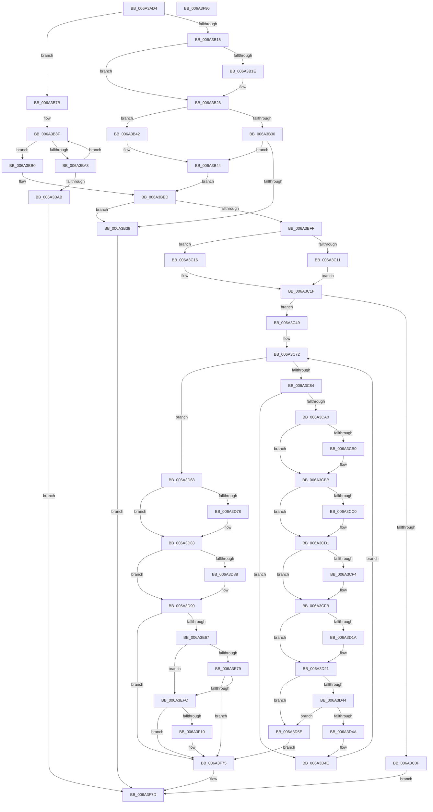

# SC_GPT::WritePartitionTable

- RVA: `0x006A3AD4`–`0x006A3F91` (길이 `1,213` bytes)
- VA: `0x00000001406A3AD4`
- 실행 섹션: `.text`
- PDB 이름 있음: `예`; PDB Function 태그: `아니요`
- unwind 정보 RVA: `0x000BD668`
- 디코드: `313`개 명령, `1,213/1,213` bytes 표시
- 미해석 바이트: `0` (있으면 어셈블리에 `.byte`로 보존)

> 이 문서는 커널 이미지의 기계어와 PDB 기호를 분석해 생성했습니다. 4번과 5번은 함수 원형과 자료형을 바이너리 사용 방식에서 추정한 C 해석이며 원본 소스 복구 결과는 아닙니다.

## 1. Dependencies

- 직접 호출 지점: **15**; 고유 호출 대상: **10**
- 직접 호출자로 확인된 함수: **2**
- RIP 상대 이미지 참조: **2**

### Outgoing calls
- `0x006A3B98` → [SC_GPT::ReadHeader](SC_GPT_ReadHeader_function_006A33E8.md) (function, `0x006A33E8`)
- `0x006A3C32` → [SC_ENV::Allocate](../../page/71/SC_ENV_Allocate_function_00716F90.md) (function, `0x00716F90`)
- `0x006A3C93` → [SC_PART_ENTRY::IsUnused](SC_PART_ENTRY_IsUnused_function_006A4890.md) (function, `0x006A4890`)
- `0x006A3CC0` → [SC_ENV::CreateGuid](../../page/71/SC_ENV_CreateGuid_function_007170B0.md) (function, `0x007170B0`)
- `0x006A3D34` → [RtlStringCbCopyW](RtlStringCbCopyW_function_006A37B0.md) (function, `0x006A37B0`)
- `0x006A3D8B` → [SC_ENV::CreateGuid](../../page/71/SC_ENV_CreateGuid_function_007170B0.md) (function, `0x007170B0`)
- `0x006A3E2A` → [crc32](../46/crc32_function_00468F58.md) (function, `0x00468F58`)
- `0x006A3E3E` → [crc32](../46/crc32_function_00468F58.md) (function, `0x00468F58`)
- `0x006A3E58` → [SC_DISK::WriteSectors](SC_DISK_WriteSectors_function_006A4E2C.md) (function, `0x006A4E2C`)
- `0x006A3EDB` → [crc32](../46/crc32_function_00468F58.md) (function, `0x00468F58`)
- `0x006A3EF1` → [SC_DISK::WriteSectors](SC_DISK_WriteSectors_function_006A4E2C.md) (function, `0x006A4E2C`)
- `0x006A3F1B` → [memset](../6C/memset_function_006C6C40.md) (function, `0x006C6C40`)
- `0x006A3F53` → [MBR_ENTRY::ComputeChs](MBR_ENTRY_ComputeChs_function_006A4F08.md) (function, `0x006A4F08`)
- `0x006A3F6E` → [SC_DISK::WriteSectors](SC_DISK_WriteSectors_function_006A4E2C.md) (function, `0x006A4E2C`)
- `0x006A3F78` → [AlpcpFreeBuffer](../../page/90/AlpcpFreeBuffer_function_009071C0.md) (function, `0x009071C0`)

### Direct callers
- [SC_GPT::CreatePartitionTable](SC_GPT_CreatePartitionTable_function_006A3238.md) at `0x006A3298`
- [SC_DISK::WritePartitionTable](SC_DISK_WritePartitionTable_function_006A4D4C.md) at `0x006A4DBE`

### Static image references
- `0x006A3CA7` → RVA `0x000112D0` (`.rdata`; read)
- `0x006A3CB4` → RVA `0x000112D8` (`.rdata`; read)

## 2. Other-region calls and transfers

- 다른 실행 섹션으로 향하는 call: **4**
  - `0x006A3C32` → [SC_ENV::Allocate](../../page/71/SC_ENV_Allocate_function_00716F90.md) (`.text` → `PAGE`)
  - `0x006A3CC0` → [SC_ENV::CreateGuid](../../page/71/SC_ENV_CreateGuid_function_007170B0.md) (`.text` → `PAGE`)
  - `0x006A3D8B` → [SC_ENV::CreateGuid](../../page/71/SC_ENV_CreateGuid_function_007170B0.md) (`.text` → `PAGE`)
  - `0x006A3F78` → [AlpcpFreeBuffer](../../page/90/AlpcpFreeBuffer_function_009071C0.md) (`.text` → `PAGE`)
- 별도 외부 분기/꼬리 이동을 확인하지 못했습니다.

## 3. Assembly (complete function range)

```asm
006A3AD4  44 88 44 24 18                  mov byte ptr [rsp + 0x18], r8b
006A3AD9  48 89 54 24 10                  mov qword ptr [rsp + 0x10], rdx
006A3ADE  53                              push rbx
006A3ADF  55                              push rbp
006A3AE0  56                              push rsi
006A3AE1  57                              push rdi
006A3AE2  41 54                           push r12
006A3AE4  41 55                           push r13
006A3AE6  41 56                           push r14
006A3AE8  41 57                           push r15
006A3AEA  48 83 EC 48                     sub rsp, 0x48
006A3AEE  4C 8B 09                        mov r9, qword ptr [rcx]
006A3AF1  BD 02 00 00 00                  mov ebp, 2
006A3AF6  83 64 24 24 00                  and dword ptr [rsp + 0x24], 0
006A3AFB  4C 8B EA                        mov r13, rdx
006A3AFE  48 8B F1                        mov rsi, rcx
006A3B01  B9 55 AA 00 00                  mov ecx, 0xaa55
006A3B06  49 8B B9 08 01 00 00            mov rdi, qword ptr [r9 + 0x108]
006A3B0D  8D 55 7E                        lea edx, [rbp + 0x7e]
006A3B10  45 84 C0                        test r8b, r8b
006A3B13  74 66                           je 0x1406a3b7b
006A3B15  66 39 8F FE 01 00 00            cmp word ptr [rdi + 0x1fe], cx
006A3B1C  75 0A                           jne 0x1406a3b28
006A3B1E  8B 87 B8 01 00 00               mov eax, dword ptr [rdi + 0x1b8]
006A3B24  89 44 24 24                     mov dword ptr [rsp + 0x24], eax
006A3B28  41 8B 4D 28                     mov ecx, dword ptr [r13 + 0x28]
006A3B2C  3B CA                           cmp ecx, edx
006A3B2E  76 12                           jbe 0x1406a3b42
006A3B30  81 F9 00 04 00 00               cmp ecx, 0x400
006A3B36  76 0C                           jbe 0x1406a3b44
006A3B38  BB 0D 00 00 C0                  mov ebx, 0xc000000d
006A3B3D  E9 3B 04 00 00                  jmp 0x1406a3f7d
006A3B42  8B CA                           mov ecx, edx
006A3B44  41 8B 81 EC 00 00 00            mov eax, dword ptr [r9 + 0xec]
006A3B4B  89 54 24 20                     mov dword ptr [rsp + 0x20], edx
006A3B4F  C1 E1 07                        shl ecx, 7
006A3B52  8D 50 FF                        lea edx, [rax - 1]
006A3B55  F7 D8                           neg eax
006A3B57  03 D1                           add edx, ecx
006A3B59  41 8B 89 F0 00 00 00            mov ecx, dword ptr [r9 + 0xf0]
006A3B60  23 D0                           and edx, eax
006A3B62  44 8B E2                        mov r12d, edx
006A3B65  44 8B C2                        mov r8d, edx
006A3B68  41 D3 EC                        shr r12d, cl
006A3B6B  41 C1 E8 07                     shr r8d, 7
006A3B6F  45 8D 54 24 02                  lea r10d, [r12 + 2]
006A3B74  4C 89 54 24 28                  mov qword ptr [rsp + 0x28], r10
006A3B79  EB 72                           jmp 0x1406a3bed
006A3B7B  41 8A 81 C8 00 00 00            mov al, byte ptr [r9 + 0xc8]
006A3B82  24 01                           and al, 1
006A3B84  F6 D8                           neg al
006A3B86  45 1B FF                        sbb r15d, r15d
006A3B89  44 03 FD                        add r15d, ebp
006A3B8C  45 33 F6                        xor r14d, r14d
006A3B8F  4C 8B C7                        mov r8, rdi
006A3B92  41 8B D6                        mov edx, r14d
006A3B95  48 8B CE                        mov rcx, rsi
006A3B98  E8 4B F8 FF FF                  call 0x1406a33e8
006A3B9D  8B D8                           mov ebx, eax
006A3B9F  85 C0                           test eax, eax
006A3BA1  79 0D                           jns 0x1406a3bb0
006A3BA3  41 FF C6                        inc r14d
006A3BA6  45 3B F7                        cmp r14d, r15d
006A3BA9  72 E4                           jb 0x1406a3b8f
006A3BAB  E9 CD 03 00 00                  jmp 0x1406a3f7d
006A3BB0  4C 8B 0E                        mov r9, qword ptr [rsi]
006A3BB3  48 8B 47 28                     mov rax, qword ptr [rdi + 0x28]
006A3BB7  44 8B 5F 54                     mov r11d, dword ptr [rdi + 0x54]
006A3BBB  44 8B 47 50                     mov r8d, dword ptr [rdi + 0x50]
006A3BBF  41 8B 89 EC 00 00 00            mov ecx, dword ptr [r9 + 0xec]
006A3BC6  48 89 44 24 28                  mov qword ptr [rsp + 0x28], rax
006A3BCB  41 8B C0                        mov eax, r8d
006A3BCE  41 0F AF C3                     imul eax, r11d
006A3BD2  44 89 5C 24 20                  mov dword ptr [rsp + 0x20], r11d
006A3BD7  8D 51 FF                        lea edx, [rcx - 1]
006A3BDA  F7 D9                           neg ecx
006A3BDC  03 D0                           add edx, eax
006A3BDE  23 D1                           and edx, ecx
006A3BE0  41 8B 89 F0 00 00 00            mov ecx, dword ptr [r9 + 0xf0]
006A3BE7  44 8B E2                        mov r12d, edx
006A3BEA  41 D3 EC                        shr r12d, cl
006A3BED  44 89 84 24 A8 00 00 00         mov dword ptr [rsp + 0xa8], r8d
006A3BF5  45 39 45 04                     cmp dword ptr [r13 + 4], r8d
006A3BF9  0F 87 39 FF FF FF               ja 0x1406a3b38
006A3BFF  41 8B 81 C8 00 00 00            mov eax, dword ptr [r9 + 0xc8]
006A3C06  4D 8B B9 F8 00 00 00            mov r15, qword ptr [r9 + 0xf8]
006A3C0D  A8 01                           test al, 1
006A3C0F  74 05                           je 0x1406a3c16
006A3C11  49 FF CF                        dec r15
006A3C14  EB 09                           jmp 0x1406a3c1f
006A3C16  41 8B C4                        mov eax, r12d
006A3C19  4C 2B F8                        sub r15, rax
006A3C1C  4C 2B FD                        sub r15, rbp
006A3C1F  41 8B 89 F0 00 00 00            mov ecx, dword ptr [r9 + 0xf0]
006A3C26  41 B9 01 00 00 00               mov r9d, 1
006A3C2C  D3 E5                           shl ebp, cl
006A3C2E  03 EA                           add ebp, edx
006A3C30  8B CD                           mov ecx, ebp
006A3C32  E8 59 33 07 00                  call 0x140716f90
006A3C37  4C 8B F0                        mov r14, rax
006A3C3A  48 85 C0                        test rax, rax
006A3C3D  75 0A                           jne 0x1406a3c49
006A3C3F  BB 9A 00 00 C0                  mov ebx, 0xc000009a
006A3C44  E9 34 03 00 00                  jmp 0x1406a3f7d
006A3C49  48 8B 0E                        mov rcx, qword ptr [rsi]
006A3C4C  B8 01 00 00 00                  mov eax, 1
006A3C51  8B 89 F0 00 00 00               mov ecx, dword ptr [rcx + 0xf0]
006A3C57  D3 E0                           shl eax, cl
006A3C59  48 63 C8                        movsxd rcx, eax
006A3C5C  48 2B E9                        sub rbp, rcx
006A3C5F  49 03 EE                        add rbp, r14
006A3C62  45 33 D2                        xor r10d, r10d
006A3C65  4A 8D 04 31                     lea rax, [rcx + r14]
006A3C69  48 89 44 24 30                  mov qword ptr [rsp + 0x30], rax
006A3C6E  48 8D 58 30                     lea rbx, [rax + 0x30]
006A3C72  44 89 94 24 90 00 00 00         mov dword ptr [rsp + 0x90], r10d
006A3C7A  45 3B 55 04                     cmp r10d, dword ptr [r13 + 4]
006A3C7E  0F 83 E4 00 00 00               jae 0x1406a3d68
006A3C84  4B 8D 0C D2                     lea rcx, [r10 + r10*8]
006A3C88  48 C1 E1 04                     shl rcx, 4
006A3C8C  4C 03 E9                        add r13, rcx
006A3C8F  49 8D 4D 30                     lea rcx, [r13 + 0x30]
006A3C93  E8 F8 0B 00 00                  call 0x1406a4890
006A3C98  84 C0                           test al, al
006A3C9A  0F 85 AE 00 00 00               jne 0x1406a3d4e
006A3CA0  49 8D 4D 60                     lea rcx, [r13 + 0x60]
006A3CA4  48 8B 01                        mov rax, qword ptr [rcx]
006A3CA7  48 2B 05 22 D6 96 FF            sub rax, qword ptr [rip - 0x6929de]
006A3CAE  75 0B                           jne 0x1406a3cbb
006A3CB0  48 8B 41 08                     mov rax, qword ptr [rcx + 8]
006A3CB4  48 2B 05 1D D6 96 FF            sub rax, qword ptr [rip - 0x6929e3]
006A3CBB  48 85 C0                        test rax, rax
006A3CBE  75 11                           jne 0x1406a3cd1
006A3CC0  E8 EB 33 07 00                  call 0x1407170b0
006A3CC5  44 8B 94 24 90 00 00 00         mov r10d, dword ptr [rsp + 0x90]
006A3CCD  49 8D 4D 60                     lea rcx, [r13 + 0x60]
006A3CD1  41 0F 10 45 50                  movups xmm0, xmmword ptr [r13 + 0x50]
006A3CD6  F3 0F 7F 43 D0                  movdqu xmmword ptr [rbx - 0x30], xmm0
006A3CDB  0F 10 09                        movups xmm1, xmmword ptr [rcx]
006A3CDE  F3 0F 7F 4B E0                  movdqu xmmword ptr [rbx - 0x20], xmm1
006A3CE3  48 8B 0E                        mov rcx, qword ptr [rsi]
006A3CE6  49 8B 45 38                     mov rax, qword ptr [r13 + 0x38]
006A3CEA  8B 91 EC 00 00 00               mov edx, dword ptr [rcx + 0xec]
006A3CF0  85 D2                           test edx, edx
006A3CF2  74 07                           je 0x1406a3cfb
006A3CF4  8B CA                           mov ecx, edx
006A3CF6  48 99                           cqo
006A3CF8  48 F7 F9                        idiv rcx
006A3CFB  48 89 43 F0                     mov qword ptr [rbx - 0x10], rax
006A3CFF  49 8B 4D 40                     mov rcx, qword ptr [r13 + 0x40]
006A3D03  49 8B 45 38                     mov rax, qword ptr [r13 + 0x38]
006A3D07  48 FF C9                        dec rcx
006A3D0A  48 03 C1                        add rax, rcx
006A3D0D  48 8B 0E                        mov rcx, qword ptr [rsi]
006A3D10  8B 91 EC 00 00 00               mov edx, dword ptr [rcx + 0xec]
006A3D16  85 D2                           test edx, edx
006A3D18  74 07                           je 0x1406a3d21
006A3D1A  8B CA                           mov ecx, edx
006A3D1C  48 99                           cqo
006A3D1E  48 F7 F9                        idiv rcx
006A3D21  48 89 43 F8                     mov qword ptr [rbx - 8], rax
006A3D25  4D 8D 45 78                     lea r8, [r13 + 0x78]
006A3D29  49 8B 45 70                     mov rax, qword ptr [r13 + 0x70]
006A3D2D  48 8D 4B 08                     lea rcx, [rbx + 8]
006A3D31  48 89 03                        mov qword ptr [rbx], rax
006A3D34  E8 77 FA FF FF                  call 0x1406a37b0
006A3D39  48 8B 44 24 28                  mov rax, qword ptr [rsp + 0x28]
006A3D3E  48 39 43 F0                     cmp qword ptr [rbx - 0x10], rax
006A3D42  72 1A                           jb 0x1406a3d5e
006A3D44  4C 39 7B F8                     cmp qword ptr [rbx - 8], r15
006A3D48  77 14                           ja 0x1406a3d5e
006A3D4A  48 83 EB 80                     sub rbx, -0x80
006A3D4E  4C 8B AC 24 98 00 00 00         mov r13, qword ptr [rsp + 0x98]
006A3D56  41 FF C2                        inc r10d
006A3D59  E9 14 FF FF FF                  jmp 0x1406a3c72
006A3D5E  BB 0D 00 00 C0                  mov ebx, 0xc000000d
006A3D63  E9 0D 02 00 00                  jmp 0x1406a3f75
006A3D68  49 8D 5D 08                     lea rbx, [r13 + 8]
006A3D6C  48 8B 03                        mov rax, qword ptr [rbx]
006A3D6F  48 2B 05 5A D5 96 FF            sub rax, qword ptr [rip - 0x692aa6]
006A3D76  75 0B                           jne 0x1406a3d83
006A3D78  48 8B 43 08                     mov rax, qword ptr [rbx + 8]
006A3D7C  48 2B 05 55 D5 96 FF            sub rax, qword ptr [rip - 0x692aab]
006A3D83  48 85 C0                        test rax, rax
006A3D86  75 08                           jne 0x1406a3d90
006A3D88  48 8B CB                        mov rcx, rbx
006A3D8B  E8 20 33 07 00                  call 0x1407170b0
006A3D90  48 8B 0E                        mov rcx, qword ptr [rsi]
006A3D93  49 8B C7                        mov rax, r15
006A3D96  48 8B 54 24 28                  mov rdx, qword ptr [rsp + 0x28]
006A3D9B  45 8B C4                        mov r8d, r12d
006A3D9E  48 2B C2                        sub rax, rdx
006A3DA1  48 FF C0                        inc rax
006A3DA4  8B 89 F0 00 00 00               mov ecx, dword ptr [rcx + 0xf0]
006A3DAA  48 D3 E0                        shl rax, cl
006A3DAD  8B 8C 24 A8 00 00 00            mov ecx, dword ptr [rsp + 0xa8]
006A3DB4  49 89 45 20                     mov qword ptr [r13 + 0x20], rax
006A3DB8  48 B8 45 46 49 20 50 41 52 54   movabs rax, 0x5452415020494645
006A3DC2  41 89 4D 28                     mov dword ptr [r13 + 0x28], ecx
006A3DC6  49 89 06                        mov qword ptr [r14], rax
006A3DC9  49 8D 44 24 01                  lea rax, [r12 + 1]
006A3DCE  49 89 56 28                     mov qword ptr [r14 + 0x28], rdx
006A3DD2  49 03 C7                        add rax, r15
006A3DD5  49 89 46 20                     mov qword ptr [r14 + 0x20], rax
006A3DD9  8B 44 24 20                     mov eax, dword ptr [rsp + 0x20]
006A3DDD  4D 89 7E 30                     mov qword ptr [r14 + 0x30], r15
006A3DE1  4C 8B 7C 24 30                  mov r15, qword ptr [rsp + 0x30]
006A3DE6  41 C7 46 08 00 00 01 00         mov dword ptr [r14 + 8], 0x10000
006A3DEE  41 C7 46 0C 5C 00 00 00         mov dword ptr [r14 + 0xc], 0x5c
006A3DF6  49 C7 46 18 01 00 00 00         mov qword ptr [r14 + 0x18], 1
006A3DFE  0F 10 03                        movups xmm0, xmmword ptr [rbx]
006A3E01  41 89 4E 50                     mov dword ptr [r14 + 0x50], ecx
006A3E05  41 89 46 54                     mov dword ptr [r14 + 0x54], eax
006A3E09  F3 41 0F 7F 46 38               movdqu xmmword ptr [r14 + 0x38], xmm0
006A3E0F  45 8B EC                        mov r13d, r12d
006A3E12  49 2B D5                        sub rdx, r13
006A3E15  49 89 56 48                     mov qword ptr [r14 + 0x48], rdx
006A3E19  49 8B D7                        mov rdx, r15
006A3E1C  48 8B 0E                        mov rcx, qword ptr [rsi]
006A3E1F  8B 89 F0 00 00 00               mov ecx, dword ptr [rcx + 0xf0]
006A3E25  41 D3 E0                        shl r8d, cl
006A3E28  33 C9                           xor ecx, ecx
006A3E2A  E8 29 51 DC FF                  call 0x140468f58
006A3E2F  41 B8 5C 00 00 00               mov r8d, 0x5c
006A3E35  41 89 46 58                     mov dword ptr [r14 + 0x58], eax
006A3E39  49 8B D6                        mov rdx, r14
006A3E3C  33 C9                           xor ecx, ecx
006A3E3E  E8 15 51 DC FF                  call 0x140468f58
006A3E43  41 89 46 10                     mov dword ptr [r14 + 0x10], eax
006A3E47  41 8D 54 24 01                  lea edx, [r12 + 1]
006A3E4C  48 8B 0E                        mov rcx, qword ptr [rsi]
006A3E4F  4D 8B CE                        mov r9, r14
006A3E52  41 B8 01 00 00 00               mov r8d, 1
006A3E58  E8 CF 0F 00 00                  call 0x1406a4e2c
006A3E5D  8B D8                           mov ebx, eax
006A3E5F  85 C0                           test eax, eax
006A3E61  0F 88 0E 01 00 00               js 0x1406a3f75
006A3E67  48 8B 06                        mov rax, qword ptr [rsi]
006A3E6A  8B 88 C8 00 00 00               mov ecx, dword ptr [rax + 0xc8]
006A3E70  F6 C1 01                        test cl, 1
006A3E73  0F 85 83 00 00 00               jne 0x1406a3efc
006A3E79  41 0F 10 06                     movups xmm0, xmmword ptr [r14]
006A3E7D  48 8B D5                        mov rdx, rbp
006A3E80  33 C9                           xor ecx, ecx
006A3E82  0F 11 45 00                     movups xmmword ptr [rbp], xmm0
006A3E86  41 0F 10 4E 10                  movups xmm1, xmmword ptr [r14 + 0x10]
006A3E8B  0F 11 4D 10                     movups xmmword ptr [rbp + 0x10], xmm1
006A3E8F  41 0F 10 46 20                  movups xmm0, xmmword ptr [r14 + 0x20]
006A3E94  0F 11 45 20                     movups xmmword ptr [rbp + 0x20], xmm0
006A3E98  41 0F 10 4E 30                  movups xmm1, xmmword ptr [r14 + 0x30]
006A3E9D  0F 11 4D 30                     movups xmmword ptr [rbp + 0x30], xmm1
006A3EA1  41 0F 10 46 40                  movups xmm0, xmmword ptr [r14 + 0x40]
006A3EA6  0F 11 45 40                     movups xmmword ptr [rbp + 0x40], xmm0
006A3EAA  F2 41 0F 10 4E 50               movsd xmm1, qword ptr [r14 + 0x50]
006A3EB0  F2 0F 11 4D 50                  movsd qword ptr [rbp + 0x50], xmm1
006A3EB5  41 8B 46 58                     mov eax, dword ptr [r14 + 0x58]
006A3EB9  89 45 58                        mov dword ptr [rbp + 0x58], eax
006A3EBC  48 8B 5D 20                     mov rbx, qword ptr [rbp + 0x20]
006A3EC0  48 8B 45 18                     mov rax, qword ptr [rbp + 0x18]
006A3EC4  44 8B 45 0C                     mov r8d, dword ptr [rbp + 0xc]
006A3EC8  83 65 10 00                     and dword ptr [rbp + 0x10], 0
006A3ECC  48 89 5D 18                     mov qword ptr [rbp + 0x18], rbx
006A3ED0  49 2B DD                        sub rbx, r13
006A3ED3  48 89 5D 48                     mov qword ptr [rbp + 0x48], rbx
006A3ED7  48 89 45 20                     mov qword ptr [rbp + 0x20], rax
006A3EDB  E8 78 50 DC FF                  call 0x140468f58
006A3EE0  89 45 10                        mov dword ptr [rbp + 0x10], eax
006A3EE3  41 8D 54 24 01                  lea edx, [r12 + 1]
006A3EE8  48 8B 0E                        mov rcx, qword ptr [rsi]
006A3EEB  4D 8B CF                        mov r9, r15
006A3EEE  4C 8B C3                        mov r8, rbx
006A3EF1  E8 36 0F 00 00                  call 0x1406a4e2c
006A3EF6  8B D8                           mov ebx, eax
006A3EF8  85 C0                           test eax, eax
006A3EFA  78 79                           js 0x1406a3f75
006A3EFC  48 8B 06                        mov rax, qword ptr [rsi]
006A3EFF  83 A0 C8 00 00 00 FD            and dword ptr [rax + 0xc8], 0xfffffffd
006A3F06  80 BC 24 A0 00 00 00 00         cmp byte ptr [rsp + 0xa0], 0
006A3F0E  74 65                           je 0x1406a3f75
006A3F10  33 D2                           xor edx, edx
006A3F12  41 B8 00 02 00 00               mov r8d, 0x200
006A3F18  48 8B CF                        mov rcx, rdi
006A3F1B  E8 20 2D 02 00                  call 0x1406c6c40
006A3F20  8B 44 24 24                     mov eax, dword ptr [rsp + 0x24]
006A3F24  48 8D 8F BE 01 00 00            lea rcx, [rdi + 0x1be]
006A3F2B  83 8F CA 01 00 00 FF            or dword ptr [rdi + 0x1ca], 0xffffffff
006A3F32  89 87 B8 01 00 00               mov dword ptr [rdi + 0x1b8], eax
006A3F38  C6 87 C2 01 00 00 EE            mov byte ptr [rdi + 0x1c2], 0xee
006A3F3F  C7 87 C6 01 00 00 01 00 00 00   mov dword ptr [rdi + 0x1c6], 1
006A3F49  48 8B 16                        mov rdx, qword ptr [rsi]
006A3F4C  48 81 C2 D8 00 00 00            add rdx, 0xd8
006A3F53  E8 B0 0F 00 00                  call 0x1406a4f08
006A3F58  45 33 C9                        xor r9d, r9d
006A3F5B  66 C7 87 FE 01 00 00 55 AA      mov word ptr [rdi + 0x1fe], 0xaa55
006A3F64  48 8B 0E                        mov rcx, qword ptr [rsi]
006A3F67  45 33 C0                        xor r8d, r8d
006A3F6A  41 8D 51 01                     lea edx, [r9 + 1]
006A3F6E  E8 B9 0E 00 00                  call 0x1406a4e2c
006A3F73  8B D8                           mov ebx, eax
006A3F75  49 8B CE                        mov rcx, r14
006A3F78  E8 43 32 26 00                  call 0x1409071c0
006A3F7D  8B C3                           mov eax, ebx
006A3F7F  48 83 C4 48                     add rsp, 0x48
006A3F83  41 5F                           pop r15
006A3F85  41 5E                           pop r14
006A3F87  41 5D                           pop r13
006A3F89  41 5C                           pop r12
006A3F8B  5F                              pop rdi
006A3F8C  5E                              pop rsi
006A3F8D  5D                              pop rbp
006A3F8E  5B                              pop rbx
006A3F8F  C3                              ret
006A3F90  CC                              int3
```

## 4. C-style interpretation (structured pseudocode)

```c
__int64 __fastcall SC_GPT__WritePartitionTable(__int64 a1, __int64 a2, unsigned __int8 a3)
{
    __int64 result;
    __int64 v_r10;
    __int64 v_r12;
    __int64 v_r13;
    __int64 v_r14;
    __int64 v_r15;
    __int64 v_rbp;
    __int64 v_rbx;
    __int64 v_rsp;
    unsigned __int64 v_stack_m58;
    unsigned __int64 v_stack_m60;
    unsigned int v_stack_m64;
    unsigned int v_stack_m68;
    unsigned __int64 v_stack_p10;
    unsigned __int8 v_stack_p18;
    unsigned int v_stack_p20;
    unsigned int v_stack_p8;

    v_stack_p18 = a3;
    v_stack_p10 = a2;
    v_rsp = (v_rsp) - (72);
    if (a3 == 0) goto loc_006A3B7B;
    if ((*(unsigned __int16 *)(*(unsigned __int64 *)(*(unsigned __int64 *)(a1) + 264) + 510)) == ((unsigned __int16)((unsigned int)(0xAA55ULL)))) {
        result = *(unsigned int *)(*(unsigned __int64 *)(*(unsigned __int64 *)(a1) + 264) + 440);
        v_stack_m64 = (unsigned int)(result);
    }
    if (((unsigned int)((unsigned int)(*(unsigned int *)(a2 + 40)))) <= ((unsigned int)(2 + 126))) goto loc_006A3B42;
    if (((unsigned int)((unsigned int)(*(unsigned int *)(a2 + 40)))) <= 0x400ULL) goto loc_006A3B44;
loc_006A3B38:
    goto loc_006A3F7D;
loc_006A3B42:
loc_006A3B44:
    v_stack_m68 = (unsigned int)(2 + 126);
    a1 = (unsigned int)(((unsigned int)((unsigned int)(2 + 126))) << (7));
    result = (unsigned int)(-((unsigned int)(*(unsigned int *)(*(unsigned __int64 *)(a1) + 236))));
    a2 = (unsigned int)(((unsigned int)(*(unsigned int *)(*(unsigned __int64 *)(a1) + 236)) - 1) + ((unsigned int)(a1)));
    a2 = (unsigned int)((a2) & ((unsigned int)(result)));
    v_r12 = (unsigned int)(((unsigned int)((unsigned int)(a2))) >> ((unsigned __int8)((unsigned int)(*(unsigned int *)(*(unsigned __int64 *)(a1) + 240)))));
    a3 = (unsigned int)(((unsigned int)((unsigned int)(a2))) >> (7));
    v_stack_m60 = v_r12 + 2;
    goto loc_006A3BED;
loc_006A3B7B:
    result = (unsigned __int8)((*(unsigned __int8 *)(*(unsigned __int64 *)(a1) + 200)) & (1));
    result = (unsigned __int8)(-(result));
    v_r15 = (unsigned int)((v_r15) + (2));
    v_r14 = 0;
loc_006A3B8F:
    result = SC_GPT__ReadHeader(a1, 0, *(unsigned __int64 *)(*(unsigned __int64 *)(a1) + 264), *(unsigned __int64 *)(a1));
    if (!sign_flag) goto loc_006A3BB0;
    v_r14 = (unsigned int)((v_r14) + 1);
    if (((unsigned int)(v_r14)) < ((unsigned int)(v_r15))) goto loc_006A3B8F;
    goto loc_006A3F7D;
loc_006A3BB0:
    v_stack_m60 = *(unsigned __int64 *)(*(unsigned __int64 *)(*(unsigned __int64 *)(a1) + 264) + 40);
    result = (unsigned int)(((unsigned int)((unsigned int)((unsigned int)(*(unsigned int *)(*(unsigned __int64 *)(*(unsigned __int64 *)(a1) + 264) + 80))))) * ((unsigned int)((unsigned int)(*(unsigned int *)(*(unsigned __int64 *)(*(unsigned __int64 *)(a1) + 264) + 84)))));
    v_stack_m68 = (unsigned int)((unsigned int)(*(unsigned int *)(*(unsigned __int64 *)(*(unsigned __int64 *)(a1) + 264) + 84)));
    a1 = (unsigned int)(-((unsigned int)(*(unsigned int *)(*(unsigned __int64 *)(a1) + 236))));
    a2 = (unsigned int)(((unsigned int)(*(unsigned int *)(*(unsigned __int64 *)(a1) + 236)) - 1) + ((unsigned int)(result)));
    a2 = (unsigned int)((a2) & ((unsigned int)(a1)));
    v_r12 = (unsigned int)(((unsigned int)((unsigned int)(a2))) >> ((unsigned __int8)((unsigned int)(*(unsigned int *)(*(unsigned __int64 *)(a1) + 240)))));
loc_006A3BED:
    v_stack_p20 = (unsigned int)((unsigned int)(*(unsigned int *)(*(unsigned __int64 *)(*(unsigned __int64 *)(a1) + 264) + 80)));
    if ((*(unsigned int *)(a2 + 4)) > ((unsigned int)((unsigned int)(*(unsigned int *)(*(unsigned __int64 *)(*(unsigned __int64 *)(a1) + 264) + 80))))) goto loc_006A3B38;
    if ((((unsigned __int8)((unsigned int)(*(unsigned int *)(*(unsigned __int64 *)(a1) + 200)))) & (1)) == 0) goto loc_006A3C16;
    v_r15 = (*(unsigned __int64 *)(*(unsigned __int64 *)(a1) + 248)) - 1;
    goto loc_006A3C1F;
loc_006A3C16:
    v_r15 = (v_r15) - ((unsigned int)((unsigned int)(v_r12)));
    v_r15 = (v_r15) - (2);
loc_006A3C1F:
    v_rbp = (unsigned int)((2) << ((unsigned __int8)((unsigned int)(*(unsigned int *)(*(unsigned __int64 *)(a1) + 240)))));
    v_rbp = (unsigned int)((v_rbp) + ((unsigned int)(a2)));
    result = SC_ENV__Allocate((unsigned int)((unsigned int)(v_rbp)), a2, (unsigned int)(*(unsigned int *)(*(unsigned __int64 *)(*(unsigned __int64 *)(a1) + 264) + 80)), 1);
    if (result != 0) goto loc_006A3C49;
    goto loc_006A3F7D;
loc_006A3C49:
    result = (unsigned int)((1) << ((unsigned __int8)((unsigned int)(*(unsigned int *)(*(unsigned __int64 *)(a1) + 240)))));
    v_rbp = (v_rbp) - ((int)((unsigned int)(result)));
    v_rbp = (v_rbp) + (result);
    v_r10 = 0;
    v_stack_m58 = (int)((unsigned int)(result)) + result * 1;
loc_006A3C72:
    v_stack_p8 = 0;
    if (0 >= (*(unsigned int *)(a2 + 4))) goto loc_006A3D68;
    a1 = (v_r10 + v_r10 * 8) << (4);
    v_r13 = (a2) + (a1);
    result = SC_PART_ENTRY__IsUnused(v_r13 + 48, a2, (unsigned int)(*(unsigned int *)(*(unsigned __int64 *)(*(unsigned __int64 *)(a1) + 264) + 80)), 1);
    if ((unsigned __int8)(result) != 0) goto loc_006A3D4E;
    result = (*(unsigned __int64 *)(v_r13 + 96)) - (*(unsigned __int64 *)(v_rip - 6891998));
    if (!(condition_is_not_equal)) {
        result = *(unsigned __int64 *)(v_r13 + 96 + 8);
        result = (result) - (*(unsigned __int64 *)(v_rip - 6892003));
    }
    if (result == 0) {
        result = SC_ENV__CreateGuid(v_r13 + 96, a2, (unsigned int)(*(unsigned int *)(*(unsigned __int64 *)(*(unsigned __int64 *)(a1) + 264) + 80)), 1);
        v_r10 = v_stack_p8;
        a1 = v_r13 + 96;
    }
    *(unsigned __int64 *)((int)((unsigned int)(result)) + result * 1 + 48 - 48) = v_xmm0;
    *(unsigned __int64 *)((int)((unsigned int)(result)) + result * 1 + 48 - 32) = v_xmm1;
    if ((unsigned int)((unsigned int)(*(unsigned int *)(*(unsigned __int64 *)(a1) + 236))) != 0) {
        a1 = (unsigned int)((unsigned int)(*(unsigned int *)(*(unsigned __int64 *)(a1) + 236)));
    }
    *(unsigned __int64 *)((int)((unsigned int)(result)) + result * 1 + 48 - 16) = *(unsigned __int64 *)(v_r13 + 56);
    a1 = (*(unsigned __int64 *)(v_r13 + 64)) - 1;
    result = (*(unsigned __int64 *)(v_r13 + 56)) + (a1);
    if ((unsigned int)((unsigned int)(*(unsigned int *)(*(unsigned __int64 *)(a1) + 236))) != 0) {
        a1 = (unsigned int)((unsigned int)(*(unsigned int *)(*(unsigned __int64 *)(a1) + 236)));
    }
    *(unsigned __int64 *)((int)((unsigned int)(result)) + result * 1 + 48 - 8) = result;
    *(unsigned __int64 *)((int)((unsigned int)(result)) + result * 1 + 48) = *(unsigned __int64 *)(v_r13 + 112);
    result = RtlStringCbCopyW((int)((unsigned int)(result)) + result * 1 + 48 + 8, (unsigned int)(*(unsigned int *)(*(unsigned __int64 *)(a1) + 236)), v_r13 + 120, 1);
    if ((*(unsigned __int64 *)((int)((unsigned int)(result)) + result * 1 + 48 - 16)) < v_stack_m60) goto loc_006A3D5E;
    if ((*(unsigned __int64 *)((int)((unsigned int)(result)) + result * 1 + 48 - 8)) > v_r15) goto loc_006A3D5E;
    v_rbx = ((int)((unsigned int)(result)) + result * 1 + 48) - (-128);
loc_006A3D4E:
    v_r10 = (unsigned int)((v_r10) + 1);
    goto loc_006A3C72;
loc_006A3D5E:
    goto loc_006A3F75;
loc_006A3D68:
    result = (*(unsigned __int64 *)(v_stack_p10 + 8)) - (*(unsigned __int64 *)(v_rip - 6892198));
    if (!(condition_is_not_equal)) {
        result = *(unsigned __int64 *)(v_stack_p10 + 8 + 8);
        result = (result) - (*(unsigned __int64 *)(v_rip - 6892203));
    }
    if (result == 0) {
        a1 = v_stack_p10 + 8;
        result = SC_ENV__CreateGuid(a1, (unsigned int)(*(unsigned int *)(*(unsigned __int64 *)(a1) + 236)), v_r13 + 120, 1);
    }
    result = (v_r15) - (v_stack_m60);
    result = (result) + 1;
    result = (result) << ((unsigned __int8)((unsigned int)(*(unsigned int *)(*(unsigned __int64 *)(a1) + 240))));
    *(unsigned __int64 *)(v_stack_p10 + 32) = result;
    *(unsigned int *)(v_stack_p10 + 40) = (unsigned int)((unsigned int)(v_stack_p20));
    *(unsigned __int64 *)(result) = result;
    *(unsigned __int64 *)(result + 40) = v_stack_m60;
    result = (v_r12 + 1) + (v_r15);
    *(unsigned __int64 *)(result + 32) = result;
    *(unsigned __int64 *)(result + 48) = v_r15;
    *(unsigned int *)(result + 8) = 0x10000ULL;
    *(unsigned int *)(result + 12) = 92;
    *(unsigned __int64 *)(result + 24) = 1;
    *(unsigned int *)(result + 80) = (unsigned int)((unsigned int)(v_stack_p20));
    *(unsigned int *)(result + 84) = (unsigned int)((unsigned int)(v_stack_m68));
    *(unsigned __int64 *)(result + 56) = v_xmm0;
    a2 = (v_stack_m60) - ((unsigned int)((unsigned int)(v_r12)));
    *(unsigned __int64 *)(result + 72) = a2;
    a3 = (unsigned int)(((unsigned int)((unsigned int)(v_r12))) << ((unsigned __int8)((unsigned int)(*(unsigned int *)(*(unsigned __int64 *)(a1) + 240)))));
    a1 = 0;
    result = crc32(a1, v_stack_m58, a3, 1);
    *(unsigned int *)(result + 88) = (unsigned int)(result);
    a1 = 0;
    result = crc32(a1, result, 92, 1);
    *(unsigned int *)(result + 16) = (unsigned int)(result);
    result = SC_DISK__WriteSectors(*(unsigned __int64 *)(a1), v_r12 + 1, 1, result);
    if (sign_flag) goto loc_006A3F75;
    if ((((unsigned __int8)((unsigned int)(*(unsigned int *)(*(unsigned __int64 *)(a1) + 200)))) & (1)) != 0) goto loc_006A3EFC;
    a1 = 0;
    *(unsigned __int64 *)(v_rbp) = v_xmm0;
    *(unsigned __int64 *)(v_rbp + 16) = v_xmm1;
    *(unsigned __int64 *)(v_rbp + 32) = v_xmm0;
    *(unsigned __int64 *)(v_rbp + 48) = v_xmm1;
    *(unsigned __int64 *)(v_rbp + 64) = v_xmm0;
    *(unsigned __int64 *)(v_rbp + 80) = v_xmm1;
    *(unsigned int *)(v_rbp + 88) = (unsigned int)((unsigned int)(*(unsigned int *)(result + 88)));
    *(unsigned __int64 *)(v_rbp + 24) = *(unsigned __int64 *)(v_rbp + 32);
    v_rbx = (*(unsigned __int64 *)(v_rbp + 32)) - ((unsigned int)((unsigned int)(v_r12)));
    *(unsigned __int64 *)(v_rbp + 72) = v_rbx;
    *(unsigned __int64 *)(v_rbp + 32) = *(unsigned __int64 *)(v_rbp + 24);
    result = crc32(a1, v_rbp, (unsigned int)(*(unsigned int *)(v_rbp + 12)), result);
    *(unsigned int *)(v_rbp + 16) = (unsigned int)(result);
    result = SC_DISK__WriteSectors(*(unsigned __int64 *)(a1), v_r12 + 1, v_rbx, v_stack_m58);
    if (sign_flag) goto loc_006A3F75;
loc_006A3EFC:
    result = *(unsigned __int64 *)(a1);
    v_rbx = (unsigned int)((unsigned int)(result));
    if (v_stack_p18 != 0) {
        a2 = 0;
        a3 = 512;
        a1 = *(unsigned __int64 *)(*(unsigned __int64 *)(a1) + 264);
        result = memset(a1, a2, a3, v_stack_m58);
        result = v_stack_m64;
        a1 = *(unsigned __int64 *)(*(unsigned __int64 *)(a1) + 264) + 446;
        *(unsigned int *)(*(unsigned __int64 *)(*(unsigned __int64 *)(a1) + 264) + 440) = (unsigned int)(result);
        *(unsigned __int8 *)(*(unsigned __int64 *)(*(unsigned __int64 *)(a1) + 264) + 450) = 238;
        *(unsigned int *)(*(unsigned __int64 *)(*(unsigned __int64 *)(a1) + 264) + 454) = 1;
        a2 = *(unsigned __int64 *)(a1);
        a2 = (a2) + (216);
        result = MBR_ENTRY__ComputeChs(a1, a2, a3, v_stack_m58);
        a4 = 0;
        *(unsigned __int16 *)(*(unsigned __int64 *)(*(unsigned __int64 *)(a1) + 264) + 510) = 0xAA55ULL;
        a1 = *(unsigned __int64 *)(a1);
        a3 = 0;
        a2 = a4 + 1;
        result = SC_DISK__WriteSectors(a1, a2, a3, a4);
        v_rbx = (unsigned int)(result);
    }
    result = AlpcpFreeBuffer(result, a2, a3, a4);
loc_006A3F7D:
    v_rsp = (v_rsp) + (72);
    return (unsigned int)((unsigned int)(v_rbx));
}
```

## 5. (Beta) C Style

```c
int64_t SC_GPT__WritePartitionTable(void *Arg1, void *Arg2, uint8_t Arg3)
{
    uint8_t *arg1 = (uint8_t *)Arg1;
    uint8_t *arg2 = (uint8_t *)Arg2;

    int64_t result;
    int64_t local_r10;
    int64_t local_r12;
    int64_t local_r13;
    int64_t local_r14;
    int64_t local_r15;
    int64_t local_rbp;
    int64_t local_rbx;
    int64_t local_rsp;
    uint64_t v_stack_m58;
    uint64_t v_stack_m60;
    uint32_t v_stack_m64;
    uint32_t v_stack_m68;
    uint64_t v_stack_p10;
    uint8_t v_stack_p18;
    uint32_t v_stack_p20;
    uint32_t v_stack_p8;

    v_stack_p18 = Arg3;
    v_stack_p10 = Arg2;
    local_rsp = (local_rsp) - (72);
    if (Arg3 == 0) goto loc_006A3B7B;
    if ((*(uint16_t *)(*(uint64_t *)(*(uint64_t *)(arg1) + 0x108) + 0x1FE)) == ((uint16_t)((uint32_t)(0xAA55ULL)))) {
        result = *(uint32_t *)(*(uint64_t *)(*(uint64_t *)(arg1) + 0x108) + 0x1B8);
        v_stack_m64 = (uint32_t)(result);
    }
    if (((uint32_t)((uint32_t)(*(uint32_t *)(arg2 + 0x28)))) <= ((uint32_t)(2 + 126))) goto loc_006A3B42;
    if (((uint32_t)((uint32_t)(*(uint32_t *)(arg2 + 0x28)))) <= 0x400ULL) goto loc_006A3B44;
loc_006A3B38:
    goto loc_006A3F7D;
loc_006A3B42:
loc_006A3B44:
    v_stack_m68 = (uint32_t)(2 + 126);
    Arg1 = (uint32_t)(((uint32_t)((uint32_t)(2 + 126))) << (7));
    result = (uint32_t)(-((uint32_t)(*(uint32_t *)(*(uint64_t *)(arg1) + 0xEC))));
    Arg2 = (uint32_t)(((uint32_t)(*(uint32_t *)(*(uint64_t *)(arg1) + 0xEC)) - 1) + ((uint32_t)(Arg1)));
    Arg2 = (uint32_t)((Arg2) & ((uint32_t)(result)));
    local_r12 = (uint32_t)(((uint32_t)((uint32_t)(Arg2))) >> ((uint8_t)((uint32_t)(*(uint32_t *)(*(uint64_t *)(arg1) + 0xF0)))));
    Arg3 = (uint32_t)(((uint32_t)((uint32_t)(Arg2))) >> (7));
    v_stack_m60 = local_r12 + 2;
    goto loc_006A3BED;
loc_006A3B7B:
    result = (uint8_t)((*(uint8_t *)(*(uint64_t *)(arg1) + 0xC8)) & (1));
    result = (uint8_t)(-(result));
    local_r15 = (uint32_t)((local_r15) + (2));
    local_r14 = 0;
loc_006A3B8F:
    result = SC_GPT__ReadHeader(Arg1, 0, *(uint64_t *)(*(uint64_t *)(arg1) + 0x108), *(uint64_t *)(arg1));
    if (!sign_flag) goto loc_006A3BB0;
    local_r14 = (uint32_t)((local_r14) + 1);
    if (((uint32_t)(local_r14)) < ((uint32_t)(local_r15))) goto loc_006A3B8F;
    goto loc_006A3F7D;
loc_006A3BB0:
    v_stack_m60 = *(uint64_t *)(*(uint64_t *)(*(uint64_t *)(arg1) + 0x108) + 0x28);
    result = (uint32_t)(((uint32_t)((uint32_t)((uint32_t)(*(uint32_t *)(*(uint64_t *)(*(uint64_t *)(arg1) + 0x108) + 0x50))))) * ((uint32_t)((uint32_t)(*(uint32_t *)(*(uint64_t *)(*(uint64_t *)(arg1) + 0x108) + 0x54)))));
    v_stack_m68 = (uint32_t)((uint32_t)(*(uint32_t *)(*(uint64_t *)(*(uint64_t *)(arg1) + 0x108) + 0x54)));
    Arg1 = (uint32_t)(-((uint32_t)(*(uint32_t *)(*(uint64_t *)(arg1) + 0xEC))));
    Arg2 = (uint32_t)(((uint32_t)(*(uint32_t *)(*(uint64_t *)(arg1) + 0xEC)) - 1) + ((uint32_t)(result)));
    Arg2 = (uint32_t)((Arg2) & ((uint32_t)(Arg1)));
    local_r12 = (uint32_t)(((uint32_t)((uint32_t)(Arg2))) >> ((uint8_t)((uint32_t)(*(uint32_t *)(*(uint64_t *)(arg1) + 0xF0)))));
loc_006A3BED:
    v_stack_p20 = (uint32_t)((uint32_t)(*(uint32_t *)(*(uint64_t *)(*(uint64_t *)(arg1) + 0x108) + 0x50)));
    if ((*(uint32_t *)(arg2 + 0x4)) > ((uint32_t)((uint32_t)(*(uint32_t *)(*(uint64_t *)(*(uint64_t *)(arg1) + 0x108) + 0x50))))) goto loc_006A3B38;
    if ((((uint8_t)((uint32_t)(*(uint32_t *)(*(uint64_t *)(arg1) + 0xC8)))) & (1)) == 0) goto loc_006A3C16;
    local_r15 = (*(uint64_t *)(*(uint64_t *)(arg1) + 0xF8)) - 1;
    goto loc_006A3C1F;
loc_006A3C16:
    local_r15 = (local_r15) - ((uint32_t)((uint32_t)(local_r12)));
    local_r15 = (local_r15) - (2);
loc_006A3C1F:
    local_rbp = (uint32_t)((2) << ((uint8_t)((uint32_t)(*(uint32_t *)(*(uint64_t *)(arg1) + 0xF0)))));
    local_rbp = (uint32_t)((local_rbp) + ((uint32_t)(Arg2)));
    result = SC_ENV__Allocate((uint32_t)((uint32_t)(local_rbp)), Arg2, (uint32_t)(*(uint32_t *)(*(uint64_t *)(*(uint64_t *)(arg1) + 0x108) + 0x50)), 1);
    if (result != 0) goto loc_006A3C49;
    goto loc_006A3F7D;
loc_006A3C49:
    result = (uint32_t)((1) << ((uint8_t)((uint32_t)(*(uint32_t *)(*(uint64_t *)(arg1) + 0xF0)))));
    local_rbp = (local_rbp) - ((int32_t)((uint32_t)(result)));
    local_rbp = (local_rbp) + (result);
    local_r10 = 0;
    v_stack_m58 = (int32_t)((uint32_t)(result)) + result * 1;
loc_006A3C72:
    v_stack_p8 = 0;
    if (0 >= (*(uint32_t *)(arg2 + 0x4))) goto loc_006A3D68;
    Arg1 = (local_r10 + local_r10 * 8) << (4);
    local_r13 = (Arg2) + (Arg1);
    result = SC_PART_ENTRY__IsUnused(local_r13 + 48, Arg2, (uint32_t)(*(uint32_t *)(*(uint64_t *)(*(uint64_t *)(arg1) + 0x108) + 0x50)), 1);
    if ((uint8_t)(result) != 0) goto loc_006A3D4E;
    result = (*(uint64_t *)(local_r13 + 0x60)) - (*(uint64_t *)(v_rip - 0x6929DE));
    if (!(condition_is_not_equal)) {
        result = *(uint64_t *)(local_r13 + 0x60 + 0x8);
        result = (result) - (*(uint64_t *)(v_rip - 0x6929E3));
    }
    if (result == 0) {
        result = SC_ENV__CreateGuid(local_r13 + 96, Arg2, (uint32_t)(*(uint32_t *)(*(uint64_t *)(*(uint64_t *)(arg1) + 0x108) + 0x50)), 1);
        local_r10 = v_stack_p8;
        Arg1 = local_r13 + 96;
    }
    *(uint64_t *)((int32_t)((uint32_t)(result)) + result * 1 + 0x30 - 0x30) = v_xmm0;
    *(uint64_t *)((int32_t)((uint32_t)(result)) + result * 1 + 0x30 - 0x20) = v_xmm1;
    if ((uint32_t)((uint32_t)(*(uint32_t *)(*(uint64_t *)(arg1) + 0xEC))) != 0) {
        Arg1 = (uint32_t)((uint32_t)(*(uint32_t *)(*(uint64_t *)(arg1) + 0xEC)));
    }
    *(uint64_t *)((int32_t)((uint32_t)(result)) + result * 1 + 0x30 - 0x10) = *(uint64_t *)(local_r13 + 0x38);
    Arg1 = (*(uint64_t *)(local_r13 + 0x40)) - 1;
    result = (*(uint64_t *)(local_r13 + 0x38)) + (Arg1);
    if ((uint32_t)((uint32_t)(*(uint32_t *)(*(uint64_t *)(arg1) + 0xEC))) != 0) {
        Arg1 = (uint32_t)((uint32_t)(*(uint32_t *)(*(uint64_t *)(arg1) + 0xEC)));
    }
    *(uint64_t *)((int32_t)((uint32_t)(result)) + result * 1 + 0x30 - 0x8) = result;
    *(uint64_t *)((int32_t)((uint32_t)(result)) + result * 1 + 0x30) = *(uint64_t *)(local_r13 + 0x70);
    result = RtlStringCbCopyW((int32_t)((uint32_t)(result)) + result * 1 + 48 + 8, (uint32_t)(*(uint32_t *)(*(uint64_t *)(arg1) + 0xEC)), local_r13 + 120, 1);
    if ((*(uint64_t *)((int32_t)((uint32_t)(result)) + result * 1 + 0x30 - 0x10)) < v_stack_m60) goto loc_006A3D5E;
    if ((*(uint64_t *)((int32_t)((uint32_t)(result)) + result * 1 + 0x30 - 0x8)) > local_r15) goto loc_006A3D5E;
    local_rbx = ((int32_t)((uint32_t)(result)) + result * 1 + 48) - (-128);
loc_006A3D4E:
    local_r10 = (uint32_t)((local_r10) + 1);
    goto loc_006A3C72;
loc_006A3D5E:
    goto loc_006A3F75;
loc_006A3D68:
    result = (*(uint64_t *)(v_stack_p10 + 0x8)) - (*(uint64_t *)(v_rip - 0x692AA6));
    if (!(condition_is_not_equal)) {
        result = *(uint64_t *)(v_stack_p10 + 0x8 + 0x8);
        result = (result) - (*(uint64_t *)(v_rip - 0x692AAB));
    }
    if (result == 0) {
        Arg1 = v_stack_p10 + 8;
        result = SC_ENV__CreateGuid(Arg1, (uint32_t)(*(uint32_t *)(*(uint64_t *)(arg1) + 0xEC)), local_r13 + 120, 1);
    }
    result = (local_r15) - (v_stack_m60);
    result = (result) + 1;
    result = (result) << ((uint8_t)((uint32_t)(*(uint32_t *)(*(uint64_t *)(arg1) + 0xF0))));
    *(uint64_t *)(v_stack_p10 + 0x20) = result;
    *(uint32_t *)(v_stack_p10 + 0x28) = (uint32_t)((uint32_t)(v_stack_p20));
    *(uint64_t *)(result) = result;
    *(uint64_t *)(result + 0x28) = v_stack_m60;
    result = (local_r12 + 1) + (local_r15);
    *(uint64_t *)(result + 0x20) = result;
    *(uint64_t *)(result + 0x30) = local_r15;
    *(uint32_t *)(result + 0x8) = 0x10000ULL;
    *(uint32_t *)(result + 0xC) = 92;
    *(uint64_t *)(result + 0x18) = 1;
    *(uint32_t *)(result + 0x50) = (uint32_t)((uint32_t)(v_stack_p20));
    *(uint32_t *)(result + 0x54) = (uint32_t)((uint32_t)(v_stack_m68));
    *(uint64_t *)(result + 0x38) = v_xmm0;
    Arg2 = (v_stack_m60) - ((uint32_t)((uint32_t)(local_r12)));
    *(void **)(result + 0x48) = Arg2;
    Arg3 = (uint32_t)(((uint32_t)((uint32_t)(local_r12))) << ((uint8_t)((uint32_t)(*(uint32_t *)(*(uint64_t *)(arg1) + 0xF0)))));
    Arg1 = 0;
    result = crc32(Arg1, v_stack_m58, Arg3, 1);
    *(uint32_t *)(result + 0x58) = (uint32_t)(result);
    Arg1 = 0;
    result = crc32(Arg1, result, 92, 1);
    *(uint32_t *)(result + 0x10) = (uint32_t)(result);
    result = SC_DISK__WriteSectors(*(uint64_t *)(arg1), local_r12 + 1, 1, result);
    if (sign_flag) goto loc_006A3F75;
    if ((((uint8_t)((uint32_t)(*(uint32_t *)(*(uint64_t *)(arg1) + 0xC8)))) & (1)) != 0) goto loc_006A3EFC;
    Arg1 = 0;
    *(uint64_t *)(local_rbp) = v_xmm0;
    *(uint64_t *)(local_rbp + 0x10) = v_xmm1;
    *(uint64_t *)(local_rbp + 0x20) = v_xmm0;
    *(uint64_t *)(local_rbp + 0x30) = v_xmm1;
    *(uint64_t *)(local_rbp + 0x40) = v_xmm0;
    *(uint64_t *)(local_rbp + 0x50) = v_xmm1;
    *(uint32_t *)(local_rbp + 0x58) = (uint32_t)((uint32_t)(*(uint32_t *)(result + 0x58)));
    *(uint64_t *)(local_rbp + 0x18) = *(uint64_t *)(local_rbp + 0x20);
    local_rbx = (*(uint64_t *)(local_rbp + 0x20)) - ((uint32_t)((uint32_t)(local_r12)));
    *(uint64_t *)(local_rbp + 0x48) = local_rbx;
    *(uint64_t *)(local_rbp + 0x20) = *(uint64_t *)(local_rbp + 0x18);
    result = crc32(Arg1, local_rbp, (uint32_t)(*(uint32_t *)(local_rbp + 0xC)), result);
    *(uint32_t *)(local_rbp + 0x10) = (uint32_t)(result);
    result = SC_DISK__WriteSectors(*(uint64_t *)(arg1), local_r12 + 1, local_rbx, v_stack_m58);
    if (sign_flag) goto loc_006A3F75;
loc_006A3EFC:
    result = *(uint64_t *)(arg1);
    local_rbx = (uint32_t)((uint32_t)(result));
    if (v_stack_p18 != 0) {
        Arg2 = 0;
        Arg3 = 512;
        Arg1 = *(uint64_t *)(*(uint64_t *)(arg1) + 0x108);
        result = memset(Arg1, Arg2, Arg3, v_stack_m58);
        result = v_stack_m64;
        Arg1 = *(uint64_t *)(*(uint64_t *)(arg1) + 0x108) + 446;
        *(uint32_t *)(*(uint64_t *)(*(uint64_t *)(arg1) + 0x108) + 0x1B8) = (uint32_t)(result);
        *(uint8_t *)(*(uint64_t *)(*(uint64_t *)(arg1) + 0x108) + 0x1C2) = 238;
        *(uint32_t *)(*(uint64_t *)(*(uint64_t *)(arg1) + 0x108) + 0x1C6) = 1;
        Arg2 = *(uint64_t *)(arg1);
        Arg2 = (Arg2) + (216);
        result = MBR_ENTRY__ComputeChs(Arg1, Arg2, Arg3, v_stack_m58);
        a4 = 0;
        *(uint16_t *)(*(uint64_t *)(*(uint64_t *)(arg1) + 0x108) + 0x1FE) = 0xAA55ULL;
        Arg1 = *(uint64_t *)(arg1);
        Arg3 = 0;
        Arg2 = a4 + 1;
        result = SC_DISK__WriteSectors(Arg1, Arg2, Arg3, a4);
        local_rbx = (uint32_t)(result);
    }
    result = AlpcpFreeBuffer(result, Arg2, Arg3, a4);
loc_006A3F7D:
    local_rsp = (local_rsp) + (72);
    return (uint32_t)((uint32_t)(local_rbx));
}
```

### 관측된 메모리 오프셋

구조체 형식이 확인되지 않은 접근은 인자 기준의 오프셋으로만 기록했습니다.

| 기준 인자 | 오프셋 표현 | 폭 (bit) | 접근 |
|---|---:|---:|---|
| `Arg1` | `+ 0x0` | `64` | `R` |
| `Arg2` | `+ 0x4` | `32` | `R` |
| `Arg2` | `+ 0x28` | `32` | `R` |

## 6. Execution-region graph

[열기: 2D/3D 그래프와 함수 탐색 컨트롤 패널](../../../control-panel.html?section=text&rva=0x006A3AD4&view=graph)

- 2D 그래프는 위에서 아래로 흐르고, 3D 그래프는 빈 공간을 드래그해 회전합니다. Shift+드래그는 이동, 휠은 확대·축소, 함수 노드 선택은 대상 보고서 이동입니다.

### Static fallback


