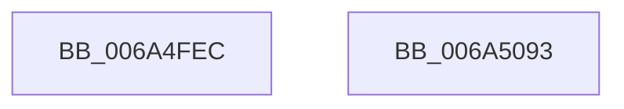

# SC_MBR::CreatePartitionTable

- RVA: `0x006A4FEC`–`0x006A5094` (길이 `168` bytes)
- VA: `0x00000001406A4FEC`
- 실행 섹션: `.text`
- PDB 이름 있음: `예`; PDB Function 태그: `아니요`
- unwind 정보 RVA: `0x000D9520`
- 디코드: `38`개 명령, `168/168` bytes 표시
- 미해석 바이트: `0` (있으면 어셈블리에 `.byte`로 보존)

> 이 문서는 커널 이미지의 기계어와 PDB 기호를 분석해 생성했습니다. 4번과 5번은 함수 원형과 자료형을 바이너리 사용 방식에서 추정한 C 해석이며 원본 소스 복구 결과는 아닙니다.

## 1. Dependencies

- 직접 호출 지점: **4**; 고유 호출 대상: **3**
- 직접 호출자로 확인된 함수: **1**
- RIP 상대 이미지 참조: **1**

### Outgoing calls
- `0x006A5023` → [memset](../6C/memset_function_006C6C40.md) (function, `0x006C6C40`)
- `0x006A503F` → [memset](../6C/memset_function_006C6C40.md) (function, `0x006C6C40`)
- `0x006A5069` → [SC_MBR::WritePartitionTable](SC_MBR_WritePartitionTable_function_006A5440.md) (function, `0x006A5440`)
- `0x006A5079` → [_security_check_cookie](_security_check_cookie_function_006AC640.md) (function, `0x006AC640`)

### Direct callers
- [SC_DISK::CreatePartitionTable](SC_DISK_CreatePartitionTable_function_006A43F8.md) at `0x006A4448`

### Static image references
- `0x006A4FFE` → RVA `0x00E0A740` (`.data`; read)

## 2. Other-region calls and transfers

- 다른 실행 섹션으로 향하는 call: **0**
- 별도 외부 분기/꼬리 이동을 확인하지 못했습니다.

## 3. Assembly (complete function range)

```asm
006A4FEC  48 89 5C 24 10                  mov qword ptr [rsp + 0x10], rbx
006A4FF1  48 89 74 24 18                  mov qword ptr [rsp + 0x18], rsi
006A4FF6  57                              push rdi
006A4FF7  48 81 EC F0 00 00 00            sub rsp, 0xf0
006A4FFE  48 8B 05 3B 57 76 00            mov rax, qword ptr [rip + 0x76573b]
006A5005  48 33 C4                        xor rax, rsp
006A5008  48 89 84 24 E0 00 00 00         mov qword ptr [rsp + 0xe0], rax
006A5010  48 8B FA                        mov rdi, rdx
006A5013  48 8B F1                        mov rsi, rcx
006A5016  33 D2                           xor edx, edx
006A5018  48 8D 4C 24 2C                  lea rcx, [rsp + 0x2c]
006A501D  41 B8 B4 00 00 00               mov r8d, 0xb4
006A5023  E8 18 1C 02 00                  call 0x1406c6c40
006A5028  48 8B 06                        mov rax, qword ptr [rsi]
006A502B  33 D2                           xor edx, edx
006A502D  48 8B 98 08 01 00 00            mov rbx, qword ptr [rax + 0x108]
006A5034  44 8D 42 40                     lea r8d, [rdx + 0x40]
006A5038  48 8D 8B BE 01 00 00            lea rcx, [rbx + 0x1be]
006A503F  E8 FC 1B 02 00                  call 0x1406c6c40
006A5044  33 C9                           xor ecx, ecx
006A5046  66 C7 83 FE 01 00 00 55 AA      mov word ptr [rbx + 0x1fe], 0xaa55
006A504F  89 8B B8 01 00 00               mov dword ptr [rbx + 0x1b8], ecx
006A5055  48 8D 54 24 20                  lea rdx, [rsp + 0x20]
006A505A  8B 47 04                        mov eax, dword ptr [rdi + 4]
006A505D  48 89 4C 24 20                  mov qword ptr [rsp + 0x20], rcx
006A5062  48 8B CE                        mov rcx, rsi
006A5065  89 44 24 28                     mov dword ptr [rsp + 0x28], eax
006A5069  E8 D2 03 00 00                  call 0x1406a5440
006A506E  48 8B 8C 24 E0 00 00 00         mov rcx, qword ptr [rsp + 0xe0]
006A5076  48 33 CC                        xor rcx, rsp
006A5079  E8 C2 75 00 00                  call 0x1406ac640
006A507E  4C 8D 9C 24 F0 00 00 00         lea r11, [rsp + 0xf0]
006A5086  49 8B 5B 18                     mov rbx, qword ptr [r11 + 0x18]
006A508A  49 8B 73 20                     mov rsi, qword ptr [r11 + 0x20]
006A508E  49 8B E3                        mov rsp, r11
006A5091  5F                              pop rdi
006A5092  C3                              ret
006A5093  CC                              int3
```

## 4. C-style interpretation (structured pseudocode)

```c
__int64 __fastcall SC_MBR__CreatePartitionTable(__int64 a1, __int64 a2)
{
    __int64 result;
    __int64 v_rsp;
    unsigned __int64 v_stack_m18;
    unsigned __int64 v_stack_m8;
    unsigned __int64 v_stack_mCC;
    unsigned int v_stack_mD0;
    unsigned __int64 v_stack_mD8;
    unsigned __int64 v_stack_p10;
    unsigned __int64 v_stack_p18;

    v_stack_p10 = v_rbx;
    v_stack_p18 = v_rsi;
    v_rsp = (v_rsp) - (240);
    result = (*(unsigned __int64 *)(v_rip + 7755579)) ^ (v_rsp);
    v_stack_m18 = result;
    a2 = 0;
    result = memset(v_stack_mCC, a2, 180, a4);
    a2 = 0;
    result = memset(*(unsigned __int64 *)(*(unsigned __int64 *)(a1) + 264) + 446, a2, a2 + 64, a4);
    a1 = 0;
    *(unsigned __int16 *)(*(unsigned __int64 *)(*(unsigned __int64 *)(a1) + 264) + 510) = 0xAA55ULL;
    *(unsigned int *)(*(unsigned __int64 *)(*(unsigned __int64 *)(a1) + 264) + 440) = 0;
    v_stack_mD8 = 0;
    v_stack_mD0 = (unsigned int)((unsigned int)(*(unsigned int *)(a2 + 4)));
    result = SC_MBR__WritePartitionTable(0, v_stack_mD8, a2 + 64, a4);
    a1 = (v_stack_m18) ^ (v_rsp);
    result = _security_check_cookie(a1, v_stack_mD8, a2 + 64, a4);
    return result;
}
```

## 5. (Beta) C Style

```c
int64_t SC_MBR__CreatePartitionTable(void *Arg1, void *Arg2)
{
    uint8_t *arg1 = (uint8_t *)Arg1;
    uint8_t *arg2 = (uint8_t *)Arg2;

    int64_t result;
    int64_t local_rsp;
    uint64_t v_stack_m18;
    uint64_t v_stack_m8;
    uint64_t v_stack_mCC;
    uint32_t v_stack_mD0;
    uint64_t v_stack_mD8;
    uint64_t v_stack_p10;
    uint64_t v_stack_p18;

    v_stack_p10 = local_rbx;
    v_stack_p18 = local_rsi;
    local_rsp = (local_rsp) - (240);
    result = (*(uint64_t *)(v_rip + 0x76573B)) ^ (local_rsp);
    v_stack_m18 = result;
    Arg2 = 0;
    result = memset(v_stack_mCC, Arg2, 180, a4);
    Arg2 = 0;
    result = memset(*(uint64_t *)(*(uint64_t *)(arg1) + 0x108) + 446, Arg2, Arg2 + 64, a4);
    Arg1 = 0;
    *(uint16_t *)(*(uint64_t *)(*(uint64_t *)(arg1) + 0x108) + 0x1FE) = 0xAA55ULL;
    *(uint32_t *)(*(uint64_t *)(*(uint64_t *)(arg1) + 0x108) + 0x1B8) = 0;
    v_stack_mD8 = 0;
    v_stack_mD0 = (uint32_t)((uint32_t)(*(uint32_t *)(arg2 + 0x4)));
    result = SC_MBR__WritePartitionTable(0, v_stack_mD8, Arg2 + 64, a4);
    Arg1 = (v_stack_m18) ^ (local_rsp);
    result = _security_check_cookie(Arg1, v_stack_mD8, Arg2 + 64, a4);
    return result;
}
```

### 관측된 메모리 오프셋

구조체 형식이 확인되지 않은 접근은 인자 기준의 오프셋으로만 기록했습니다.

| 기준 인자 | 오프셋 표현 | 폭 (bit) | 접근 |
|---|---:|---:|---|
| `Arg1` | `+ 0x0` | `64` | `R` |
| `Arg2` | `+ 0x4` | `32` | `R` |

## 6. Execution-region graph

[열기: 2D/3D 그래프와 함수 탐색 컨트롤 패널](../../../control-panel.html?section=text&rva=0x006A4FEC&view=graph)

- 2D 그래프는 위에서 아래로 흐르고, 3D 그래프는 빈 공간을 드래그해 회전합니다. Shift+드래그는 이동, 휠은 확대·축소, 함수 노드 선택은 대상 보고서 이동입니다.

### Static fallback


