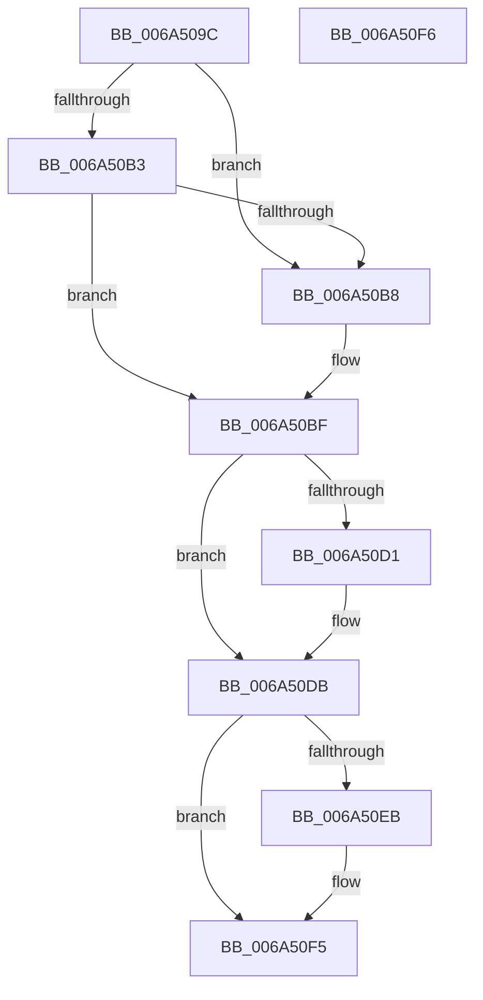

# SC_MBR::Initialize

- RVA: `0x006A509C`–`0x006A50F7` (길이 `91` bytes)
- VA: `0x00000001406A509C`
- 실행 섹션: `.text`
- PDB 이름 있음: `예`; PDB Function 태그: `아니요`
- unwind 정보 RVA: `0x000DB714`
- 디코드: `23`개 명령, `91/91` bytes 표시
- 미해석 바이트: `0` (있으면 어셈블리에 `.byte`로 보존)

> 이 문서는 커널 이미지의 기계어와 PDB 기호를 분석해 생성했습니다. 4번과 5번은 함수 원형과 자료형을 바이너리 사용 방식에서 추정한 C 해석이며 원본 소스 복구 결과는 아닙니다.

## 1. Dependencies

- 직접 호출 지점: **0**; 고유 호출 대상: **0**
- 직접 호출자로 확인된 함수: **3**
- RIP 상대 이미지 참조: **0**

### Outgoing calls
- 직접 디코드된 call 명령이 없습니다.

### Direct callers
- [SC_DISK::CreatePartitionTable](SC_DISK_CreatePartitionTable_function_006A43F8.md) at `0x006A443B`
- [SC_DISK::ReadPartitionTable](SC_DISK_ReadPartitionTable_function_006A499C.md) at `0x006A4A07`
- [SC_DISK::WritePartitionTable](SC_DISK_WritePartitionTable_function_006A4D4C.md) at `0x006A4E04`

### Static image references
- 디코드된 RIP-relative 메모리 참조가 없습니다.

## 2. Other-region calls and transfers

- 다른 실행 섹션으로 향하는 call: **0**
- 별도 외부 분기/꼬리 이동을 확인하지 못했습니다.

## 3. Assembly (complete function range)

```asm
006A509C  48 89 11                        mov qword ptr [rcx], rdx
006A509F  4C 8B C1                        mov r8, rcx
006A50A2  48 8B 82 D8 00 00 00            mov rax, qword ptr [rdx + 0xd8]
006A50A9  B9 00 04 00 00                  mov ecx, 0x400
006A50AE  48 85 C0                        test rax, rax
006A50B1  74 05                           je 0x1406a50b8
006A50B3  48 3B C1                        cmp rax, rcx
006A50B6  7E 07                           jle 0x1406a50bf
006A50B8  48 89 8A D8 00 00 00            mov qword ptr [rdx + 0xd8], rcx
006A50BF  49 8B 08                        mov rcx, qword ptr [r8]
006A50C2  8B 81 E4 00 00 00               mov eax, dword ptr [rcx + 0xe4]
006A50C8  FF C8                           dec eax
006A50CA  3D FE 00 00 00                  cmp eax, 0xfe
006A50CF  76 0A                           jbe 0x1406a50db
006A50D1  C7 81 E4 00 00 00 FF 00 00 00   mov dword ptr [rcx + 0xe4], 0xff
006A50DB  49 8B 08                        mov rcx, qword ptr [r8]
006A50DE  8B 81 E8 00 00 00               mov eax, dword ptr [rcx + 0xe8]
006A50E4  FF C8                           dec eax
006A50E6  83 F8 3E                        cmp eax, 0x3e
006A50E9  76 0A                           jbe 0x1406a50f5
006A50EB  C7 81 E8 00 00 00 3F 00 00 00   mov dword ptr [rcx + 0xe8], 0x3f
006A50F5  C3                              ret
006A50F6  CC                              int3
```

## 4. C-style interpretation (structured pseudocode)

```c
__int64 __fastcall SC_MBR__Initialize(__int64 a1, __int64 a2)
{
    __int64 result;

    *(unsigned __int64 *)(a1) = a2;
    if (*(unsigned __int64 *)(a2 + 216) == 0) goto loc_006A50B8;
    if ((*(unsigned __int64 *)(a2 + 216)) >= = ((unsigned int)(0x400ULL))) {
        *(unsigned __int64 *)(a2 + 216) = (unsigned int)(0x400ULL);
    }
    result = (unsigned int)(((unsigned int)(*(unsigned int *)(*(unsigned __int64 *)(a1) + 228))) - 1);
    if (((unsigned int)(result)) >= = 254) {
        *(unsigned int *)(*(unsigned __int64 *)(a1) + 228) = 255;
    }
    result = (unsigned int)(((unsigned int)(*(unsigned int *)(*(unsigned __int64 *)(a1) + 232))) - 1);
    if (((unsigned int)(result)) >= = 62) {
        *(unsigned int *)(*(unsigned __int64 *)(a1) + 232) = 63;
    }
    return result;
}
```

## 5. (Beta) C Style

```c
int64_t SC_MBR__Initialize(void *Arg1, void *Arg2)
{
    uint8_t *arg1 = (uint8_t *)Arg1;
    uint8_t *arg2 = (uint8_t *)Arg2;

    int64_t result;

    *(void **)(arg1) = Arg2;
    if (*(uint64_t *)(arg2 + 0xD8) == 0) goto loc_006A50B8;
    if ((*(uint64_t *)(arg2 + 0xD8)) >= = ((uint32_t)(0x400ULL))) {
        *(uint64_t *)(arg2 + 0xD8) = (uint32_t)(0x400ULL);
    }
    result = (uint32_t)(((uint32_t)(*(uint32_t *)(*(uint64_t *)(arg1) + 0xE4))) - 1);
    if (((uint32_t)(result)) >= = 254) {
        *(uint32_t *)(*(uint64_t *)(arg1) + 0xE4) = 255;
    }
    result = (uint32_t)(((uint32_t)(*(uint32_t *)(*(uint64_t *)(arg1) + 0xE8))) - 1);
    if (((uint32_t)(result)) >= = 62) {
        *(uint32_t *)(*(uint64_t *)(arg1) + 0xE8) = 63;
    }
    return result;
}
```

### 관측된 메모리 오프셋

구조체 형식이 확인되지 않은 접근은 인자 기준의 오프셋으로만 기록했습니다.

| 기준 인자 | 오프셋 표현 | 폭 (bit) | 접근 |
|---|---:|---:|---|
| `Arg1` | `+ 0x0` | `64` | `R` |
| `Arg1` | `+ 0x0` | `64` | `W` |
| `Arg2` | `+ 0xD8` | `64` | `R` |
| `Arg2` | `+ 0xD8` | `64` | `W` |

## 6. Execution-region graph

[열기: 2D/3D 그래프와 함수 탐색 컨트롤 패널](../../../control-panel.html?section=text&rva=0x006A509C&view=graph)

- 2D 그래프는 위에서 아래로 흐르고, 3D 그래프는 빈 공간을 드래그해 회전합니다. Shift+드래그는 이동, 휠은 확대·축소, 함수 노드 선택은 대상 보고서 이동입니다.

### Static fallback


