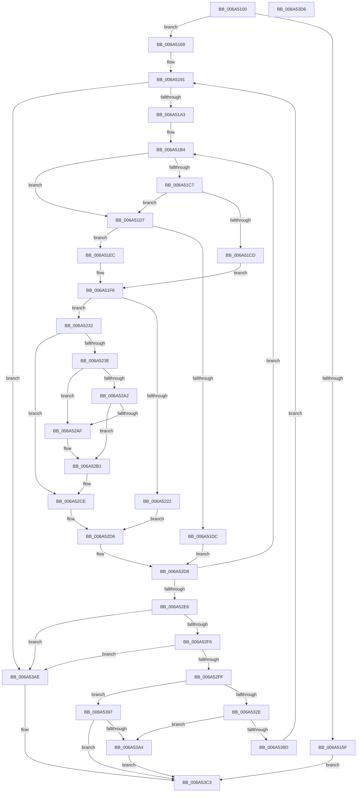

# SC_MBR::ReadPartitionTable

- RVA: `0x006A5100`–`0x006A53D7` (길이 `727` bytes)
- VA: `0x00000001406A5100`
- 실행 섹션: `.text`
- PDB 이름 있음: `예`; PDB Function 태그: `아니요`
- unwind 정보 RVA: `0x000BD668`
- 디코드: `194`개 명령, `727/727` bytes 표시
- 미해석 바이트: `0` (있으면 어셈블리에 `.byte`로 보존)

> 이 문서는 커널 이미지의 기계어와 PDB 기호를 분석해 생성했습니다. 4번과 5번은 함수 원형과 자료형을 바이너리 사용 방식에서 추정한 C 해석이며 원본 소스 복구 결과는 아닙니다.

## 1. Dependencies

- 직접 호출 지점: **10**; 고유 호출 대상: **7**
- 직접 호출자로 확인된 함수: **1**
- RIP 상대 이미지 참조: **0**

### Outgoing calls
- `0x006A5152` → [SC_ENV::Allocate](../../page/71/SC_ENV_Allocate_function_00716F90.md) (function, `0x00716F90`)
- `0x006A5175` → [memset](../6C/memset_function_006C6C40.md) (function, `0x006C6C40`)
- `0x006A5189` → [MBR_HEADER::CheckSum](MBR_HEADER_CheckSum_function_006A4EC4.md) (function, `0x006A4EC4`)
- `0x006A5216` → [MBR_ENTRY::Validate](MBR_ENTRY_Validate_function_006A53E0.md) (function, `0x006A53E0`)
- `0x006A5321` → [SC_ENV::Allocate](../../page/71/SC_ENV_Allocate_function_00716F90.md) (function, `0x00716F90`)
- `0x006A533A` → [memcpy](../6C/memcpy_function_006C6840.md) (function, `0x006C6840`)
- `0x006A5359` → [memset](../6C/memset_function_006C6C40.md) (function, `0x006C6C40`)
- `0x006A5361` → [AlpcpFreeBuffer](../../page/90/AlpcpFreeBuffer_function_009071C0.md) (function, `0x009071C0`)
- `0x006A537E` → [SC_DISK::ReadSectors](SC_DISK_ReadSectors_function_006A4A2C.md) (function, `0x006A4A2C`)
- `0x006A53A7` → [AlpcpFreeBuffer](../../page/90/AlpcpFreeBuffer_function_009071C0.md) (function, `0x009071C0`)

### Direct callers
- [SC_DISK::ReadPartitionTable](SC_DISK_ReadPartitionTable_function_006A499C.md) at `0x006A4A14`

### Static image references
- 디코드된 RIP-relative 메모리 참조가 없습니다.

## 2. Other-region calls and transfers

- 다른 실행 섹션으로 향하는 call: **4**
  - `0x006A5152` → [SC_ENV::Allocate](../../page/71/SC_ENV_Allocate_function_00716F90.md) (`.text` → `PAGE`)
  - `0x006A5321` → [SC_ENV::Allocate](../../page/71/SC_ENV_Allocate_function_00716F90.md) (`.text` → `PAGE`)
  - `0x006A5361` → [AlpcpFreeBuffer](../../page/90/AlpcpFreeBuffer_function_009071C0.md) (`.text` → `PAGE`)
  - `0x006A53A7` → [AlpcpFreeBuffer](../../page/90/AlpcpFreeBuffer_function_009071C0.md) (`.text` → `PAGE`)
- 별도 외부 분기/꼬리 이동을 확인하지 못했습니다.

## 3. Assembly (complete function range)

```asm
006A5100  48 89 54 24 10                  mov qword ptr [rsp + 0x10], rdx
006A5105  48 89 4C 24 08                  mov qword ptr [rsp + 8], rcx
006A510A  53                              push rbx
006A510B  55                              push rbp
006A510C  56                              push rsi
006A510D  57                              push rdi
006A510E  41 54                           push r12
006A5110  41 55                           push r13
006A5112  41 56                           push r14
006A5114  41 57                           push r15
006A5116  48 83 EC 48                     sub rsp, 0x48
006A511A  48 8B 01                        mov rax, qword ptr [rcx]
006A511D  45 33 F6                        xor r14d, r14d
006A5120  45 33 C9                        xor r9d, r9d
006A5123  44 88 B4 24 A0 00 00 00         mov byte ptr [rsp + 0xa0], r14b
006A512B  B9 70 02 00 00                  mov ecx, 0x270
006A5130  44 89 74 24 24                  mov dword ptr [rsp + 0x24], r14d
006A5135  45 8B EE                        mov r13d, r14d
006A5138  44 89 74 24 20                  mov dword ptr [rsp + 0x20], r14d
006A513D  48 8B B0 08 01 00 00            mov rsi, qword ptr [rax + 0x108]
006A5144  45 8B FE                        mov r15d, r14d
006A5147  48 89 74 24 30                  mov qword ptr [rsp + 0x30], rsi
006A514C  41 8B FE                        mov edi, r14d
006A514F  4C 89 32                        mov qword ptr [rdx], r14
006A5152  E8 39 1E 07 00                  call 0x140716f90
006A5157  48 8B D8                        mov rbx, rax
006A515A  48 85 C0                        test rax, rax
006A515D  75 0A                           jne 0x1406a5169
006A515F  BF 9A 00 00 C0                  mov edi, 0xc000009a
006A5164  E9 5A 02 00 00                  jmp 0x1406a53c3
006A5169  48 8D 48 04                     lea rcx, [rax + 4]
006A516D  33 D2                           xor edx, edx
006A516F  41 B8 6C 02 00 00               mov r8d, 0x26c
006A5175  E8 C6 1A 02 00                  call 0x1406c6c40
006A517A  44 89 33                        mov dword ptr [rbx], r14d
006A517D  48 8B CE                        mov rcx, rsi
006A5180  8B 86 B8 01 00 00               mov eax, dword ptr [rsi + 0x1b8]
006A5186  89 43 08                        mov dword ptr [rbx + 8], eax
006A5189  E8 36 FD FF FF                  call 0x1406a4ec4
006A518E  89 43 0C                        mov dword ptr [rbx + 0xc], eax
006A5191  B8 55 AA 00 00                  mov eax, 0xaa55
006A5196  66 39 86 FE 01 00 00            cmp word ptr [rsi + 0x1fe], ax
006A519D  0F 85 0B 02 00 00               jne 0x1406a53ae
006A51A3  49 8B EE                        mov rbp, r14
006A51A6  BF 04 00 00 00                  mov edi, 4
006A51AB  4C 8D B6 C2 01 00 00            lea r14, [rsi + 0x1c2]
006A51B2  33 C9                           xor ecx, ecx
006A51B4  45 8A 26                        mov r12b, byte ptr [r14]
006A51B7  41 8B C7                        mov eax, r15d
006A51BA  48 8D 34 C0                     lea rsi, [rax + rax*8]
006A51BE  48 03 F6                        add rsi, rsi
006A51C1  41 80 FC 05                     cmp r12b, 5
006A51C5  74 10                           je 0x1406a51d7
006A51C7  41 80 FC 0F                     cmp r12b, 0xf
006A51CB  74 0A                           je 0x1406a51d7
006A51CD  8B 44 24 20                     mov eax, dword ptr [rsp + 0x20]
006A51D1  49 8D 4E FC                     lea rcx, [r14 - 4]
006A51D5  EB 1F                           jmp 0x1406a51f6
006A51D7  48 85 ED                        test rbp, rbp
006A51DA  74 10                           je 0x1406a51ec
006A51DC  41 B4 01                        mov r12b, 1
006A51DF  44 88 A4 24 A0 00 00 00         mov byte ptr [rsp + 0xa0], r12b
006A51E7  E9 EC 00 00 00                  jmp 0x1406a52d8
006A51EC  49 8D 6E FC                     lea rbp, [r14 - 4]
006A51F0  41 8B C5                        mov eax, r13d
006A51F3  48 8B CD                        mov rcx, rbp
006A51F6  48 8B 94 24 90 00 00 00         mov rdx, qword ptr [rsp + 0x90]
006A51FE  48 89 4C 24 28                  mov qword ptr [rsp + 0x28], rcx
006A5203  89 84 24 A8 00 00 00            mov dword ptr [rsp + 0xa8], eax
006A520A  4C 8B 02                        mov r8, qword ptr [rdx]
006A520D  8B D0                           mov edx, eax
006A520F  4D 8B 80 F8 00 00 00            mov r8, qword ptr [r8 + 0xf8]
006A5216  E8 C5 01 00 00                  call 0x1406a53e0
006A521B  45 33 C9                        xor r9d, r9d
006A521E  84 C0                           test al, al
006A5220  75 10                           jne 0x1406a5232
006A5222  41 B4 01                        mov r12b, 1
006A5225  44 88 A4 24 A0 00 00 00         mov byte ptr [rsp + 0xa0], r12b
006A522D  E9 A4 00 00 00                  jmp 0x1406a52d6
006A5232  41 FF C7                        inc r15d
006A5235  45 84 E4                        test r12b, r12b
006A5238  0F 84 90 00 00 00               je 0x1406a52ce
006A523E  4C 8B 84 24 90 00 00 00         mov r8, qword ptr [rsp + 0x90]
006A5246  8B 84 24 A8 00 00 00            mov eax, dword ptr [rsp + 0xa8]
006A524D  44 89 4C F3 30                  mov dword ptr [rbx + rsi*8 + 0x30], r9d
006A5252  41 8B 56 04                     mov edx, dword ptr [r14 + 4]
006A5256  49 8B 08                        mov rcx, qword ptr [r8]
006A5259  48 03 D0                        add rdx, rax
006A525C  8B 89 F0 00 00 00               mov ecx, dword ptr [rcx + 0xf0]
006A5262  48 D3 E2                        shl rdx, cl
006A5265  48 89 54 F3 38                  mov qword ptr [rbx + rsi*8 + 0x38], rdx
006A526A  49 8B 08                        mov rcx, qword ptr [r8]
006A526D  41 8B 46 08                     mov eax, dword ptr [r14 + 8]
006A5271  8B 89 F0 00 00 00               mov ecx, dword ptr [rcx + 0xf0]
006A5277  48 D3 E0                        shl rax, cl
006A527A  48 89 44 F3 40                  mov qword ptr [rbx + rsi*8 + 0x40], rax
006A527F  44 89 4C F3 48                  mov dword ptr [rbx + rsi*8 + 0x48], r9d
006A5284  41 8A 06                        mov al, byte ptr [r14]
006A5287  88 44 F3 50                     mov byte ptr [rbx + rsi*8 + 0x50], al
006A528B  48 8B 44 24 28                  mov rax, qword ptr [rsp + 0x28]
006A5290  80 38 80                        cmp byte ptr [rax], 0x80
006A5293  0F 94 C0                        sete al
006A5296  88 44 F3 51                     mov byte ptr [rbx + rsi*8 + 0x51], al
006A529A  41 0F B6 06                     movzx eax, byte ptr [r14]
006A529E  3C 0F                           cmp al, 0xf
006A52A0  77 0D                           ja 0x1406a52af
006A52A2  B9 21 80 00 00                  mov ecx, 0x8021
006A52A7  0F A3 C1                        bt ecx, eax
006A52AA  41 8A C1                        mov al, r9b
006A52AD  72 02                           jb 0x1406a52b1
006A52AF  B0 01                           mov al, 1
006A52B1  88 44 F3 52                     mov byte ptr [rbx + rsi*8 + 0x52], al
006A52B5  41 8B 46 04                     mov eax, dword ptr [r14 + 4]
006A52B9  89 44 F3 54                     mov dword ptr [rbx + rsi*8 + 0x54], eax
006A52BD  8B 43 08                        mov eax, dword ptr [rbx + 8]
006A52C0  89 44 F3 58                     mov dword ptr [rbx + rsi*8 + 0x58], eax
006A52C4  44 89 4C F3 5C                  mov dword ptr [rbx + rsi*8 + 0x5c], r9d
006A52C9  48 89 54 F3 60                  mov qword ptr [rbx + rsi*8 + 0x60], rdx
006A52CE  44 8A A4 24 A0 00 00 00         mov r12b, byte ptr [rsp + 0xa0]
006A52D6  33 C9                           xor ecx, ecx
006A52D8  49 83 C6 10                     add r14, 0x10
006A52DC  48 83 EF 01                     sub rdi, 1
006A52E0  0F 85 CE FE FF FF               jne 0x1406a51b4
006A52E6  8B 7C 24 24                     mov edi, dword ptr [rsp + 0x24]
006A52EA  45 33 F6                        xor r14d, r14d
006A52ED  45 84 E4                        test r12b, r12b
006A52F0  0F 85 B8 00 00 00               jne 0x1406a53ae
006A52F6  48 85 ED                        test rbp, rbp
006A52F9  0F 84 AF 00 00 00               je 0x1406a53ae
006A52FF  8B 45 08                        mov eax, dword ptr [rbp + 8]
006A5302  43 8D 3C FF                     lea edi, [r15 + r15*8]
006A5306  45 85 ED                        test r13d, r13d
006A5309  42 8D 2C 28                     lea ebp, [rax + r13]
006A530D  44 0F 44 E8                     cmove r13d, eax
006A5311  C1 E7 04                        shl edi, 4
006A5314  45 33 C9                        xor r9d, r9d
006A5317  89 6C 24 20                     mov dword ptr [rsp + 0x20], ebp
006A531B  8D 8F 70 02 00 00               lea ecx, [rdi + 0x270]
006A5321  E8 6A 1C 07 00                  call 0x140716f90
006A5326  48 8B F0                        mov rsi, rax
006A5329  48 85 C0                        test rax, rax
006A532C  74 69                           je 0x1406a5397
006A532E  8D 57 30                        lea edx, [rdi + 0x30]
006A5331  48 8B C8                        mov rcx, rax
006A5334  4C 63 C2                        movsxd r8, edx
006A5337  48 8B D3                        mov rdx, rbx
006A533A  E8 01 15 02 00                  call 0x1406c6840
006A533F  41 8B D7                        mov edx, r15d
006A5342  41 B8 40 02 00 00               mov r8d, 0x240
006A5348  48 8D 0C D2                     lea rcx, [rdx + rdx*8]
006A534C  33 D2                           xor edx, edx
006A534E  48 C1 E1 04                     shl rcx, 4
006A5352  48 83 C1 30                     add rcx, 0x30
006A5356  48 03 CE                        add rcx, rsi
006A5359  E8 E2 18 02 00                  call 0x1406c6c40
006A535E  48 8B CB                        mov rcx, rbx
006A5361  E8 5A 1E 26 00                  call 0x1409071c0
006A5366  48 8B 84 24 90 00 00 00         mov rax, qword ptr [rsp + 0x90]
006A536E  41 8D 56 01                     lea edx, [r14 + 1]
006A5372  44 8B C5                        mov r8d, ebp
006A5375  45 33 C9                        xor r9d, r9d
006A5378  48 8B DE                        mov rbx, rsi
006A537B  48 8B 08                        mov rcx, qword ptr [rax]
006A537E  E8 A9 F6 FF FF                  call 0x1406a4a2c
006A5383  89 44 24 24                     mov dword ptr [rsp + 0x24], eax
006A5387  8B F8                           mov edi, eax
006A5389  85 C0                           test eax, eax
006A538B  78 17                           js 0x1406a53a4
006A538D  48 8B 74 24 30                  mov rsi, qword ptr [rsp + 0x30]
006A5392  E9 FA FD FF FF                  jmp 0x1406a5191
006A5397  48 8B C3                        mov rax, rbx
006A539A  BF 9A 00 00 C0                  mov edi, 0xc000009a
006A539F  48 85 C0                        test rax, rax
006A53A2  74 1F                           je 0x1406a53c3
006A53A4  48 8B CB                        mov rcx, rbx
006A53A7  E8 14 1E 26 00                  call 0x1409071c0
006A53AC  EB 15                           jmp 0x1406a53c3
006A53AE  41 8D 47 03                     lea eax, [r15 + 3]
006A53B2  83 E0 FC                        and eax, 0xfffffffc
006A53B5  89 43 04                        mov dword ptr [rbx + 4], eax
006A53B8  48 8B 84 24 98 00 00 00         mov rax, qword ptr [rsp + 0x98]
006A53C0  48 89 18                        mov qword ptr [rax], rbx
006A53C3  8B C7                           mov eax, edi
006A53C5  48 83 C4 48                     add rsp, 0x48
006A53C9  41 5F                           pop r15
006A53CB  41 5E                           pop r14
006A53CD  41 5D                           pop r13
006A53CF  41 5C                           pop r12
006A53D1  5F                              pop rdi
006A53D2  5E                              pop rsi
006A53D3  5D                              pop rbp
006A53D4  5B                              pop rbx
006A53D5  C3                              ret
006A53D6  CC                              int3
```

## 4. C-style interpretation (structured pseudocode)

```c
__int64 __fastcall SC_MBR__ReadPartitionTable(__int64 a1, __int64 a2, __int64 a3, int a4)
{
    __int64 result;
    __int64 v_r13;
    __int64 v_r14;
    __int64 v_r15;
    __int64 v_rdi;
    __int64 v_rsi;
    __int64 v_rsp;
    unsigned __int64 v_stack_m58;
    unsigned __int64 v_stack_m60;
    unsigned int v_stack_m64;
    unsigned int v_stack_m68;
    unsigned __int64 v_stack_p10;
    unsigned __int8 v_stack_p18;
    unsigned int v_stack_p20;
    unsigned __int64 v_stack_p8;

    v_stack_p10 = a2;
    v_stack_p8 = a1;
    v_rsp = (v_rsp) - (72);
    v_r14 = 0;
    a4 = 0;
    v_stack_p18 = 0;
    v_stack_m64 = 0;
    v_stack_m68 = 0;
    v_stack_m58 = *(unsigned __int64 *)(*(unsigned __int64 *)(a1) + 264);
    *(unsigned __int64 *)(a2) = 0;
    result = SC_ENV__Allocate(624, a2, a3, a4);
    if (result != 0) goto loc_006A5169;
    goto loc_006A53C3;
loc_006A5169:
    a2 = 0;
    result = memset(result + 4, a2, 620, a4);
    *(unsigned int *)(result) = 0;
    *(unsigned int *)(result + 8) = (unsigned int)((unsigned int)(*(unsigned int *)(*(unsigned __int64 *)(*(unsigned __int64 *)(a1) + 264) + 440)));
    result = MBR_HEADER__CheckSum(*(unsigned __int64 *)(*(unsigned __int64 *)(a1) + 264), a2, 620, a4);
    *(unsigned int *)(result + 12) = (unsigned int)(result);
loc_006A5191:
    if ((*(unsigned __int16 *)(*(unsigned __int64 *)(*(unsigned __int64 *)(a1) + 264) + 510)) != ((unsigned __int16)((unsigned int)(0xAA55ULL)))) goto loc_006A53AE;
    a1 = 0;
loc_006A51B4:
    v_rsi = (0 + 0 * 8) + (0 + 0 * 8);
    if (((unsigned __int8)(*(unsigned __int8 *)(*(unsigned __int64 *)(*(unsigned __int64 *)(a1) + 264) + 450))) == 5) goto loc_006A51D7;
    if (((unsigned __int8)(*(unsigned __int8 *)(*(unsigned __int64 *)(*(unsigned __int64 *)(a1) + 264) + 450))) == 15) goto loc_006A51D7;
    goto loc_006A51F6;
loc_006A51D7:
    if (0 == 0) goto loc_006A51EC;
    v_stack_p18 = 1;
    goto loc_006A52D8;
loc_006A51EC:
loc_006A51F6:
    v_stack_m60 = *(unsigned __int64 *)(*(unsigned __int64 *)(a1) + 264) + 450 - 4;
    v_stack_p20 = 0;
    result = MBR_ENTRY__Validate(*(unsigned __int64 *)(*(unsigned __int64 *)(a1) + 264) + 450 - 4, 0, *(unsigned __int64 *)(*(unsigned __int64 *)(v_stack_p8) + 248), a4);
    a4 = 0;
    if ((unsigned __int8)(result) != 0) goto loc_006A5232;
    v_stack_p18 = 1;
    goto loc_006A52D6;
loc_006A5232:
    v_r15 = (unsigned int)((0) + 1);
    if (1 == 0) goto loc_006A52CE;
    *(unsigned int *)(result + v_rsi * 8 + 48) = 0;
    a2 = ((unsigned int)(*(unsigned int *)(*(unsigned __int64 *)(*(unsigned __int64 *)(a1) + 264) + 450 + 4))) + ((unsigned int)(v_stack_p20));
    a2 = (a2) << ((unsigned __int8)((unsigned int)(*(unsigned int *)(*(unsigned __int64 *)(v_stack_p8) + 240))));
    *(unsigned __int64 *)(result + v_rsi * 8 + 56) = a2;
    result = ((unsigned int)(*(unsigned int *)(*(unsigned __int64 *)(*(unsigned __int64 *)(a1) + 264) + 450 + 8))) << ((unsigned __int8)((unsigned int)(*(unsigned int *)(*(unsigned __int64 *)(v_stack_p8) + 240))));
    *(unsigned __int64 *)(result + v_rsi * 8 + 64) = result;
    *(unsigned int *)(result + v_rsi * 8 + 72) = 0;
    *(unsigned __int8 *)(result + v_rsi * 8 + 80) = (unsigned __int8)(*(unsigned __int8 *)(*(unsigned __int64 *)(*(unsigned __int64 *)(a1) + 264) + 450));
    result = ((*(unsigned __int8 *)(v_stack_m60)) == 128) ? 1 : 0;
    *(unsigned __int8 *)(result + v_rsi * 8 + 81) = (unsigned __int8)(result);
    if (((unsigned __int8)(*(unsigned __int8 *)(*(unsigned __int64 *)(*(unsigned __int64 *)(a1) + 264) + 450))) > 15) goto loc_006A52AF;
    result = 0;
    if (((unsigned __int8)(*(unsigned __int8 *)(*(unsigned __int64 *)(*(unsigned __int64 *)(a1) + 264) + 450))) >= 15) {
        result = 1;
    }
    *(unsigned __int8 *)(result + v_rsi * 8 + 82) = (unsigned __int8)(result);
    *(unsigned int *)(result + v_rsi * 8 + 84) = (unsigned int)((unsigned int)(*(unsigned int *)(*(unsigned __int64 *)(*(unsigned __int64 *)(a1) + 264) + 450 + 4)));
    *(unsigned int *)(result + v_rsi * 8 + 88) = (unsigned int)((unsigned int)(*(unsigned int *)(result + 8)));
    *(unsigned int *)(result + v_rsi * 8 + 92) = 0;
    *(unsigned __int64 *)(result + v_rsi * 8 + 96) = a2;
loc_006A52CE:
loc_006A52D6:
    a1 = 0;
loc_006A52D8:
    v_r14 = (*(unsigned __int64 *)(*(unsigned __int64 *)(a1) + 264) + 450) + (16);
    v_rdi = (4) - (1);
    if (condition_is_not_equal) goto loc_006A51B4;
    v_r14 = 0;
    if ((unsigned __int8)(v_stack_p18) != 0) goto loc_006A53AE;
    if (*(unsigned __int64 *)(*(unsigned __int64 *)(a1) + 264) + 450 - 4 == 0) goto loc_006A53AE;
    v_r13 = 0;
    if (0 == 0) { v_r13 = (unsigned int)((unsigned int)(*(unsigned int *)(*(unsigned __int64 *)(*(unsigned __int64 *)(a1) + 264) + 450 - 4 + 8))); }
    v_rdi = (unsigned int)((v_r15 + v_r15 * 8) << (4));
    a4 = 0;
    v_stack_m68 = (unsigned int)((unsigned int)(*(unsigned int *)(*(unsigned __int64 *)(*(unsigned __int64 *)(a1) + 264) + 450 - 4 + 8)) + 0 * 1);
    result = SC_ENV__Allocate(v_rdi + 624, a2, v_stack_p8, a4);
    if (result == 0) goto loc_006A5397;
    result = memcpy(result, result, (int)((unsigned int)(v_rdi + 48)), a4);
    a2 = 0;
    a1 = ((unsigned int)((unsigned int)(v_r15)) + (unsigned int)((unsigned int)(v_r15)) * 8) << (4);
    a1 = (a1) + (48);
    a1 = (a1) + (result);
    result = memset(a1, a2, 576, a4);
    result = AlpcpFreeBuffer(result, a2, 576, a4);
    a4 = 0;
    result = SC_DISK__ReadSectors(*(unsigned __int64 *)(v_stack_p8), v_r14 + 1, (unsigned int)((unsigned int)((unsigned int)(*(unsigned int *)(*(unsigned __int64 *)(*(unsigned __int64 *)(a1) + 264) + 450 - 4 + 8)) + 0 * 1)), a4);
    v_stack_m64 = (unsigned int)(result);
    if (sign_flag) goto loc_006A53A4;
    goto loc_006A5191;
loc_006A5397:
    if (result == 0) goto loc_006A53C3;
loc_006A53A4:
    result = AlpcpFreeBuffer(result, v_r14 + 1, (unsigned int)((unsigned int)((unsigned int)(*(unsigned int *)(*(unsigned __int64 *)(*(unsigned __int64 *)(a1) + 264) + 450 - 4 + 8)) + 0 * 1)), a4);
    goto loc_006A53C3;
loc_006A53AE:
    result = (unsigned int)((v_r15 + 3) & (0xFFFFFFFCULL));
    *(unsigned int *)(result + 4) = (unsigned int)(result);
    *(unsigned __int64 *)(v_stack_p10) = result;
loc_006A53C3:
    v_rsp = (v_rsp) + (72);
    return (unsigned int)((unsigned int)((unsigned int)(0xC000009AULL)));
}
```

## 5. (Beta) C Style

```c
int64_t SC_MBR__ReadPartitionTable(void *Arg1, void *Arg2, int64_t Arg3, int32_t Arg4)
{
    uint8_t *arg1 = (uint8_t *)Arg1;
    uint8_t *arg2 = (uint8_t *)Arg2;

    int64_t result;
    int64_t local_r13;
    int64_t local_r14;
    int64_t local_r15;
    int64_t local_rdi;
    int64_t local_rsi;
    int64_t local_rsp;
    uint64_t v_stack_m58;
    uint64_t v_stack_m60;
    uint32_t v_stack_m64;
    uint32_t v_stack_m68;
    uint64_t v_stack_p10;
    uint8_t v_stack_p18;
    uint32_t v_stack_p20;
    uint64_t v_stack_p8;

    v_stack_p10 = Arg2;
    v_stack_p8 = Arg1;
    local_rsp = (local_rsp) - (72);
    local_r14 = 0;
    Arg4 = 0;
    v_stack_p18 = 0;
    v_stack_m64 = 0;
    v_stack_m68 = 0;
    v_stack_m58 = *(uint64_t *)(*(uint64_t *)(arg1) + 0x108);
    *(uint64_t *)(arg2) = 0;
    result = SC_ENV__Allocate(624, Arg2, Arg3, Arg4);
    if (result != 0) goto loc_006A5169;
    goto loc_006A53C3;
loc_006A5169:
    Arg2 = 0;
    result = memset(result + 4, Arg2, 620, Arg4);
    *(uint32_t *)(result) = 0;
    *(uint32_t *)(result + 0x8) = (uint32_t)((uint32_t)(*(uint32_t *)(*(uint64_t *)(*(uint64_t *)(arg1) + 0x108) + 0x1B8)));
    result = MBR_HEADER__CheckSum(*(uint64_t *)(*(uint64_t *)(arg1) + 0x108), Arg2, 620, Arg4);
    *(uint32_t *)(result + 0xC) = (uint32_t)(result);
loc_006A5191:
    if ((*(uint16_t *)(*(uint64_t *)(*(uint64_t *)(arg1) + 0x108) + 0x1FE)) != ((uint16_t)((uint32_t)(0xAA55ULL)))) goto loc_006A53AE;
    Arg1 = 0;
loc_006A51B4:
    local_rsi = (0 + 0 * 8) + (0 + 0 * 8);
    if (((uint8_t)(*(uint8_t *)(*(uint64_t *)(*(uint64_t *)(arg1) + 0x108) + 0x1C2))) == 5) goto loc_006A51D7;
    if (((uint8_t)(*(uint8_t *)(*(uint64_t *)(*(uint64_t *)(arg1) + 0x108) + 0x1C2))) == 15) goto loc_006A51D7;
    goto loc_006A51F6;
loc_006A51D7:
    if (0 == 0) goto loc_006A51EC;
    v_stack_p18 = 1;
    goto loc_006A52D8;
loc_006A51EC:
loc_006A51F6:
    v_stack_m60 = *(uint64_t *)(*(uint64_t *)(arg1) + 0x108) + 450 - 4;
    v_stack_p20 = 0;
    result = MBR_ENTRY__Validate(*(uint64_t *)(*(uint64_t *)(arg1) + 0x108) + 450 - 4, 0, *(uint64_t *)(*(uint64_t *)(v_stack_p8) + 0xF8), Arg4);
    Arg4 = 0;
    if ((uint8_t)(result) != 0) goto loc_006A5232;
    v_stack_p18 = 1;
    goto loc_006A52D6;
loc_006A5232:
    local_r15 = (uint32_t)((0) + 1);
    if (1 == 0) goto loc_006A52CE;
    *(uint32_t *)(result + local_rsi * 8 + 0x30) = 0;
    Arg2 = ((uint32_t)(*(uint32_t *)(*(uint64_t *)(*(uint64_t *)(arg1) + 0x108) + 0x1C2 + 0x4))) + ((uint32_t)(v_stack_p20));
    Arg2 = (Arg2) << ((uint8_t)((uint32_t)(*(uint32_t *)(*(uint64_t *)(v_stack_p8) + 0xF0))));
    *(void **)(result + local_rsi * 8 + 0x38) = Arg2;
    result = ((uint32_t)(*(uint32_t *)(*(uint64_t *)(*(uint64_t *)(arg1) + 0x108) + 0x1C2 + 0x8))) << ((uint8_t)((uint32_t)(*(uint32_t *)(*(uint64_t *)(v_stack_p8) + 0xF0))));
    *(uint64_t *)(result + local_rsi * 8 + 0x40) = result;
    *(uint32_t *)(result + local_rsi * 8 + 0x48) = 0;
    *(uint8_t *)(result + local_rsi * 8 + 0x50) = (uint8_t)(*(uint8_t *)(*(uint64_t *)(*(uint64_t *)(arg1) + 0x108) + 0x1C2));
    result = ((*(uint8_t *)(v_stack_m60)) == 128) ? 1 : 0;
    *(uint8_t *)(result + local_rsi * 8 + 0x51) = (uint8_t)(result);
    if (((uint8_t)(*(uint8_t *)(*(uint64_t *)(*(uint64_t *)(arg1) + 0x108) + 0x1C2))) > 15) goto loc_006A52AF;
    result = 0;
    if (((uint8_t)(*(uint8_t *)(*(uint64_t *)(*(uint64_t *)(arg1) + 0x108) + 0x1C2))) >= 15) {
        result = 1;
    }
    *(uint8_t *)(result + local_rsi * 8 + 0x52) = (uint8_t)(result);
    *(uint32_t *)(result + local_rsi * 8 + 0x54) = (uint32_t)((uint32_t)(*(uint32_t *)(*(uint64_t *)(*(uint64_t *)(arg1) + 0x108) + 0x1C2 + 0x4)));
    *(uint32_t *)(result + local_rsi * 8 + 0x58) = (uint32_t)((uint32_t)(*(uint32_t *)(result + 0x8)));
    *(uint32_t *)(result + local_rsi * 8 + 0x5C) = 0;
    *(void **)(result + local_rsi * 8 + 0x60) = Arg2;
loc_006A52CE:
loc_006A52D6:
    Arg1 = 0;
loc_006A52D8:
    local_r14 = (*(uint64_t *)(*(uint64_t *)(arg1) + 0x108) + 450) + (16);
    local_rdi = (4) - (1);
    if (condition_is_not_equal) goto loc_006A51B4;
    local_r14 = 0;
    if ((uint8_t)(v_stack_p18) != 0) goto loc_006A53AE;
    if (*(uint64_t *)(*(uint64_t *)(arg1) + 0x108) + 450 - 4 == 0) goto loc_006A53AE;
    local_r13 = 0;
    if (0 == 0) { local_r13 = (uint32_t)((uint32_t)(*(uint32_t *)(*(uint64_t *)(*(uint64_t *)(arg1) + 0x108) + 0x1C2 - 0x4 + 0x8))); }
    local_rdi = (uint32_t)((local_r15 + local_r15 * 8) << (4));
    Arg4 = 0;
    v_stack_m68 = (uint32_t)((uint32_t)(*(uint32_t *)(*(uint64_t *)(*(uint64_t *)(arg1) + 0x108) + 0x1C2 - 0x4 + 0x8)) + 0 * 1);
    result = SC_ENV__Allocate(local_rdi + 624, Arg2, v_stack_p8, Arg4);
    if (result == 0) goto loc_006A5397;
    result = memcpy(result, result, (int32_t)((uint32_t)(local_rdi + 48)), Arg4);
    Arg2 = 0;
    Arg1 = ((uint32_t)((uint32_t)(local_r15)) + (uint32_t)((uint32_t)(local_r15)) * 8) << (4);
    Arg1 = (Arg1) + (48);
    Arg1 = (Arg1) + (result);
    result = memset(Arg1, Arg2, 576, Arg4);
    result = AlpcpFreeBuffer(result, Arg2, 576, Arg4);
    Arg4 = 0;
    result = SC_DISK__ReadSectors(*(uint64_t *)(v_stack_p8), local_r14 + 1, (uint32_t)((uint32_t)((uint32_t)(*(uint32_t *)(*(uint64_t *)(*(uint64_t *)(arg1) + 0x108) + 0x1C2 - 0x4 + 0x8)) + 0 * 1)), Arg4);
    v_stack_m64 = (uint32_t)(result);
    if (sign_flag) goto loc_006A53A4;
    goto loc_006A5191;
loc_006A5397:
    if (result == 0) goto loc_006A53C3;
loc_006A53A4:
    result = AlpcpFreeBuffer(result, local_r14 + 1, (uint32_t)((uint32_t)((uint32_t)(*(uint32_t *)(*(uint64_t *)(*(uint64_t *)(arg1) + 0x108) + 0x1C2 - 0x4 + 0x8)) + 0 * 1)), Arg4);
    goto loc_006A53C3;
loc_006A53AE:
    result = (uint32_t)((local_r15 + 3) & (0xFFFFFFFCULL));
    *(uint32_t *)(result + 0x4) = (uint32_t)(result);
    *(uint64_t *)(v_stack_p10) = result;
loc_006A53C3:
    local_rsp = (local_rsp) + (72);
    return (uint32_t)((uint32_t)((uint32_t)(0xC000009AULL)));
}
```

### 관측된 메모리 오프셋

구조체 형식이 확인되지 않은 접근은 인자 기준의 오프셋으로만 기록했습니다.

| 기준 인자 | 오프셋 표현 | 폭 (bit) | 접근 |
|---|---:|---:|---|
| `Arg1` | `+ 0x0` | `64` | `R` |
| `Arg2` | `+ 0x0` | `64` | `W` |

## 6. Execution-region graph

[열기: 2D/3D 그래프와 함수 탐색 컨트롤 패널](../../../control-panel.html?section=text&rva=0x006A5100&view=graph)

- 2D 그래프는 위에서 아래로 흐르고, 3D 그래프는 빈 공간을 드래그해 회전합니다. Shift+드래그는 이동, 휠은 확대·축소, 함수 노드 선택은 대상 보고서 이동입니다.

### Static fallback


