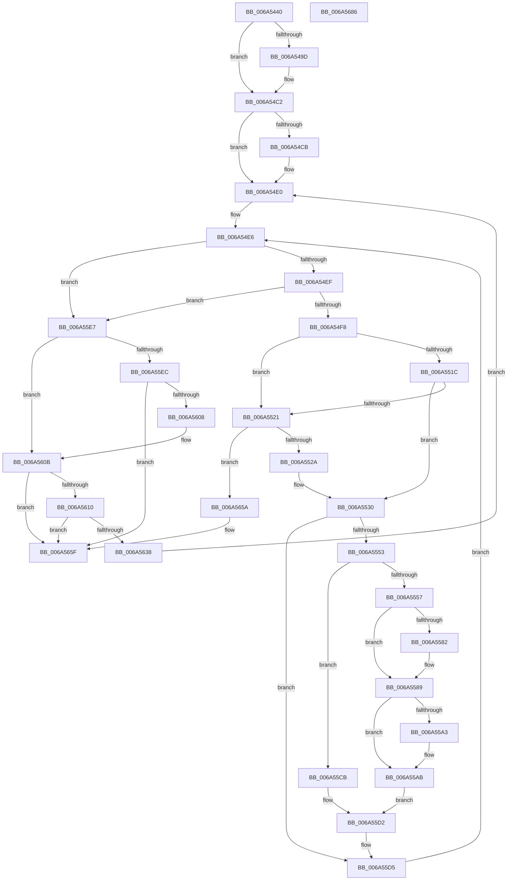

# SC_MBR::WritePartitionTable

- RVA: `0x006A5440`–`0x006A5687` (길이 `583` bytes)
- VA: `0x00000001406A5440`
- 실행 섹션: `.text`
- PDB 이름 있음: `예`; PDB Function 태그: `아니요`
- unwind 정보 RVA: `0x000DACA8`
- 디코드: `167`개 명령, `583/583` bytes 표시
- 미해석 바이트: `0` (있으면 어셈블리에 `.byte`로 보존)

> 이 문서는 커널 이미지의 기계어와 PDB 기호를 분석해 생성했습니다. 4번과 5번은 함수 원형과 자료형을 바이너리 사용 방식에서 추정한 C 해석이며 원본 소스 복구 결과는 아닙니다.

## 1. Dependencies

- 직접 호출 지점: **6**; 고유 호출 대상: **6**
- 직접 호출자로 확인된 함수: **2**
- RIP 상대 이미지 참조: **1**

### Outgoing calls
- `0x006A54A2` → [SC_ENV::CreateGuid](../../page/71/SC_ENV_CreateGuid_function_007170B0.md) (function, `0x007170B0`)
- `0x006A54D8` → [MBR_HEADER::CheckSum](MBR_HEADER_CheckSum_function_006A4EC4.md) (function, `0x006A4EC4`)
- `0x006A55BD` → [MBR_ENTRY::ComputeChs](MBR_ENTRY_ComputeChs_function_006A4F08.md) (function, `0x006A4F08`)
- `0x006A55FA` → [SC_DISK::WriteSectors](SC_DISK_WriteSectors_function_006A4E2C.md) (function, `0x006A4E2C`)
- `0x006A562A` → [SC_DISK::ReadSectors](SC_DISK_ReadSectors_function_006A4A2C.md) (function, `0x006A4A2C`)
- `0x006A5669` → [_security_check_cookie](_security_check_cookie_function_006AC640.md) (function, `0x006AC640`)

### Direct callers
- [SC_DISK::WritePartitionTable](SC_DISK_WritePartitionTable_function_006A4D4C.md) at `0x006A4E11`
- [SC_MBR::CreatePartitionTable](SC_MBR_CreatePartitionTable_function_006A4FEC.md) at `0x006A5069`

### Static image references
- `0x006A5454` → RVA `0x00E0A740` (`.data`; read)

## 2. Other-region calls and transfers

- 다른 실행 섹션으로 향하는 call: **1**
  - `0x006A54A2` → [SC_ENV::CreateGuid](../../page/71/SC_ENV_CreateGuid_function_007170B0.md) (`.text` → `PAGE`)
- 별도 외부 분기/꼬리 이동을 확인하지 못했습니다.

## 3. Assembly (complete function range)

```asm
006A5440  48 89 5C 24 18                  mov qword ptr [rsp + 0x18], rbx
006A5445  55                              push rbp
006A5446  56                              push rsi
006A5447  57                              push rdi
006A5448  41 54                           push r12
006A544A  41 55                           push r13
006A544C  41 56                           push r14
006A544E  41 57                           push r15
006A5450  48 83 EC 40                     sub rsp, 0x40
006A5454  48 8B 05 E5 52 76 00            mov rax, qword ptr [rip + 0x7652e5]
006A545B  48 33 C4                        xor rax, rsp
006A545E  48 89 44 24 38                  mov qword ptr [rsp + 0x38], rax
006A5463  48 8B 01                        mov rax, qword ptr [rcx]
006A5466  45 33 DB                        xor r11d, r11d
006A5469  48 8B DA                        mov rbx, rdx
006A546C  44 89 5C 24 24                  mov dword ptr [rsp + 0x24], r11d
006A5471  41 8B D3                        mov edx, r11d
006A5474  0F 57 C0                        xorps xmm0, xmm0
006A5477  4C 8B E1                        mov r12, rcx
006A547A  89 54 24 20                     mov dword ptr [rsp + 0x20], edx
006A547E  4C 8B B8 08 01 00 00            mov r15, qword ptr [rax + 0x108]
006A5485  45 8B EB                        mov r13d, r11d
006A5488  8B 43 08                        mov eax, dword ptr [rbx + 8]
006A548B  41 8B F3                        mov esi, r11d
006A548E  45 8B D3                        mov r10d, r11d
006A5491  41 8A EB                        mov bpl, r11b
006A5494  0F 11 44 24 28                  movups xmmword ptr [rsp + 0x28], xmm0
006A5499  85 C0                           test eax, eax
006A549B  75 25                           jne 0x1406a54c2
006A549D  48 8D 4C 24 28                  lea rcx, [rsp + 0x28]
006A54A2  E8 09 1C 07 00                  call 0x1407170b0
006A54A7  8B 44 24 28                     mov eax, dword ptr [rsp + 0x28]
006A54AB  8B D6                           mov edx, esi
006A54AD  33 44 24 2C                     xor eax, dword ptr [rsp + 0x2c]
006A54B1  44 8B D6                        mov r10d, esi
006A54B4  33 44 24 30                     xor eax, dword ptr [rsp + 0x30]
006A54B8  33 44 24 34                     xor eax, dword ptr [rsp + 0x34]
006A54BC  89 43 08                        mov dword ptr [rbx + 8], eax
006A54BF  45 33 DB                        xor r11d, r11d
006A54C2  41 39 87 B8 01 00 00            cmp dword ptr [r15 + 0x1b8], eax
006A54C9  74 15                           je 0x1406a54e0
006A54CB  49 8B CF                        mov rcx, r15
006A54CE  41 89 87 B8 01 00 00            mov dword ptr [r15 + 0x1b8], eax
006A54D5  40 B5 01                        mov bpl, 1
006A54D8  E8 E7 F9 FF FF                  call 0x1406a4ec4
006A54DD  89 43 0C                        mov dword ptr [rbx + 0xc], eax
006A54E0  4D 8B F3                        mov r14, r11
006A54E3  41 8B FB                        mov edi, r11d
006A54E6  83 FF 04                        cmp edi, 4
006A54E9  0F 83 F8 00 00 00               jae 0x1406a55e7
006A54EF  3B 53 04                        cmp edx, dword ptr [rbx + 4]
006A54F2  0F 83 EF 00 00 00               jae 0x1406a55e7
006A54F8  8B C2                           mov eax, edx
006A54FA  44 8B CF                        mov r9d, edi
006A54FD  49 C1 E1 04                     shl r9, 4
006A5501  49 81 C1 BE 01 00 00            add r9, 0x1be
006A5508  4C 8D 04 C0                     lea r8, [rax + rax*8]
006A550C  4D 03 CF                        add r9, r15
006A550F  4D 03 C0                        add r8, r8
006A5512  42 8A 4C C3 50                  mov cl, byte ptr [rbx + r8*8 + 0x50]
006A5517  80 F9 05                        cmp cl, 5
006A551A  74 05                           je 0x1406a5521
006A551C  80 F9 0F                        cmp cl, 0xf
006A551F  75 0F                           jne 0x1406a5530
006A5521  4D 85 F6                        test r14, r14
006A5524  0F 85 30 01 00 00               jne 0x1406a565a
006A552A  4D 8B F1                        mov r14, r9
006A552D  45 8B D5                        mov r10d, r13d
006A5530  8B 43 08                        mov eax, dword ptr [rbx + 8]
006A5533  42 83 64 C3 5C 00               and dword ptr [rbx + r8*8 + 0x5c], 0
006A5539  42 89 44 C3 58                  mov dword ptr [rbx + r8*8 + 0x58], eax
006A553E  4A 8B 44 C3 38                  mov rax, qword ptr [rbx + r8*8 + 0x38]
006A5543  4A 89 44 C3 60                  mov qword ptr [rbx + r8*8 + 0x60], rax
006A5548  46 38 5C C3 4C                  cmp byte ptr [rbx + r8*8 + 0x4c], r11b
006A554D  0F 84 82 00 00 00               je 0x1406a55d5
006A5553  84 C9                           test cl, cl
006A5555  74 74                           je 0x1406a55cb
006A5557  42 8A 44 C3 51                  mov al, byte ptr [rbx + r8*8 + 0x51]
006A555C  F6 D8                           neg al
006A555E  1A C9                           sbb cl, cl
006A5560  80 E1 80                        and cl, 0x80
006A5563  41 88 09                        mov byte ptr [r9], cl
006A5566  42 8A 44 C3 50                  mov al, byte ptr [rbx + r8*8 + 0x50]
006A556B  41 88 41 04                     mov byte ptr [r9 + 4], al
006A556F  49 8B 0C 24                     mov rcx, qword ptr [r12]
006A5573  4A 8B 44 C3 38                  mov rax, qword ptr [rbx + r8*8 + 0x38]
006A5578  8B 91 EC 00 00 00               mov edx, dword ptr [rcx + 0xec]
006A557E  85 D2                           test edx, edx
006A5580  74 07                           je 0x1406a5589
006A5582  8B CA                           mov ecx, edx
006A5584  48 99                           cqo
006A5586  48 F7 F9                        idiv rcx
006A5589  41 2B C2                        sub eax, r10d
006A558C  41 89 41 08                     mov dword ptr [r9 + 8], eax
006A5590  49 8B 0C 24                     mov rcx, qword ptr [r12]
006A5594  4A 8B 44 C3 40                  mov rax, qword ptr [rbx + r8*8 + 0x40]
006A5599  8B 91 EC 00 00 00               mov edx, dword ptr [rcx + 0xec]
006A559F  85 D2                           test edx, edx
006A55A1  74 08                           je 0x1406a55ab
006A55A3  44 8B C2                        mov r8d, edx
006A55A6  48 99                           cqo
006A55A8  49 F7 F8                        idiv r8
006A55AB  41 89 41 0C                     mov dword ptr [r9 + 0xc], eax
006A55AF  49 8B C9                        mov rcx, r9
006A55B2  49 8B 14 24                     mov rdx, qword ptr [r12]
006A55B6  48 81 C2 D8 00 00 00            add rdx, 0xd8
006A55BD  E8 46 F9 FF FF                  call 0x1406a4f08
006A55C2  8B 54 24 20                     mov edx, dword ptr [rsp + 0x20]
006A55C6  45 33 DB                        xor r11d, r11d
006A55C9  EB 07                           jmp 0x1406a55d2
006A55CB  0F 57 C0                        xorps xmm0, xmm0
006A55CE  41 0F 11 01                     movups xmmword ptr [r9], xmm0
006A55D2  40 B5 01                        mov bpl, 1
006A55D5  44 8B 54 24 24                  mov r10d, dword ptr [rsp + 0x24]
006A55DA  FF C7                           inc edi
006A55DC  FF C2                           inc edx
006A55DE  89 54 24 20                     mov dword ptr [rsp + 0x20], edx
006A55E2  E9 FF FE FF FF                  jmp 0x1406a54e6
006A55E7  40 84 ED                        test bpl, bpl
006A55EA  74 1F                           je 0x1406a560b
006A55EC  49 8B 0C 24                     mov rcx, qword ptr [r12]
006A55F0  45 33 C9                        xor r9d, r9d
006A55F3  45 8B C2                        mov r8d, r10d
006A55F6  41 8D 51 01                     lea edx, [r9 + 1]
006A55FA  E8 2D F8 FF FF                  call 0x1406a4e2c
006A55FF  45 33 DB                        xor r11d, r11d
006A5602  8B F0                           mov esi, eax
006A5604  85 C0                           test eax, eax
006A5606  78 57                           js 0x1406a565f
006A5608  41 8A EB                        mov bpl, r11b
006A560B  4D 85 F6                        test r14, r14
006A560E  74 4F                           je 0x1406a565f
006A5610  41 8B 7E 08                     mov edi, dword ptr [r14 + 8]
006A5614  45 33 C9                        xor r9d, r9d
006A5617  49 8B 0C 24                     mov rcx, qword ptr [r12]
006A561B  42 8D 04 2F                     lea eax, [rdi + r13]
006A561F  44 8B C0                        mov r8d, eax
006A5622  41 8D 51 01                     lea edx, [r9 + 1]
006A5626  89 44 24 24                     mov dword ptr [rsp + 0x24], eax
006A562A  E8 FD F3 FF FF                  call 0x1406a4a2c
006A562F  45 33 DB                        xor r11d, r11d
006A5632  8B F0                           mov esi, eax
006A5634  85 C0                           test eax, eax
006A5636  78 27                           js 0x1406a565f
006A5638  8B 54 24 20                     mov edx, dword ptr [rsp + 0x20]
006A563C  45 85 ED                        test r13d, r13d
006A563F  44 8B 54 24 24                  mov r10d, dword ptr [rsp + 0x24]
006A5644  41 0F 45 FD                     cmovne edi, r13d
006A5648  66 41 C7 87 FE 01 00 00 55 AA   mov word ptr [r15 + 0x1fe], 0xaa55
006A5652  44 8B EF                        mov r13d, edi
006A5655  E9 86 FE FF FF                  jmp 0x1406a54e0
006A565A  BE 01 00 00 C0                  mov esi, 0xc0000001
006A565F  8B C6                           mov eax, esi
006A5661  48 8B 4C 24 38                  mov rcx, qword ptr [rsp + 0x38]
006A5666  48 33 CC                        xor rcx, rsp
006A5669  E8 D2 6F 00 00                  call 0x1406ac640
006A566E  48 8B 9C 24 90 00 00 00         mov rbx, qword ptr [rsp + 0x90]
006A5676  48 83 C4 40                     add rsp, 0x40
006A567A  41 5F                           pop r15
006A567C  41 5E                           pop r14
006A567E  41 5D                           pop r13
006A5680  41 5C                           pop r12
006A5682  5F                              pop rdi
006A5683  5E                              pop rsi
006A5684  5D                              pop rbp
006A5685  C3                              ret
006A5686  CC                              int3
```

## 4. C-style interpretation (structured pseudocode)

```c
__int64 __fastcall SC_MBR__WritePartitionTable(__int64 a1, __int64 a2)
{
    __int64 result;
    __int64 v_r10;
    __int64 v_r11;
    __int64 v_rbp;
    __int64 v_rdi;
    __int64 v_rsp;
    unsigned __int64 v_stack_m40;
    unsigned int v_stack_m44;
    unsigned int v_stack_m48;
    unsigned int v_stack_m4C;
    unsigned __int64 v_stack_m50;
    unsigned int v_stack_m54;
    unsigned int v_stack_m58;
    unsigned __int64 v_stack_p18;

    v_stack_p18 = v_rbx;
    v_rsp = (v_rsp) - (64);
    result = (*(unsigned __int64 *)(v_rip + 7754469)) ^ (v_rsp);
    v_stack_m40 = result;
    v_r11 = 0;
    v_stack_m54 = 0;
    v_stack_m58 = 0;
    v_stack_m50 = v_xmm0;
    result = (unsigned int)(*(unsigned int *)(a2 + 8));
    v_r10 = 0;
    if ((unsigned int)((unsigned int)(*(unsigned int *)(a2 + 8))) == 0) {
        a1 = v_stack_m50;
        result = SC_ENV__CreateGuid(a1, 0, a3, a4);
        result = v_stack_m50;
        a2 = 0;
        result = (unsigned int)((result) ^ (v_stack_m4C));
        v_r10 = 0;
        result = (unsigned int)((result) ^ (v_stack_m48));
        result = (unsigned int)((result) ^ (v_stack_m44));
        *(unsigned int *)(a2 + 8) = (unsigned int)(result);
        v_r11 = 0;
    }
    v_rbp = 0;
    if ((*(unsigned int *)(*(unsigned __int64 *)(*(unsigned __int64 *)(a1) + 264) + 440)) != ((unsigned int)(result))) {
        a1 = *(unsigned __int64 *)(*(unsigned __int64 *)(a1) + 264);
        *(unsigned int *)(*(unsigned __int64 *)(*(unsigned __int64 *)(a1) + 264) + 440) = (unsigned int)(result);
        v_rbp = 1;
        result = MBR_HEADER__CheckSum(a1, a2, a3, a4);
        *(unsigned int *)(a2 + 12) = (unsigned int)(result);
    }
loc_006A54E6:
    if (0 >= 4) goto loc_006A55E7;
    if (((unsigned int)(a2)) >= (*(unsigned int *)(a2 + 4))) goto loc_006A55E7;
    a4 = (0) << (4);
    a4 = (a4) + (446);
    a4 = (a4) + (*(unsigned __int64 *)(*(unsigned __int64 *)(a1) + 264));
    a3 = ((unsigned int)((unsigned int)(a2)) + (unsigned int)((unsigned int)(a2)) * 8) + ((unsigned int)((unsigned int)(a2)) + (unsigned int)((unsigned int)(a2)) * 8);
    if (((unsigned __int8)(*(unsigned __int8 *)(a2 + a3 * 8 + 80))) == 5) goto loc_006A5521;
    if (((unsigned __int8)(*(unsigned __int8 *)(a2 + a3 * 8 + 80))) != 15) goto loc_006A5530;
loc_006A5521:
    if (0 != 0) goto loc_006A565A;
loc_006A5530:
    *(unsigned int *)(a2 + a3 * 8 + 88) = (unsigned int)((unsigned int)(*(unsigned int *)(a2 + 8)));
    *(unsigned __int64 *)(a2 + a3 * 8 + 96) = *(unsigned __int64 *)(a2 + a3 * 8 + 56);
    if ((*(unsigned __int8 *)(a2 + a3 * 8 + 76)) == 0) goto loc_006A55D5;
    if ((unsigned __int8)(*(unsigned __int8 *)(a2 + a3 * 8 + 80)) == 0) goto loc_006A55CB;
    result = (unsigned __int8)(-(*(unsigned __int8 *)(a2 + a3 * 8 + 81)));
    a1 = (unsigned __int8)((*(unsigned __int8 *)(a2 + a3 * 8 + 80)) & (128));
    *(unsigned __int8 *)(a4) = (unsigned __int8)(a1);
    *(unsigned __int8 *)(a4 + 4) = (unsigned __int8)(*(unsigned __int8 *)(a2 + a3 * 8 + 80));
    if ((unsigned int)((unsigned int)(*(unsigned int *)(*(unsigned __int64 *)(a1) + 236))) != 0) {
        a1 = (unsigned int)((unsigned int)(*(unsigned int *)(*(unsigned __int64 *)(a1) + 236)));
    }
    result = (unsigned int)((*(unsigned __int64 *)(a2 + a3 * 8 + 56)) - (0));
    *(unsigned int *)(a4 + 8) = (unsigned int)(result);
    if ((unsigned int)((unsigned int)(*(unsigned int *)(*(unsigned __int64 *)(a1) + 236))) != 0) {
        a3 = (unsigned int)((unsigned int)(*(unsigned int *)(*(unsigned __int64 *)(a1) + 236)));
    }
    *(unsigned int *)(a4 + 12) = (unsigned int)(*(unsigned __int64 *)(a2 + a3 * 8 + 64));
    a2 = (*(unsigned __int64 *)(a1)) + (216);
    result = MBR_ENTRY__ComputeChs(a4, a2, a3, a4);
    v_r11 = 0;
    goto loc_006A55D2;
loc_006A55CB:
    *(unsigned __int64 *)(a4) = v_xmm0;
loc_006A55D2:
loc_006A55D5:
    v_rdi = (unsigned int)((0) + 1);
    a2 = (unsigned int)(((unsigned int)(v_stack_m58)) + 1);
    v_stack_m58 = (unsigned int)(a2);
    goto loc_006A54E6;
loc_006A55E7:
    if (1 == 0) goto loc_006A560B;
    a4 = 0;
    result = SC_DISK__WriteSectors(*(unsigned __int64 *)(a1), a4 + 1, (unsigned int)((unsigned int)((unsigned int)(v_stack_m54))), a4);
    v_r11 = 0;
    if (sign_flag) goto loc_006A565F;
loc_006A560B:
    if (0 == 0) goto loc_006A565F;
    a4 = 0;
    v_stack_m54 = (unsigned int)((unsigned int)(*(unsigned int *)(a4 + 8)) + 0 * 1);
    result = SC_DISK__ReadSectors(*(unsigned __int64 *)(a1), a4 + 1, (unsigned int)((unsigned int)((unsigned int)(*(unsigned int *)(a4 + 8)) + 0 * 1)), a4);
    v_r11 = 0;
    if (sign_flag) goto loc_006A565F;
    v_rdi = (unsigned int)(*(unsigned int *)(a4 + 8));
    if (0 != 0) { v_rdi = 0; }
    *(unsigned __int16 *)(*(unsigned __int64 *)(*(unsigned __int64 *)(a1) + 264) + 510) = 0xAA55ULL;
    goto loc_006A54E0;
loc_006A565A:
loc_006A565F:
    a1 = (v_stack_m40) ^ (v_rsp);
    result = _security_check_cookie(a1, (unsigned int)(v_stack_m58), (unsigned int)((unsigned int)((unsigned int)(*(unsigned int *)(a4 + 8)) + 0 * 1)), a4);
    v_rsp = (v_rsp) + (64);
    return result;
}
```

## 5. (Beta) C Style

```c
int64_t SC_MBR__WritePartitionTable(void *Arg1, void *Arg2)
{
    uint8_t *arg1 = (uint8_t *)Arg1;
    uint8_t *arg2 = (uint8_t *)Arg2;

    int64_t result;
    int64_t local_r10;
    int64_t local_r11;
    int64_t local_rbp;
    int64_t local_rdi;
    int64_t local_rsp;
    uint64_t v_stack_m40;
    uint32_t v_stack_m44;
    uint32_t v_stack_m48;
    uint32_t v_stack_m4C;
    uint64_t v_stack_m50;
    uint32_t v_stack_m54;
    uint32_t v_stack_m58;
    uint64_t v_stack_p18;

    v_stack_p18 = local_rbx;
    local_rsp = (local_rsp) - (64);
    result = (*(uint64_t *)(v_rip + 0x7652E5)) ^ (local_rsp);
    v_stack_m40 = result;
    local_r11 = 0;
    v_stack_m54 = 0;
    v_stack_m58 = 0;
    v_stack_m50 = v_xmm0;
    result = (uint32_t)(*(uint32_t *)(arg2 + 0x8));
    local_r10 = 0;
    if ((uint32_t)((uint32_t)(*(uint32_t *)(arg2 + 0x8))) == 0) {
        Arg1 = v_stack_m50;
        result = SC_ENV__CreateGuid(Arg1, 0, a3, a4);
        result = v_stack_m50;
        Arg2 = 0;
        result = (uint32_t)((result) ^ (v_stack_m4C));
        local_r10 = 0;
        result = (uint32_t)((result) ^ (v_stack_m48));
        result = (uint32_t)((result) ^ (v_stack_m44));
        *(uint32_t *)(arg2 + 0x8) = (uint32_t)(result);
        local_r11 = 0;
    }
    local_rbp = 0;
    if ((*(uint32_t *)(*(uint64_t *)(*(uint64_t *)(arg1) + 0x108) + 0x1B8)) != ((uint32_t)(result))) {
        Arg1 = *(uint64_t *)(*(uint64_t *)(arg1) + 0x108);
        *(uint32_t *)(*(uint64_t *)(*(uint64_t *)(arg1) + 0x108) + 0x1B8) = (uint32_t)(result);
        local_rbp = 1;
        result = MBR_HEADER__CheckSum(Arg1, Arg2, a3, a4);
        *(uint32_t *)(arg2 + 0xC) = (uint32_t)(result);
    }
loc_006A54E6:
    if (0 >= 4) goto loc_006A55E7;
    if (((uint32_t)(Arg2)) >= (*(uint32_t *)(arg2 + 0x4))) goto loc_006A55E7;
    a4 = (0) << (4);
    a4 = (a4) + (446);
    a4 = (a4) + (*(uint64_t *)(*(uint64_t *)(arg1) + 0x108));
    a3 = ((uint32_t)((uint32_t)(Arg2)) + (uint32_t)((uint32_t)(Arg2)) * 8) + ((uint32_t)((uint32_t)(Arg2)) + (uint32_t)((uint32_t)(Arg2)) * 8);
    if (((uint8_t)(*(uint8_t *)(arg2 + a3 * 8 + 0x50))) == 5) goto loc_006A5521;
    if (((uint8_t)(*(uint8_t *)(arg2 + a3 * 8 + 0x50))) != 15) goto loc_006A5530;
loc_006A5521:
    if (0 != 0) goto loc_006A565A;
loc_006A5530:
    *(uint32_t *)(arg2 + a3 * 8 + 0x58) = (uint32_t)((uint32_t)(*(uint32_t *)(arg2 + 0x8)));
    *(uint64_t *)(arg2 + a3 * 8 + 0x60) = *(uint64_t *)(arg2 + a3 * 8 + 0x38);
    if ((*(uint8_t *)(arg2 + a3 * 8 + 0x4C)) == 0) goto loc_006A55D5;
    if ((uint8_t)(*(uint8_t *)(arg2 + a3 * 8 + 0x50)) == 0) goto loc_006A55CB;
    result = (uint8_t)(-(*(uint8_t *)(arg2 + a3 * 8 + 0x51)));
    Arg1 = (uint8_t)((*(uint8_t *)(arg2 + a3 * 8 + 0x50)) & (128));
    *(uint8_t *)(a4) = (uint8_t)(Arg1);
    *(uint8_t *)(a4 + 0x4) = (uint8_t)(*(uint8_t *)(arg2 + a3 * 8 + 0x50));
    if ((uint32_t)((uint32_t)(*(uint32_t *)(*(uint64_t *)(arg1) + 0xEC))) != 0) {
        Arg1 = (uint32_t)((uint32_t)(*(uint32_t *)(*(uint64_t *)(arg1) + 0xEC)));
    }
    result = (uint32_t)((*(uint64_t *)(arg2 + a3 * 8 + 0x38)) - (0));
    *(uint32_t *)(a4 + 0x8) = (uint32_t)(result);
    if ((uint32_t)((uint32_t)(*(uint32_t *)(*(uint64_t *)(arg1) + 0xEC))) != 0) {
        a3 = (uint32_t)((uint32_t)(*(uint32_t *)(*(uint64_t *)(arg1) + 0xEC)));
    }
    *(uint32_t *)(a4 + 0xC) = (uint32_t)(*(uint64_t *)(arg2 + a3 * 8 + 0x40));
    Arg2 = (*(uint64_t *)(arg1)) + (216);
    result = MBR_ENTRY__ComputeChs(a4, Arg2, a3, a4);
    local_r11 = 0;
    goto loc_006A55D2;
loc_006A55CB:
    *(uint64_t *)(a4) = v_xmm0;
loc_006A55D2:
loc_006A55D5:
    local_rdi = (uint32_t)((0) + 1);
    Arg2 = (uint32_t)(((uint32_t)(v_stack_m58)) + 1);
    v_stack_m58 = (uint32_t)(Arg2);
    goto loc_006A54E6;
loc_006A55E7:
    if (1 == 0) goto loc_006A560B;
    a4 = 0;
    result = SC_DISK__WriteSectors(*(uint64_t *)(arg1), a4 + 1, (uint32_t)((uint32_t)((uint32_t)(v_stack_m54))), a4);
    local_r11 = 0;
    if (sign_flag) goto loc_006A565F;
loc_006A560B:
    if (0 == 0) goto loc_006A565F;
    a4 = 0;
    v_stack_m54 = (uint32_t)((uint32_t)(*(uint32_t *)(a4 + 0x8)) + 0 * 1);
    result = SC_DISK__ReadSectors(*(uint64_t *)(arg1), a4 + 1, (uint32_t)((uint32_t)((uint32_t)(*(uint32_t *)(a4 + 0x8)) + 0 * 1)), a4);
    local_r11 = 0;
    if (sign_flag) goto loc_006A565F;
    local_rdi = (uint32_t)(*(uint32_t *)(a4 + 0x8));
    if (0 != 0) { local_rdi = 0; }
    *(uint16_t *)(*(uint64_t *)(*(uint64_t *)(arg1) + 0x108) + 0x1FE) = 0xAA55ULL;
    goto loc_006A54E0;
loc_006A565A:
loc_006A565F:
    Arg1 = (v_stack_m40) ^ (local_rsp);
    result = _security_check_cookie(Arg1, (uint32_t)(v_stack_m58), (uint32_t)((uint32_t)((uint32_t)(*(uint32_t *)(a4 + 0x8)) + 0 * 1)), a4);
    local_rsp = (local_rsp) + (64);
    return result;
}
```

### 관측된 메모리 오프셋

구조체 형식이 확인되지 않은 접근은 인자 기준의 오프셋으로만 기록했습니다.

| 기준 인자 | 오프셋 표현 | 폭 (bit) | 접근 |
|---|---:|---:|---|
| `Arg1` | `+ 0x0` | `64` | `R` |
| `Arg2` | `+ 0x4` | `32` | `R` |
| `Arg2` | `+ 0x8` | `32` | `R` |
| `Arg2` | `+ 0x8` | `32` | `W` |
| `Arg2` | `+ 0xC` | `32` | `W` |
| `Arg2` | `+ 0x38 + r8*8` | `64` | `R` |
| `Arg2` | `+ 0x40 + r8*8` | `64` | `R` |
| `Arg2` | `+ 0x4C + r8*8` | `8` | `R` |
| `Arg2` | `+ 0x50 + r8*8` | `8` | `R` |
| `Arg2` | `+ 0x51 + r8*8` | `8` | `R` |
| `Arg2` | `+ 0x58 + r8*8` | `32` | `W` |
| `Arg2` | `+ 0x5C + r8*8` | `32` | `R/W` |
| `Arg2` | `+ 0x60 + r8*8` | `64` | `W` |

## 6. Execution-region graph

[열기: 2D/3D 그래프와 함수 탐색 컨트롤 패널](../../../control-panel.html?section=text&rva=0x006A5440&view=graph)

- 2D 그래프는 위에서 아래로 흐르고, 3D 그래프는 빈 공간을 드래그해 회전합니다. Shift+드래그는 이동, 휠은 확대·축소, 함수 노드 선택은 대상 보고서 이동입니다.

### Static fallback


