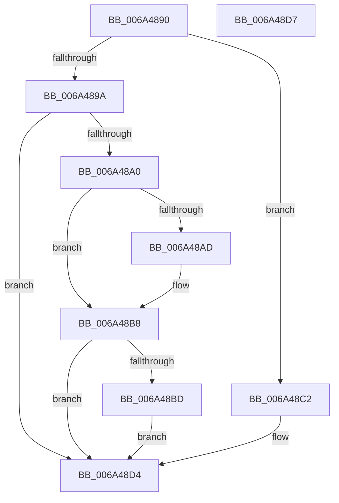

# SC_PART_ENTRY::IsUnused

- RVA: `0x006A4890`–`0x006A48D8` (길이 `72` bytes)
- VA: `0x00000001406A4890`
- 실행 섹션: `.text`
- PDB 이름 있음: `예`; PDB Function 태그: `아니요`
- unwind 정보 RVA: `0x000DB714`
- 디코드: `23`개 명령, `72/72` bytes 표시
- 미해석 바이트: `0` (있으면 어셈블리에 `.byte`로 보존)

> 이 문서는 커널 이미지의 기계어와 PDB 기호를 분석해 생성했습니다. 4번과 5번은 함수 원형과 자료형을 바이너리 사용 방식에서 추정한 C 해석이며 원본 소스 복구 결과는 아닙니다.

## 1. Dependencies

- 직접 호출 지점: **0**; 고유 호출 대상: **0**
- 직접 호출자로 확인된 함수: **2**
- RIP 상대 이미지 참조: **2**

### Outgoing calls
- 직접 디코드된 call 명령이 없습니다.

### Direct callers
- [SC_GPT::WritePartitionTable](SC_GPT_WritePartitionTable_function_006A3AD4.md) at `0x006A3C93`
- [SC_DISK::SetPartition](SC_DISK_SetPartition_function_006A4BDC.md) at `0x006A4C6A`

### Static image references
- `0x006A48A4` → RVA `0x000112D0` (`.rdata`; read)
- `0x006A48B1` → RVA `0x000112D8` (`.rdata`; read)

## 2. Other-region calls and transfers

- 다른 실행 섹션으로 향하는 call: **0**
- 별도 외부 분기/꼬리 이동을 확인하지 못했습니다.

## 3. Assembly (complete function range)

```asm
006A4890  44 8B 01                        mov r8d, dword ptr [rcx]
006A4893  33 D2                           xor edx, edx
006A4895  45 85 C0                        test r8d, r8d
006A4898  74 28                           je 0x1406a48c2
006A489A  41 83 F8 01                     cmp r8d, 1
006A489E  75 34                           jne 0x1406a48d4
006A48A0  48 8B 41 20                     mov rax, qword ptr [rcx + 0x20]
006A48A4  48 2B 05 25 CA 96 FF            sub rax, qword ptr [rip - 0x6935db]
006A48AB  75 0B                           jne 0x1406a48b8
006A48AD  48 8B 41 28                     mov rax, qword ptr [rcx + 0x28]
006A48B1  48 2B 05 20 CA 96 FF            sub rax, qword ptr [rip - 0x6935e0]
006A48B8  48 85 C0                        test rax, rax
006A48BB  75 17                           jne 0x1406a48d4
006A48BD  8D 50 01                        lea edx, [rax + 1]
006A48C0  EB 12                           jmp 0x1406a48d4
006A48C2  38 51 20                        cmp byte ptr [rcx + 0x20], dl
006A48C5  41 B8 01 00 00 00               mov r8d, 1
006A48CB  0F B6 C2                        movzx eax, dl
006A48CE  41 0F 44 C0                     cmove eax, r8d
006A48D2  8A D0                           mov dl, al
006A48D4  8A C2                           mov al, dl
006A48D6  C3                              ret
006A48D7  CC                              int3
```

## 4. C-style interpretation (structured pseudocode)

```c
__int64 __fastcall SC_PART_ENTRY__IsUnused(__int64 a1, int a2)
{
    __int64 result;

    a2 = 0;
    if ((unsigned int)((unsigned int)(*(unsigned int *)(a1))) == 0) goto loc_006A48C2;
    if (((unsigned int)((unsigned int)(*(unsigned int *)(a1)))) != 1) goto loc_006A48D4;
    result = (*(unsigned __int64 *)(a1 + 32)) - (*(unsigned __int64 *)(v_rip - 6895067));
    if (!(condition_is_not_equal)) {
        result = *(unsigned __int64 *)(a1 + 40);
        result = (result) - (*(unsigned __int64 *)(v_rip - 6895072));
    }
    if (result != 0) goto loc_006A48D4;
    goto loc_006A48D4;
loc_006A48C2:
    result = (unsigned __int8)(result + 1);
    if ((*(unsigned __int8 *)(a1 + 32)) == ((unsigned __int8)(result + 1))) { result = 1; }
loc_006A48D4:
    return (unsigned __int8)((unsigned __int8)(result));
}
```

## 5. (Beta) C Style

```c
int64_t SC_PART_ENTRY__IsUnused(void *Arg1, int32_t Arg2)
{
    uint8_t *arg1 = (uint8_t *)Arg1;

    int64_t result;

    Arg2 = 0;
    if ((uint32_t)((uint32_t)(*(uint32_t *)(arg1))) == 0) goto loc_006A48C2;
    if (((uint32_t)((uint32_t)(*(uint32_t *)(arg1)))) != 1) goto loc_006A48D4;
    result = (*(uint64_t *)(arg1 + 0x20)) - (*(uint64_t *)(v_rip - 0x6935DB));
    if (!(condition_is_not_equal)) {
        result = *(uint64_t *)(arg1 + 0x28);
        result = (result) - (*(uint64_t *)(v_rip - 0x6935E0));
    }
    if (result != 0) goto loc_006A48D4;
    goto loc_006A48D4;
loc_006A48C2:
    result = (uint8_t)(result + 1);
    if ((*(uint8_t *)(arg1 + 0x20)) == ((uint8_t)(result + 1))) { result = 1; }
loc_006A48D4:
    return (uint8_t)((uint8_t)(result));
}
```

### 관측된 메모리 오프셋

구조체 형식이 확인되지 않은 접근은 인자 기준의 오프셋으로만 기록했습니다.

| 기준 인자 | 오프셋 표현 | 폭 (bit) | 접근 |
|---|---:|---:|---|
| `Arg1` | `+ 0x0` | `32` | `R` |
| `Arg1` | `+ 0x20` | `8` | `R` |
| `Arg1` | `+ 0x20` | `64` | `R` |
| `Arg1` | `+ 0x28` | `64` | `R` |

## 6. Execution-region graph

[열기: 2D/3D 그래프와 함수 탐색 컨트롤 패널](../../../control-panel.html?section=text&rva=0x006A4890&view=graph)

- 2D 그래프는 위에서 아래로 흐르고, 3D 그래프는 빈 공간을 드래그해 회전합니다. Shift+드래그는 이동, 휠은 확대·축소, 함수 노드 선택은 대상 보고서 이동입니다.

### Static fallback


