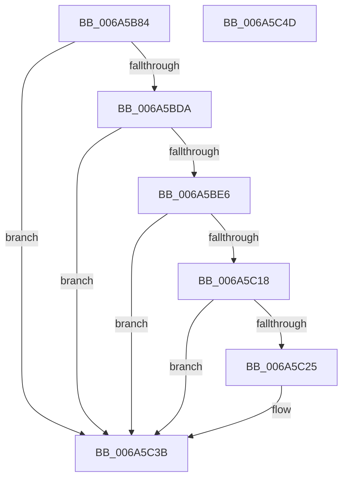

# SC_RAW::CreatePartitionTable

- RVA: `0x006A5B84`–`0x006A5C4E` (길이 `202` bytes)
- VA: `0x00000001406A5B84`
- 실행 섹션: `.text`
- PDB 이름 있음: `예`; PDB Function 태그: `아니요`
- unwind 정보 RVA: `0x00060BC4`
- 디코드: `58`개 명령, `202/202` bytes 표시
- 미해석 바이트: `0` (있으면 어셈블리에 `.byte`로 보존)

> 이 문서는 커널 이미지의 기계어와 PDB 기호를 분석해 생성했습니다. 4번과 5번은 함수 원형과 자료형을 바이너리 사용 방식에서 추정한 C 해석이며 원본 소스 복구 결과는 아닙니다.

## 1. Dependencies

- 직접 호출 지점: **5**; 고유 호출 대상: **2**
- 직접 호출자로 확인된 함수: **1**
- RIP 상대 이미지 참조: **0**

### Outgoing calls
- `0x006A5BAD` → [memset](../6C/memset_function_006C6C40.md) (function, `0x006C6C40`)
- `0x006A5BCF` → [SC_DISK::WriteSectors](SC_DISK_WriteSectors_function_006A4E2C.md) (function, `0x006A4E2C`)
- `0x006A5BFD` → [memset](../6C/memset_function_006C6C40.md) (function, `0x006C6C40`)
- `0x006A5C0D` → [SC_DISK::WriteSectors](SC_DISK_WriteSectors_function_006A4E2C.md) (function, `0x006A4E2C`)
- `0x006A5C34` → [SC_DISK::WriteSectors](SC_DISK_WriteSectors_function_006A4E2C.md) (function, `0x006A4E2C`)

### Direct callers
- [SC_DISK::CreatePartitionTable](SC_DISK_CreatePartitionTable_function_006A43F8.md) at `0x006A4459`

### Static image references
- 디코드된 RIP-relative 메모리 참조가 없습니다.

## 2. Other-region calls and transfers

- 다른 실행 섹션으로 향하는 call: **0**
- 별도 외부 분기/꼬리 이동을 확인하지 못했습니다.

## 3. Assembly (complete function range)

```asm
006A5B84  48 89 5C 24 08                  mov qword ptr [rsp + 8], rbx
006A5B89  48 89 74 24 10                  mov qword ptr [rsp + 0x10], rsi
006A5B8E  57                              push rdi
006A5B8F  48 83 EC 20                     sub rsp, 0x20
006A5B93  48 8B 01                        mov rax, qword ptr [rcx]
006A5B96  33 D2                           xor edx, edx
006A5B98  48 8B F9                        mov rdi, rcx
006A5B9B  48 8B 98 08 01 00 00            mov rbx, qword ptr [rax + 0x108]
006A5BA2  44 8D 42 40                     lea r8d, [rdx + 0x40]
006A5BA6  48 8D 8B BE 01 00 00            lea rcx, [rbx + 0x1be]
006A5BAD  E8 8E 10 02 00                  call 0x1406c6c40
006A5BB2  33 F6                           xor esi, esi
006A5BB4  45 33 C9                        xor r9d, r9d
006A5BB7  89 B3 B8 01 00 00               mov dword ptr [rbx + 0x1b8], esi
006A5BBD  45 33 C0                        xor r8d, r8d
006A5BC0  66 89 B3 FE 01 00 00            mov word ptr [rbx + 0x1fe], si
006A5BC7  48 8B 0F                        mov rcx, qword ptr [rdi]
006A5BCA  8D 5E 01                        lea ebx, [rsi + 1]
006A5BCD  8B D3                           mov edx, ebx
006A5BCF  E8 58 F2 FF FF                  call 0x1406a4e2c
006A5BD4  8B D0                           mov edx, eax
006A5BD6  85 C0                           test eax, eax
006A5BD8  78 61                           js 0x1406a5c3b
006A5BDA  4C 8B 0F                        mov r9, qword ptr [rdi]
006A5BDD  41 39 99 00 01 00 00            cmp dword ptr [r9 + 0x100], ebx
006A5BE4  75 55                           jne 0x1406a5c3b
006A5BE6  41 8B 89 F0 00 00 00            mov ecx, dword ptr [r9 + 0xf0]
006A5BED  8B C3                           mov eax, ebx
006A5BEF  D3 E0                           shl eax, cl
006A5BF1  33 D2                           xor edx, edx
006A5BF3  49 8B 89 08 01 00 00            mov rcx, qword ptr [r9 + 0x108]
006A5BFA  4C 63 C0                        movsxd r8, eax
006A5BFD  E8 3E 10 02 00                  call 0x1406c6c40
006A5C02  48 8B 0F                        mov rcx, qword ptr [rdi]
006A5C05  45 33 C9                        xor r9d, r9d
006A5C08  44 8B C3                        mov r8d, ebx
006A5C0B  8B D3                           mov edx, ebx
006A5C0D  E8 1A F2 FF FF                  call 0x1406a4e2c
006A5C12  8B D0                           mov edx, eax
006A5C14  85 C0                           test eax, eax
006A5C16  78 23                           js 0x1406a5c3b
006A5C18  48 8B 0F                        mov rcx, qword ptr [rdi]
006A5C1B  8B 81 C8 00 00 00               mov eax, dword ptr [rcx + 0xc8]
006A5C21  84 C3                           test bl, al
006A5C23  75 16                           jne 0x1406a5c3b
006A5C25  4C 8B 81 F8 00 00 00            mov r8, qword ptr [rcx + 0xf8]
006A5C2C  45 33 C9                        xor r9d, r9d
006A5C2F  4C 2B C3                        sub r8, rbx
006A5C32  8B D3                           mov edx, ebx
006A5C34  E8 F3 F1 FF FF                  call 0x1406a4e2c
006A5C39  8B D0                           mov edx, eax
006A5C3B  48 8B 5C 24 30                  mov rbx, qword ptr [rsp + 0x30]
006A5C40  8B C2                           mov eax, edx
006A5C42  48 8B 74 24 38                  mov rsi, qword ptr [rsp + 0x38]
006A5C47  48 83 C4 20                     add rsp, 0x20
006A5C4B  5F                              pop rdi
006A5C4C  C3                              ret
006A5C4D  CC                              int3
```

## 4. C-style interpretation (structured pseudocode)

```c
__int64 __fastcall SC_RAW__CreatePartitionTable(__int64 a1, int a2, __int64 a3, int a4)
{
    __int64 result;
    __int64 v_rsi;
    __int64 v_rsp;
    unsigned __int64 v_stack_p10;
    unsigned __int64 v_stack_p8;

    v_stack_p8 = v_rbx;
    v_stack_p10 = v_rsi;
    v_rsp = (v_rsp) - (32);
    a2 = 0;
    result = memset(*(unsigned __int64 *)(*(unsigned __int64 *)(a1) + 264) + 446, a2, a2 + 64, a4);
    v_rsi = 0;
    a4 = 0;
    *(unsigned int *)(*(unsigned __int64 *)(*(unsigned __int64 *)(a1) + 264) + 440) = 0;
    a3 = 0;
    *(unsigned __int16 *)(*(unsigned __int64 *)(*(unsigned __int64 *)(a1) + 264) + 510) = 0;
    result = SC_DISK__WriteSectors(*(unsigned __int64 *)(a1), (unsigned int)((unsigned int)(v_rsi + 1)), a3, a4);
    if (sign_flag) goto loc_006A5C3B;
    if ((*(unsigned int *)(*(unsigned __int64 *)(a1) + 256)) != ((unsigned int)(v_rsi + 1))) goto loc_006A5C3B;
    result = (unsigned int)(((unsigned int)((unsigned int)(v_rsi + 1))) << ((unsigned __int8)((unsigned int)(*(unsigned int *)(*(unsigned __int64 *)(a1) + 240)))));
    a2 = 0;
    result = memset(*(unsigned __int64 *)(*(unsigned __int64 *)(a1) + 264), a2, (int)((unsigned int)(result)), *(unsigned __int64 *)(a1));
    a4 = 0;
    result = SC_DISK__WriteSectors(*(unsigned __int64 *)(a1), (unsigned int)((unsigned int)(v_rsi + 1)), (unsigned int)((unsigned int)(v_rsi + 1)), a4);
    if (sign_flag) goto loc_006A5C3B;
    result = (unsigned int)(*(unsigned int *)(*(unsigned __int64 *)(a1) + 200));
    if ((((unsigned __int8)(v_rsi + 1)) & ((unsigned __int8)((unsigned int)(*(unsigned int *)(*(unsigned __int64 *)(a1) + 200))))) == 0) {
        a3 = *(unsigned __int64 *)(*(unsigned __int64 *)(a1) + 248);
        a4 = 0;
        a3 = (a3) - (v_rsi + 1);
        a2 = (unsigned int)(v_rsi + 1);
        result = SC_DISK__WriteSectors(*(unsigned __int64 *)(a1), a2, a3, a4);
        a2 = (unsigned int)(result);
    }
    v_rsp = (v_rsp) + (32);
    return (unsigned int)(a2);
}
```

## 5. (Beta) C Style

```c
int64_t SC_RAW__CreatePartitionTable(void *Arg1, int32_t Arg2, int64_t Arg3, int32_t Arg4)
{
    uint8_t *arg1 = (uint8_t *)Arg1;

    int64_t result;
    int64_t local_rsi;
    int64_t local_rsp;
    uint64_t v_stack_p10;
    uint64_t v_stack_p8;

    v_stack_p8 = local_rbx;
    v_stack_p10 = local_rsi;
    local_rsp = (local_rsp) - (32);
    Arg2 = 0;
    result = memset(*(uint64_t *)(*(uint64_t *)(arg1) + 0x108) + 446, Arg2, Arg2 + 64, Arg4);
    local_rsi = 0;
    Arg4 = 0;
    *(uint32_t *)(*(uint64_t *)(*(uint64_t *)(arg1) + 0x108) + 0x1B8) = 0;
    Arg3 = 0;
    *(uint16_t *)(*(uint64_t *)(*(uint64_t *)(arg1) + 0x108) + 0x1FE) = 0;
    result = SC_DISK__WriteSectors(*(uint64_t *)(arg1), (uint32_t)((uint32_t)(local_rsi + 1)), Arg3, Arg4);
    if (sign_flag) goto loc_006A5C3B;
    if ((*(uint32_t *)(*(uint64_t *)(arg1) + 0x100)) != ((uint32_t)(local_rsi + 1))) goto loc_006A5C3B;
    result = (uint32_t)(((uint32_t)((uint32_t)(local_rsi + 1))) << ((uint8_t)((uint32_t)(*(uint32_t *)(*(uint64_t *)(arg1) + 0xF0)))));
    Arg2 = 0;
    result = memset(*(uint64_t *)(*(uint64_t *)(arg1) + 0x108), Arg2, (int32_t)((uint32_t)(result)), *(uint64_t *)(arg1));
    Arg4 = 0;
    result = SC_DISK__WriteSectors(*(uint64_t *)(arg1), (uint32_t)((uint32_t)(local_rsi + 1)), (uint32_t)((uint32_t)(local_rsi + 1)), Arg4);
    if (sign_flag) goto loc_006A5C3B;
    result = (uint32_t)(*(uint32_t *)(*(uint64_t *)(arg1) + 0xC8));
    if ((((uint8_t)(local_rsi + 1)) & ((uint8_t)((uint32_t)(*(uint32_t *)(*(uint64_t *)(arg1) + 0xC8))))) == 0) {
        Arg3 = *(uint64_t *)(*(uint64_t *)(arg1) + 0xF8);
        Arg4 = 0;
        Arg3 = (Arg3) - (local_rsi + 1);
        Arg2 = (uint32_t)(local_rsi + 1);
        result = SC_DISK__WriteSectors(*(uint64_t *)(arg1), Arg2, Arg3, Arg4);
        Arg2 = (uint32_t)(result);
    }
    local_rsp = (local_rsp) + (32);
    return (uint32_t)(Arg2);
}
```

### 관측된 메모리 오프셋

구조체 형식이 확인되지 않은 접근은 인자 기준의 오프셋으로만 기록했습니다.

| 기준 인자 | 오프셋 표현 | 폭 (bit) | 접근 |
|---|---:|---:|---|
| `Arg1` | `+ 0x0` | `64` | `R` |

## 6. Execution-region graph

[열기: 2D/3D 그래프와 함수 탐색 컨트롤 패널](../../../control-panel.html?section=text&rva=0x006A5B84&view=graph)

- 2D 그래프는 위에서 아래로 흐르고, 3D 그래프는 빈 공간을 드래그해 회전합니다. Shift+드래그는 이동, 휠은 확대·축소, 함수 노드 선택은 대상 보고서 이동입니다.

### Static fallback


