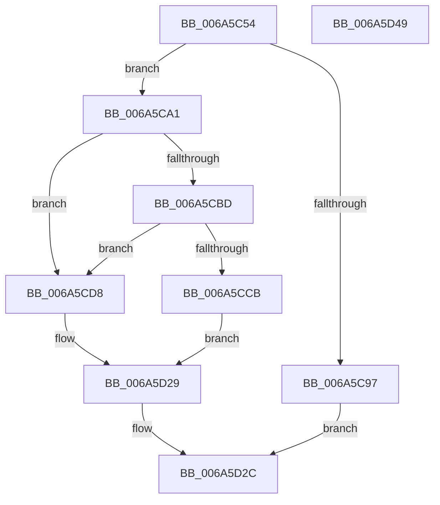

# SC_RAW::ReadPartitionTable

- RVA: `0x006A5C54`–`0x006A5D4A` (길이 `246` bytes)
- VA: `0x00000001406A5C54`
- 실행 섹션: `.text`
- PDB 이름 있음: `예`; PDB Function 태그: `아니요`
- unwind 정보 RVA: `0x0007F3F8`
- 디코드: `65`개 명령, `246/246` bytes 표시
- 미해석 바이트: `0` (있으면 어셈블리에 `.byte`로 보존)

> 이 문서는 커널 이미지의 기계어와 PDB 기호를 분석해 생성했습니다. 4번과 5번은 함수 원형과 자료형을 바이너리 사용 방식에서 추정한 C 해석이며 원본 소스 복구 결과는 아닙니다.

## 1. Dependencies

- 직접 호출 지점: **4**; 고유 호출 대상: **3**
- 직접 호출자로 확인된 함수: **1**
- RIP 상대 이미지 참조: **0**

### Outgoing calls
- `0x006A5C8A` → [SC_ENV::Allocate](../../page/71/SC_ENV_Allocate_function_00716F90.md) (function, `0x00716F90`)
- `0x006A5CAC` → [memset](../6C/memset_function_006C6C40.md) (function, `0x006C6C40`)
- `0x006A5CCE` → [MBR_HEADER::CheckSum](MBR_HEADER_CheckSum_function_006A4EC4.md) (function, `0x006A4EC4`)
- `0x006A5CE9` → [MBR_HEADER::CheckSum](MBR_HEADER_CheckSum_function_006A4EC4.md) (function, `0x006A4EC4`)

### Direct callers
- [SC_DISK::ReadPartitionTable](SC_DISK_ReadPartitionTable_function_006A499C.md) at `0x006A49D9`

### Static image references
- 디코드된 RIP-relative 메모리 참조가 없습니다.

## 2. Other-region calls and transfers

- 다른 실행 섹션으로 향하는 call: **1**
  - `0x006A5C8A` → [SC_ENV::Allocate](../../page/71/SC_ENV_Allocate_function_00716F90.md) (`.text` → `PAGE`)
- 별도 외부 분기/꼬리 이동을 확인하지 못했습니다.

## 3. Assembly (complete function range)

```asm
006A5C54  48 8B C4                        mov rax, rsp
006A5C57  48 89 58 08                     mov qword ptr [rax + 8], rbx
006A5C5B  48 89 70 10                     mov qword ptr [rax + 0x10], rsi
006A5C5F  48 89 78 18                     mov qword ptr [rax + 0x18], rdi
006A5C63  4C 89 70 20                     mov qword ptr [rax + 0x20], r14
006A5C67  41 57                           push r15
006A5C69  48 83 EC 20                     sub rsp, 0x20
006A5C6D  48 8B 01                        mov rax, qword ptr [rcx]
006A5C70  4C 8B F1                        mov r14, rcx
006A5C73  33 FF                           xor edi, edi
006A5C75  45 33 C9                        xor r9d, r9d
006A5C78  B9 C0 00 00 00                  mov ecx, 0xc0
006A5C7D  4C 8B FA                        mov r15, rdx
006A5C80  48 8B B0 08 01 00 00            mov rsi, qword ptr [rax + 0x108]
006A5C87  48 89 3A                        mov qword ptr [rdx], rdi
006A5C8A  E8 01 13 07 00                  call 0x140716f90
006A5C8F  48 8B D8                        mov rbx, rax
006A5C92  48 85 C0                        test rax, rax
006A5C95  75 0A                           jne 0x1406a5ca1
006A5C97  BF 9A 00 00 C0                  mov edi, 0xc000009a
006A5C9C  E9 8B 00 00 00                  jmp 0x1406a5d2c
006A5CA1  33 D2                           xor edx, edx
006A5CA3  41 B8 C0 00 00 00               mov r8d, 0xc0
006A5CA9  48 8B CB                        mov rcx, rbx
006A5CAC  E8 8F 0F 02 00                  call 0x1406c6c40
006A5CB1  49 8B 06                        mov rax, qword ptr [r14]
006A5CB4  83 B8 E0 00 00 00 0B            cmp dword ptr [rax + 0xe0], 0xb
006A5CBB  74 1B                           je 0x1406a5cd8
006A5CBD  B8 55 AA 00 00                  mov eax, 0xaa55
006A5CC2  66 39 86 FE 01 00 00            cmp word ptr [rsi + 0x1fe], ax
006A5CC9  74 0D                           je 0x1406a5cd8
006A5CCB  48 8B CE                        mov rcx, rsi
006A5CCE  E8 F1 F1 FF FF                  call 0x1406a4ec4
006A5CD3  89 43 0C                        mov dword ptr [rbx + 0xc], eax
006A5CD6  EB 51                           jmp 0x1406a5d29
006A5CD8  41 B8 01 00 00 00               mov r8d, 1
006A5CDE  48 8B CE                        mov rcx, rsi
006A5CE1  44 89 43 04                     mov dword ptr [rbx + 4], r8d
006A5CE5  44 89 43 08                     mov dword ptr [rbx + 8], r8d
006A5CE9  E8 D6 F1 FF FF                  call 0x1406a4ec4
006A5CEE  89 43 0C                        mov dword ptr [rbx + 0xc], eax
006A5CF1  48 89 7B 38                     mov qword ptr [rbx + 0x38], rdi
006A5CF5  49 8B 06                        mov rax, qword ptr [r14]
006A5CF8  8B 88 F0 00 00 00               mov ecx, dword ptr [rax + 0xf0]
006A5CFE  48 8B 90 F8 00 00 00            mov rdx, qword ptr [rax + 0xf8]
006A5D05  48 D3 E2                        shl rdx, cl
006A5D08  48 89 53 40                     mov qword ptr [rbx + 0x40], rdx
006A5D0C  89 7B 48                        mov dword ptr [rbx + 0x48], edi
006A5D0F  66 C7 43 50 04 00               mov word ptr [rbx + 0x50], 4
006A5D15  44 88 43 52                     mov byte ptr [rbx + 0x52], r8b
006A5D19  89 7B 54                        mov dword ptr [rbx + 0x54], edi
006A5D1C  8B 4B 08                        mov ecx, dword ptr [rbx + 8]
006A5D1F  89 4B 58                        mov dword ptr [rbx + 0x58], ecx
006A5D22  89 7B 5C                        mov dword ptr [rbx + 0x5c], edi
006A5D25  48 89 7B 60                     mov qword ptr [rbx + 0x60], rdi
006A5D29  49 89 1F                        mov qword ptr [r15], rbx
006A5D2C  48 8B 5C 24 30                  mov rbx, qword ptr [rsp + 0x30]
006A5D31  8B C7                           mov eax, edi
006A5D33  48 8B 7C 24 40                  mov rdi, qword ptr [rsp + 0x40]
006A5D38  48 8B 74 24 38                  mov rsi, qword ptr [rsp + 0x38]
006A5D3D  4C 8B 74 24 48                  mov r14, qword ptr [rsp + 0x48]
006A5D42  48 83 C4 20                     add rsp, 0x20
006A5D46  41 5F                           pop r15
006A5D48  C3                              ret
006A5D49  CC                              int3
```

## 4. C-style interpretation (structured pseudocode)

```c
__int64 __fastcall SC_RAW__ReadPartitionTable(__int64 a1, __int64 a2, __int64 a3, int a4)
{
    __int64 result;
    __int64 v_rdi;
    __int64 v_rsp;
    unsigned __int64 v_stack_p10;
    unsigned __int64 v_stack_p18;
    unsigned __int64 v_stack_p20;
    unsigned __int64 v_stack_p8;

    *(unsigned __int64 *)(v_rsp + 8) = v_rbx;
    *(unsigned __int64 *)(v_rsp + 16) = v_rsi;
    *(unsigned __int64 *)(v_rsp + 24) = v_rdi;
    *(unsigned __int64 *)(v_rsp + 32) = v_r14;
    v_rsp = (v_rsp) - (32);
    v_rdi = 0;
    a4 = 0;
    *(unsigned __int64 *)(a2) = 0;
    result = SC_ENV__Allocate(192, a2, a3, a4);
    if (result != 0) goto loc_006A5CA1;
    goto loc_006A5D2C;
loc_006A5CA1:
    a2 = 0;
    result = memset(result, a2, 192, a4);
    if ((*(unsigned int *)(*(unsigned __int64 *)(a1) + 224)) == 11) goto loc_006A5CD8;
    if ((*(unsigned __int16 *)(*(unsigned __int64 *)(*(unsigned __int64 *)(a1) + 264) + 510)) == ((unsigned __int16)((unsigned int)(0xAA55ULL)))) goto loc_006A5CD8;
    result = MBR_HEADER__CheckSum(*(unsigned __int64 *)(*(unsigned __int64 *)(a1) + 264), a2, 192, a4);
    *(unsigned int *)(result + 12) = (unsigned int)(result);
    goto loc_006A5D29;
loc_006A5CD8:
    *(unsigned int *)(result + 4) = 1;
    *(unsigned int *)(result + 8) = 1;
    result = MBR_HEADER__CheckSum(*(unsigned __int64 *)(*(unsigned __int64 *)(a1) + 264), a2, 1, a4);
    *(unsigned int *)(result + 12) = (unsigned int)(result);
    *(unsigned __int64 *)(result + 56) = (unsigned int)(0xC000009AULL);
    a2 = (*(unsigned __int64 *)(*(unsigned __int64 *)(a1) + 248)) << ((unsigned __int8)((unsigned int)(*(unsigned int *)(*(unsigned __int64 *)(a1) + 240))));
    *(unsigned __int64 *)(result + 64) = a2;
    *(unsigned int *)(result + 72) = (unsigned int)((unsigned int)(0xC000009AULL));
    *(unsigned __int16 *)(result + 80) = 4;
    *(unsigned __int8 *)(result + 82) = 1;
    *(unsigned int *)(result + 84) = (unsigned int)((unsigned int)(0xC000009AULL));
    *(unsigned int *)(result + 88) = (unsigned int)((unsigned int)(*(unsigned int *)(result + 8)));
    *(unsigned int *)(result + 92) = (unsigned int)((unsigned int)(0xC000009AULL));
    *(unsigned __int64 *)(result + 96) = (unsigned int)(0xC000009AULL);
loc_006A5D29:
    *(unsigned __int64 *)(a2) = result;
loc_006A5D2C:
    v_rsp = (v_rsp) + (32);
    return (unsigned int)((unsigned int)((unsigned int)(0xC000009AULL)));
}
```

## 5. (Beta) C Style

```c
int64_t SC_RAW__ReadPartitionTable(void *Arg1, void *Arg2, int64_t Arg3, int32_t Arg4)
{
    uint8_t *arg1 = (uint8_t *)Arg1;
    uint8_t *arg2 = (uint8_t *)Arg2;

    int64_t result;
    int64_t local_rdi;
    int64_t local_rsp;
    uint64_t v_stack_p10;
    uint64_t v_stack_p18;
    uint64_t v_stack_p20;
    uint64_t v_stack_p8;

    *(uint64_t *)(local_rsp + 0x8) = local_rbx;
    *(uint64_t *)(local_rsp + 0x10) = local_rsi;
    *(uint64_t *)(local_rsp + 0x18) = local_rdi;
    *(uint64_t *)(local_rsp + 0x20) = local_r14;
    local_rsp = (local_rsp) - (32);
    local_rdi = 0;
    Arg4 = 0;
    *(uint64_t *)(arg2) = 0;
    result = SC_ENV__Allocate(192, Arg2, Arg3, Arg4);
    if (result != 0) goto loc_006A5CA1;
    goto loc_006A5D2C;
loc_006A5CA1:
    Arg2 = 0;
    result = memset(result, Arg2, 192, Arg4);
    if ((*(uint32_t *)(*(uint64_t *)(arg1) + 0xE0)) == 11) goto loc_006A5CD8;
    if ((*(uint16_t *)(*(uint64_t *)(*(uint64_t *)(arg1) + 0x108) + 0x1FE)) == ((uint16_t)((uint32_t)(0xAA55ULL)))) goto loc_006A5CD8;
    result = MBR_HEADER__CheckSum(*(uint64_t *)(*(uint64_t *)(arg1) + 0x108), Arg2, 192, Arg4);
    *(uint32_t *)(result + 0xC) = (uint32_t)(result);
    goto loc_006A5D29;
loc_006A5CD8:
    *(uint32_t *)(result + 0x4) = 1;
    *(uint32_t *)(result + 0x8) = 1;
    result = MBR_HEADER__CheckSum(*(uint64_t *)(*(uint64_t *)(arg1) + 0x108), Arg2, 1, Arg4);
    *(uint32_t *)(result + 0xC) = (uint32_t)(result);
    *(uint64_t *)(result + 0x38) = (uint32_t)(0xC000009AULL);
    Arg2 = (*(uint64_t *)(*(uint64_t *)(arg1) + 0xF8)) << ((uint8_t)((uint32_t)(*(uint32_t *)(*(uint64_t *)(arg1) + 0xF0))));
    *(void **)(result + 0x40) = Arg2;
    *(uint32_t *)(result + 0x48) = (uint32_t)((uint32_t)(0xC000009AULL));
    *(uint16_t *)(result + 0x50) = 4;
    *(uint8_t *)(result + 0x52) = 1;
    *(uint32_t *)(result + 0x54) = (uint32_t)((uint32_t)(0xC000009AULL));
    *(uint32_t *)(result + 0x58) = (uint32_t)((uint32_t)(*(uint32_t *)(result + 0x8)));
    *(uint32_t *)(result + 0x5C) = (uint32_t)((uint32_t)(0xC000009AULL));
    *(uint64_t *)(result + 0x60) = (uint32_t)(0xC000009AULL);
loc_006A5D29:
    *(uint64_t *)(arg2) = result;
loc_006A5D2C:
    local_rsp = (local_rsp) + (32);
    return (uint32_t)((uint32_t)((uint32_t)(0xC000009AULL)));
}
```

### 관측된 메모리 오프셋

구조체 형식이 확인되지 않은 접근은 인자 기준의 오프셋으로만 기록했습니다.

| 기준 인자 | 오프셋 표현 | 폭 (bit) | 접근 |
|---|---:|---:|---|
| `Arg1` | `+ 0x0` | `64` | `R` |
| `Arg2` | `+ 0x0` | `64` | `W` |

## 6. Execution-region graph

[열기: 2D/3D 그래프와 함수 탐색 컨트롤 패널](../../../control-panel.html?section=text&rva=0x006A5C54&view=graph)

- 2D 그래프는 위에서 아래로 흐르고, 3D 그래프는 빈 공간을 드래그해 회전합니다. Shift+드래그는 이동, 휠은 확대·축소, 함수 노드 선택은 대상 보고서 이동입니다.

### Static fallback


