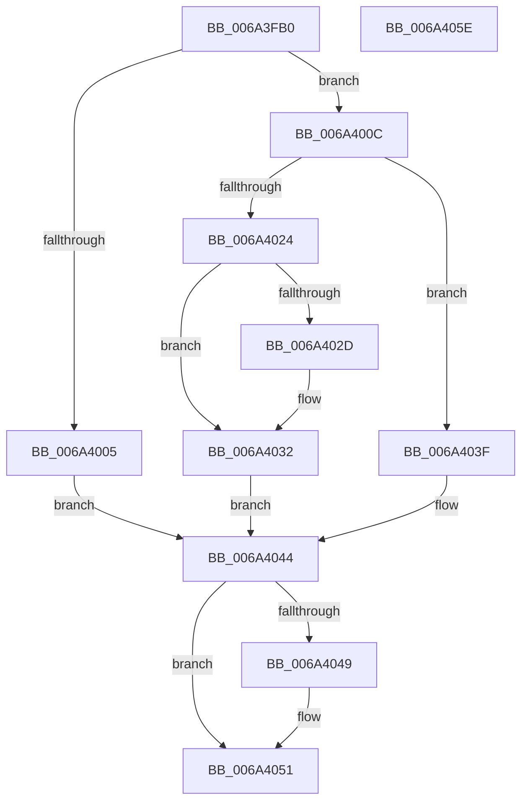

# ScAnsiToUnicodeString

- RVA: `0x006A3FB0`–`0x006A405F` (길이 `175` bytes)
- VA: `0x00000001406A3FB0`
- 실행 섹션: `.text`
- PDB 이름 있음: `예`; PDB Function 태그: `아니요`
- unwind 정보 RVA: `0x00065960`
- 디코드: `50`개 명령, `175/175` bytes 표시
- 미해석 바이트: `0` (있으면 어셈블리에 `.byte`로 보존)

> 이 문서는 커널 이미지의 기계어와 PDB 기호를 분석해 생성했습니다. 4번과 5번은 함수 원형과 자료형을 바이너리 사용 방식에서 추정한 C 해석이며 원본 소스 복구 결과는 아닙니다.

## 1. Dependencies

- 직접 호출 지점: **7**; 고유 호출 대상: **6**
- 직접 호출자로 확인된 함수: **2**
- RIP 상대 이미지 참조: **0**

### Outgoing calls
- `0x006A3FD0` → [ScTrimString](ScTrimString_function_006A4120.md) (function, `0x006A4120`)
- `0x006A3FDD` → [RtlInitAnsiString](../47/RtlInitAnsiString_function_00470F40.md) (function, `0x00470F40`)
- `0x006A3FE7` → [RtlxAnsiStringToUnicodeSize](../../page/90/RtlxAnsiStringToUnicodeSize_function_0090E850.md) (function, `0x0090E850`)
- `0x006A3FF6` → [SC_ENV::Allocate](../../page/71/SC_ENV_Allocate_function_00716F90.md) (function, `0x00716F90`)
- `0x006A4019` → [RtlAnsiStringToUnicodeString](../../page/90/RtlAnsiStringToUnicodeString_function_0090BEA0.md) (function, `0x0090BEA0`)
- `0x006A402D` → [AlpcpFreeBuffer](../../page/90/AlpcpFreeBuffer_function_009071C0.md) (function, `0x009071C0`)
- `0x006A404C` → [AlpcpFreeBuffer](../../page/90/AlpcpFreeBuffer_function_009071C0.md) (function, `0x009071C0`)

### Direct callers
- [ScExtractDeviceStrings](ScExtractDeviceStrings_function_006A4068.md) at `0x006A40E4`
- [SC_DISK::GetStoragePropertyPost](SC_DISK_GetStoragePropertyPost_function_006A4500.md) at `0x006A45B9`

### Static image references
- 디코드된 RIP-relative 메모리 참조가 없습니다.

## 2. Other-region calls and transfers

- 다른 실행 섹션으로 향하는 call: **5**
  - `0x006A3FE7` → [RtlxAnsiStringToUnicodeSize](../../page/90/RtlxAnsiStringToUnicodeSize_function_0090E850.md) (`.text` → `PAGE`)
  - `0x006A3FF6` → [SC_ENV::Allocate](../../page/71/SC_ENV_Allocate_function_00716F90.md) (`.text` → `PAGE`)
  - `0x006A4019` → [RtlAnsiStringToUnicodeString](../../page/90/RtlAnsiStringToUnicodeString_function_0090BEA0.md) (`.text` → `PAGE`)
  - `0x006A402D` → [AlpcpFreeBuffer](../../page/90/AlpcpFreeBuffer_function_009071C0.md) (`.text` → `PAGE`)
  - `0x006A404C` → [AlpcpFreeBuffer](../../page/90/AlpcpFreeBuffer_function_009071C0.md) (`.text` → `PAGE`)
- 별도 외부 분기/꼬리 이동을 확인하지 못했습니다.

## 3. Assembly (complete function range)

```asm
006A3FB0  48 89 5C 24 08                  mov qword ptr [rsp + 8], rbx
006A3FB5  57                              push rdi
006A3FB6  48 83 EC 40                     sub rsp, 0x40
006A3FBA  0F 57 C0                        xorps xmm0, xmm0
006A3FBD  0F 57 C9                        xorps xmm1, xmm1
006A3FC0  0F 11 44 24 30                  movups xmmword ptr [rsp + 0x30], xmm0
006A3FC5  48 8B FA                        mov rdi, rdx
006A3FC8  48 8B D9                        mov rbx, rcx
006A3FCB  0F 11 4C 24 20                  movups xmmword ptr [rsp + 0x20], xmm1
006A3FD0  E8 4B 01 00 00                  call 0x1406a4120
006A3FD5  48 8B D3                        mov rdx, rbx
006A3FD8  48 8D 4C 24 30                  lea rcx, [rsp + 0x30]
006A3FDD  E8 5E CF DC FF                  call 0x140470f40
006A3FE2  48 8D 4C 24 30                  lea rcx, [rsp + 0x30]
006A3FE7  E8 64 A8 26 00                  call 0x14090e850
006A3FEC  8B C8                           mov ecx, eax
006A3FEE  45 33 C9                        xor r9d, r9d
006A3FF1  66 89 44 24 22                  mov word ptr [rsp + 0x22], ax
006A3FF6  E8 95 2F 07 00                  call 0x140716f90
006A3FFB  48 89 44 24 28                  mov qword ptr [rsp + 0x28], rax
006A4000  48 85 C0                        test rax, rax
006A4003  75 07                           jne 0x1406a400c
006A4005  BB 9A 00 00 C0                  mov ebx, 0xc000009a
006A400A  EB 38                           jmp 0x1406a4044
006A400C  45 33 C0                        xor r8d, r8d
006A400F  48 8D 54 24 30                  lea rdx, [rsp + 0x30]
006A4014  48 8D 4C 24 20                  lea rcx, [rsp + 0x20]
006A4019  E8 82 7E 26 00                  call 0x14090bea0
006A401E  8B D8                           mov ebx, eax
006A4020  85 C0                           test eax, eax
006A4022  78 1B                           js 0x1406a403f
006A4024  48 8B 4F 08                     mov rcx, qword ptr [rdi + 8]
006A4028  48 85 C9                        test rcx, rcx
006A402B  74 05                           je 0x1406a4032
006A402D  E8 8E 31 26 00                  call 0x1409071c0
006A4032  0F 10 44 24 20                  movups xmm0, xmmword ptr [rsp + 0x20]
006A4037  33 C0                           xor eax, eax
006A4039  F3 0F 7F 07                     movdqu xmmword ptr [rdi], xmm0
006A403D  EB 05                           jmp 0x1406a4044
006A403F  48 8B 44 24 28                  mov rax, qword ptr [rsp + 0x28]
006A4044  48 85 C0                        test rax, rax
006A4047  74 08                           je 0x1406a4051
006A4049  48 8B C8                        mov rcx, rax
006A404C  E8 6F 31 26 00                  call 0x1409071c0
006A4051  8B C3                           mov eax, ebx
006A4053  48 8B 5C 24 50                  mov rbx, qword ptr [rsp + 0x50]
006A4058  48 83 C4 40                     add rsp, 0x40
006A405C  5F                              pop rdi
006A405D  C3                              ret
006A405E  CC                              int3
```

## 4. C-style interpretation (structured pseudocode)

```c
__int64 __fastcall ScAnsiToUnicodeString(__int64 a1, __int64 a2, int a3, int a4)
{
    __int64 result;
    __int64 v_rsp;
    unsigned __int64 v_stack_m18;
    unsigned __int64 v_stack_m20;
    unsigned __int16 v_stack_m26;
    unsigned __int64 v_stack_m28;
    unsigned __int64 v_stack_p8;

    v_stack_p8 = v_rbx;
    v_rsp = (v_rsp) - (64);
    v_stack_m18 = v_xmm0;
    v_stack_m28 = v_xmm1;
    result = ScTrimString(a1, a2, a3, a4);
    result = RtlInitAnsiString(v_stack_m18, a1, a3, a4);
    result = RtlxAnsiStringToUnicodeSize(v_stack_m18, a1, a3, a4);
    a4 = 0;
    v_stack_m26 = (unsigned __int16)(result);
    result = SC_ENV__Allocate((unsigned int)((unsigned int)(result)), a1, a3, a4);
    v_stack_m20 = result;
    if (result != 0) goto loc_006A400C;
    goto loc_006A4044;
loc_006A400C:
    a3 = 0;
    result = RtlAnsiStringToUnicodeString(v_stack_m28, v_stack_m18, a3, a4);
    if (sign_flag) goto loc_006A403F;
    if (*(unsigned __int64 *)(a2 + 8) != 0) {
        result = AlpcpFreeBuffer(*(unsigned __int64 *)(a2 + 8), v_stack_m18, a3, a4);
    }
    result = 0;
    *(unsigned __int64 *)(a2) = v_xmm0;
    goto loc_006A4044;
loc_006A403F:
loc_006A4044:
    result = v_stack_m20;
    if (v_stack_m20 != 0) {
        a1 = v_stack_m20;
        result = AlpcpFreeBuffer(a1, v_stack_m18, a3, a4);
    }
    v_rsp = (v_rsp) + (64);
    return (unsigned int)((unsigned int)((unsigned int)((unsigned int)(result))));
}
```

## 5. (Beta) C Style

```c
int64_t ScAnsiToUnicodeString(int64_t Arg1, void *Arg2, int32_t Arg3, int32_t Arg4)
{
    uint8_t *arg2 = (uint8_t *)Arg2;

    int64_t result;
    int64_t local_rsp;
    uint64_t v_stack_m18;
    uint64_t v_stack_m20;
    uint16_t v_stack_m26;
    uint64_t v_stack_m28;
    uint64_t v_stack_p8;

    v_stack_p8 = local_rbx;
    local_rsp = (local_rsp) - (64);
    v_stack_m18 = v_xmm0;
    v_stack_m28 = v_xmm1;
    result = ScTrimString(Arg1, Arg2, Arg3, Arg4);
    result = RtlInitAnsiString(v_stack_m18, Arg1, Arg3, Arg4);
    result = RtlxAnsiStringToUnicodeSize(v_stack_m18, Arg1, Arg3, Arg4);
    Arg4 = 0;
    v_stack_m26 = (uint16_t)(result);
    result = SC_ENV__Allocate((uint32_t)((uint32_t)(result)), Arg1, Arg3, Arg4);
    v_stack_m20 = result;
    if (result != 0) goto loc_006A400C;
    goto loc_006A4044;
loc_006A400C:
    Arg3 = 0;
    result = RtlAnsiStringToUnicodeString(v_stack_m28, v_stack_m18, Arg3, Arg4);
    if (sign_flag) goto loc_006A403F;
    if (*(uint64_t *)(arg2 + 0x8) != 0) {
        result = AlpcpFreeBuffer(*(uint64_t *)(arg2 + 0x8), v_stack_m18, Arg3, Arg4);
    }
    result = 0;
    *(uint64_t *)(arg2) = v_xmm0;
    goto loc_006A4044;
loc_006A403F:
loc_006A4044:
    result = v_stack_m20;
    if (v_stack_m20 != 0) {
        Arg1 = v_stack_m20;
        result = AlpcpFreeBuffer(Arg1, v_stack_m18, Arg3, Arg4);
    }
    local_rsp = (local_rsp) + (64);
    return (uint32_t)((uint32_t)((uint32_t)((uint32_t)(result))));
}
```

### 관측된 메모리 오프셋

구조체 형식이 확인되지 않은 접근은 인자 기준의 오프셋으로만 기록했습니다.

| 기준 인자 | 오프셋 표현 | 폭 (bit) | 접근 |
|---|---:|---:|---|
| `Arg2` | `+ 0x0` | `128` | `W` |
| `Arg2` | `+ 0x8` | `64` | `R` |

## 6. Execution-region graph

[열기: 2D/3D 그래프와 함수 탐색 컨트롤 패널](../../../control-panel.html?section=text&rva=0x006A3FB0&view=graph)

- 2D 그래프는 위에서 아래로 흐르고, 3D 그래프는 빈 공간을 드래그해 회전합니다. Shift+드래그는 이동, 휠은 확대·축소, 함수 노드 선택은 대상 보고서 이동입니다.

### Static fallback


