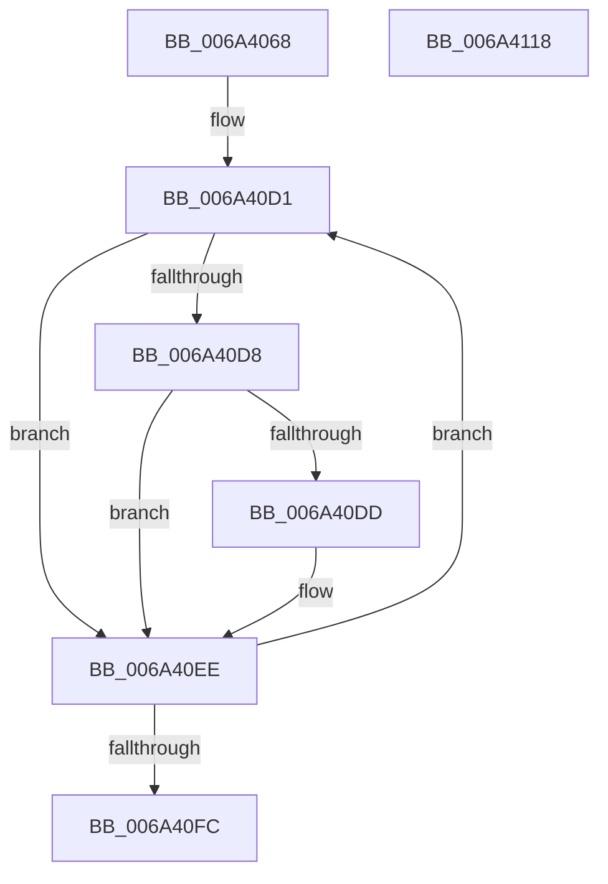

# ScExtractDeviceStrings

- RVA: `0x006A4068`–`0x006A4119` (길이 `177` bytes)
- VA: `0x00000001406A4068`
- 실행 섹션: `.text`
- PDB 이름 있음: `예`; PDB Function 태그: `아니요`
- unwind 정보 RVA: `0x000DAC88`
- 디코드: `58`개 명령, `177/177` bytes 표시
- 미해석 바이트: `0` (있으면 어셈블리에 `.byte`로 보존)

> 이 문서는 커널 이미지의 기계어와 PDB 기호를 분석해 생성했습니다. 4번과 5번은 함수 원형과 자료형을 바이너리 사용 방식에서 추정한 C 해석이며 원본 소스 복구 결과는 아닙니다.

## 1. Dependencies

- 직접 호출 지점: **2**; 고유 호출 대상: **2**
- 직접 호출자로 확인된 함수: **1**
- RIP 상대 이미지 참조: **1**

### Outgoing calls
- `0x006A40E4` → [ScAnsiToUnicodeString](ScAnsiToUnicodeString_function_006A3FB0.md) (function, `0x006A3FB0`)
- `0x006A4106` → [_security_check_cookie](_security_check_cookie_function_006AC640.md) (function, `0x006AC640`)

### Direct callers
- [SC_DEVICE::SaveStorageProperty](SC_DEVICE_SaveStorageProperty_function_006A5A20.md) at `0x006A5B13`

### Static image references
- `0x006A4077` → RVA `0x00E0A740` (`.data`; read)

## 2. Other-region calls and transfers

- 다른 실행 섹션으로 향하는 call: **0**
- 별도 외부 분기/꼬리 이동을 확인하지 못했습니다.

## 3. Assembly (complete function range)

```asm
006A4068  4C 8B DC                        mov r11, rsp
006A406B  53                              push rbx
006A406C  55                              push rbp
006A406D  56                              push rsi
006A406E  57                              push rdi
006A406F  41 56                           push r14
006A4071  41 57                           push r15
006A4073  48 83 EC 68                     sub rsp, 0x68
006A4077  48 8B 05 C2 66 76 00            mov rax, qword ptr [rip + 0x7666c2]
006A407E  48 33 C4                        xor rax, rsp
006A4081  48 89 44 24 50                  mov qword ptr [rsp + 0x50], rax
006A4086  8B 41 0C                        mov eax, dword ptr [rcx + 0xc]
006A4089  49 8D 73 98                     lea rsi, [r11 - 0x68]
006A408D  4C 8B 94 24 C0 00 00 00         mov r10, qword ptr [rsp + 0xc0]
006A4095  49 8D 7B 88                     lea rdi, [r11 - 0x78]
006A4099  44 8B 79 04                     mov r15d, dword ptr [rcx + 4]
006A409D  33 DB                           xor ebx, ebx
006A409F  89 44 24 20                     mov dword ptr [rsp + 0x20], eax
006A40A3  4C 8B F1                        mov r14, rcx
006A40A6  8B 41 10                        mov eax, dword ptr [rcx + 0x10]
006A40A9  41 FF CF                        dec r15d
006A40AC  89 44 24 24                     mov dword ptr [rsp + 0x24], eax
006A40B0  8B 41 14                        mov eax, dword ptr [rcx + 0x14]
006A40B3  8D 6B 04                        lea ebp, [rbx + 4]
006A40B6  89 44 24 28                     mov dword ptr [rsp + 0x28], eax
006A40BA  8B 41 18                        mov eax, dword ptr [rcx + 0x18]
006A40BD  89 44 24 2C                     mov dword ptr [rsp + 0x2c], eax
006A40C1  49 89 53 98                     mov qword ptr [r11 - 0x68], rdx
006A40C5  4D 89 43 A0                     mov qword ptr [r11 - 0x60], r8
006A40C9  4D 89 4B A8                     mov qword ptr [r11 - 0x58], r9
006A40CD  4D 89 53 B0                     mov qword ptr [r11 - 0x50], r10
006A40D1  8B 07                           mov eax, dword ptr [rdi]
006A40D3  83 F8 24                        cmp eax, 0x24
006A40D6  72 16                           jb 0x1406a40ee
006A40D8  41 3B C7                        cmp eax, r15d
006A40DB  77 11                           ja 0x1406a40ee
006A40DD  48 8B 16                        mov rdx, qword ptr [rsi]
006A40E0  49 8D 0C 06                     lea rcx, [r14 + rax]
006A40E4  E8 C7 FE FF FF                  call 0x1406a3fb0
006A40E9  85 C0                           test eax, eax
006A40EB  0F 48 D8                        cmovs ebx, eax
006A40EE  48 83 C7 04                     add rdi, 4
006A40F2  48 83 C6 08                     add rsi, 8
006A40F6  48 83 ED 01                     sub rbp, 1
006A40FA  75 D5                           jne 0x1406a40d1
006A40FC  8B C3                           mov eax, ebx
006A40FE  48 8B 4C 24 50                  mov rcx, qword ptr [rsp + 0x50]
006A4103  48 33 CC                        xor rcx, rsp
006A4106  E8 35 85 00 00                  call 0x1406ac640
006A410B  48 83 C4 68                     add rsp, 0x68
006A410F  41 5F                           pop r15
006A4111  41 5E                           pop r14
006A4113  5F                              pop rdi
006A4114  5E                              pop rsi
006A4115  5D                              pop rbp
006A4116  5B                              pop rbx
006A4117  C3                              ret
006A4118  CC                              int3
```

## 4. C-style interpretation (structured pseudocode)

```c
__int64 __fastcall ScExtractDeviceStrings(__int64 a1, __int64 a2, __int64 a3, __int64 a4, __int64 a5)
{
    __int64 result;
    __int64 v_r15;
    __int64 v_rbp;
    __int64 v_rbx;
    __int64 v_rdi;
    __int64 v_rsi;
    __int64 v_rsp;
    unsigned __int64 v_stack_m48;
    unsigned int v_stack_m6C;
    unsigned int v_stack_m70;
    unsigned int v_stack_m74;
    unsigned int v_stack_m78;

    v_rsp = (v_rsp) - (104);
    result = (*(unsigned __int64 *)(v_rip + 7759554)) ^ (v_rsp);
    v_stack_m48 = result;
    v_rbx = 0;
    v_stack_m78 = (unsigned int)((unsigned int)(*(unsigned int *)(a1 + 12)));
    v_r15 = (unsigned int)(((unsigned int)(*(unsigned int *)(a1 + 4))) - 1);
    v_stack_m74 = (unsigned int)((unsigned int)(*(unsigned int *)(a1 + 16)));
    v_stack_m70 = (unsigned int)((unsigned int)(*(unsigned int *)(a1 + 20)));
    v_stack_m6C = (unsigned int)((unsigned int)(*(unsigned int *)(a1 + 24)));
    *(unsigned __int64 *)(v_rsp - 104) = a2;
    *(unsigned __int64 *)(v_rsp - 96) = a3;
    *(unsigned __int64 *)(v_rsp - 88) = a4;
    *(unsigned __int64 *)(v_rsp - 80) = a5;
loc_006A40D1:
    if (((unsigned int)((unsigned int)(*(unsigned int *)(v_rsp - 120)))) < 36) goto loc_006A40EE;
    result = (unsigned int)(*(unsigned int *)(v_rsp - 120));
    if (((unsigned int)((unsigned int)(*(unsigned int *)(v_rsp - 120)))) <= ((unsigned int)(v_r15))) {
        a2 = *(unsigned __int64 *)(v_rsp - 104);
        a1 = a1 + (unsigned int)(*(unsigned int *)(v_rsp - 120)) * 1;
        result = ScAnsiToUnicodeString(a1, a2, a3, a4);
        if (sign_flag) { v_rbx = (unsigned int)(result); }
    }
    v_rdi = (v_rsp - 120) + (4);
    v_rsi = (v_rsp - 104) + (8);
    v_rbp = (v_rbx + 4) - (1);
    if (condition_is_not_equal) goto loc_006A40D1;
    a1 = (v_stack_m48) ^ (v_rsp);
    result = _security_check_cookie(a1, a2, a3, a4);
    v_rsp = (v_rsp) + (104);
    return result;
}
```

## 5. (Beta) C Style

```c
int64_t ScExtractDeviceStrings(void *Arg1, int64_t Arg2, int64_t Arg3, int64_t Arg4, int64_t Arg5)
{
    uint8_t *arg1 = (uint8_t *)Arg1;

    int64_t result;
    int64_t local_r15;
    int64_t local_rbp;
    int64_t local_rbx;
    int64_t local_rdi;
    int64_t local_rsi;
    int64_t local_rsp;
    uint64_t v_stack_m48;
    uint32_t v_stack_m6C;
    uint32_t v_stack_m70;
    uint32_t v_stack_m74;
    uint32_t v_stack_m78;

    local_rsp = (local_rsp) - (104);
    result = (*(uint64_t *)(v_rip + 0x7666C2)) ^ (local_rsp);
    v_stack_m48 = result;
    local_rbx = 0;
    v_stack_m78 = (uint32_t)((uint32_t)(*(uint32_t *)(arg1 + 0xC)));
    local_r15 = (uint32_t)(((uint32_t)(*(uint32_t *)(arg1 + 0x4))) - 1);
    v_stack_m74 = (uint32_t)((uint32_t)(*(uint32_t *)(arg1 + 0x10)));
    v_stack_m70 = (uint32_t)((uint32_t)(*(uint32_t *)(arg1 + 0x14)));
    v_stack_m6C = (uint32_t)((uint32_t)(*(uint32_t *)(arg1 + 0x18)));
    *(uint64_t *)(local_rsp - 0x68) = Arg2;
    *(uint64_t *)(local_rsp - 0x60) = Arg3;
    *(uint64_t *)(local_rsp - 0x58) = Arg4;
    *(uint64_t *)(local_rsp - 0x50) = Arg5;
loc_006A40D1:
    if (((uint32_t)((uint32_t)(*(uint32_t *)(local_rsp - 0x78)))) < 36) goto loc_006A40EE;
    result = (uint32_t)(*(uint32_t *)(local_rsp - 0x78));
    if (((uint32_t)((uint32_t)(*(uint32_t *)(local_rsp - 0x78)))) <= ((uint32_t)(local_r15))) {
        Arg2 = *(uint64_t *)(local_rsp - 0x68);
        Arg1 = Arg1 + (uint32_t)(*(uint32_t *)(local_rsp - 0x78)) * 1;
        result = ScAnsiToUnicodeString(Arg1, Arg2, Arg3, Arg4);
        if (sign_flag) { local_rbx = (uint32_t)(result); }
    }
    local_rdi = (local_rsp - 120) + (4);
    local_rsi = (local_rsp - 104) + (8);
    local_rbp = (local_rbx + 4) - (1);
    if (condition_is_not_equal) goto loc_006A40D1;
    Arg1 = (v_stack_m48) ^ (local_rsp);
    result = _security_check_cookie(Arg1, Arg2, Arg3, Arg4);
    local_rsp = (local_rsp) + (104);
    return result;
}
```

### 관측된 메모리 오프셋

구조체 형식이 확인되지 않은 접근은 인자 기준의 오프셋으로만 기록했습니다.

| 기준 인자 | 오프셋 표현 | 폭 (bit) | 접근 |
|---|---:|---:|---|
| `Arg1` | `+ 0x0 + rax*1` | `64` | `R` |
| `Arg1` | `+ 0x4` | `32` | `R` |
| `Arg1` | `+ 0xC` | `32` | `R` |
| `Arg1` | `+ 0x10` | `32` | `R` |
| `Arg1` | `+ 0x14` | `32` | `R` |
| `Arg1` | `+ 0x18` | `32` | `R` |

## 6. Execution-region graph

[열기: 2D/3D 그래프와 함수 탐색 컨트롤 패널](../../../control-panel.html?section=text&rva=0x006A4068&view=graph)

- 2D 그래프는 위에서 아래로 흐르고, 3D 그래프는 빈 공간을 드래그해 회전합니다. Shift+드래그는 이동, 휠은 확대·축소, 함수 노드 선택은 대상 보고서 이동입니다.

### Static fallback


