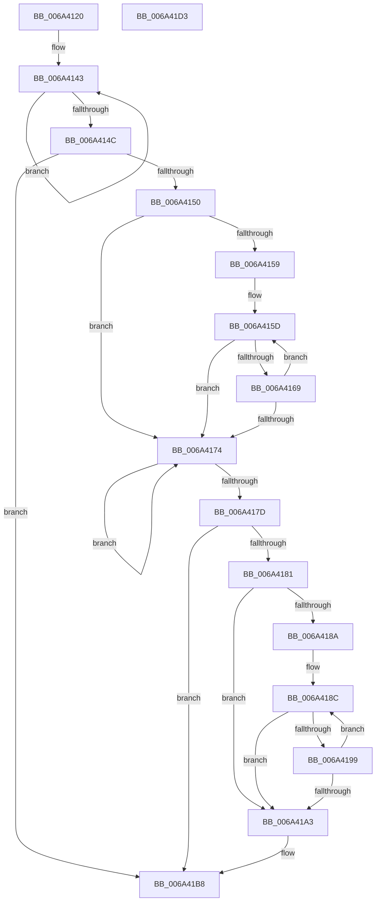

# ScTrimString

- RVA: `0x006A4120`–`0x006A41D4` (길이 `180` bytes)
- VA: `0x00000001406A4120`
- 실행 섹션: `.text`
- PDB 이름 있음: `예`; PDB Function 태그: `아니요`
- unwind 정보 RVA: `0x0005E6B4`
- 디코드: `60`개 명령, `180/180` bytes 표시
- 미해석 바이트: `0` (있으면 어셈블리에 `.byte`로 보존)

> 이 문서는 커널 이미지의 기계어와 PDB 기호를 분석해 생성했습니다. 4번과 5번은 함수 원형과 자료형을 바이너리 사용 방식에서 추정한 C 해석이며 원본 소스 복구 결과는 아닙니다.

## 1. Dependencies

- 직접 호출 지점: **3**; 고유 호출 대상: **2**
- 직접 호출자로 확인된 함수: **1**
- RIP 상대 이미지 참조: **0**

### Outgoing calls
- `0x006A4160` → [isspace](../50/isspace_function_00500710.md) (function, `0x00500710`)
- `0x006A4190` → [isspace](../50/isspace_function_00500710.md) (function, `0x00500710`)
- `0x006A41B3` → [memcpy](../6C/memcpy_function_006C6840.md) (function, `0x006C6840`)

### Direct callers
- [ScAnsiToUnicodeString](ScAnsiToUnicodeString_function_006A3FB0.md) at `0x006A3FD0`

### Static image references
- 디코드된 RIP-relative 메모리 참조가 없습니다.

## 2. Other-region calls and transfers

- 다른 실행 섹션으로 향하는 call: **0**
- 별도 외부 분기/꼬리 이동을 확인하지 못했습니다.

## 3. Assembly (complete function range)

```asm
006A4120  48 8B C4                        mov rax, rsp
006A4123  48 89 58 08                     mov qword ptr [rax + 8], rbx
006A4127  48 89 68 10                     mov qword ptr [rax + 0x10], rbp
006A412B  48 89 70 18                     mov qword ptr [rax + 0x18], rsi
006A412F  48 89 78 20                     mov qword ptr [rax + 0x20], rdi
006A4133  41 56                           push r14
006A4135  48 83 EC 20                     sub rsp, 0x20
006A4139  48 83 CB FF                     or rbx, 0xffffffffffffffff
006A413D  48 8B F1                        mov rsi, rcx
006A4140  48 8B C3                        mov rax, rbx
006A4143  48 FF C0                        inc rax
006A4146  80 3C 01 00                     cmp byte ptr [rcx + rax], 0
006A414A  75 F7                           jne 0x1406a4143
006A414C  85 C0                           test eax, eax
006A414E  74 68                           je 0x1406a41b8
006A4150  48 63 C8                        movsxd rcx, eax
006A4153  48 83 E9 01                     sub rcx, 1
006A4157  78 1B                           js 0x1406a4174
006A4159  48 8D 3C 31                     lea rdi, [rcx + rsi]
006A415D  0F BE 0F                        movsx ecx, byte ptr [rdi]
006A4160  E8 AB C5 E5 FF                  call 0x140500710
006A4165  85 C0                           test eax, eax
006A4167  74 0B                           je 0x1406a4174
006A4169  C6 07 00                        mov byte ptr [rdi], 0
006A416C  48 FF CF                        dec rdi
006A416F  48 3B FE                        cmp rdi, rsi
006A4172  79 E9                           jns 0x1406a415d
006A4174  48 FF C3                        inc rbx
006A4177  80 3C 1E 00                     cmp byte ptr [rsi + rbx], 0
006A417B  75 F7                           jne 0x1406a4174
006A417D  85 DB                           test ebx, ebx
006A417F  74 37                           je 0x1406a41b8
006A4181  33 ED                           xor ebp, ebp
006A4183  4C 63 F3                        movsxd r14, ebx
006A4186  85 DB                           test ebx, ebx
006A4188  7E 19                           jle 0x1406a41a3
006A418A  33 FF                           xor edi, edi
006A418C  0F BE 0C 37                     movsx ecx, byte ptr [rdi + rsi]
006A4190  E8 7B C5 E5 FF                  call 0x140500710
006A4195  85 C0                           test eax, eax
006A4197  74 0A                           je 0x1406a41a3
006A4199  FF C5                           inc ebp
006A419B  48 FF C7                        inc rdi
006A419E  49 3B FE                        cmp rdi, r14
006A41A1  7C E9                           jl 0x1406a418c
006A41A3  2B DD                           sub ebx, ebp
006A41A5  48 63 D5                        movsxd rdx, ebp
006A41A8  FF C3                           inc ebx
006A41AA  48 03 D6                        add rdx, rsi
006A41AD  4C 63 C3                        movsxd r8, ebx
006A41B0  48 8B CE                        mov rcx, rsi
006A41B3  E8 88 26 02 00                  call 0x1406c6840
006A41B8  48 8B 5C 24 30                  mov rbx, qword ptr [rsp + 0x30]
006A41BD  48 8B 6C 24 38                  mov rbp, qword ptr [rsp + 0x38]
006A41C2  48 8B 74 24 40                  mov rsi, qword ptr [rsp + 0x40]
006A41C7  48 8B 7C 24 48                  mov rdi, qword ptr [rsp + 0x48]
006A41CC  48 83 C4 20                     add rsp, 0x20
006A41D0  41 5E                           pop r14
006A41D2  C3                              ret
006A41D3  CC                              int3
```

## 4. C-style interpretation (structured pseudocode)

```c
__int64 __fastcall ScTrimString(__int64 a1)
{
    __int64 result;
    __int64 v_rbp;
    __int64 v_rbx;
    __int64 v_rdi;
    __int64 v_rsp;
    unsigned __int64 v_stack_p10;
    unsigned __int64 v_stack_p18;
    unsigned __int64 v_stack_p20;
    unsigned __int64 v_stack_p8;

    *(unsigned __int64 *)(v_rsp + 8) = v_rbx;
    *(unsigned __int64 *)(v_rsp + 16) = v_rbp;
    *(unsigned __int64 *)(v_rsp + 24) = v_rsi;
    *(unsigned __int64 *)(v_rsp + 32) = v_rdi;
    v_rsp = (v_rsp) - (32);
    v_rbx = (v_rbx) | (-1);
loc_006A4143:
    result = (v_rbx) + 1;
    if ((*(unsigned __int8 *)(a1 + result * 1)) != 0) goto loc_006A4143;
    if ((unsigned int)(result) == 0) goto loc_006A41B8;
    a1 = ((int)((unsigned int)(result))) - (1);
    if (sign_flag) goto loc_006A4174;
loc_006A415D:
    result = isspace((__int8)(*(unsigned __int8 *)(a1 + a1 * 1)), a2, a3, a4);
    if ((unsigned int)(result) == 0) goto loc_006A4174;
    *(unsigned __int8 *)(a1 + a1 * 1) = 0;
    v_rdi = (a1 + a1 * 1) - 1;
    if (!sign_flag) goto loc_006A415D;
loc_006A4174:
    v_rbx = (v_rbx) + 1;
    if ((*(unsigned __int8 *)(a1 + v_rbx * 1)) != 0) goto loc_006A4174;
    if ((unsigned int)(v_rbx) == 0) goto loc_006A41B8;
    v_rbp = 0;
    if (condition_is_less_or_equal) goto loc_006A41A3;
    v_rdi = 0;
loc_006A418C:
    result = isspace((__int8)(*(unsigned __int8 *)(v_rdi + a1 * 1)), a2, a3, a4);
    if ((unsigned int)(result) == 0) goto loc_006A41A3;
    v_rbp = (unsigned int)((v_rbp) + 1);
    v_rdi = (v_rdi) + 1;
    if (v_rdi < ((int)((unsigned int)(v_rbx)))) goto loc_006A418C;
loc_006A41A3:
    v_rbx = (unsigned int)((v_rbx) - ((unsigned int)(v_rbp)));
    v_rbx = (unsigned int)((v_rbx) + 1);
    a2 = ((int)((unsigned int)(v_rbp))) + (a1);
    result = memcpy(a1, a2, (int)((unsigned int)(v_rbx)), a4);
loc_006A41B8:
    v_rsp = (v_rsp) + (32);
    return result;
}
```

## 5. (Beta) C Style

```c
int64_t ScTrimString(void *Arg1)
{
    uint8_t *arg1 = (uint8_t *)Arg1;

    int64_t result;
    int64_t local_rbp;
    int64_t local_rbx;
    int64_t local_rdi;
    int64_t local_rsp;
    uint64_t v_stack_p10;
    uint64_t v_stack_p18;
    uint64_t v_stack_p20;
    uint64_t v_stack_p8;

    *(uint64_t *)(local_rsp + 0x8) = local_rbx;
    *(uint64_t *)(local_rsp + 0x10) = local_rbp;
    *(uint64_t *)(local_rsp + 0x18) = local_rsi;
    *(uint64_t *)(local_rsp + 0x20) = local_rdi;
    local_rsp = (local_rsp) - (32);
    local_rbx = (local_rbx) | (-1);
loc_006A4143:
    result = (local_rbx) + 1;
    if ((*(uint8_t *)(arg1 + result * 1)) != 0) goto loc_006A4143;
    if ((uint32_t)(result) == 0) goto loc_006A41B8;
    Arg1 = ((int32_t)((uint32_t)(result))) - (1);
    if (sign_flag) goto loc_006A4174;
loc_006A415D:
    result = isspace((int8_t)(*(uint8_t *)(arg1 + arg1 * 1)), a2, a3, a4);
    if ((uint32_t)(result) == 0) goto loc_006A4174;
    *(uint8_t *)(arg1 + arg1 * 1) = 0;
    local_rdi = (Arg1 + Arg1 * 1) - 1;
    if (!sign_flag) goto loc_006A415D;
loc_006A4174:
    local_rbx = (local_rbx) + 1;
    if ((*(uint8_t *)(arg1 + local_rbx * 1)) != 0) goto loc_006A4174;
    if ((uint32_t)(local_rbx) == 0) goto loc_006A41B8;
    local_rbp = 0;
    if (condition_is_less_or_equal) goto loc_006A41A3;
    local_rdi = 0;
loc_006A418C:
    result = isspace((int8_t)(*(uint8_t *)(local_rdi + arg1 * 1)), a2, a3, a4);
    if ((uint32_t)(result) == 0) goto loc_006A41A3;
    local_rbp = (uint32_t)((local_rbp) + 1);
    local_rdi = (local_rdi) + 1;
    if (local_rdi < ((int32_t)((uint32_t)(local_rbx)))) goto loc_006A418C;
loc_006A41A3:
    local_rbx = (uint32_t)((local_rbx) - ((uint32_t)(local_rbp)));
    local_rbx = (uint32_t)((local_rbx) + 1);
    a2 = ((int32_t)((uint32_t)(local_rbp))) + (Arg1);
    result = memcpy(Arg1, a2, (int32_t)((uint32_t)(local_rbx)), a4);
loc_006A41B8:
    local_rsp = (local_rsp) + (32);
    return result;
}
```

### 관측된 메모리 오프셋

구조체 형식이 확인되지 않은 접근은 인자 기준의 오프셋으로만 기록했습니다.

| 기준 인자 | 오프셋 표현 | 폭 (bit) | 접근 |
|---|---:|---:|---|
| `Arg1` | `+ 0x0 + rax*1` | `8` | `R` |
| `Arg1` | `+ 0x0 + rbx*1` | `8` | `R` |

## 6. Execution-region graph

[열기: 2D/3D 그래프와 함수 탐색 컨트롤 패널](../../../control-panel.html?section=text&rva=0x006A4120&view=graph)

- 2D 그래프는 위에서 아래로 흐르고, 3D 그래프는 빈 공간을 드래그해 회전합니다. Shift+드래그는 이동, 휠은 확대·축소, 함수 노드 선택은 대상 보고서 이동입니다.

### Static fallback


