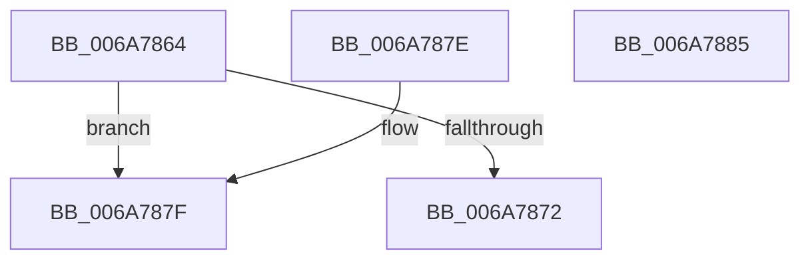

# SpcIsFbClearSupported

- RVA: `0x006A7864`–`0x006A7886` (길이 `34` bytes)
- VA: `0x00000001406A7864`
- 실행 섹션: `.text`
- PDB 이름 있음: `예`; PDB Function 태그: `아니요`
- unwind 정보 RVA: `0x000DB714`
- 디코드: `12`개 명령, `34/34` bytes 표시
- 미해석 바이트: `0` (있으면 어셈블리에 `.byte`로 보존)

> 이 문서는 커널 이미지의 기계어와 PDB 기호를 분석해 생성했습니다. 4번과 5번은 함수 원형과 자료형을 바이너리 사용 방식에서 추정한 C 해석이며 원본 소스 복구 결과는 아닙니다.

## 1. Dependencies

- 직접 호출 지점: **0**; 고유 호출 대상: **0**
- 직접 호출자로 확인된 함수: **2**
- RIP 상대 이미지 참조: **1**

### Outgoing calls
- 직접 디코드된 call 명령이 없습니다.

### Direct callers
- [KeQuerySpeculationControlInformation](../../page/74/KeQuerySpeculationControlInformation_function_007468A8.md) at `0x00746B92`
- [SpcDetectKvaLeakage](../../pagelk/B7/SpcDetectKvaLeakage_function_00B75098.md) at `0x00B7517C`

### Static image references
- `0x006A7864` → RVA `0x00FC6B60` (`ALMOSTRO`; read)

## 2. Other-region calls and transfers

- 다른 실행 섹션으로 향하는 call: **0**
- 별도 외부 분기/꼬리 이동을 확인하지 못했습니다.

## 3. Assembly (complete function range)

```asm
006A7864  48 8B 0D F5 F2 91 00            mov rcx, qword ptr [rip + 0x91f2f5]
006A786B  48 0F BA E1 16                  bt rcx, 0x16
006A7870  72 0D                           jb 0x1406a787f
006A7872  33 C0                           xor eax, eax
006A7874  80 E1 29                        and cl, 0x29
006A7877  80 F9 09                        cmp cl, 9
006A787A  0F 94 C0                        sete al
006A787D  C3                              ret
006A787E  CC                              int3
006A787F  B8 01 00 00 00                  mov eax, 1
006A7884  C3                              ret
006A7885  CC                              int3
```

## 4. C-style interpretation (structured pseudocode)

```c
__int64 __fastcall SpcIsFbClearSupported(void)
{
    __int64 result;

    if (condition_is_below) goto loc_006A787F;
    result = 0;
    a1 = (unsigned __int8)((*(unsigned __int64 *)(v_rip + 9564917)) & (41));
    result = (((unsigned __int8)(a1)) == 9) ? 1 : 0;
    return result;
loc_006A787F:
    return 1;
}
```

## 5. (Beta) C Style

```c
void SpcIsFbClearSupported(void)
{
    int64_t result;

    if (condition_is_below) goto loc_006A787F;
    result = 0;
    a1 = (uint8_t)((*(uint64_t *)(v_rip + 0x91F2F5)) & (41));
    result = (((uint8_t)(a1)) == 9) ? 1 : 0;
    return result;
loc_006A787F:
    return 1;
}
```

## 6. Execution-region graph

[열기: 2D/3D 그래프와 함수 탐색 컨트롤 패널](../../../control-panel.html?section=text&rva=0x006A7864&view=graph)

- 2D 그래프는 위에서 아래로 흐르고, 3D 그래프는 빈 공간을 드래그해 회전합니다. Shift+드래그는 이동, 휠은 확대·축소, 함수 노드 선택은 대상 보고서 이동입니다.

### Static fallback


