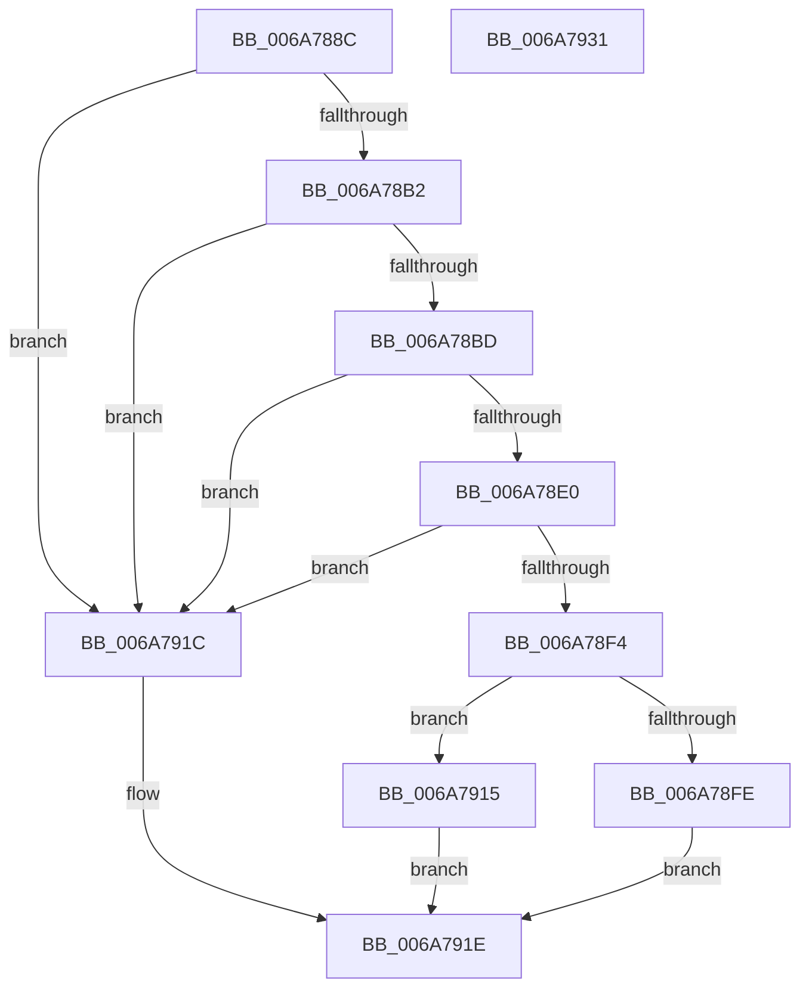

# SpcIsHyperVCr3RspErrataPresent

- RVA: `0x006A788C`–`0x006A7932` (길이 `166` bytes)
- VA: `0x00000001406A788C`
- 실행 섹션: `.text`
- PDB 이름 있음: `예`; PDB Function 태그: `아니요`
- unwind 정보 RVA: `0x000606C0`
- 디코드: `43`개 명령, `166/166` bytes 표시
- 미해석 바이트: `0` (있으면 어셈블리에 `.byte`로 보존)

> 이 문서는 커널 이미지의 기계어와 PDB 기호를 분석해 생성했습니다. 4번과 5번은 함수 원형과 자료형을 바이너리 사용 방식에서 추정한 C 해석이며 원본 소스 복구 결과는 아닙니다.

## 1. Dependencies

- 직접 호출 지점: **5**; 고유 호출 대상: **5**
- 직접 호출자로 확인된 함수: **3**
- RIP 상대 이미지 참조: **1**

### Outgoing calls
- `0x006A78A9` → [RtlGetCpuVendor](../../pagelk/B7/RtlGetCpuVendor_function_00B72180.md) (function, `0x00B72180`)
- `0x006A78B2` → [HviIsHypervisorVendorMicrosoft](../66/HviIsHypervisorVendorMicrosoft_function_00666920.md) (function, `0x00666920`)
- `0x006A78CA` → [HviGetHypervisorFeatures](../66/HviGetHypervisorFeatures_function_00666630.md) (function, `0x00666630`)
- `0x006A78E5` → [HviGetHypervisorVersion](../66/HviGetHypervisorVersion_function_006666C0.md) (function, `0x006666C0`)
- `0x006A7926` → [_security_check_cookie](_security_check_cookie_function_006AC640.md) (function, `0x006AC640`)

### Direct callers
- [KiIsBranchConfusionMitigationSupported](../5B/KiIsBranchConfusionMitigationSupported_function_005BF2BC.md) at `0x005BF2C7`
- [KiIsTsaMitigationSupported](../5B/KiIsTsaMitigationSupported_function_005BF454.md) at `0x005BF461`
- [SpcDetectKvaLeakage](../../pagelk/B7/SpcDetectKvaLeakage_function_00B75098.md) at `0x00B7519C`

### Static image references
- `0x006A7892` → RVA `0x00E0A740` (`.data`; read)

## 2. Other-region calls and transfers

- 다른 실행 섹션으로 향하는 call: **1**
  - `0x006A78A9` → [RtlGetCpuVendor](../../pagelk/B7/RtlGetCpuVendor_function_00B72180.md) (`.text` → `PAGELK`)
- 별도 외부 분기/꼬리 이동을 확인하지 못했습니다.

## 3. Assembly (complete function range)

```asm
006A788C  40 53                           push rbx
006A788E  48 83 EC 50                     sub rsp, 0x50
006A7892  48 8B 05 A7 2E 76 00            mov rax, qword ptr [rip + 0x762ea7]
006A7899  48 33 C4                        xor rax, rsp
006A789C  48 89 44 24 40                  mov qword ptr [rsp + 0x40], rax
006A78A1  0F 57 C0                        xorps xmm0, xmm0
006A78A4  0F 11 44 24 20                  movups xmmword ptr [rsp + 0x20], xmm0
006A78A9  E8 D2 A8 4C 00                  call 0x140b72180
006A78AE  3C 01                           cmp al, 1
006A78B0  75 6A                           jne 0x1406a791c
006A78B2  E8 69 F0 FB FF                  call 0x140666920
006A78B7  33 DB                           xor ebx, ebx
006A78B9  84 C0                           test al, al
006A78BB  74 5F                           je 0x1406a791c
006A78BD  0F 57 C0                        xorps xmm0, xmm0
006A78C0  48 8D 4C 24 30                  lea rcx, [rsp + 0x30]
006A78C5  0F 11 44 24 30                  movups xmmword ptr [rsp + 0x30], xmm0
006A78CA  E8 61 ED FB FF                  call 0x140666630
006A78CF  48 B8 00 00 00 00 00 10 00 00   movabs rax, 0x100000000000
006A78D9  48 85 44 24 30                  test qword ptr [rsp + 0x30], rax
006A78DE  75 3C                           jne 0x1406a791c
006A78E0  48 8D 4C 24 20                  lea rcx, [rsp + 0x20]
006A78E5  E8 D6 ED FB FF                  call 0x1406666c0
006A78EA  81 7C 24 20 9D 42 00 00         cmp dword ptr [rsp + 0x20], 0x429d
006A78F2  73 28                           jae 0x1406a791c
006A78F4  81 7C 24 20 39 38 00 00         cmp dword ptr [rsp + 0x20], 0x3839
006A78FC  75 17                           jne 0x1406a7915
006A78FE  8B 4C 24 2C                     mov ecx, dword ptr [rsp + 0x2c]
006A7902  81 E1 FF FF FF 00               and ecx, 0xffffff
006A7908  81 F9 07 14 00 00               cmp ecx, 0x1407
006A790E  0F 96 C3                        setbe bl
006A7911  8B C3                           mov eax, ebx
006A7913  EB 09                           jmp 0x1406a791e
006A7915  B8 01 00 00 00                  mov eax, 1
006A791A  EB 02                           jmp 0x1406a791e
006A791C  33 C0                           xor eax, eax
006A791E  48 8B 4C 24 40                  mov rcx, qword ptr [rsp + 0x40]
006A7923  48 33 CC                        xor rcx, rsp
006A7926  E8 15 4D 00 00                  call 0x1406ac640
006A792B  48 83 C4 50                     add rsp, 0x50
006A792F  5B                              pop rbx
006A7930  C3                              ret
006A7931  CC                              int3
```

## 4. C-style interpretation (structured pseudocode)

```c
__int64 __fastcall SpcIsHyperVCr3RspErrataPresent(void)
{
    __int64 result;
    __int64 v_rbx;
    __int64 v_rsp;
    unsigned __int64 v_stack_m18;
    unsigned __int64 v_stack_m28;
    unsigned int v_stack_m2C;
    unsigned __int64 v_stack_m38;

    v_rsp = (v_rsp) - (80);
    result = (*(unsigned __int64 *)(v_rip + 7745191)) ^ (v_rsp);
    v_stack_m18 = result;
    v_stack_m38 = v_xmm0;
    result = RtlGetCpuVendor(a1, a2, a3, a4);
    if (((unsigned __int8)(result)) != 1) goto loc_006A791C;
    result = HviIsHypervisorVendorMicrosoft(a1, a2, a3, a4);
    v_rbx = 0;
    if ((unsigned __int8)(result) == 0) goto loc_006A791C;
    v_stack_m28 = v_xmm0;
    result = HviGetHypervisorFeatures(v_stack_m28, a2, a3, a4);
    if (((v_stack_m28) & (result)) != 0) goto loc_006A791C;
    result = HviGetHypervisorVersion(v_stack_m38, a2, a3, a4);
    if (v_stack_m38 >= 0x429DULL) goto loc_006A791C;
    if (v_stack_m38 != 0x3839ULL) goto loc_006A7915;
    a1 = (unsigned int)(((unsigned int)(v_stack_m2C)) & (0xFFFFFFULL));
    v_rbx = (((unsigned int)(a1)) <= 0x1407ULL) ? 1 : 0;
    goto loc_006A791E;
loc_006A7915:
    goto loc_006A791E;
loc_006A791C:
    result = 0;
loc_006A791E:
    a1 = (v_stack_m18) ^ (v_rsp);
    result = _security_check_cookie(a1, a2, a3, a4);
    v_rsp = (v_rsp) + (80);
    return result;
}
```

## 5. (Beta) C Style

```c
void SpcIsHyperVCr3RspErrataPresent(void)
{
    int64_t result;
    int64_t local_rbx;
    int64_t local_rsp;
    uint64_t v_stack_m18;
    uint64_t v_stack_m28;
    uint32_t v_stack_m2C;
    uint64_t v_stack_m38;

    local_rsp = (local_rsp) - (80);
    result = (*(uint64_t *)(v_rip + 0x762EA7)) ^ (local_rsp);
    v_stack_m18 = result;
    v_stack_m38 = v_xmm0;
    result = RtlGetCpuVendor(a1, a2, a3, a4);
    if (((uint8_t)(result)) != 1) goto loc_006A791C;
    result = HviIsHypervisorVendorMicrosoft(a1, a2, a3, a4);
    local_rbx = 0;
    if ((uint8_t)(result) == 0) goto loc_006A791C;
    v_stack_m28 = v_xmm0;
    result = HviGetHypervisorFeatures(v_stack_m28, a2, a3, a4);
    if (((v_stack_m28) & (result)) != 0) goto loc_006A791C;
    result = HviGetHypervisorVersion(v_stack_m38, a2, a3, a4);
    if (v_stack_m38 >= 0x429DULL) goto loc_006A791C;
    if (v_stack_m38 != 0x3839ULL) goto loc_006A7915;
    a1 = (uint32_t)(((uint32_t)(v_stack_m2C)) & (0xFFFFFFULL));
    local_rbx = (((uint32_t)(a1)) <= 0x1407ULL) ? 1 : 0;
    goto loc_006A791E;
loc_006A7915:
    goto loc_006A791E;
loc_006A791C:
    result = 0;
loc_006A791E:
    a1 = (v_stack_m18) ^ (local_rsp);
    result = _security_check_cookie(a1, a2, a3, a4);
    local_rsp = (local_rsp) + (80);
    return result;
}
```

## 6. Execution-region graph

[열기: 2D/3D 그래프와 함수 탐색 컨트롤 패널](../../../control-panel.html?section=text&rva=0x006A788C&view=graph)

- 2D 그래프는 위에서 아래로 흐르고, 3D 그래프는 빈 공간을 드래그해 회전합니다. Shift+드래그는 이동, 휠은 확대·축소, 함수 노드 선택은 대상 보고서 이동입니다.

### Static fallback


